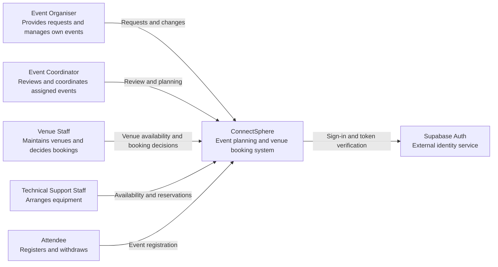
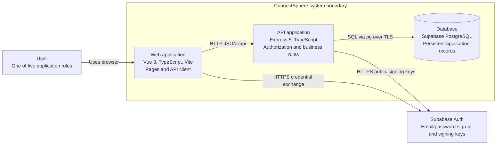
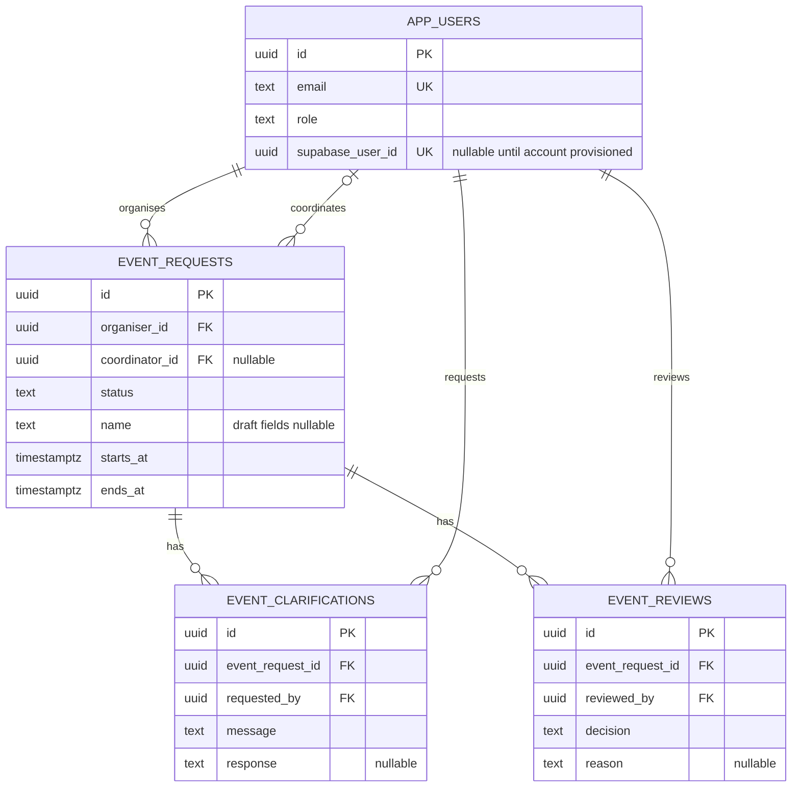

# Architecture

ConnectSphere uses one Git repository, one Vue frontend, one Express backend, Supabase PostgreSQL and Supabase Auth. The backend is a modular monolith: domain modules run in the same process and database transaction boundary. The team selected this structure during Sprint 1 planning to keep development and integration manageable across the six workstreams. Supabase was selected for database hosting on 8 September 2026; its authentication integration is recorded in the 15 September decision log.

## C4 system context

The context diagram describes the intended first release. Sign-in, coordinator review/decision pages and organiser status/detail pages are implemented, with backend support for draft editing/submission and shared details. Organiser creation/editing/submission interfaces, clarification, assignment and later event-planning workflows remain incomplete; the diagram does not imply completion of those capabilities.

The organiser's approved outcome and rejected status/reason remained visible after refresh in the 17 September hosted check (MAN-20260917-01). Reopening a request URL after sign-out showed a sign-in prompt without request details or the review reason (MAN-20260917-02). Non-final statuses, submission-to-status refresh, unrelated-owner reads and signed-out list access still need hosted checks; see [test evidence](../testing/test-evidence.md).

## C4 containers

In local development Vite proxies `/api` to Express; the browser needs no database credentials or direct database access. Supabase hosts PostgreSQL, while the frontend and API run locally. Deployment of the frontend and API is not configured. Plan HTTPS and same-origin API routing when deployment enters scope.

Application tables remain in the `public` schema. Supabase's unused Data API is disabled; the hardening migration enables row-level security and removes Data API roles' access to application tables. Express uses its server database connection for application reads/writes and enforces roles, ownership and coordinator assignment. Supabase Auth remains available independently of the Data API.

The browser obtains a Supabase access token through sign-in and exchanges it at `POST /api/auth/login`. Express verifies the token and stores it in an HttpOnly session cookie, revalidating it for later API calls. The token subject maps through `app_users.supabase_user_id` to the application's trusted ID and role. Session lifetime follows the token's expiry; automatic session refresh is not implemented. Public signing keys are retrieved from the project's JWKS; the backend-only HS256 secret is an optional compatibility path for legacy projects.

## Module boundaries

| Area          | Responsibility                                                        | Current state                                    |
| ------------- | --------------------------------------------------------------------- | ------------------------------------------------ |
| auth          | Identity, session lifecycle, role and event access policies           | Supabase sign-in, token verification, mapped profiles and sessions |
| events        | Requests, drafts, assignment, review, status, significant changes     | Draft edit/submit APIs, shared detail, coordinator queue, atomic decisions and organiser status/detail pages; creation, clarification, assignment and organiser editing/submission UI pending |
| venues        | Catalogue, suitability, availability, booking decisions and conflicts | Planned; add when taken into a sprint            |
| equipment     | Requests, quantity availability, reservations                         | Planned                                          |
| registrations | Attendee eligibility, registration and withdrawal                     | Planned                                          |
| notifications | Relevant recipients and notification delivery                         | Planned                                          |

Keep controllers thin: parse requests and call services. Services own permissions and workflow consistency; repositories own parameterized SQL. Add subfolders when real files justify them rather than pre-creating empty controller/service/repository trees. Avoid a global bucket of unrelated utilities. Cross-domain workflows should call explicit services and share a transaction when several reservations or statuses must change together.

The backend is currently laid out under `backend/src/modules/`; see its README for paths. Database migrations live at root in `database/` to make shared schema changes visible to all workstreams. Documentation and tests live with their consumers. Add C4 component views when components exist; these context/container views are a baseline, not a completed final design submission.

## Starting ERD

Numbered migrations define the reproducible local and CI schema; coordinate equivalent dashboard changes in the shared Supabase project with Arvin. The ERD omits housekeeping fields, migration metadata and unused legacy auth fields/tables. Credentials are managed by Supabase Auth; the nullable historical `password_hash` field and Firebase identity table are not used by the current authentication code. Role checks, event ownership, transition validity and atomic decisions belong to services, with database constraints providing additional integrity.

## Decisions and tradeoffs

- Use one repository and modular backend to keep setup and integration manageable for six developers. There are no independently deployed business services.
- Use TypeScript across Vue and Express for consistent types and tooling. HTTP contracts still need runtime validation; static types do not validate user input.
- Use hosted Supabase PostgreSQL and explicit SQL migrations for visible schema changes and future reservation transactions. Retain `pg` and the Express service boundary. The small migration runner is forward-only, transactional, checksummed, and tested for repeat execution. Evaluate a fuller migration tool if lifecycle needs grow.
- Use a direct database connection where the network supports it, or the session pooler on port 5432 for IPv4 development. Connections verify TLS certificates. Compose remains available for optional local databases and isolated tests; GitHub Actions uses its own temporary PostgreSQL service.
- Coordinate changes against the shared development database. A feature branch isolates code, but it does not isolate Supabase tables or data. Keep schema changes in migrations and agree their order before applying them.
- Keep credentials out of the repository. Seed profiles have no login credentials; provision Supabase Auth accounts and map them to application profiles before sign-in. All mounted event routes verify the application session.
- Use current coordinator assignment as the Sprint 1 relationship rule. `event_requests.coordinator_id` refers to `app_users.id`, not the Supabase UUID. Recheck this assignment with the locked row when recording a decision; unassigned triage and delegation remain customer questions.
- Keep optional draft values nullable. Do not reuse draft validation as submission validation. Record confirmed required fields in the clarification log.
- Use six Sprint 1 statuses. Implemented transitions are draft submission and initial approval/rejection; clarification/intermediate transitions remain pending. Request approval is distinct from a later fully arranged event confirmation. Later lifecycle states require explicit rules and migrations.
- Keep venue/equipment/registration/notification implementations out of this scaffold; their boundaries and requirements are documented for later sprints.

Record significant changes in the [decision log](../requirements/assumptions-and-questions.md), including context, options, the chosen approach, consequences, linked stories and any superseded decision. Keep implementation assumptions separate from customer clarifications.
