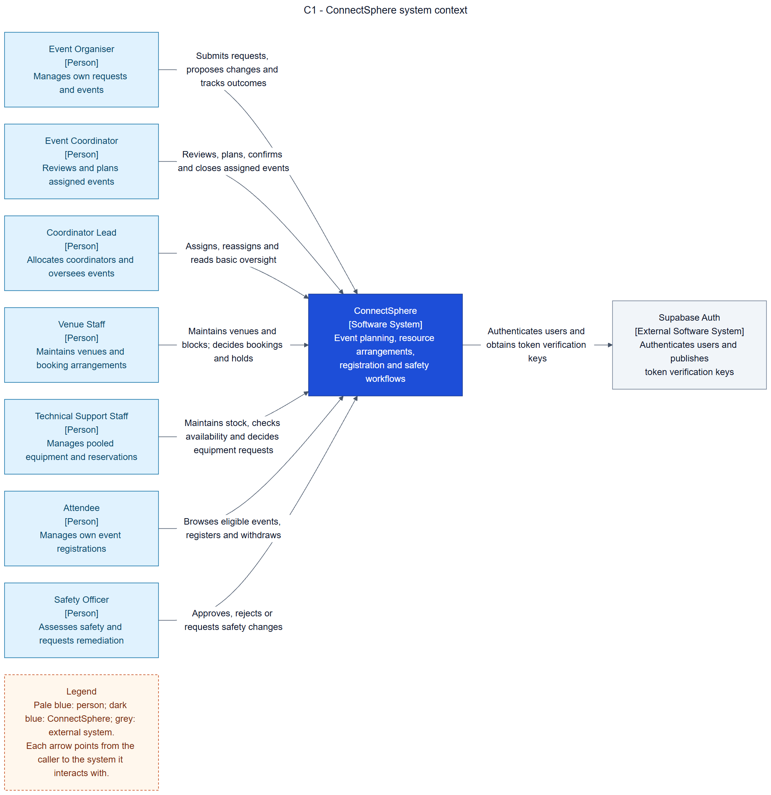
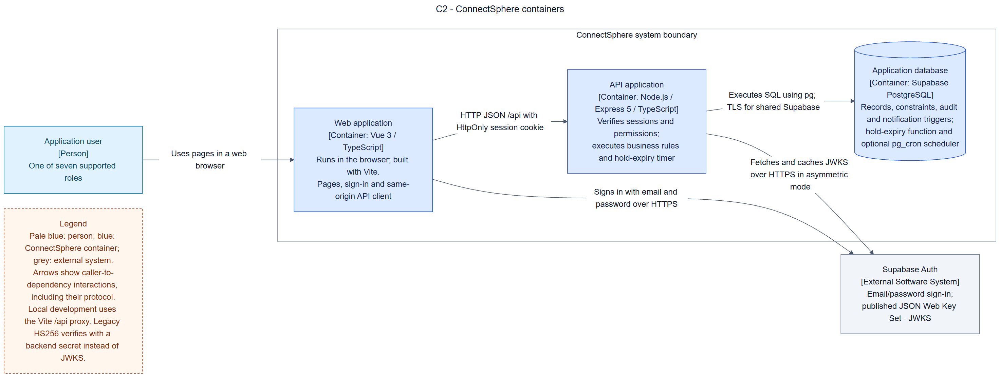
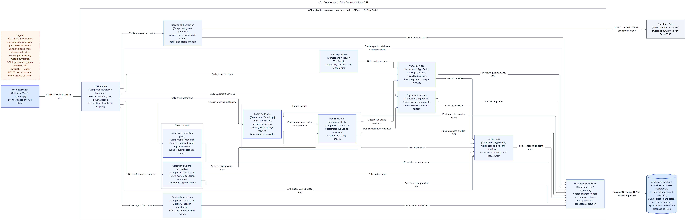

# System design

ConnectSphere is a role-based event planning system. This report explains the frozen release's structure, responsibilities and important design choices. Read the context and container views first, then the workflows and trade-offs. Detailed contracts and earlier design checkpoints are linked as supporting material.

The diagrams describe the **1 November 2026 frozen build** (`fb6d8d9`, migrations 001–023). The report was shortened on 5 November. The 6 November updates reconciled the diagrams, API contract and database model against that build. See the [design chronology](#design-chronology) for the earlier views and the [release record](../submission/release-record.md) for formal acceptance.

## Team input needed

WS2's editor and reviewer are selected in the [team home](../README.md#ws2-architecture). Complete the fields below after reviewing this report and its images. Any remaining action belongs in the [shared checklist](../submission/checklist.md#ws2-architecture).

| Design review field | Value |
| --- | --- |
| Editor | Arvin supplied the C4 and design package. Irfan integrated it on 6 November, corrected and re-rendered C3, and included a presentation overview. |
| Reviewed by / actual date | Irfan, 6 November 2026 |
| What Irfan reviewed | C1–C3, roles, transaction boundaries and workflow descriptions against build `fb6d8d9`. The [database model](../database-diagram.md) covers 24 tables and 55 foreign keys. The [API contract](api-contract.md) covers 85 endpoints. Irfan checked that all 23 views rendered, examined labels at full size in the densest diagrams and checked links in the active design documents. |
| Corrections from that review | Irfan added change requests to C3 and re-rendered it, corrected the frontend session reference and five-day cap, replaced the older report exports, and added entries for venue holds, outage recovery, completion and significant changes. He also repaired one evidence link. The full ERD displays keys, foreign keys and selected workflow fields. Use the dictionary for all columns and the smaller views for presentations. |
| Source/evidence for corrections | [Arvin’s design package and Irfan’s C3 correction (PR #81)](https://github.com/MochaLxtte/ConnectSphere/pull/81) · [Integrated report at `2d87111`](https://github.com/MochaLxtte/ConnectSphere/commit/2d87111f7b46a694e25fd75638fca0057eb568fa). The [design principles](#design-principles-and-patterns) link to the frozen code for the withdrawal cutoff and roster access checks. |
| Independent check of the 6 November integration edits | Pending — Irfan made the integration edits, so a second team member should confirm them before DOC-201 is ticked |

Edit the current explanation here. Keep endpoint detail in the [API contract](api-contract.md), schema detail in the [database model](../database-diagram.md), full diagram sources in the [detailed design reference](design-reference.md), and original decisions in the [historical design](archive/2026-11-05/README.md). Code remains frozen.

## C4 system context

Seven roles use one application. Organisers own requests; assigned coordinators review and plan their events; Coordinator Leads allocate or hand over responsibility and have limited oversight. Venue Staff manage venues and booking decisions. Technical Support Staff manage pooled stock and equipment requests. Attendees register for eligible events. Safety Officers assess submitted arrangements and request remediation.

[Full-size PNG](exports/c1-context.png) · [SVG](exports/c1-context.svg)

**Boundary:** Supabase Auth supplies identity; ConnectSphere decides application authority using trusted profiles and current relationships. A Lead does not inherit every coordinator permission. Initial request approval, individual arrangement decisions, final event confirmation and safety approval are separate decisions.

## C4 containers

[Full-size PNG](exports/c2-containers.png) · [SVG](exports/c2-containers.svg)

The Vue 3/TypeScript frontend talks to the Express 5/TypeScript API through `/api`. In local operation, Vite proxies those requests to Express. The backend connects to Supabase PostgreSQL through `pg`; database credentials stay on the server. The frontend and API run locally for acceptance; application hosting is not a release requirement.

The browser obtains a Supabase token during sign-in and exchanges it for an HttpOnly API session cookie. The API verifies the token and maps its subject to `app_users.supabase_user_id`; the application profile determines role. Later requests revalidate the session. Session lifetime follows the token's expiry, capped at five days; automatic token refresh is not implemented. Logout clears the cookie/application session, without revoking an independently copied token before expiry.

The setup calls for disabling the unused Supabase Data API. Migration 002 enables row-level security and restricts direct access by its roles. The Express services check roles, ownership and current assignment. [Database setup](../../database/README.md) The API timer and the shared development `pg_cron` job call the same idempotent hold-expiry operation. Database-clock expiry is authoritative even before cleanup updates a hold's stored status.

## C4 components (C3)

[Full-size PNG](exports/c3-components.png) · [SVG](exports/c3-components.svg) — the image is wide; open the SVG and zoom to read labels. For slides, use the [C3 overview](exports/c3-components-overview.png) ([SVG](exports/c3-components-overview.svg)): the same components, boundaries and arrows without arrow labels, at slide proportions.

C3 decomposes the **API application** container: HTTP routers, session authentication, event workflows (drafts, submission, assignment, review, planning edits, change requests and lifecycle), readiness and arrangement locks, venue, equipment, registration, safety and remediation, notifications, the hold-expiry timer and database connections. The browser application is a single Vue container whose pages are grouped by feature under `frontend/src/features/` (auth, events, reviews, venues, equipment, registrations, safety, notifications, system); it is shown at C2 and not decomposed further.

The backend is a **modular monolith**: modules have distinct responsibilities but share one process and transactional database. Routers parse input and resolve the actor. Services enforce workflow and relationship rules and use parameterised SQL through the pool/transaction client. Deterministic input/rule modules isolate calculations. Shared readiness and locking helpers coordinate actions that cross modules.

| Area | Responsibility and current implementation | Main implementation reference |
| --- | --- | --- |
| auth | Supabase sign-in exchange, verified HttpOnly session, trusted profile/role mapping and event access policies. | [Auth module](../../backend/src/modules/auth/README.md) |
| events | Owned drafts/submission, Lead assignment/handover, clarification, initial review, planning edits and reviewed significant changes; shared readiness, confirmation, cancellation, completion and status history. | [Events module](../../backend/src/modules/events/README.md) |
| venues | Catalogue and buffers, search/calendar, advisory suitability for event or selected arrangement, booking/hold decisions, independent cancellation/replacement, operational blocks and outage recovery. | [Venues module](../../backend/src/modules/venues/README.md) |
| equipment | Stock/loss audit, read-only saved/what-if availability, coordinator request/replacement/cancellation and Technical Support review/full reservation; live readiness, terminal release and restricted technical-remediation work. | [Equipment module](../../backend/src/modules/equipment/README.md) |
| registrations | Confirmed-event eligibility, attendee registration and withdrawal, duplicate/capacity/time guards, attendee records and owner/current-coordinator roster access. | [Registrations module](../../backend/src/modules/registrations/README.md) |
| safety | Versioned review rounds and Safety Officer decisions, requested-area remediation, current approval and preparation gates; immutable baselines and permanent invalidation in migration 023. | [Safety module](../../backend/src/modules/safety/README.md) |
| notifications | Transactional outcome notices, deduplication, recipient/current-target access, inbox and read state. Submission of a significant change is the coordinator's request for action; there is no additional action-request transition. | [Notifications module](../../backend/src/modules/notifications/README.md) |

There is no separate repository class per service and no independently deployed microservice layer. The module boundaries provide separation without making cross-domain transactions depend on distributed coordination.

## Class diagram and data model

[Open the full-size domain/class view](exports/class.png) ([SVG](exports/class.svg)), or the smaller [events](exports/class-events.png), [planning](exports/class-planning.png) and [safety](exports/class-safety.png) class views. Events connect to current coordinator assignment and retained history, initial reviews/clarifications, independent venue arrangements, equipment requests/reservations, registrations, notifications and safety rounds.

| Data view | Read it for | Qualification |
| --- | --- | --- |
| [Detailed database model](../database-diagram.md) | All 24 tables, a column dictionary, the foreign-key register, constraints and triggers through 023 | Authoritative detailed schema explanation; checked column-by-column against migrations 001–023 |
| [Full physical ERD](exports/erd-database.png) ([SVG](exports/erd-database.svg)) | Every table and all 55 foreign keys | Displays keys, foreign keys and selected workflow fields. The dictionary lists all columns. Open the SVG or use the three detail views below |
| [Events detail](exports/erd-events.png) and [planning detail](exports/erd-planning.png) | Smaller readable views of the request lifecycle and of venue/equipment planning | Curated domain views; every column they show exists in the migrations |
| [Safety detail](exports/erd-safety-invalidation.png) | Safety rounds, baselines (022), permanent invalidation (023) and their links to notifications | Current through migration 023 |

Database constraints and triggers protect uniqueness, booking occupancy, pooled equipment capacity, registration limits and relevant history. Role checks and permitted transitions remain service responsibilities. Applied migrations are forward-only and checksummed; a shared schema rollout is distinct from testing an isolated database.

## Important workflows

| Workflow and diagram | Interaction and design consequence |
| --- | --- |
| [Lead assignment/handover](exports/seq-lead-assignment.png) | Submission enters an unassigned queue. The Lead selects an available coordinator. Locked revalidation and assignment versions prevent stale allocation; history is retained and current-assignment authority changes with handover. |
| [Venue write ordering](exports/seq-venue-write-locking.png) | Buffered intervals, holds, bookings and operational blocks share a consistent locking boundary. An earlier availability read cannot authorize a conflicting later write. Outage recovery keeps unrelated arrangements intact. |
| [Equipment availability](exports/seq-equipment-availability.png) and [reservation](exports/seq-equipment-reservation.png) | Availability may be an unsaved advisory calculation. Reserving a saved request rechecks live pooled stock and overlapping commitments transactionally. Cancellation retains release reasons and audit history. |
| [Event confirmation](exports/seq-event-confirmation.png) | Confirmation aggregates live arrangement readiness. New or changed pending arrangements invalidate an earlier Ready view; the server rechecks at the write boundary. |
| [Safety review/preparation](exports/seq-safety-review.png) | Safety approval binds to an arrangement snapshot. Migration 023 permanently invalidates affected approvals after relevant changes, even if values are restored. A fresh round is required; preparation requires current approval. |
| [Cancellation/equipment](exports/seq-event-cancellation-equipment.png) and [registration withdrawal](exports/seq-registration-withdrawal.png) | Terminal/release actions and notices commit together. Withdrawal preserves history and updates capacity for the relevant event. |
| [Venue temporary hold](exports/seq-venue-hold.png) | Venue Staff hold a pending booking until an explicit deadline after rechecking buffered occupancy and hours under locks. The API timer and `pg_cron` both call `expire_venue_holds()`, which expires overdue holds and writes deduplicated notices. |
| [Venue outage recovery](exports/seq-venue-recovery.png) | An outage releases overlapping holds but keeps approved bookings, recording an impact and recovery notice instead of cancelling. The coordinator requests a linked replacement, which staff decide separately. |
| [Event completion](exports/seq-event-completion.png) | Once the database clock reaches the event’s end time, the current coordinator can complete a confirmed event. The transaction also releases reserved equipment and records completion notices. |
| [Significant planning change](exports/seq-planning-change.png) | The coordinator decides a change request against the event revision. Approval rechecks prior values, assesses arrangement impact, applies the new revision with an edit audit and cancels only affected pending arrangements. |

Current Mermaid sources for these diagrams are in the [detailed design reference](design-reference.md#current-workflow-sequences); original captions are in the [design appendix](archive/2026-11-05/README.md). The current API contract defines exact request bodies, status codes and errors.

## Decisions and tradeoffs

| Current choice | Reason and tradeoff | Implementation boundary |
| --- | --- | --- |
| One modular monolith and database | Cross-domain actions can share a transaction and local setup stays manageable. Modules are not independently deployed or scaled. | `backend/src/app.ts`, `runtime-app.ts`; explicit services under `modules/` |
| TypeScript with runtime boundary validation | Shared language reduces translation, but static types cannot validate HTTP data or enforce permissions. | Router/input modules plus trusted server policies |
| Supabase identity with local application profiles | Signing verification proves identity; the current `app_users` row determines role and relationships. Session expiry and logout semantics remain explicit. | `modules/auth/supabase.ts`, `router.ts`, `user-repository.ts`; `frontend/src/features/auth/session.ts` |
| Explicit SQL, transactions and database invariants | Ordered locks and constraints protect competing writes; SQL and migration maintenance require deliberate review. This is not an ORM repository layer. | Workflow services, `workflow-support.ts`, forward-only checksummed migrations |
| Optimistic revisions plus locked revalidation | Stale forms fail without overwriting newer state; locks protect the final decision. A previously successful advisory read cannot authorize a later write. | Event revisions, assignment version, booking/source fingerprints and equipment plan revision |
| Current assignment controls event authority | A handover changes access immediately while preserving assignment history. Lead oversight uses limited projections instead of coordinator powers. | Assignment service and shared event-access policies |
| Advisory assessments separate from binding decisions | Suitability and equipment availability explain current constraints; reservation/confirmation/safety check live state again. Suitability does not silently impose a new automatic capacity-refusal policy. | Venue suitability, equipment availability, booking/reservation and readiness services |
| Atomic in-app outcome notices | Business outcomes and deduplicated notices commit or roll back together. Inbox reads recheck current access; there is no email delivery service or outbox worker. | Notification writer, outcome triggers and inbox service |
| Independent venue arrangements with shared readiness | Each booking retains its own interval, layout, cancellation/replacement and decision. Event confirmation aggregates live arrangement requirements. | Venue booking services and `eventReadiness` |
| Versioned safety evidence and permanent invalidation | Decisions remain immutable; changes after approval require a fresh round even if values are restored. Migration 023 cannot reconstruct already-restored pre-upgrade changes. | Safety service, migrations 021–023 and preparation gate |
| Database-clock holds with idempotent expiry | Reads stop counting expired holds immediately. API timer and `pg_cron` may safely call the same function; late cleanup cannot extend a hold. | Hold expiry function and `hold-expiry-scheduler.ts` |
| Frontend responses belong to their initiating context | Route/account changes discard stale reads and writes. Failed write reconciliation disables decisions until current server state is known. | Session generation and safety/planning page request guards |

The lifecycle includes `DRAFT`, `SUBMITTED`, `UNDER_REVIEW`, `CLARIFICATION_REQUESTED`, `APPROVED`, `REJECTED`, `CONFIRMED`, `CANCELLED` and `COMPLETED`. Preparation is separately gated by current safety approval. Cancelling or completing an event preserves history and releases relevant allocations instead of deleting the planning record.

## Design principles and patterns

| Principle or pattern | Where it is applied | Why it was chosen |
| --- | --- | --- |
| Modular monolith with domain modules | `backend/src/modules/{auth,events,venues,equipment,registrations,safety,notifications}`; one Express process and one database | Cross-domain actions (confirmation, cancellation, safety) share one transaction; each module still owns its rules and SQL |
| Layered router → service → SQL | Routers wrap handlers in `workflowRoute` (`events/workflow-http.ts`) for session, role and input checks; services enforce business rules; parameterised SQL through `pg` | Transport concerns stay out of business rules, and one service serves several routes and tests |
| Dependency injection | `createApp` (`app.ts`) and every `create*Router(dependencies)` receive their database and auth dependencies | Tests replace the database or identity provider without changing production code |
| Pure rule modules (policy objects) | `suitability-rules.ts`, `availability-rules.ts`, `stock-rules.ts`, `registration-rules.ts`, `planning-edit-policy.ts`, `safety/remediation.ts` | Deterministic decisions are isolated from I/O, unit-tested directly and reused by reads and writes |
| Optimistic concurrency with revision tokens | `event_requests.revision` (migration 016), `equipment_types.stock_revision` (020); clients send `expectedRevision` | A stale form fails with a conflict instead of overwriting newer data |
| Pessimistic row locks in a fixed order | `lockEventRequest` (`events/workflow-support.ts`), `events/arrangement-locks.ts`; `FOR UPDATE` in 19 service files | Concurrent bookings, reservations and confirmations cannot both succeed against the same capacity |
| Unit of work for business change and notification | `inActorTransaction` (`events/workflow-support.ts`); the notice writer (`notifications/notify.ts`) uses the caller's transaction client; migration 019 triggers | An outcome and its notice commit or roll back together |
| Idempotent operations | The API timer and `pg_cron` both call `expire_venue_holds()`. Mark-as-read keeps the first `readAt`. | Repeating a withdrawal returns `changed: false` while the event is open and before its start. At or after the start, or for a cancelled or completed event, the service refuses even a repeat. [Withdrawal logic](../../backend/src/modules/registrations/service.ts) |
| Advisory read vs binding write | Suitability and equipment availability are read-only; booking, reservation, confirmation and safety writes re-check live state under locks | A successful check never authorises a later write on its own |
| Immutable audit and snapshot evidence | `event_status_history`, `equipment_stock_changes`, safety fingerprints and baselines (021–022), `safety_approval_invalidations` (023) | Decisions stay explainable after later changes; restoring a value cannot restore an approval |
| Defence in depth | The API checks the role and the caller’s relationship to the event. PostgreSQL constraints protect data integrity. Deployment instructions call for disabling the unused Data API. Migration 002 restricts direct table access by its roles. | For example, the roster service checks that the caller owns the event or is its assigned coordinator before returning attendee details. [Roster check](../../backend/src/modules/registrations/service.ts) · [Database access restrictions](../../database/migrations/002_restrict_data_api_access.sql) |

## Customer changes and design impact

The team dates receipt of the six changes to **2 October 2026**. Compare the diagrams by family to see how the design changed, then use the change register to trace each decision to planning and acceptance. [Before-and-after diagram comparison](archive/pre-week-7-customer-changes/README.md#what-changed-in-the-frozen-design) · [Change register](../requirements/change-requests.md)

| Change | Design response | Where it shows in the design | Important regression boundary |
| --- | --- | --- | --- |
| CR-1 — setup/turnaround buffers | KAN-77/78 extend venue occupancy and conflict calculations | Migrations 009 and 012; venue services in C3; [venue write ordering](exports/seq-venue-write-locking.png) | Booking/search/calendar consumers use compatible intervals; original access rules remain |
| CR-2 — unavailable booked venue | KAN-81 introduces recovery information/actions | Migration 010; `venues/outage-impact.ts`; [outage recovery](exports/seq-venue-recovery.png) | Preserve approved history and unaffected arrangements; an outage is not a silent cancellation |
| CR-3 — independent arrangements | KAN-82 uses each booking's interval, layout and cancellation/replacement relationship | Migration 011; readiness and arrangement locks in C3; [event confirmation](exports/seq-event-confirmation.png) | One arrangement's action must not mutate other venues; aggregate readiness still reflects the event |
| CR-4 — expiring holds | KAN-83 adds explicit live holds and idempotent expiry | Migration 013; hold-expiry timer in C2/C3; [venue hold](exports/seq-venue-hold.png) | Ordinary pending requests do not reserve space; stale holds cannot extend occupancy |
| CR-5 — Coordinator Lead | KAN-79 and refined KAN-65 replace automatic initial assignment with Lead allocation/handover | Migration 007; Coordinator Lead in C1; [Lead assignment](exports/seq-lead-assignment.png) | Preserve original KAN-29 criteria as history; enforce current assignment at subsequent actions |
| CR-6 — safety review | KAN-84 adds the Safety Officer, snapshot reviews, remediation and preparation gate | Migrations 021–023; safety module and remediation policy in C3; [safety review](exports/seq-safety-review.png) | Safety approval is distinct from initial approval and advisory suitability; changed arrangements require renewed approval |

Because responsibilities were already split by module, each change landed mainly in one module plus the shared readiness and locking helpers — the trade-off recorded under the modular-monolith decision above.

## Diagram exports

**23 current views**, each exported as PNG and SVG, can be read without GitHub Mermaid rendering: C1–C3, four class views, four ERDs and twelve sequence diagrams. A slide-sized **C3 overview** is provided in addition to the full C3. Browse them in the [diagram gallery](exports/index.html); the full list with links is in the [detailed design reference](design-reference.md#diagram-exports).

Arvin’s 5–6 November design package describes build `fb6d8d9`. Irfan subsequently added the change-request label to C3 and re-rendered it. His integration also includes a C3 overview with the same components and boundaries and fewer labels. The 5 November render checks describe the earlier C3. [5 November C4 checks](../scrum/sprint-03/evidence/c4-audit-20261105/render-validation.json) · [6 November design audit](../scrum/sprint-03/evidence/design-audit-20261106/README.md)

**Scope:** the C4 views describe the Release 1 system as frozen. Backlog items beyond the first release are not modelled; they are listed in the [product backlog](../requirements/product-backlog.md).

Open the full C3 and physical ERD as SVG to read small labels. For a presentation, select the relevant C3 components or one of the three detail ERDs.

## Design chronology

All dates below are in 2026 (Singapore time). The meeting accounts establish what members discussed, reported or accepted. Repository records date the design snapshots, frozen build and exports. The WS2 design review in November is separate from the Sprint Reviews in October.

| Date | Design record and what it establishes |
| --- | --- |
| 8 and 15 September | At the 8 September standup, Arvin reported that the team had chosen Supabase for the database. Ryan was still comparing authentication options. On 15 September, Ryan reported that Supabase sign-in and coordinator access were connected and that other pages still needed checking. [Sprint 1 standups 01 and 03, cues 01–02](../scrum/sprint-01/evidence/meetings/current/daily.docx) |
| 1 October | Last repository snapshot before the customer changes (`b981f11`). It preserves the original C1, C2 and three ERD sources. The archive separates the five original sources from later reconstructions of C1–C3. [Pre-change diagram record](archive/pre-week-7-customer-changes/README.md) |
| 2 and 4 October | The six changes arrived on 2 October. At Sprint 3 planning on **4 October**, the team selected 13 stories for **63 SP**. Arvin identified the design updates needed for roles, venue states, intervals, APIs and the database. [Sprint 3 planning account](../scrum/sprint-03/evidence/meetings/current/planning.docx) · [Change-to-design mapping](#customer-changes-and-design-impact) |
| 16 October | The administrative backlog record documents the agreed scope. Its earlier 97/29-point allocation and the revised 63/63 split describe how the same remaining work was distributed across Sprints 3 and 4. [Sprint 3 planning chronology](../scrum/sprint-03/planning.md#customer-change-chronology) |
| 10–19 October | The 10 October architecture still listed class and sequence models as work to do. The Sprint 3 Review on 17 October records 13 accepted stories (63 points). The first committed class and sequence models found are dated 19 October (`6eb6450`). The 1 October snapshot also lacks an original C3. [Sprint 3 review, cues 02 and 13](../scrum/sprint-03/evidence/meetings/current/review.docx) · [Archive provenance](archive/pre-week-7-customer-changes/README.md) |
| 31 October | At the 14:00 Sprint 4 Review, Kai Jie described the effect of a safety-relevant change on an existing approval. Arvin recorded 15 accepted stories, totalling 63 points. The identifier of the build demonstrated at that review was not retained. [Sprint 4 review, cues 08, 10 and 16](../scrum/sprint-04/evidence/meetings/current/review.docx) |
| 1 November | The freeze commit (`fb6d8d9`, 23:58:58 SGT) includes the post-review repair and migration 023 for permanent safety-approval invalidation. The current diagrams describe this version. [Migration and connected checks](../../database/README.md#1-november-2026--shared-023-rollout-and-connected-retests) |
| 5–6 November | The concise report was prepared on 5 November. The separate working-tree archive captured on 6 November already includes Week 7 changes and earlier C4 corrections. The current set incorporates Irfan’s subsequent C3 edit. [Pre-update archive](archive/before-2026-11-06-update/README.md) · [Detailed dated checkpoints](design-reference.md#earlier-design-notes-historical) |
| 6 November, after integration | The submission review clarified equipment reservation, venue holds, planning changes and repeated safety preparation. Each revised diagram is paired with the version in the teammate’s push. [Four diagram comparisons](archive/2026-11-06-integration/README.md) · [Corrections and frozen service references](design-reference.md#diagram-exports) |

## Supporting records

- [Detailed design reference](design-reference.md): all Mermaid sources, class, sequence and data views, and dated design history.
- [API contract](api-contract.md): all 85 endpoints with access, input, response and handler links.
- [Database model](../database-diagram.md) and [database setup](../../database/README.md): schema and operational prerequisites.
- [Testing report](../testing/README.md): automated, connected and formal acceptance boundaries.
- [Frozen-code/release identification](../submission/release-record.md): build and package distinction.
- [Historical design and progress snapshots](archive/2026-11-05/README.md): preserved dates, original prose and diagram sources.

Links to earlier sections (historical reference)

- [Architecture](archive/2026-11-05/README.md#architecture) — retained historical section.

- [Module boundaries](archive/2026-11-05/README.md#module-boundaries) — retained historical section.

- [Class diagram](archive/2026-11-05/README.md#class-diagram) — retained historical section.

- [Registration withdrawal sequence (KAN-17 / KAN-80)](archive/2026-11-05/README.md#registration-withdrawal-sequence-kan-17--kan-80) — retained historical section.

- [Event confirmation sequence (KAN-61)](archive/2026-11-05/README.md#event-confirmation-sequence-kan-61) — retained historical section.

- [Safety review and preparation sequence (KAN-84)](archive/2026-11-05/README.md#safety-review-and-preparation-sequence-kan-84) — retained historical section.

- [Event cancellation and equipment request sequence (KAN-62 / KAN-63)](archive/2026-11-05/README.md#event-cancellation-and-equipment-request-sequence-kan-62--kan-63) — retained historical section.

- [Sequence diagrams](archive/2026-11-05/README.md#sequence-diagrams) — retained historical section.

- [Equipment availability sequence (KAN-9)](archive/2026-11-05/README.md#equipment-availability-sequence-kan-9) — retained historical section.

- [Equipment reservation sequence (KAN-26)](archive/2026-11-05/README.md#equipment-reservation-sequence-kan-26) — retained historical section.

- [ERD](archive/2026-11-05/README.md#erd) — retained historical section.

- [Sprint 1 request workflow](archive/2026-11-05/README.md#sprint-1-request-workflow) — retained historical section.

- [Venues, equipment, registration and notifications](archive/2026-11-05/README.md#venues-equipment-registration-and-notifications) — retained historical section.

- [Planned customer-change design work — 16 October 2026](archive/2026-11-05/README.md#planned-customer-change-design-work--16-october-2026) — retained historical section.

- [KAN-78 occupied interval evaluation — 21 October 2026](archive/2026-11-05/README.md#kan-78-occupied-interval-evaluation--21-october-2026) — retained historical section.

- [25 October 2026 — Arvin contribution reconciliation (Sprints 1–3)](archive/2026-11-05/README.md#25-october-2026--arvin-contribution-reconciliation-sprints-13) — retained historical section.

- [Venue write ordering — 25 October 2026](archive/2026-11-05/README.md#venue-write-ordering--25-october-2026) — retained historical section.

- [26 October 2026 — KAN-66 planning edits](archive/2026-11-05/README.md#26-october-2026--kan-66-planning-edits) — retained historical section.

- [27 October 2026 — KAN-15 change requests](archive/2026-11-05/README.md#27-october-2026--kan-15-change-requests) — retained historical section.

- [28 October 2026 — Integrated diagram refresh](archive/2026-11-05/README.md#28-october-2026--integrated-diagram-refresh) — retained historical section.

- [28 October 2026 — KAN-82 independent venue arrangements](archive/2026-11-05/README.md#28-october-2026--kan-82-independent-venue-arrangements) — retained historical section.

- [1 November 2026 — permanent safety invalidation (migration 023)](archive/2026-11-05/README.md#1-november-2026--permanent-safety-invalidation-migration-023) — retained historical section.

