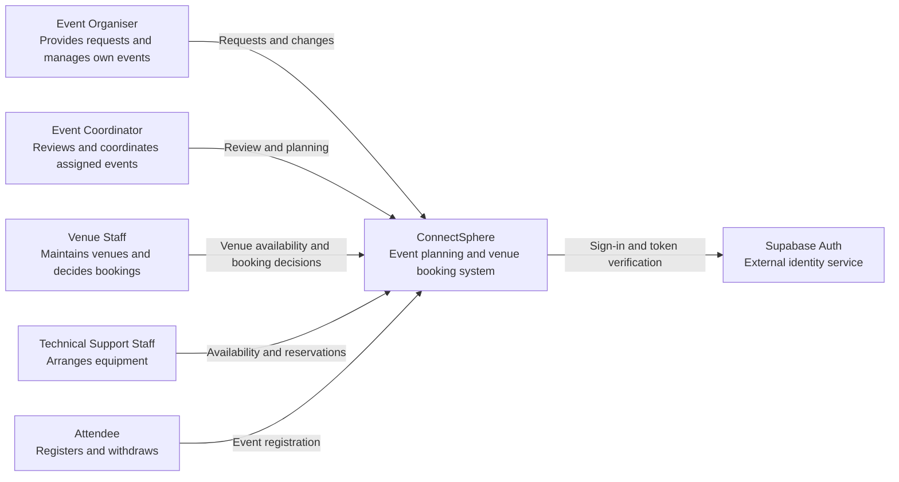
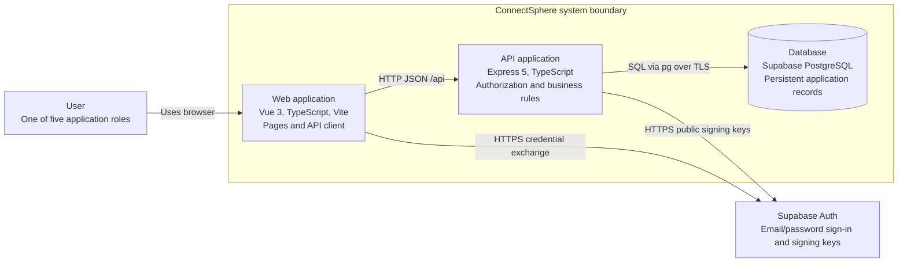
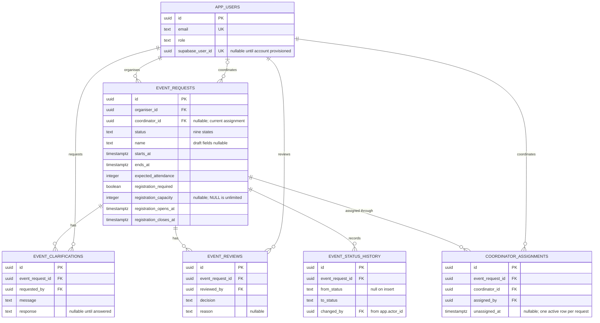
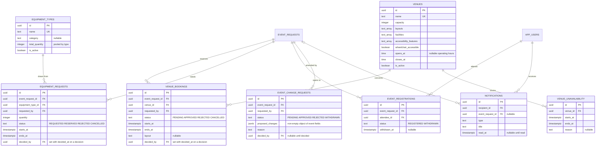

# Architecture

ConnectSphere uses one Git repository, one Vue frontend, one Express backend, Supabase PostgreSQL and Supabase Auth. The backend is a modular monolith: domain modules run in the same process and database transaction boundary. The team selected this structure during Sprint 1 planning to keep development and integration manageable across the six workstreams. Supabase was selected for database hosting on 8 September 2026; its authentication integration is recorded in the 15 September decision log.

## C4 system context

The context diagram describes the intended first release. Every role shown now has implemented routes and pages on `feat/KAN-24-core-feature-schema`: organiser creation, editing and submission, coordinator assignment, clarification, lifecycle and change requests, venue and equipment arrangements, attendee registration and in-app notifications. Their unit, component and PostgreSQL integration tests pass locally. None of it has been verified against hosted Supabase accounts or peer reviewed, and the rules it encodes for the open customer questions are team implementation assumptions, so the diagram does not imply acceptance or completion of those capabilities. Venue Staff, Technical Support Staff and Attendee accounts must be provisioned in Supabase Auth and linked through `app_users.supabase_user_id` before those roles can sign in.

The organiser's approved outcome and rejected status/reason remained visible after refresh in the 17 September hosted check (MAN-20260917-01). Reopening a request URL after sign-out showed a sign-in prompt without request details or the review reason (MAN-20260917-02). Draft and Submitted detail statuses and their no-decision messages also passed (MAN-20260917-03). A second organiser received the unavailable/no-permission message for the first organiser's request and saw an empty request list (MAN-20260917-04). Opening `/events` directly after signing out showed a sign-in prompt without request names or statuses (MAN-20260917-05). The request list showed matching Draft, Submitted, Rejected and Approved labels, and Draft/Submitted detail statuses and review messages remained correct after refresh (MAN-20260917-06). The remaining submission-to-status check is in the [test evidence](../testing/test-evidence.md).

## C4 containers

In local development Vite proxies `/api` to Express; the browser needs no database credentials or direct database access. Supabase hosts PostgreSQL, while the frontend and API run locally. Deployment of the frontend and API is not configured. Plan HTTPS and same-origin API routing when deployment enters scope.

Application tables remain in the `public` schema. Supabase's unused Data API is disabled; the hardening migration enables row-level security and removes Data API roles' access to application tables. Express uses its server database connection for application reads/writes and enforces roles, ownership and coordinator assignment. Supabase Auth remains available independently of the Data API.

The browser obtains a Supabase access token through sign-in and exchanges it at `POST /api/auth/login`. Express verifies the token and stores it in an HttpOnly session cookie, revalidating it for later API calls. The token subject maps through `app_users.supabase_user_id` to the application's trusted ID and role. Session lifetime follows the token's expiry; automatic session refresh is not implemented. Public signing keys are retrieved from the project's JWKS; the backend-only HS256 secret is an optional compatibility path for legacy projects.

## Module boundaries

| Area          | Responsibility                                                        | Current state                                    |
| ------------- | --------------------------------------------------------------------- | ------------------------------------------------ |
| auth          | Identity, session lifecycle, role and event access policies           | Supabase sign-in, token verification, mapped profiles and sessions |
| events        | Requests, drafts, assignment, review, status, significant changes     | Draft creation/edit/submit APIs and organiser forms, shared detail, coordinator queue and atomic decisions, unassigned queue and coordinator handover, review start and clarification, confirm/cancel/complete with status history, and change requests. Implemented with automated tests; source-commit results are in the test evidence register and hosted acceptance and peer review remain outstanding |
| venues        | Catalogue, suitability, availability, booking decisions and conflicts | Catalogue CRUD for Venue Staff, search filters, availability calendar with blocked periods, suitability checks, booking requests and Venue Staff decisions with the conflict trigger as final guard. Same evidence limits as above |
| equipment     | Requests, quantity availability, reservations                         | Catalogue CRUD for Technical Support Staff, pooled peak availability, requests, edits, cancellation and reserve/reject decisions. Same evidence limits as above |
| registrations | Attendee eligibility, registration and withdrawal                     | Discoverable-event browsing, attendee registration and withdrawal, own-registration list and organiser/coordinator attendee list. Same evidence limits as above |
| notifications | Relevant recipients and notification delivery                         | In-app inbox, unread count and read marking, written by `notify()` in each acting service's transaction. No email, push or retry. Same evidence limits as above |

Keep controllers thin: parse requests and call services. Services own permissions and workflow consistency; repositories own parameterized SQL. Add subfolders when real files justify them rather than pre-creating empty controller/service/repository trees. Avoid a global bucket of unrelated utilities. Cross-domain workflows should call explicit services and share a transaction when several reservations or statuses must change together.

The backend is currently laid out under `backend/src/modules/`; see its README for paths. Database migrations live at root in `database/` to make shared schema changes visible to all workstreams. Documentation and tests live with their consumers. Add C4 component views when components exist; these context/container views are a baseline, not a completed final design submission.

## ERD

Migrations 001–004 carry the Sprint 1 request workflow. Migration 005 adds the remaining
first-release tables and 006 corrects the equipment availability guard. The diagram omits
housekeeping timestamps, migration metadata and the unused legacy auth fields/tables.
[docs/database-diagram.md](../database-diagram.md) holds the full generated diagram of
the live `public` schema, including every foreign key this curated view leaves out.

### Sprint 1 request workflow

### Venues, equipment, registration and notifications

Database triggers enforce the invariants that concurrent requests could otherwise break:
the status-history record, one approved booking per venue and period, the pooled equipment
peak, and the registration capacity. Roles, ownership and transition validity remain
service responsibilities; `event_registrations` is unique per attendee and event.

Numbered migrations define the reproducible local and CI schema; coordinate equivalent dashboard changes in the shared Supabase project with Arvin. The ERD omits housekeeping fields, migration metadata and unused legacy auth fields/tables. Credentials are managed by Supabase Auth; the nullable historical `password_hash` field and Firebase identity table are not used by the current authentication code. Role checks, event ownership, transition validity and atomic decisions belong to services, with database constraints providing additional integrity.

## Decisions and tradeoffs

- Use one repository and modular backend to keep setup and integration manageable for six developers. There are no independently deployed business services.
- Use TypeScript across Vue and Express for consistent types and tooling. HTTP contracts still need runtime validation; static types do not validate user input.
- Use hosted Supabase PostgreSQL and explicit SQL migrations for visible schema changes and future reservation transactions. Retain `pg` and the Express service boundary. The small migration runner is forward-only, transactional, checksummed, and tested for repeat execution. Evaluate a fuller migration tool if lifecycle needs grow.
- Use a direct database connection where the network supports it, or the session pooler on port 5432 for IPv4 development. Connections verify TLS certificates. Compose remains available for optional local databases and isolated tests; GitHub Actions uses its own temporary PostgreSQL service.
- Coordinate changes against the shared development database. A feature branch isolates code, but it does not isolate Supabase tables or data. Keep schema changes in migrations and agree their order before applying them.
- Keep credentials out of the repository. Seed profiles have no login credentials; provision Supabase Auth accounts and map them to application profiles through `app_users.supabase_user_id` before sign-in, including the Venue Staff, Technical Support Staff and Attendee accounts the new routes need. `database/seed.ts` also adds fictional venues and equipment types once migration 005 has run, so the catalogue pages have something to show. All mounted routes verify the application session.
- Use current coordinator assignment as the relationship rule. `event_requests.coordinator_id` refers to `app_users.id`, not the Supabase UUID. Recheck this assignment with the locked row when recording a decision. The assignment workflow now exists: `coordinator_assignments` keeps the history while `coordinator_id` stays the current assignment, any coordinator may claim or assign an unassigned non-draft request, and afterwards only the assigned coordinator may hand it over. That is a provisional team rule; Q-02 stays open for unassigned triage authority and delegation.
- Keep optional draft values nullable. Do not reuse draft validation as submission validation. Record confirmed required fields in the clarification log.
- Use the nine statuses defined by migration 005: `DRAFT`, `SUBMITTED`, `UNDER_REVIEW`, `CLARIFICATION_REQUESTED`, `APPROVED`, `REJECTED`, `CONFIRMED`, `CANCELLED` and `COMPLETED`. The six Sprint 1 statuses are unchanged; the migration adds the three later lifecycle states. Implemented transitions are draft submission, review start, clarification and its answer, initial approval/rejection, confirmation, cancellation and completion. Request approval remains distinct from confirmation of a fully arranged event, which additionally requires an approved venue booking and no equipment request still awaiting a decision. The transition rules are team implementation assumptions while Q-04 and Q-12 are open.
- A coordinator may record an initial decision from `SUBMITTED` or `UNDER_REVIEW`, so starting a review does not block the decision it precedes. A pending clarification must be answered first, which returns the request to `SUBMITTED`.
- The venue, equipment, registration and notification modules are implemented on this branch rather than deferred. Their routes mount through the shared `workspace` dependencies in `app.ts`, and database triggers guard the invariants concurrency could break: one approved booking per venue and period, the pooled equipment peak, and the registration capacity. Roles, ownership and transition validity stay in services.
- Post-approval event fields change only through a reviewed change request, not direct editing, while Q-05 and Q-11 are open. Approving a change to the dates or expected attendance releases the event's open venue bookings and equipment requests and returns a `CONFIRMED` event to `APPROVED`.

Record significant changes in the [decision log](../requirements/assumptions-and-questions.md), including context, options, the chosen approach, consequences, linked stories and any superseded decision. Keep implementation assumptions separate from customer clarifications.
