# Architecture

**Current implementation — 1 November 2026.** The current branch implements all seven application roles and the event lifecycle from draft submission through assignment, review, arrangements, confirmation, safety/preparation, registration, cancellation and completion. The views below describe the mounted application in `backend/src/app.ts` and `frontend/src/app/router.ts`; they do not establish story acceptance or code-freeze readiness. Migration 023 adds permanent safety-approval invalidation and supplemental context baselines. Its shared application and the three focused connected regression checks passed on 1 November in `MAN-20261101-03`; see the [rollout checkpoint](../../database/README.md#1-november-2026--shared-023-rollout-and-connected-retests). See the [API contract](api-contract.md), [current database model](../database-diagram.md), and [test evidence](../testing/test-evidence.md) for the separate automated, connected and release-review boundaries.

Earlier implementation checkpoints — retained as dated history

**Current implementation — 25 October 2026.** Lead assignment/reassignment and notification integration, strict search/draft validation, catalogue repair, buffers, outage recovery and holds are implemented. The current closeout branch repairs confirmed-event replacement controls, outage/hold concurrency, PostgreSQL date bounds and Singapore/buffer-warning displays. The shared venue gate is documented below. Shared migration 013 is verified; the approved Supabase expiry job is enabled and successful runs observed. Earlier dated pending-implementation/rollout notes retain their original checkpoint. Automated evidence and team-reported manual results are separate from review acceptance; final lifecycle/safety consumers remain Sprint 4 work.

**Arvin KAN-78/KAN-34 integration readback — 25 October 2026.** Current source is `main` `96a0d10`. KAN-78 is implemented and integrated through PR #48/#54: shared venue duration columns are migration 009, occupied endpoints/approval snapshots/warnings are **012**, and live holds extend them in **013**. Five venue consumers use buffered intervals; catalogue saves report affected bookings without changing their status/time. KAN-81 permits later outages over approved bookings and flags buffered overlaps; outage-only warnings use recovery instead of the decision queue. The dated pre-integration migration/dependency statements below retain their original checkpoint and are superseded for these details. [Current verification](../testing/test-evidence.md#25-october-2026--arvin-kan-78-and-kan-34-documentation-reconciliation) is automated evidence; hosted acceptance remains Not executed. The class, planning ERD and workflow sequence exports are refreshed from the current inline Mermaid sources in this update.

**25 October 2026 documentation follow-up.** [Reported original-story manual results](../testing/test-evidence.md#25-october-2026--reported-manual-results-for-original-stories) now accompany the implementation and automated evidence for the seven original stories. This update corrects current implementation/setup prose, keeps dated design and test history, and does not change diagram structure or claim a new combined diagram export.

**27 October 2026 — KAN-62/KAN-63 rebase reconciliation.** Event cancellation and equipment request/review routes are mounted in the backend, and the Technical Support request queue has a frontend route. Equipment cancellation reuses migration 015's immutable `released_*` audit fields and event-terminal trigger; migration 018 adds the event cancellation record and equipment planning fields. Updated inline C3/class/sequence design below. Automated checks passed; PostgreSQL integration and connected acceptance remain **Not executed**. Mermaid CLI is unavailable in this workspace, so existing PNG exports were not regenerated in this follow-up.

ConnectSphere uses one Git repository, one Vue frontend, one Express backend, Supabase PostgreSQL and Supabase Auth. The backend is a modular monolith: domain modules run in the same process and database transaction boundary. The team selected this structure during Sprint 1 planning to keep development and integration manageable across the six workstreams. Supabase was selected for database hosting on 8 September 2026; its authentication integration is recorded in the 15 September decision log.

## C4 system context

Seven roles use the same application with different server-enforced permissions. Organisers manage their own requests; assigned coordinators plan and review events; Coordinator Leads allocate and hand over responsibility without inheriting coordinator decision powers. Venue Staff maintain and decide venue arrangements. Technical Support Staff maintain pooled stock and decide equipment requests. Attendees register for eligible confirmed events and withdraw their own registrations. Safety Officers assess submitted arrangement snapshots, while preparation requires current safety approval and a confirmed, ready event.

Initial submission leaves a request unassigned for the Lead queue. Approval of the event request, approval of individual venue/equipment arrangements, final event confirmation and safety approval are distinct transitions. The application preserves this separation in its pages, APIs, audit records and notifications.

Earlier context and acceptance checkpoints — retained verbatim

The context diagram includes the KAN-79 Coordinator Lead role and KAN-65 reassignment implemented on **19 October 2026**, with KAN-64 notifications integrated on **21 October 2026**. The Safety Officer remains planned under KAN-84. KAN-79 replaces automatic initial allocation with a Lead queue: valid submissions remain unassigned, Leads allocate available coordinators, and ordinary coordinators manage only their assigned events. KAN-65 adds versioned handover with a required reason and retained history; the new coordinator gains assignment-derived access and the old coordinator loses it. Separate basic oversight endpoints do not grant Leads review, booking-decision or attendee-roster authority. Migration 007 and Lead login were reported successful. The 25 October original-story report records successful localhost manual scenarios for KAN-79/KAN-65; deployed-environment acceptance remains **Not assessed**. KAN-64 writes the relevant in-app notices in the same transaction as the action. Migration 008 adds notification inbox fields and 009 adds venue buffers. The 25 October KAN-60/KAN-83 run records a shared Supabase ledger check showing migrations 001–013 applied; that ledger check is distinct from the earlier structural schema audit. No schema change is added for KAN-65. See the [change register](../requirements/change-requests.md) and [test evidence](../testing/test-evidence.md).

Implemented request workflows also include draft creation/editing, clarification, review decisions and read-only status history. KAN-51 provides the internal availability calendar and KAN-12 venue search is integrated. KAN-8 adds staff booking decisions and assigned-coordinator outcomes. KAN-52 provides read-only event-specific suitability and KAN-55 provides Venue Staff block management. KAN-53 booking submission was integrated on 5 October with current reservation/block checks. Catalogue maintenance and the KAN-50 stale-save repair are merged, including PR #56 on 25 October. KAN-77 stores and exposes setup/turnaround minutes; KAN-78 applies buffered occupancy and affected-booking warnings. These implementation updates do not supply another owner's missing acceptance results. KAN-64 provides an in-app inbox for submission, clarification, review, assignment and venue-decision outcomes. KAN-9 availability, KAN-26 saved equipment reservations, KAN-63 request entry/review and KAN-62 event cancellation are implemented in source. KAN-18 stock editing, attendee registration, significant event changes and event completion remain separate workflows; KAN-80 owns notification triggers beyond the reservation/cancellation slices implemented so far. Migration 018 adds request/cancellation state after the migration-015 equipment release model. The [current sprint plan](../scrum/sprint-04/planning.md) separates existing repairs from new customer requirements. The test evidence register separates local automated results from the hosted Sprint 1 observations below; the diagrams do not imply acceptance. Venue Staff, Technical Support Staff and Attendee accounts need trusted Supabase Auth provisioning and an `app_users.supabase_user_id` mapping before connected role workflows can be tested.

The organiser's approved outcome and rejected status/reason remained visible after refresh in the 17 September hosted check (MAN-20260917-01). Reopening a request URL after sign-out showed a sign-in prompt without request details or the review reason (MAN-20260917-02). Draft and Submitted detail statuses and their no-decision messages also passed (MAN-20260917-03). A second organiser received the unavailable/no-permission message for the first organiser's request and saw an empty request list (MAN-20260917-04). Opening `/events` directly after signing out showed a sign-in prompt without request names or statuses (MAN-20260917-05). The request list showed matching Draft, Submitted, Rejected and Approved labels, and Draft/Submitted detail statuses and review messages remained correct after refresh (MAN-20260917-06). The remaining submission-to-status check is in the [test evidence](../testing/test-evidence.md).

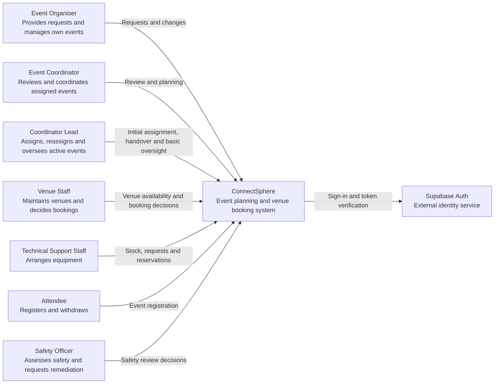

## C4 containers

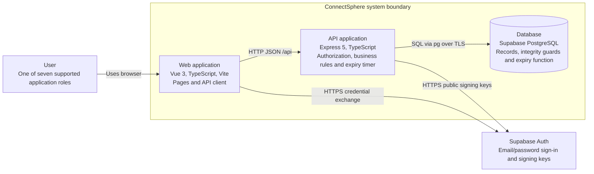

In local development Vite proxies `/api` to Express; the browser needs no database credentials or direct database access. Supabase hosts PostgreSQL, while the frontend and API run locally. Deployment of the frontend and API is not configured. Plan HTTPS and same-origin API routing when deployment enters scope.

Application tables remain in the `public` schema. Supabase's unused Data API is disabled; the hardening migration enables row-level security and removes Data API roles' access to application tables. Express uses its server database connection for application reads/writes and enforces roles, ownership and coordinator assignment. Supabase Auth remains available independently of the Data API.

The browser obtains a Supabase access token through sign-in, clears the temporary SDK session, and exchanges the token at `POST /api/auth/login`. Express verifies the token and stores it in an HttpOnly session cookie, revalidating it for later API calls. The token subject maps through `app_users.supabase_user_id` to the application's trusted ID and role. Session lifetime follows the token's expiry; automatic session refresh is not implemented. Logout clears the API cookie and local application state; it does not revoke a previously copied access token before its expiry. Public signing keys are retrieved from the project's JWKS; the backend-only HS256 secret is an optional compatibility path for legacy projects.

The API runs the idempotent hold-expiry function at startup and every minute; the shared development database also has the recorded `pg_cron` schedule. These are two callers of the same database operation, not separate booking authorities. Queries stop counting a hold at its database-clock deadline even if a cleanup call has not yet updated its status.

## Module boundaries

| Area | Responsibility and current implementation | Main implementation reference |
| --- | --- | --- |
| auth | Supabase sign-in exchange, verified HttpOnly session, trusted profile/role mapping and event access policies. | [Auth module](../../backend/src/modules/auth/README.md) |
| events | Owned drafts/submission, Lead assignment/handover, clarification, initial review, planning edits and reviewed significant changes; shared readiness, confirmation, cancellation, completion and status history. | [Events module](../../backend/src/modules/events/README.md) |
| venues | Catalogue and buffers, search/calendar, advisory suitability for event or selected arrangement, booking/hold decisions, independent cancellation/replacement, operational blocks and outage recovery. | [Venues module](../../backend/src/modules/venues/README.md) |
| equipment | Stock/loss audit, read-only saved/what-if availability, coordinator request/replacement/cancellation and Technical Support review/full reservation; live readiness, terminal release and restricted technical-remediation work. | [Equipment module](../../backend/src/modules/equipment/README.md) |
| registrations | Confirmed-event eligibility, attendee registration and withdrawal, duplicate/capacity/time guards, attendee records and owner/current-coordinator roster access. | [Registrations module](../../backend/src/modules/registrations/README.md) |
| safety | Versioned review rounds and Safety Officer decisions, requested-area remediation, current approval and preparation gates; immutable baselines and permanent invalidation in migration 023. | [Safety module](../../backend/src/modules/safety/README.md) |
| notifications | Transactional outcome notices, deduplication, recipient/current-target access, inbox and read state. Submission of a significant change is the coordinator's request for action; there is no additional action-request transition. | [Notifications module](../../backend/src/modules/notifications/README.md) |

Routers validate transport input, resolve the actor and call services. Services enforce role, relationship and transition rules and use parameterized SQL through the shared pool or transaction client. This codebase does not introduce a separate repository class for every service. Small input/rule modules isolate deterministic calculations; shared readiness and arrangement-locking helpers coordinate cross-domain transitions. Database constraints and triggers provide additional protection for direct SQL and concurrent writers.

The backend is under `backend/src/modules/`, frontend pages/components under `frontend/src/features/`, and migrations at root in `database/`. Module READMEs retain their dated implementation checkpoints; the table above and mounted routes identify the current scope. The detailed database diagram records schema state, while execution and acceptance remain in the testing and sprint records.

## C4 components (C3)

The API is one process. Every protected router resolves the verified session to the current trusted application profile. KAN-79 allocation reads use their own DTOs rather than widening coordinator review access.

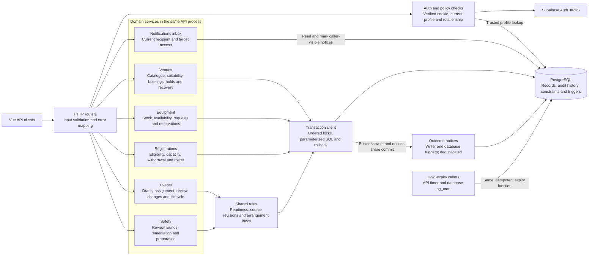

The displayed authentication dependencies are policy checks, not a second sign-in operation. Assignment services use parameterized SQL through the shared pool; queue/oversight reads have no write side effects. Reassignment checks the active-history version under event/history locks before changing linkage. Assignment, clarification and status-history reads hold a shared event lock across authorisation and their data query; a handover cannot expose newly protected rows through an earlier permission check. The KAN-64 writer uses the caller's transaction client: business changes and notification rows commit or roll back together. A unique recipient/outcome key suppresses duplicate rows. Inbox queries recheck the current recipient, role and event/booking access; they do not reuse the permissions held when a notice was created. Delivery is in-app polling, with no email service or background delivery worker.

Availability and suitability are advisory reads; booking, reservation, confirmation and safety writes re-evaluate live state under their own locks. Readiness combines venue, equipment and pending-change state without treating advisory success as permission to commit. Technical remediation on a confirmed event is restricted to a current changes-requested safety round that names the technical area; normal request/reservation editing remains subject to its lifecycle restrictions.

Safety decisions retain immutable reviewed snapshots. Current approval requires matching arrangement/context fingerprints, live readiness and no permanent invalidation. Migration 023 records invalidation in the source transaction without adding reverse-order event/review locks to stock or venue writes. Restoring an approved value does not restore the approval. Pending-round restoration and post-decision invalidation remain distinct rules.

Original equipment integration checkpoint — retained verbatim

KAN-9's equipment service has its own minimal approved/confirmed event projection rather than widening shared event-detail access. One SQL statement reads source requirements, saved requests, stock and relevant reservations; the service validates the source version and calculates advisory quantities without joining a write transaction or notification flow. What-if input is explicitly unsaved; saved input reloads persisted lines and excludes only its own reserved IDs. Migration 014 provides damaged/maintenance quantities. KAN-26 uses a separate mutation service for full saved requests on approved events, locking current source/pools/lines before checking capacity and writing notices. Migration 015 protects operational stock, immutable allocation/release history and one-time terminal release. KAN-63 adds coordinator request entry and Technical Support review, using explicit manual release metadata for cancellation/replacement. KAN-62 changes event status in the same transaction as its audit and notices; the migration-015 trigger releases RESERVED equipment while KAN-62 cancels remaining REQUESTED/REJECTED lines. Migration 018 adds the remaining event/request planning state.

## Class diagram

The diagram is a curated domain model of persisted records and derived API projections, not an ORM class hierarchy. Runtime services use TypeScript types and explicit SQL. A Lead is an `AppUser.role`, not an additional coordinator assignment. Confirmation/completion are event transitions with status history; there are no separate confirmation or completion tables. See the [database model](../database-diagram.md) for full columns and foreign keys.

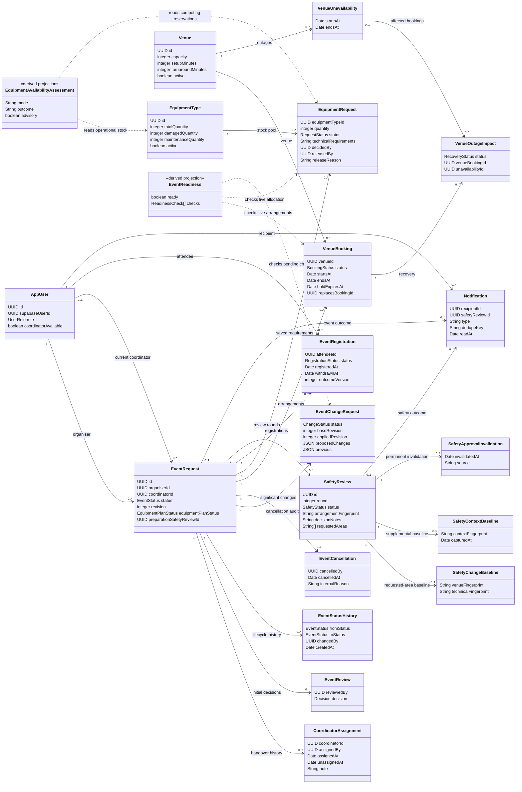

Safety baseline and invalidation entities supplement immutable review decisions; migration 023 must be applied before this branch's safety services run. The class view omits scalar audit columns and optional notification foreign keys for readability; omission does not remove them from the schema. Derived readiness and availability are recomputed and are not persisted approval records.

## Registration withdrawal sequence (KAN-17 / KAN-80)

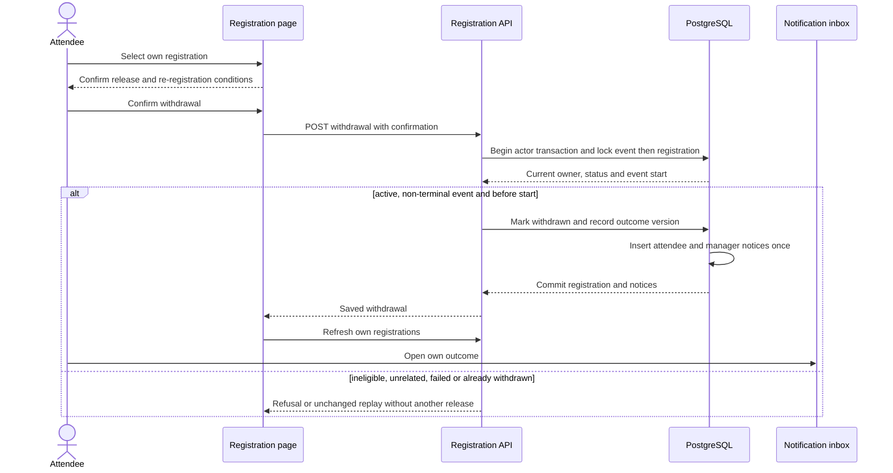

## Event confirmation sequence (KAN-61)

The assigned coordinator confirms an APPROVED event only when the shared readiness check passes. The check and the status write happen in one transaction after the arrangement locks, so a concurrent outage, booking change, equipment change or change request is either already visible or waits.

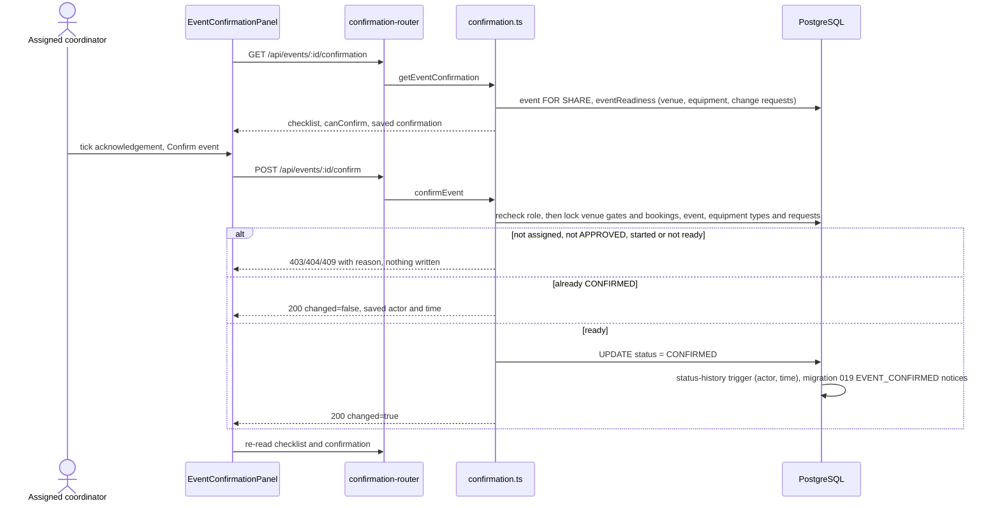

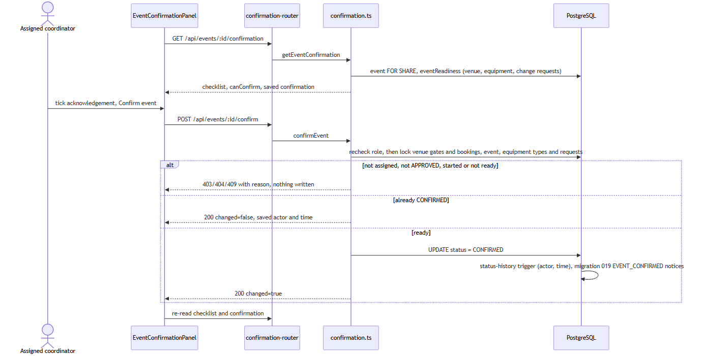

## Safety review and preparation sequence (KAN-84)

A round records the arrangement fingerprint it was submitted against. Approval counts only while the original and supplemental fingerprints match, the arrangements remain ready, and no permanent invalidation exists. Migration 023 source-write triggers record relevant changes to approved rounds in the same transaction; restoring values cannot revive approval. Preparation stays blocked until a fresh round is approved. Pending rounds retain current-value comparison before their first decision. Migration 022 preserves original 021 and adds immutable, per-area remediation baselines. A change-request decision captures current venue and technical digests; every requested area must change before resubmission. Safety notes and unrelated-area edits do not satisfy this check. A changed digest still requires current readiness and a fresh officer decision.

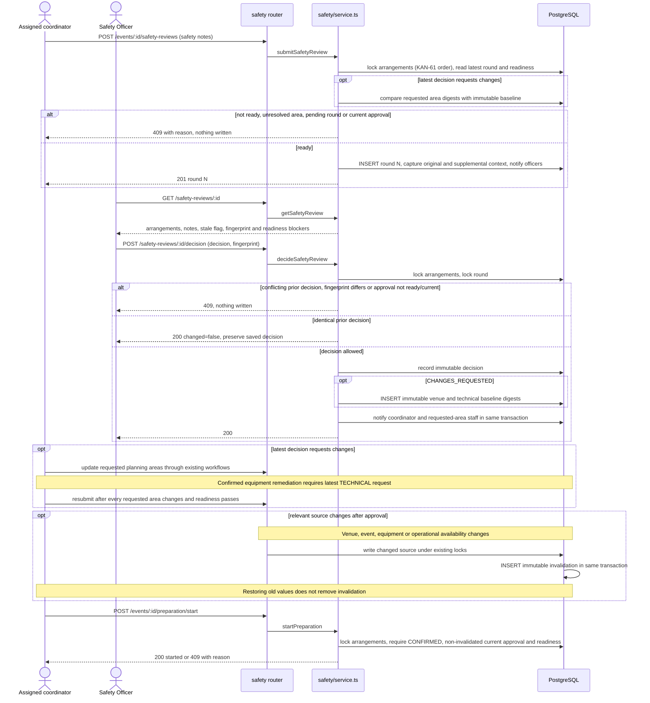

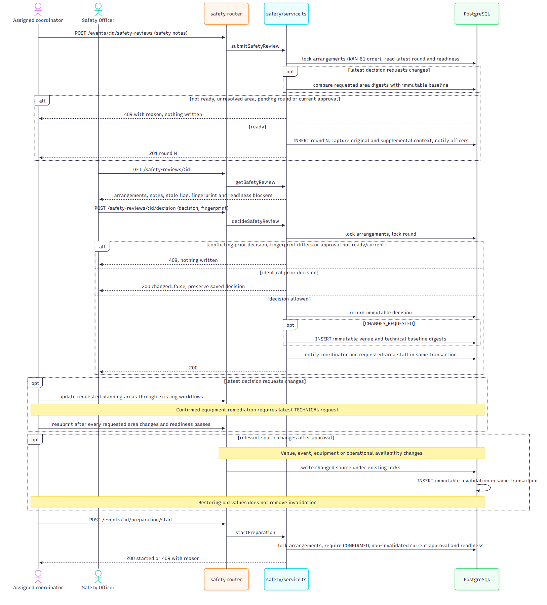

29 October upgrade checkpoint — shared rollout status is historical

The 021 → 022 upgrade retains decided rounds and any existing preparation record. Existing change-request decisions receive conservative baselines from upgrade-time current arrangements; this cannot prove that earlier remediation was performed. Original approvals may become stale when the stronger full fingerprint includes venue hours and buffers. See the [migration procedure](../../database/README.md#kan-84-forward-upgrade--migration-022-29-october-2026) and [baseline relationship](../database-diagram.md#29-october-2026--migration-022-safety-remediation-baselines-kan-84). Shared 022 rollout and connected manual acceptance remain **Not executed** in this review run.

## Event cancellation and equipment request sequence (KAN-62 / KAN-63)

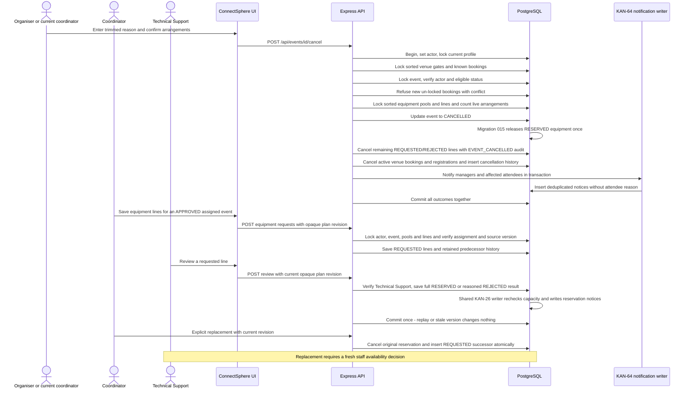

`coordinatorId`, `assignmentVersion` and automatic-history `assignedBy` may be null. A partial unique index permits at most one assignment with null `unassignedAt` per event. New initial allocations and handovers are MANUAL with the Lead actor; historical AUTOMATIC rows retain their null actor. `assignmentVersion` is the UUID of matching active history rather than a new database column. Handover records its required reason in `note` and uses the same instant for the old end/new start. Notification event/booking/equipment-request links, legacy `dedupeKey` and unread `readAt` may be null; `(recipientId, dedupeKey)` is unique for keyed outcomes. Venue buffer values are integers from 0 to 1,440, defaulting to 0. They are returned as planning inputs; no buffered occupancy calculation or affected-booking warning is implemented yet. KAN-83 adds `HELD`/`EXPIRED` booking states and a hold deadline: `occupiesVenue()` is the shared rule in `occupancy.ts` (approved, or held with the deadline still in the future), and `expire_venue_holds()` marks overdue holds expired.

## Sequence diagrams

KAN-79 changes submission and allocation; KAN-65 adds a later explicit handover while retaining the existing assigned-coordinator review and venue workflow. KAN-64 writes notices before each relevant transaction commits.

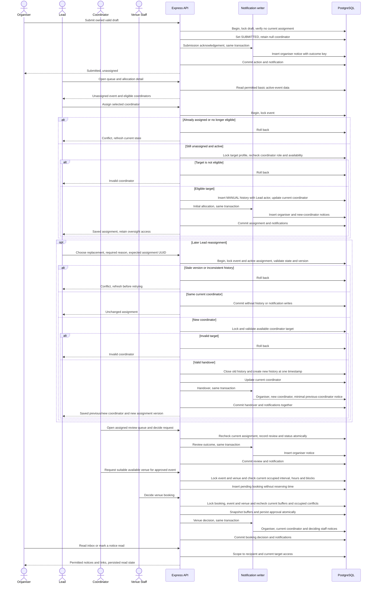

Two Lead writes serialize on the event lock. An initial-allocation loser receives `409 COORDINATOR_ALREADY_ASSIGNED`; a stale handover receives `409 ASSIGNMENT_VERSION_CONFLICT`. Neither overwrites the winner. Valid same-coordinator requests preserve the version and all history and create no notification. Any persistence failure, including a notification insert failure, rolls back the action and its notices together. The coordinator in the later review/venue steps must be the currently assigned coordinator: after handover, the former coordinator is denied. Protected multi-query history reads take a shared event lock, so assignment cannot change between authorisation and fetching those records. The previous coordinator receives only a minimal reassignment notice; protected event and booking links are omitted when current access is absent. Clarification requests also notify the organiser in their transaction. Inbox reads/mark-read actions are separate from the business transaction; these diagrams describe implementation, not observed hosted delivery or acceptance.

## Equipment availability sequence (KAN-9)

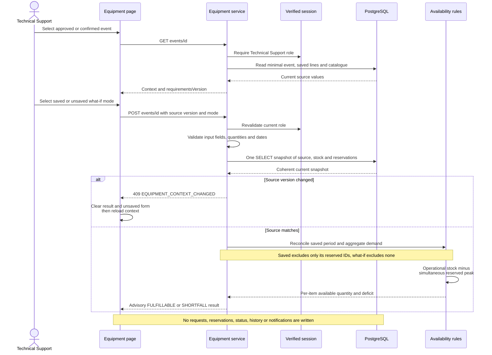

The result is valid only for the snapshot checked. KAN-26 rechecks operational capacity under the equipment-pool lock in its separate reservation sequence below; the availability sequence never reserves equipment. Venue confirmation is not a precondition. Missing saved requirements and mismatched saved periods return explicit errors rather than empty success or silent date changes.

## Equipment reservation sequence (KAN-26)

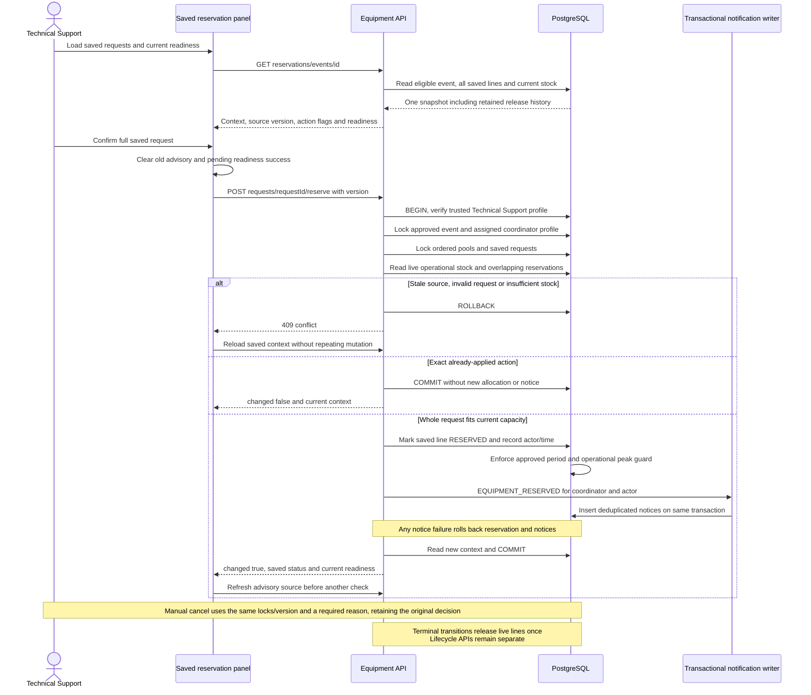

The request row is both the requirement and, while `RESERVED`, its reservation. Cancellation adds release metadata without rewriting its original allocation/decision. Readiness re-evaluates current stock rather than trusting the saved status: empty requirements are not ready, and stock loss can make all-reserved requirements unfulfillable. KAN-63 owns request creation; what-if checks supply no mutation input. Migration 015 also supports the implemented KAN-62 cancellation and KAN-10 completion transitions; those services provide the actor and commit event status, release effects and outcome notices atomically.

## Diagram exports

On **1 November 2026**, C1 context, C2 containers, C3 components and the class view were regenerated from this file for all seven roles and currently mounted workflows, including safety, registration, stock, significant changes and lifecycle transitions. Migration 023 was pending shared application at that rendering checkpoint; the [later rollout checkpoint](../../database/README.md#1-november-2026--shared-023-rollout-and-connected-retests) verifies its application and focused connected retests without changing the diagram structure. Rendering and visual inspection are design verification; they do not replace connected acceptance. Other exported sequences retain their documented generation dates. The automated test-hardening record is `AUTO-20261101-TEST-HARDENING` in [test evidence](../testing/test-evidence.md).

On 29 October 2026 the C3, class and planning ERD exports were refreshed for registration and notification outcomes. The new `seq-registration-withdrawal.png` and `erd-database.png` exports depict the current withdrawal sequence and detailed database diagram. These exports are design evidence, not execution or acceptance results.

GitHub's Mermaid rendering is not part of the submission. PNG exports live in `docs/architecture/exports/`: `c1-context.png`, `c2-containers.png`, `c3-components.png`, `class.png`, `seq-lead-assignment.png`, `seq-venue-write-locking.png`, `seq-equipment-availability.png`, `seq-equipment-reservation.png`, `erd-events.png` and `erd-planning.png`. On 26 October 2026 the affected C3, class and planning-ERD images were re-exported from the current source for KAN-9 and KAN-26, with separate availability and reservation sequences, using Mermaid CLI. These depict implementation boundaries, not manual acceptance. Re-export affected diagrams after subsequent design changes.

## ERD

The detailed [database model](../database-diagram.md) is the current schema reference through migration 023. The curated historical views below focus on request and planning relationships; the class view above and detailed model include the newer safety entities. Numbered migrations preserve applied history and checksums. Shared Supabase was verified through 023 on 1 November, followed by the focused connected retests in `MAN-20261101-03`. The [shared rollout evidence](../../database/README.md#1-november-2026--shared-023-rollout-and-connected-retests) is separate from disposable-database verification.

Earlier schema checkpoints — retained verbatim

Migrations 001–003 provide the Sprint 1 request/authentication foundation. Migration 004 adds the
broader first-release tables, 005 corrects the equipment availability guard and 006 adds
historical automatic coordinator assignment fields. Migration 007 adds the trusted Lead role to the profile constraint without rewriting assignments. Migration 008 (KAN-64) adds notification booking links and deduplication keys. Migration 009 (KAN-77) adds per-venue setup and turnaround minutes, defaulting to 0; KAN-78 will apply them to occupancy. Migration 010 adds per-outage booking recovery flags with retained outage history. The diagram omits
housekeeping timestamps, migration metadata and the unused legacy auth fields/tables. Migration 014 adds zero-default damaged and maintenance quantities to equipment types; their nonnegative sum cannot exceed total stock. Migration 015 adds request release metadata, equipment notification linkage, operational-capacity guards and terminal release. Migration 014/account setup is reported complete; shared 015 application is Not executed.
[docs/database-diagram.md](../database-diagram.md) holds the detailed schema reference and its verification dates, including foreign keys this curated view leaves out. Local migration 007 tests passed, and its shared application plus Lead login were subsequently reported successful. Full hosted workflow acceptance remains pending. KAN-65 uses the existing fields and active-row constraint without a new migration.

### Sprint 1 request workflow

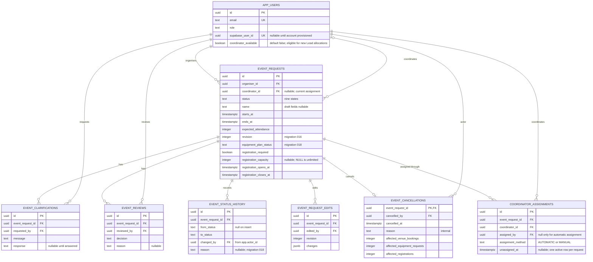

### Venues, equipment, registration and notifications

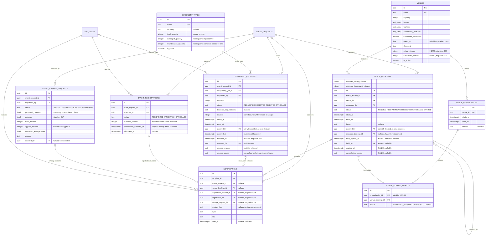

Database triggers enforce the invariants that concurrent requests could otherwise break:
the status-history record, one approved booking per venue and period, the pooled equipment
peak, and the registration capacity. Roles, ownership and transition validity remain
service responsibilities; `event_registrations` is unique per attendee and event.

Numbered migrations define the reproducible local and CI schema; coordinate equivalent dashboard changes in the shared Supabase project with Arvin. The ERD omits housekeeping fields, migration metadata and unused legacy auth fields/tables. Credentials are managed by Supabase Auth; the nullable historical `password_hash` field is not used by the current authentication code. Role checks, event ownership, transition validity and atomic decisions belong to services, with database constraints providing additional integrity.

## Decisions and tradeoffs

| Current choice | Reason and tradeoff | Implementation boundary |
| --- | --- | --- |
| One modular monolith and database | Cross-domain actions can share a transaction and local setup stays manageable. Modules are not independently deployed or scaled. | `backend/src/app.ts`, `runtime-app.ts`; explicit services under `modules/` |
| TypeScript with runtime boundary validation | Shared language reduces translation, but static types cannot validate HTTP data or enforce permissions. | Router/input modules plus trusted server policies |
| Supabase identity with local application profiles | Signing verification proves identity; the current `app_users` row determines role and relationships. Session expiry and logout semantics remain explicit. | `modules/auth/supabase.ts`, `router.ts`, `session.ts` |
| Explicit SQL, transactions and database invariants | Ordered locks and constraints protect competing writes; SQL and migration maintenance require deliberate review. This is not an ORM repository layer. | Workflow services, `workflow-support.ts`, forward-only checksummed migrations |
| Optimistic revisions plus locked revalidation | Stale forms fail without overwriting newer state; locks protect the final decision. A previously successful advisory read cannot authorize a later write. | Event revisions, assignment version, booking/source fingerprints and equipment plan revision |
| Current assignment controls event authority | A handover changes access immediately while preserving assignment history. Lead oversight uses limited projections instead of coordinator powers. | Assignment service and shared event-access policies |
| Advisory assessments separate from binding decisions | Suitability and equipment availability explain current constraints; reservation/confirmation/safety check live state again. Suitability does not silently impose a new automatic capacity-refusal policy. | Venue suitability, equipment availability, booking/reservation and readiness services |
| Atomic in-app outcome notices | Business outcomes and deduplicated notices commit or roll back together. Inbox reads recheck current access; there is no email delivery service or outbox worker. | Notification writer, outcome triggers and inbox service |
| Independent venue arrangements with shared readiness | Each booking retains its own interval, layout, cancellation/replacement and decision. Event confirmation aggregates live arrangement requirements. | Venue booking services and `eventReadiness` |
| Versioned safety evidence and permanent invalidation | Decisions remain immutable; changes after approval require a fresh round even if values are restored. Migration 023 cannot reconstruct already-restored pre-upgrade changes. | Safety service, migrations 021–023 and preparation gate |
| Database-clock holds with idempotent expiry | Reads stop counting expired holds immediately. API timer and `pg_cron` may safely call the same function; late cleanup cannot extend a hold. | Hold expiry function and `hold-expiry-scheduler.ts` |
| Frontend responses belong to their initiating context | Route/account changes discard stale reads and writes. Failed write reconciliation disables decisions until current server state is known. | Session generation and safety/planning page request guards |

Current lifecycle transitions cover `DRAFT`, `SUBMITTED`, `UNDER_REVIEW`, `CLARIFICATION_REQUESTED`, `APPROVED`, `REJECTED`, `CONFIRMED`, `CANCELLED` and `COMPLETED`. Initial approval accepts the event request; confirmation requires ready arrangements; preparation additionally requires current safety approval. Cancellation and completion retain history and release relevant allocations rather than deleting planning records.

Earlier design and scope checkpoints — retained verbatim

- Use one repository and modular backend to keep setup and integration manageable for six developers. There are no independently deployed business services.
- Use TypeScript across Vue and Express for consistent types and tooling. HTTP contracts still need runtime validation; static types do not validate user input.
- Use hosted Supabase PostgreSQL and explicit SQL migrations for visible schema changes and future reservation transactions. Retain `pg` and the Express service boundary. The small migration runner is forward-only, transactional, checksummed, and tested for repeat execution. Evaluate a fuller migration tool if lifecycle needs grow.
- Use a direct database connection where the network supports it, or the session pooler on port 5432 for IPv4 development. Connections verify TLS certificates. Compose remains available for optional local databases and isolated tests; GitHub Actions uses its own temporary PostgreSQL service.
- Coordinate changes against the shared development database. A feature branch isolates code, but it does not isolate Supabase tables or data. Keep schema changes in migrations and agree their order before applying them.
- Keep credentials out of the repository. Seed profiles have no login credentials; provision Supabase Auth accounts and map them to application profiles through `app_users.supabase_user_id` before sign-in, including the Venue Staff, Technical Support Staff and Attendee accounts the new routes need. `database/seed.ts` also adds fictional venues once migration 004 has run; equipment sample generation is removed. All mounted routes verify the application session.
- Use current coordinator assignment as the relationship rule. `event_requests.coordinator_id` refers to `app_users.id`, not the Supabase UUID. KAN-79 replaces automatic selection with a Lead-only initial assignment transaction: lock the active event, check it is still unassigned, lock the target profile and recheck its role/availability, then commit history and coordinator together. New submissions need no available coordinator. KAN-65 permits explicit versioned handover with a reason and nonoverlapping assignment intervals; the version is checked before a same-coordinator no-op. Missing/mismatched legacy history is preserved for reconciliation, never reconstructed with invented provenance. Migration 007 adds the Lead role without rewriting migrations 001–006 or previous acceptance; KAN-65 adds no schema change. Review and venue operations continue to require their existing role and current event relationship; Lead oversight uses a separate limited projection. KAN-64 commits keyed in-app notification rows with the relevant action. The 25 October KAN-60/KAN-83 record confirms shared migration application through 013; the original-story report separately records reported localhost allocation/handover verification. Deployed acceptance remains Not assessed.
- Keep optional draft values nullable. Do not reuse draft validation as submission validation. Record confirmed required fields in the clarification log.
- Use the nine statuses defined by migration 004: `DRAFT`, `SUBMITTED`, `UNDER_REVIEW`, `CLARIFICATION_REQUESTED`, `APPROVED`, `REJECTED`, `CONFIRMED`, `CANCELLED` and `COMPLETED`. The six Sprint 1 statuses are unchanged; the migration adds the three later lifecycle states. Implemented transitions are draft submission, review start, clarification and its answer, and initial approval/rejection. Later status values remain readable for compatibility with existing records and KAN-29 workload counting; the application cannot confirm, cancel or complete events. Request approval remains distinct from future final confirmation.
- A coordinator may record an initial decision from `SUBMITTED` or `UNDER_REVIEW`, so starting a review does not block the decision it precedes. A pending clarification must be answered first, which returns the request to `SUBMITTED`.
- The 26 September scope correction removed the broader venue, equipment, registration, change-request and notification feature modules. Their schema and database guards remain, but do not establish working interfaces or accepted stories. The 4 October integration adds KAN-12 search, KAN-51 availability and KAN-8 booking decisions within Sprint 2 scope. KAN-9 subsequently adds read-only equipment assessment on 26 October and KAN-26 adds full saved-line reservations, release history and current readiness. Equipment stock maintenance, request editing and lifecycle APIs remain pending, alongside attendee registration and change-request application workflows. Notification application workflows include the KAN-64 inbox for request, assignment and venue outcomes plus KAN-26’s equipment-reserved slice (see the notifications row above).

Record significant changes in the [decision log](../requirements/assumptions-and-questions.md), including context, options, the chosen approach, consequences, linked stories and any superseded decision. Keep implementation assumptions separate from customer clarifications.

## Planned customer-change design work — 16 October 2026

Customer changes received 2 October are represented by KAN-77/78/79/81/82/83/84; the complete [design/test impact register](../requirements/change-requests.md#design-and-test-impact-planned-work) and Sprint 3/4 cards allocate the work. This is planned design work, not a claim that new roles, APIs, migrations or diagram exports already exist.

Implementers must update C3/class/sequence/data/API views for venue buffers, outage recovery, timed holds and its scheduler, Lead authorization, independent arrangements, revision-bound safety and preparation, plus notification integration. Preserve existing diagrams as the current implementation until code changes; add numbered migrations rather than editing applied history. Re-export affected diagrams in the same story PR. Safety review remains separate from event confirmation: readiness permits review, while preparation requires both a confirmed event and current safety approval, avoiding a circular prerequisite.

**21 October implementation follow-up:** Lead allocation/reassignment and the KAN-64 inbox are reflected in the current C3, class and sequence views above. Migration 009 and the venue fields implement KAN-77 AC1–AC5; buffer application and affected-booking warnings remain KAN-78/KAN-77 AC6 work. The 16 October paragraph is the original design plan, not the current implementation status.

## KAN-78 occupied interval evaluation — 21 October 2026

The API's venue module now shares SQL occupied-interval calculation across search, calendar, suitability and booking writes. Migration 008 centralises occupied endpoints and operating-hour eligibility. The internal view selects current durations for live bookings and approval snapshots for ended/completed history. Computed warnings identify both affected overlaps and operational violations after buffer edits; no background job or booking cancellation is introduced. Existing API/module boundaries stay the same. KAN-77's configuration editor remains a separate dependency. The updated class, planning ERD and workflow sequence PNGs accompany this source.

## 25 October 2026 — Arvin contribution reconciliation (Sprints 1–3)

This is a dated evidence backfill prepared with Codex on 25 October, not a new ceremony, Jira transition, test execution or acceptance decision. Historical entries, other members’ ownership and agreed estimates are preserved.

KAN-24’s schema/ERD work and KAN-51’s navigation/access fixes are historical contributions; current diagrams describe the integrated system rather than every workflow once present in PR #10. The 12 October C4 preparation record is retained as a historical TXT snapshot in Sprint 3 evidence; its export/review/delivery claims must not be substituted for current design or independent review. KAN-81 stale-write refresh corrections came from Arvin’s review follow-up; Kai Jie retains the feature ownership.

## Venue write ordering — 25 October 2026

The per-venue advisory transaction gate precedes row locks for booking and outage mutations. This closes the skipped-hold race without a schema change; expiry remains idempotent and checks the current row after any wait.

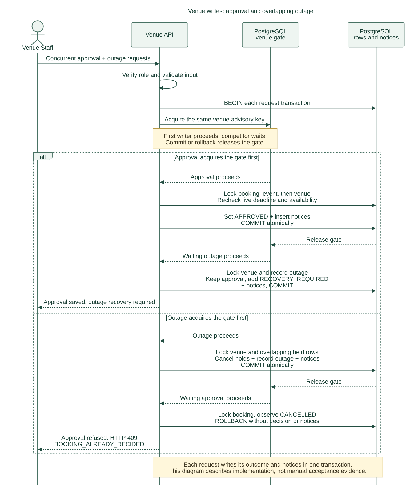

Export generated from the source above on 25 October. State/notices commit atomically. This is an implementation diagram, not a manual acceptance result.

## 26 October 2026 — KAN-66 planning edits

The events component gains `planning-edit-policy.ts` (edit rules by status, role and relationship) used by the detail read and the PATCH write. `event_requests.revision` (migration 016, originally numbered 014) gives every writer an optimistic-concurrency token; edits and reviewer actions compare it under the existing row lock, so no new lock ordering is introduced. The class diagram, ERD and C3 exports do not yet show these additions; the combined re-export remains **pending**. See the [API contract](api-contract.md#kan-66-planning-edits-and-revisions--26-october-2026).

## 27 October 2026 — KAN-15 change requests

The events component gains `change-requests.ts` and `change-request-impact.ts`: owners propose significant-field changes, assigned coordinators approve (values applied, affected pending venue/equipment arrangements cancelled, KAN-66 edit audit written) or reject, all in one transaction checked against the KAN-66 revision. Approval is refused when confirmed arrangements, a confirmed event or registrations are affected (cancel and resubmit). The approval locks venue bookings before the event, matching Venue Staff decisions. Notifications reuse the KAN-64 inbox. The C4 diagram exports are not yet regenerated for this change.

## 28 October 2026 — Integrated diagram refresh

C3, class, event/planning ERDs and the cancellation/equipment sequence were re-exported from the current source through migrations 016–018. This supersedes the pending-export notes above, not their historical shared-migration status. The new export is [seq-event-cancellation-equipment.png](exports/seq-event-cancellation-equipment.png). The lock sequence and opaque plan version are application protocols, not additional database tables. Real isolated PostgreSQL verification is in AUTO-20261028-PR63-01; shared schema rollout and manual acceptance remain separate.

## 28 October 2026 — KAN-82 independent venue arrangements

The venues component adds coordinator cancellation of one venue arrangement and replacement requests linked to a cancelled arrangement, without a schema change. Venue readiness is derived from booking rows for later confirmation (KAN-61) and safety review (KAN-84). Notifications reuse the KAN-64 inbox. The C4 diagram exports are not regenerated for this change.

### 1 November 2026 — permanent safety invalidation (migration 023)

The [023 schema](../database-diagram.md#1-november-2026--migration-023-permanent-safety-invalidation) supplements the historical 021/022 design without changing public decision bodies or rewriting decisions. Triggers record invalidation without acquiring reverse-order event/review locks from venue or equipment stock writes. Supplemental baselines cover facilities and line technical requirements, displayed to the officer. Upgrade backfills detectable differences and buffered operational-block overlaps; it cannot reconstruct a change already restored before upgrade. See the [current migration procedure](../../database/README.md#kan-84-persistent-invalidation--migration-023-1-november-2026).

**Later 1 November rollout checkpoint:** shared 023 was applied with checksum validation and a no-op repeat, preserving all 30 existing reviews and 10 preparation records. `MAN-20261101-03` then passed TC-06-446 (permanent invalidation after exact restoration, followed by a new approved round and resumed preparation), TC-06-447 (live confirmation readiness refresh after a pending venue request and cancellation), and TC-15-108 (separate equipment decision/release reasons). The [rollout record](../../database/README.md#1-november-2026--shared-023-rollout-and-connected-retests) links persisted snapshots and connected evidence. These results verify the described boundaries; exact-commit CI and independent review remain separate release requirements.
