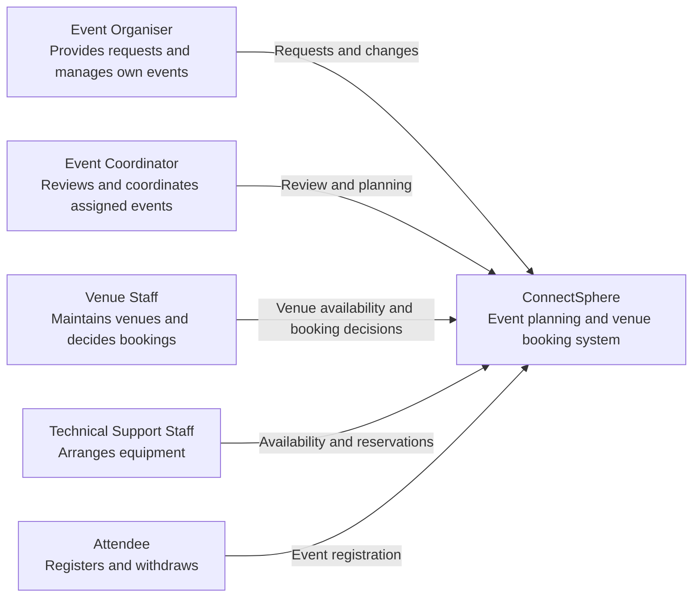
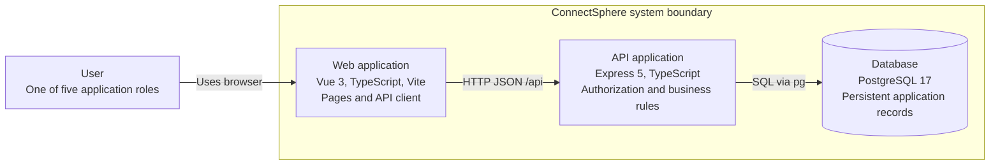
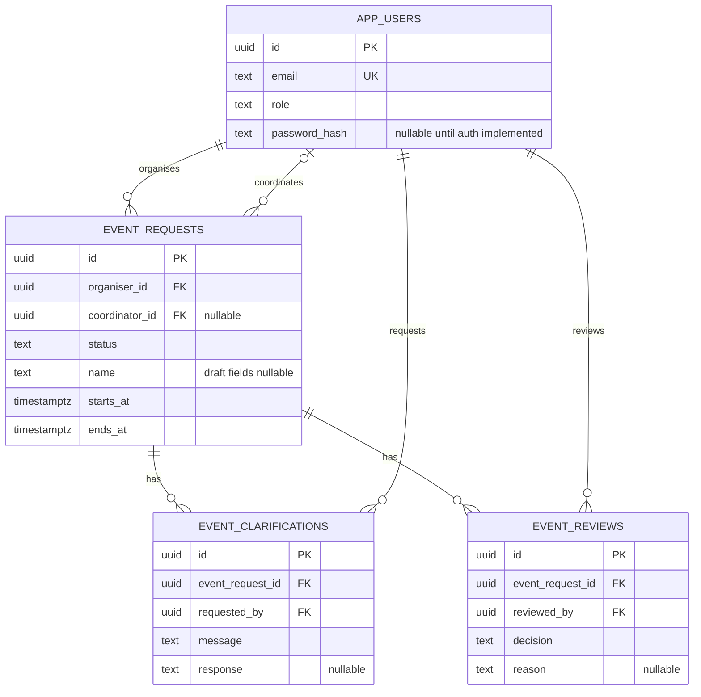

# Architecture

ConnectSphere uses one Git repository, one Vue frontend, one Express backend, and one PostgreSQL database. The backend is a modular monolith: domain modules run in the same process and database transaction boundary. The team selected this structure during Sprint 1 planning to keep development and integration manageable across the six workstreams.

## C4 system context

The diagrams describe the intended first release. Business capabilities remain to be implemented; the current executable path is the connection check.

## C4 containers

In local development Vite proxies `/api` to Express; the browser needs no database credentials or direct database access. Production hosting and authentication are not configured. Plan HTTPS and same-origin API routing when deployment enters scope.

## Module boundaries

| Area          | Responsibility                                                        | Current state                                    |
| ------------- | --------------------------------------------------------------------- | ------------------------------------------------ |
| auth          | Identity, session lifecycle, role and event access policies           | Role contracts and developer notes               |
| events        | Requests, drafts, assignment, review, status, significant changes     | DTOs/model contracts and initial database tables |
| venues        | Catalogue, suitability, availability, booking decisions and conflicts | Planned; add when taken into a sprint            |
| equipment     | Requests, quantity availability, reservations                         | Planned                                          |
| registrations | Attendee eligibility, registration and withdrawal                     | Planned                                          |
| notifications | Relevant recipients and notification delivery                         | Planned                                          |

Keep controllers thin: parse requests and call services. Services own permissions and workflow consistency; repositories own parameterized SQL. Add subfolders when real files justify them rather than pre-creating empty controller/service/repository trees. Avoid a global bucket of unrelated utilities. Cross-domain workflows should call explicit services and share a transaction when several reservations or statuses must change together.

The backend is currently laid out under `backend/src/modules/`; see its README for paths. Database migrations live at root in `database/` to make shared schema changes visible to all workstreams. Documentation and tests live with their consumers. Add C4 component views when components exist; these context/container views are a baseline, not a completed final design submission.

## Starting ERD

The SQL migration is the complete schema source. The ERD omits housekeeping fields and scaffold migration tables. Role checks, event ownership, transition validity and atomic decisions belong to services, with database constraints providing additional integrity.

## Decisions and tradeoffs

- Use one repository and modular backend to keep setup and integration manageable for six developers. There are no independently deployed business services.
- Use TypeScript across Vue and Express for consistent types and tooling. HTTP contracts still need runtime validation; static types do not validate user input.
- Use PostgreSQL and explicit SQL migrations for visible schema changes and future reservation transactions. The small migration runner is forward-only, transactional, checksummed, and tested for repeat execution. Evaluate a fuller migration tool if lifecycle needs grow.
- Keep credentials out of the scaffold. Seed users have no password and cannot log in. KAN-25 must deliver authentication and deny unauthorized API access before event routers are exposed.
- Keep optional draft values nullable. Do not reuse draft validation as submission validation. Record confirmed required fields in the clarification log.
- Use six provisional Sprint 1 statuses. Request approval is distinct from a later fully arranged event confirmation. Later lifecycle states require explicit rules and migrations.
- Keep venue/equipment/registration/notification implementations out of this scaffold; their boundaries and requirements are documented for later sprints.

For a significant change, add a dated decision under `docs/architecture/decisions/` stating context, options, chosen approach, consequences, linked stories, and superseded decisions. Do not record a proposal as customer approval.
