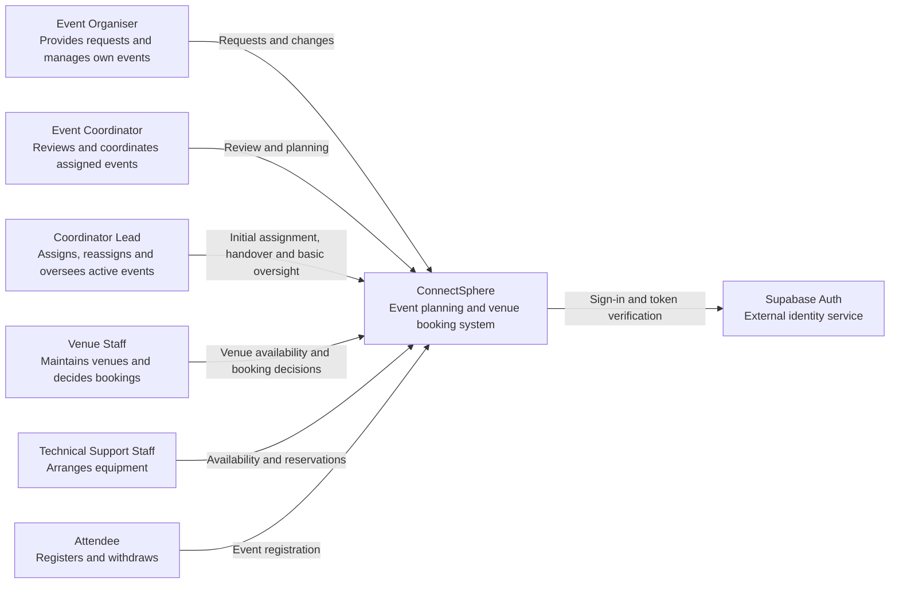
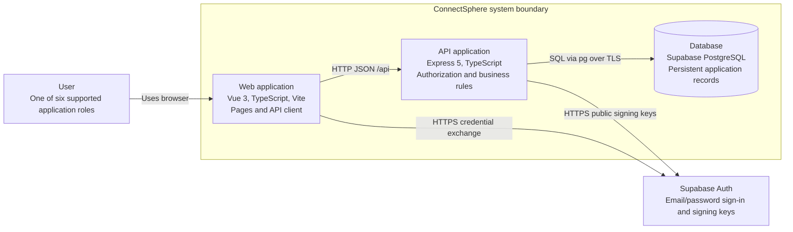
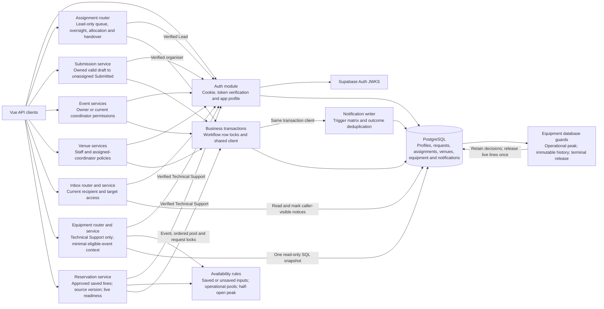
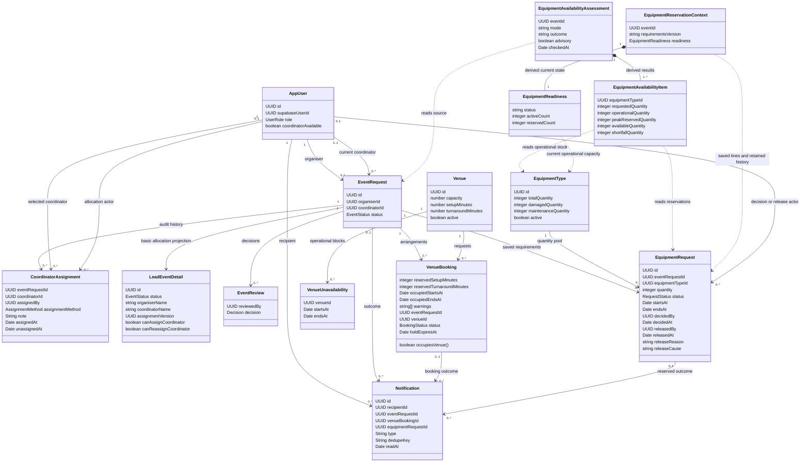
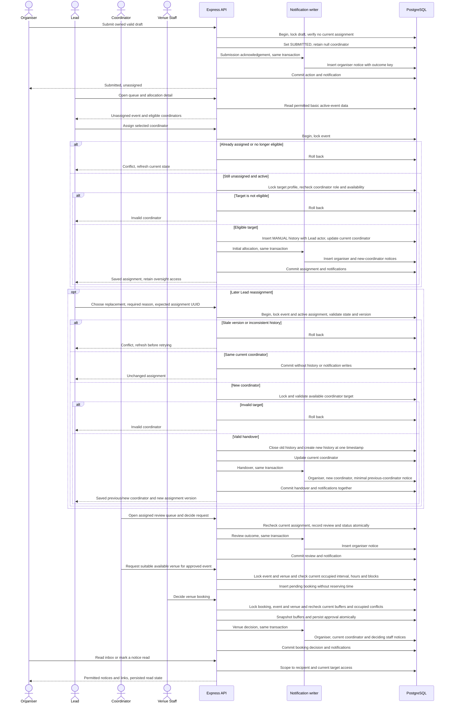
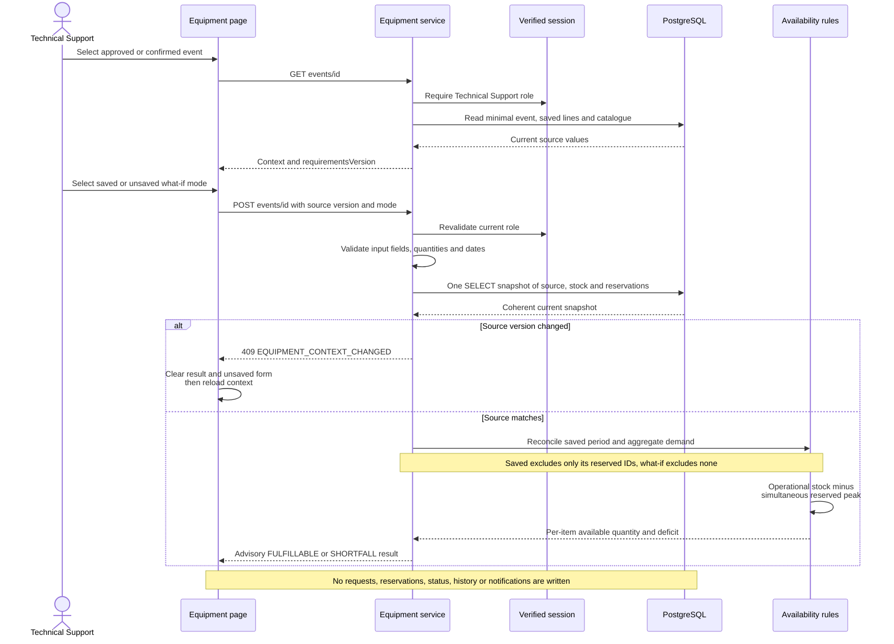
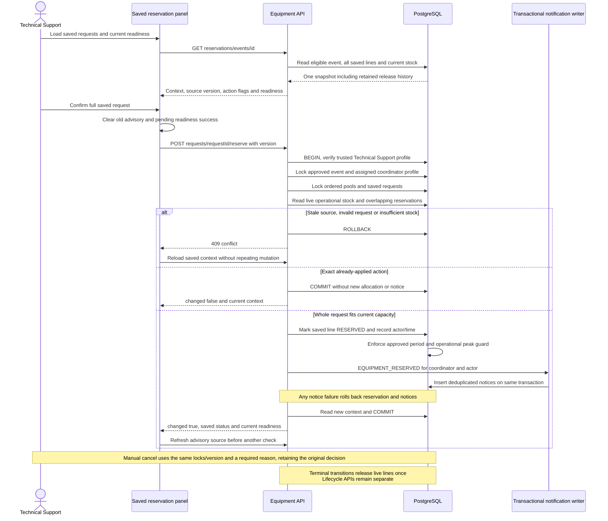
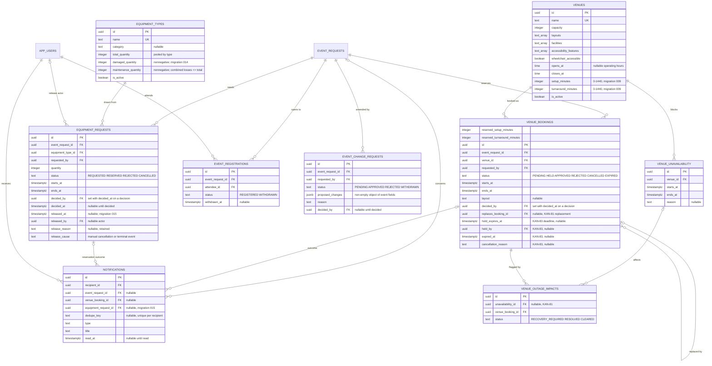
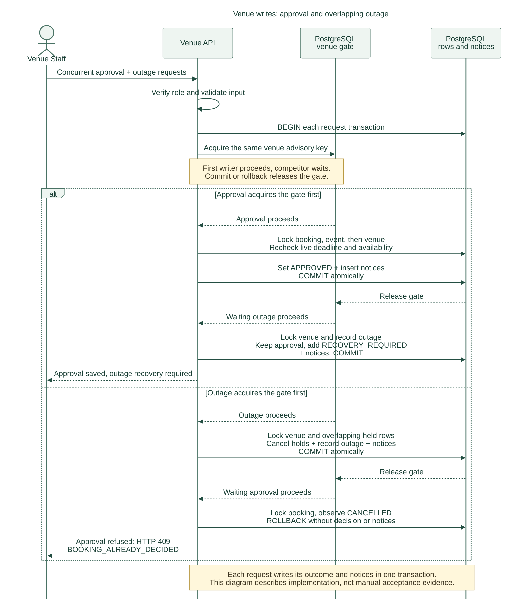
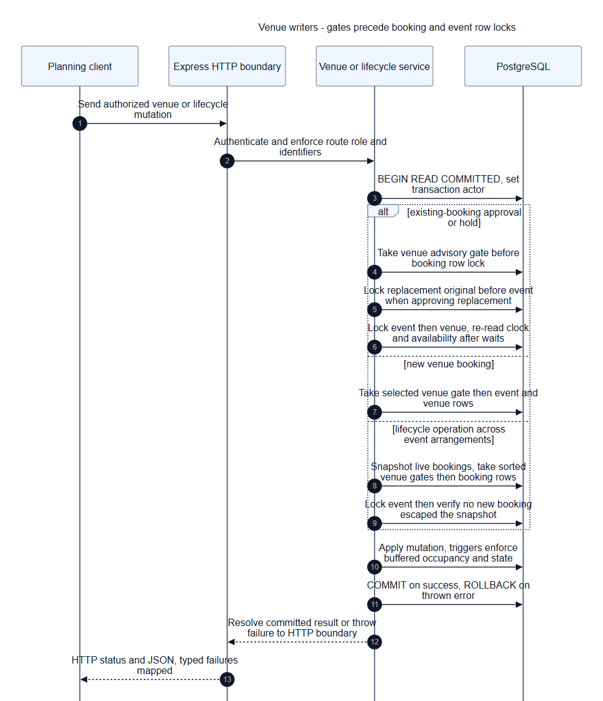

# Architecture

**Current implementation — 25 October 2026.** Lead assignment/reassignment and notification integration, strict search/draft validation, catalogue repair, buffers, outage recovery and holds are implemented. The current closeout branch repairs confirmed-event replacement controls, outage/hold concurrency, PostgreSQL date bounds and Singapore/buffer-warning displays. The shared venue gate is documented below. Shared migration 013 is verified; the approved Supabase expiry job is enabled and successful runs observed. Earlier dated pending-implementation/rollout notes retain their original checkpoint. Automated evidence and team-reported manual results are separate from review acceptance; final lifecycle/safety consumers remain Sprint 4 work.

**Arvin KAN-78/KAN-34 integration readback — 25 October 2026.** Current source is `main` `96a0d10`. KAN-78 is implemented and integrated through PR #48/#54: shared venue duration columns are migration 009, occupied endpoints/approval snapshots/warnings are **012**, and live holds extend them in **013**. Five venue consumers use buffered intervals; catalogue saves report affected bookings without changing their status/time. KAN-81 permits later outages over approved bookings and flags buffered overlaps; outage-only warnings use recovery instead of the decision queue. The dated pre-integration migration/dependency statements below retain their original checkpoint and are superseded for these details. [Current verification](../testing/test-evidence.md#25-october-2026--arvin-kan-78-and-kan-34-documentation-reconciliation) is automated evidence; hosted acceptance remains Not executed. The class, planning ERD and workflow sequence exports are refreshed from the current inline Mermaid sources in this update.

**25 October 2026 documentation follow-up.** [Reported original-story manual results](../testing/test-evidence.md#25-october-2026--reported-manual-results-for-original-stories) now accompany the implementation and automated evidence for the seven original stories. This update corrects current implementation/setup prose, keeps dated design and test history, and does not change diagram structure or claim a new combined diagram export.

ConnectSphere uses one Git repository, one Vue frontend, one Express backend, Supabase PostgreSQL and Supabase Auth. The backend is a modular monolith: domain modules run in the same process and database transaction boundary. The team selected this structure during Sprint 1 planning to keep development and integration manageable across the six workstreams. Supabase was selected for database hosting on 8 September 2026; its authentication integration is recorded in the 15 September decision log.

## C4 system context

The context diagram includes the KAN-79 Coordinator Lead role and KAN-65 reassignment implemented on **19 October 2026**, with KAN-64 notifications integrated on **21 October 2026**. The Safety Officer remains planned under KAN-84. KAN-79 replaces automatic initial allocation with a Lead queue: valid submissions remain unassigned, Leads allocate available coordinators, and ordinary coordinators manage only their assigned events. KAN-65 adds versioned handover with a required reason and retained history; the new coordinator gains assignment-derived access and the old coordinator loses it. Separate basic oversight endpoints do not grant Leads review, booking-decision or attendee-roster authority. Migration 007 and Lead login were reported successful. The 25 October original-story report records successful localhost manual scenarios for KAN-79/KAN-65; deployed-environment acceptance remains **Not assessed**. KAN-64 writes the relevant in-app notices in the same transaction as the action. Migration 008 adds notification inbox fields and 009 adds venue buffers. The 25 October KAN-60/KAN-83 run records a shared Supabase ledger check showing migrations 001–013 applied; that ledger check is distinct from the earlier structural schema audit. No schema change is added for KAN-65. See the [change register](../requirements/change-requests.md) and [test evidence](../testing/test-evidence.md).

Implemented request workflows also include draft creation/editing, clarification, review decisions and read-only status history. KAN-51 provides the internal availability calendar and KAN-12 venue search is integrated. KAN-8 adds staff booking decisions and assigned-coordinator outcomes. KAN-52 provides read-only event-specific suitability and KAN-55 provides Venue Staff block management. KAN-53 booking submission was integrated on 5 October with current reservation/block checks. Catalogue maintenance and the KAN-50 stale-save repair are merged, including PR #56 on 25 October. KAN-77 stores and exposes setup/turnaround minutes; KAN-78 applies buffered occupancy and affected-booking warnings. These implementation updates do not supply another owner's missing acceptance results. KAN-64 provides an in-app inbox for submission, clarification, review, assignment and venue-decision outcomes. KAN-9 availability and KAN-26 saved equipment reservations are implemented. Equipment stock/request editing, registration, significant changes and later lifecycle APIs remain to implement; KAN-80 owns their notification triggers beyond the equipment-reserved slice supplied by KAN-26. Migration 004 provides supporting tables and guards. The [current sprint plan](../scrum/sprint-04/planning.md) separates existing repairs from new customer requirements. The test evidence register separates local automated results from the hosted Sprint 1 observations below; the diagram does not imply acceptance. Venue Staff, Technical Support Staff and Attendee accounts need trusted Supabase Auth provisioning and an `app_users.supabase_user_id` mapping before their workflows can be tested.

The organiser's approved outcome and rejected status/reason remained visible after refresh in the 17 September hosted check (MAN-20260917-01). Reopening a request URL after sign-out showed a sign-in prompt without request details or the review reason (MAN-20260917-02). Draft and Submitted detail statuses and their no-decision messages also passed (MAN-20260917-03). A second organiser received the unavailable/no-permission message for the first organiser's request and saw an empty request list (MAN-20260917-04). Opening `/events` directly after signing out showed a sign-in prompt without request names or statuses (MAN-20260917-05). The request list showed matching Draft, Submitted, Rejected and Approved labels, and Draft/Submitted detail statuses and review messages remained correct after refresh (MAN-20260917-06). The remaining submission-to-status check is in the [test evidence](../testing/test-evidence.md).

## C4 containers

In local development Vite proxies `/api` to Express; the browser needs no database credentials or direct database access. Supabase hosts PostgreSQL, while the frontend and API run locally. Deployment of the frontend and API is not configured. Plan HTTPS and same-origin API routing when deployment enters scope.

Application tables remain in the `public` schema. Supabase's unused Data API is disabled; the hardening migration enables row-level security and removes Data API roles' access to application tables. Express uses its server database connection for application reads/writes and enforces roles, ownership and coordinator assignment. Supabase Auth remains available independently of the Data API.

The browser obtains a Supabase access token through sign-in and exchanges it at `POST /api/auth/login`. Express verifies the token and stores it in an HttpOnly session cookie, revalidating it for later API calls. The token subject maps through `app_users.supabase_user_id` to the application's trusted ID and role. Session lifetime follows the token's expiry; automatic session refresh is not implemented. Public signing keys are retrieved from the project's JWKS; the backend-only HS256 secret is an optional compatibility path for legacy projects.

## Module boundaries

| Area          | Responsibility                                                        | Current state                                    |
| ------------- | --------------------------------------------------------------------- | ------------------------------------------------ |
| auth          | Identity, session lifecycle, role and event access policies           | Supabase sign-in, token verification, mapped profiles and sessions |
| events        | Requests, drafts, assignment/reassignment, review and status | Draft creation/edit/submit, shared detail, assigned-coordinator queue and decisions, Lead queue/oversight and initial allocation, versioned reassignment with retained history, review start, clarification and protected read-only status history. Later lifecycle writes and significant changes are deferred. Dated validation is in the test evidence register. |
| venues        | Catalogue, suitability, availability, booking decisions and conflicts | Tables and the booking-conflict trigger exist in migration 004. The read-only KAN-51 availability calendar (`GET /api/venues/availability`, `/venues/availability`) is implemented with automated tests for the three internal roles; hosted acceptance and peer review remain. KAN-12 search and KAN-8 pending-booking decisions/outcomes are integrated. KAN-8 rechecks conflicts during approval; KAN-52 assesses latest event/venue data with explicitly interpreted requirements and explained tri-state checks; KAN-55 creates/lists/removes operational blocks. KAN-53 now creates pending bookings after current approved-booking/block checks under the venue lock. KAN-50 catalogue maintenance includes the stale-save repair merged in PR #56. KAN-77 stores setup/turnaround settings through migration 009; KAN-78 buffered occupancy and affected-booking warnings are integrated through migration 012; full KAN-54 acceptance, policy review and hosted workflow evidence remain pending |
| equipment     | Requests, quantity availability, reservations                         | KAN-9 Technical Support-only saved/unsaved availability checks and KAN-26 full saved-line reservations/cancellation/readiness at `/equipment/availability/:id`. Reads remain advisory; approved-only writes lock live operational pools and record notifications atomically. Migration 014 adds losses; 015 adds release history, notification links and terminal release. KAN-18 maintenance, KAN-63 request editing and KAN-62/KAN-10 lifecycle APIs remain pending; 014/account setup is reported complete; shared 015 application and connected manual acceptance are Not executed. |
| registrations | Attendee eligibility, registration and withdrawal                     | Tables and the capacity trigger exist in migration 004; no services or pages. Planned |
| notifications | Relevant recipients and notification delivery                         | KAN-64 (21 October 2026): `modules/notifications` writes in-app notifications inside the request, clarification, review, assignment and venue-decision transactions and serves `/api/notifications`; the UI has a bell and `/notifications`. KAN-80 owns later triggers. Shared ledger application through migration 013 reported in the 25 October KAN-60/KAN-83 run |

Keep controllers thin: parse requests and call services. Services own permissions and workflow consistency; repositories own parameterized SQL. Add subfolders when real files justify them rather than pre-creating empty controller/service/repository trees. Avoid a global bucket of unrelated utilities. Cross-domain workflows should call explicit services and share a transaction when several reservations or statuses must change together.

The backend is laid out under `backend/src/modules/`; see its README for paths. Database migrations live at root in `database/` to make shared schema changes visible to all workstreams. Documentation and tests live with their consumers. The component, class and sequence views below describe the current branch; future release workflows remain explicitly separate.

## C4 components (C3)

The API is one process. Every protected router resolves the verified session to the current trusted application profile. KAN-79 allocation reads use their own DTOs rather than widening coordinator review access.

The displayed authentication dependencies are policy checks, not a second sign-in operation. Assignment services use parameterized SQL through the shared pool; queue/oversight reads have no write side effects. Reassignment checks the active-history version under event/history locks before changing linkage. Assignment, clarification and status-history reads hold a shared event lock across authorisation and their data query; a handover cannot expose newly protected rows through an earlier permission check. The KAN-64 writer uses the caller's transaction client: business changes and notification rows commit or roll back together. A unique recipient/outcome key suppresses duplicate rows. Inbox queries recheck the current recipient, role and event/booking access; they do not reuse the permissions held when a notice was created. Delivery is in-app polling, with no email service or background delivery worker.

KAN-9's equipment service has its own minimal approved/confirmed event projection rather than widening shared event-detail access. One SQL statement reads source requirements, saved requests, stock and relevant reservations; the service validates the source version and calculates advisory quantities without joining a write transaction or notification flow. What-if input is explicitly unsaved; saved input reloads persisted lines and excludes only its own reserved IDs. Migration 014 provides damaged/maintenance quantities. KAN-26 uses a separate mutation service for full saved requests on approved events, locking current source/pools/lines before checking capacity and writing notices. Migration 015 protects operational stock, immutable allocation/release history and one-time terminal release. Stock maintenance/request editing and lifecycle APIs remain separate stories.

## Class diagram

These domain types describe persisted relationships and API boundaries. A Lead is a trusted `AppUser.role`, not a second coordinator assignment on the event.

`coordinatorId`, `assignmentVersion` and automatic-history `assignedBy` may be null. A partial unique index permits at most one assignment with null `unassignedAt` per event. New initial allocations and handovers are MANUAL with the Lead actor; historical AUTOMATIC rows retain their null actor. `assignmentVersion` is the UUID of matching active history rather than a new database column. Handover records its required reason in `note` and uses the same instant for the old end/new start. Notification event/booking/equipment-request links, legacy `dedupeKey` and unread `readAt` may be null; `(recipientId, dedupeKey)` is unique for keyed outcomes. Venue buffer values are integers from 0 to 1,440, defaulting to 0. They are returned as planning inputs; no buffered occupancy calculation or affected-booking warning is implemented yet. KAN-83 adds `HELD`/`EXPIRED` booking states and a hold deadline: `occupiesVenue()` is the shared rule in `occupancy.ts` (approved, or held with the deadline still in the future), and `expire_venue_holds()` marks overdue holds expired.

## Sequence diagrams

KAN-79 changes submission and allocation; KAN-65 adds a later explicit handover while retaining the existing assigned-coordinator review and venue workflow. KAN-64 writes notices before each relevant transaction commits.

Two Lead writes serialize on the event lock. An initial-allocation loser receives `409 COORDINATOR_ALREADY_ASSIGNED`; a stale handover receives `409 ASSIGNMENT_VERSION_CONFLICT`. Neither overwrites the winner. Valid same-coordinator requests preserve the version and all history and create no notification. Any persistence failure, including a notification insert failure, rolls back the action and its notices together. The coordinator in the later review/venue steps must be the currently assigned coordinator: after handover, the former coordinator is denied. Protected multi-query history reads take a shared event lock, so assignment cannot change between authorisation and fetching those records. The previous coordinator receives only a minimal reassignment notice; protected event and booking links are omitted when current access is absent. Clarification requests also notify the organiser in their transaction. Inbox reads/mark-read actions are separate from the business transaction; these diagrams describe implementation, not observed hosted delivery or acceptance.

## Equipment availability sequence (KAN-9)

The result is valid only for the snapshot checked. KAN-26 rechecks operational capacity under the equipment-pool lock in its separate reservation sequence below; the availability sequence never reserves equipment. Venue confirmation is not a precondition. Missing saved requirements and mismatched saved periods return explicit errors rather than empty success or silent date changes.

## Equipment reservation sequence (KAN-26)

The request row is both the requirement and, while `RESERVED`, its reservation. Cancellation adds release metadata without rewriting its original allocation/decision. Readiness re-evaluates current stock rather than trusting the saved status: empty requirements are not ready, and stock loss can make all-reserved requirements unfulfillable. KAN-63 owns request creation; what-if checks supply no mutation input. Migration 015 supports future KAN-62/KAN-10 terminal transitions, but those user workflows remain pending.

## Diagram exports

GitHub's Mermaid rendering is not part of the submission. PNG exports live in `docs/architecture/exports/`: `c1-context.png`, `c2-containers.png`, `c3-components.png`, `class.png`, `seq-lead-assignment.png`, `seq-venue-write-locking.png`, `seq-equipment-availability.png`, `seq-equipment-reservation.png`, `erd-events.png` and `erd-planning.png`. On 26 October 2026 the affected C3, class and planning-ERD images were re-exported from the current source for KAN-9 and KAN-26, with separate availability and reservation sequences, using Mermaid CLI. These depict implementation boundaries, not manual acceptance. Re-export affected diagrams after subsequent design changes.

## ERD

Migrations 001–003 provide the Sprint 1 request/authentication foundation. Migration 004 adds the
broader first-release tables, 005 corrects the equipment availability guard and 006 adds
historical automatic coordinator assignment fields. Migration 007 adds the trusted Lead role to the profile constraint without rewriting assignments. Migration 008 (KAN-64) adds notification booking links and deduplication keys. Migration 009 (KAN-77) adds per-venue setup and turnaround minutes, defaulting to 0; KAN-78 will apply them to occupancy. Migration 010 adds per-outage booking recovery flags with retained outage history. The diagram omits
housekeeping timestamps, migration metadata and the unused legacy auth fields/tables. Migration 014 adds zero-default damaged and maintenance quantities to equipment types; their nonnegative sum cannot exceed total stock. Migration 015 adds request release metadata, equipment notification linkage, operational-capacity guards and terminal release. Migration 014/account setup is reported complete; shared 015 application is Not executed.
[docs/database-diagram.md](../database-diagram.md) holds the detailed schema reference and its verification dates, including foreign keys this curated view leaves out. Local migration 007 tests passed, and its shared application plus Lead login were subsequently reported successful. Full hosted workflow acceptance remains pending. KAN-65 uses the existing fields and active-row constraint without a new migration.

### Sprint 1 request workflow

### Venues, equipment, registration and notifications

Database triggers enforce the invariants that concurrent requests could otherwise break:
the status-history record, one approved booking per venue and period, the pooled equipment
peak, and the registration capacity. Roles, ownership and transition validity remain
service responsibilities; `event_registrations` is unique per attendee and event.

Numbered migrations define the reproducible local and CI schema; coordinate equivalent dashboard changes in the shared Supabase project with Arvin. The ERD omits housekeeping fields, migration metadata and unused legacy auth fields/tables. Credentials are managed by Supabase Auth; the nullable historical `password_hash` field is not used by the current authentication code. Role checks, event ownership, transition validity and atomic decisions belong to services, with database constraints providing additional integrity.

## Decisions and tradeoffs

- Use one repository and modular backend to keep setup and integration manageable for six developers. There are no independently deployed business services.
- Use TypeScript across Vue and Express for consistent types and tooling. HTTP contracts still need runtime validation; static types do not validate user input.
- Use hosted Supabase PostgreSQL and explicit SQL migrations for visible schema changes and future reservation transactions. Retain `pg` and the Express service boundary. The small migration runner is forward-only, transactional, checksummed, and tested for repeat execution. Evaluate a fuller migration tool if lifecycle needs grow.
- Use a direct database connection where the network supports it, or the session pooler on port 5432 for IPv4 development. Connections verify TLS certificates. Compose remains available for optional local databases and isolated tests; GitHub Actions uses its own temporary PostgreSQL service.
- Coordinate changes against the shared development database. A feature branch isolates code, but it does not isolate Supabase tables or data. Keep schema changes in migrations and agree their order before applying them.
- Keep credentials out of the repository. Seed profiles have no login credentials; provision Supabase Auth accounts and map them to application profiles through `app_users.supabase_user_id` before sign-in, including the Venue Staff, Technical Support Staff and Attendee accounts the new routes need. `database/seed.ts` also adds fictional venues once migration 004 has run; equipment sample generation is removed. All mounted routes verify the application session.
- Use current coordinator assignment as the relationship rule. `event_requests.coordinator_id` refers to `app_users.id`, not the Supabase UUID. KAN-79 replaces automatic selection with a Lead-only initial assignment transaction: lock the active event, check it is still unassigned, lock the target profile and recheck its role/availability, then commit history and coordinator together. New submissions need no available coordinator. KAN-65 permits explicit versioned handover with a reason and nonoverlapping assignment intervals; the version is checked before a same-coordinator no-op. Missing/mismatched legacy history is preserved for reconciliation, never reconstructed with invented provenance. Migration 007 adds the Lead role without rewriting migrations 001–006 or previous acceptance; KAN-65 adds no schema change. Review and venue operations continue to require their existing role and current event relationship; Lead oversight uses a separate limited projection. KAN-64 commits keyed in-app notification rows with the relevant action. The 25 October KAN-60/KAN-83 record confirms shared migration application through 013; the original-story report separately records reported localhost allocation/handover verification. Deployed acceptance remains Not assessed.
- Keep optional draft values nullable. Do not reuse draft validation as submission validation. Record confirmed required fields in the clarification log.
- Use the nine statuses defined by migration 004: `DRAFT`, `SUBMITTED`, `UNDER_REVIEW`, `CLARIFICATION_REQUESTED`, `APPROVED`, `REJECTED`, `CONFIRMED`, `CANCELLED` and `COMPLETED`. The six Sprint 1 statuses are unchanged; the migration adds the three later lifecycle states. Implemented transitions are draft submission, review start, clarification and its answer, and initial approval/rejection. Later status values remain readable for compatibility with existing records and KAN-29 workload counting; the application cannot confirm, cancel or complete events. Request approval remains distinct from future final confirmation.
- A coordinator may record an initial decision from `SUBMITTED` or `UNDER_REVIEW`, so starting a review does not block the decision it precedes. A pending clarification must be answered first, which returns the request to `SUBMITTED`.
- The 26 September scope correction removed the broader venue, equipment, registration, change-request and notification feature modules. Their schema and database guards remain, but do not establish working interfaces or accepted stories. The 4 October integration adds KAN-12 search, KAN-51 availability and KAN-8 booking decisions within Sprint 2 scope. KAN-9 subsequently adds read-only equipment assessment on 26 October and KAN-26 adds full saved-line reservations, release history and current readiness. Equipment stock maintenance, request editing and lifecycle APIs remain pending, alongside attendee registration and change-request application workflows. Notification application workflows include the KAN-64 inbox for request, assignment and venue outcomes plus KAN-26’s equipment-reserved slice (see the notifications row above).

Record significant changes in the [decision log](../requirements/assumptions-and-questions.md), including context, options, the chosen approach, consequences, linked stories and any superseded decision. Keep implementation assumptions separate from customer clarifications.

## Planned customer-change design work — 16 October 2026

Customer changes received 2 October are represented by KAN-77/78/79/81/82/83/84; the complete [design/test impact register](../requirements/change-requests.md#design-and-test-impact-planned-work) and Sprint 3/4 cards allocate the work. This is planned design work, not a claim that new roles, APIs, migrations or diagram exports already exist.

Implementers must update C3/class/sequence/data/API views for venue buffers, outage recovery, timed holds and its scheduler, Lead authorization, independent arrangements, revision-bound safety and preparation, plus notification integration. Preserve existing diagrams as the current implementation until code changes; add numbered migrations rather than editing applied history. Re-export affected diagrams in the same story PR. Safety review remains separate from event confirmation: readiness permits review, while preparation requires both a confirmed event and current safety approval, avoiding a circular prerequisite.

**21 October implementation follow-up:** Lead allocation/reassignment and the KAN-64 inbox are reflected in the current C3, class and sequence views above. Migration 009 and the venue fields implement KAN-77 AC1–AC5; buffer application and affected-booking warnings remain KAN-78/KAN-77 AC6 work. The 16 October paragraph is the original design plan, not the current implementation status.

## KAN-78 occupied interval evaluation — 21 October 2026

The API's venue module now shares SQL occupied-interval calculation across search, calendar, suitability and booking writes. Migration 008 centralises occupied endpoints and operating-hour eligibility. The internal view selects current durations for live bookings and approval snapshots for ended/completed history. Computed warnings identify both affected overlaps and operational violations after buffer edits; no background job or booking cancellation is introduced. Existing API/module boundaries stay the same. KAN-77's configuration editor remains a separate dependency. The updated class, planning ERD and workflow sequence PNGs accompany this source.

## 25 October 2026 — Arvin contribution reconciliation (Sprints 1–3)

This is a dated evidence backfill prepared with Codex on 25 October, not a new ceremony, Jira transition, test execution or acceptance decision. Historical entries, other members’ ownership and agreed estimates are preserved.

KAN-24’s schema/ERD work and KAN-51’s navigation/access fixes are historical contributions; current diagrams describe the integrated system rather than every workflow once present in PR #10. The 12 October C4 preparation record is retained as a historical TXT snapshot in Sprint 3 evidence; its export/review/delivery claims must not be substituted for current design or independent review. KAN-81 stale-write refresh corrections came from Arvin’s review follow-up; Kai Jie retains the feature ownership.

## Venue write ordering — 25 October 2026

The per-venue advisory transaction gate precedes row locks for booking and outage mutations. This closes the skipped-hold race without a schema change; expiry remains idempotent and checks the current row after any wait.

Export generated from the source above on 25 October. State/notices commit atomically. This is an implementation diagram, not a manual acceptance result.

## 26 October 2026 — KAN-66 planning edits

The events component gains `planning-edit-policy.ts` (edit rules by status, role and relationship) used by the detail read and the PATCH write. `event_requests.revision` (migration 016, originally numbered 014) gives every writer an optimistic-concurrency token; edits and reviewer actions compare it under the existing row lock, so no new lock ordering is introduced. The class diagram, ERD and C3 exports do not yet show these additions; the combined re-export remains **pending**. See the [API contract](api-contract.md#kan-66-planning-edits-and-revisions--26-october-2026).

