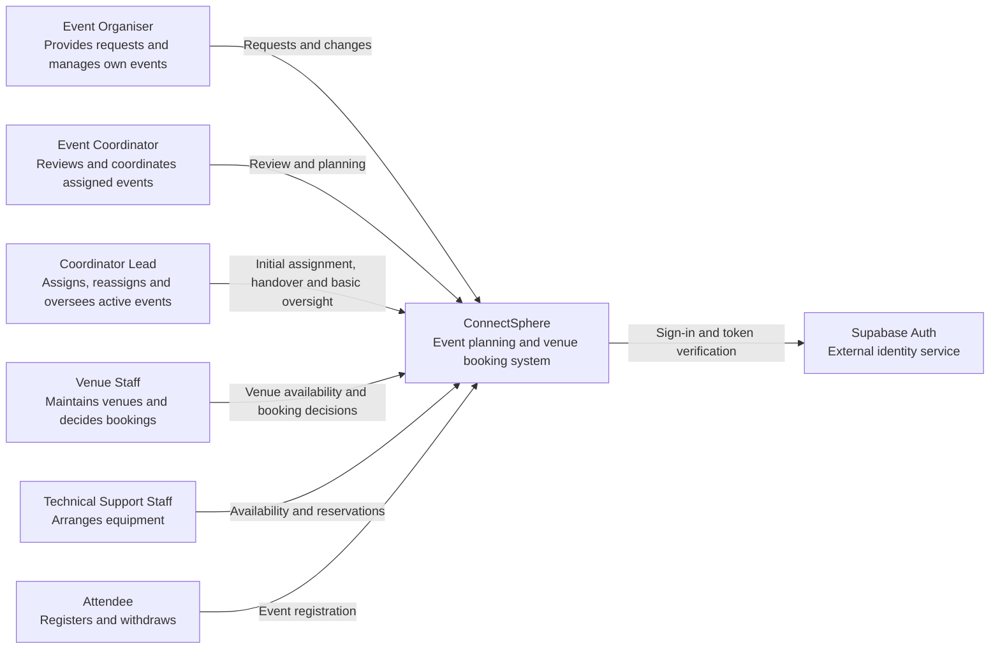
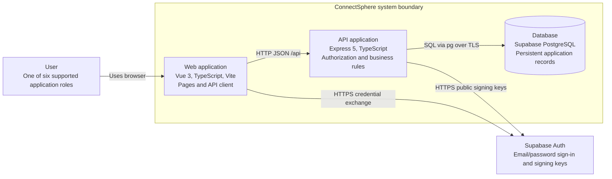
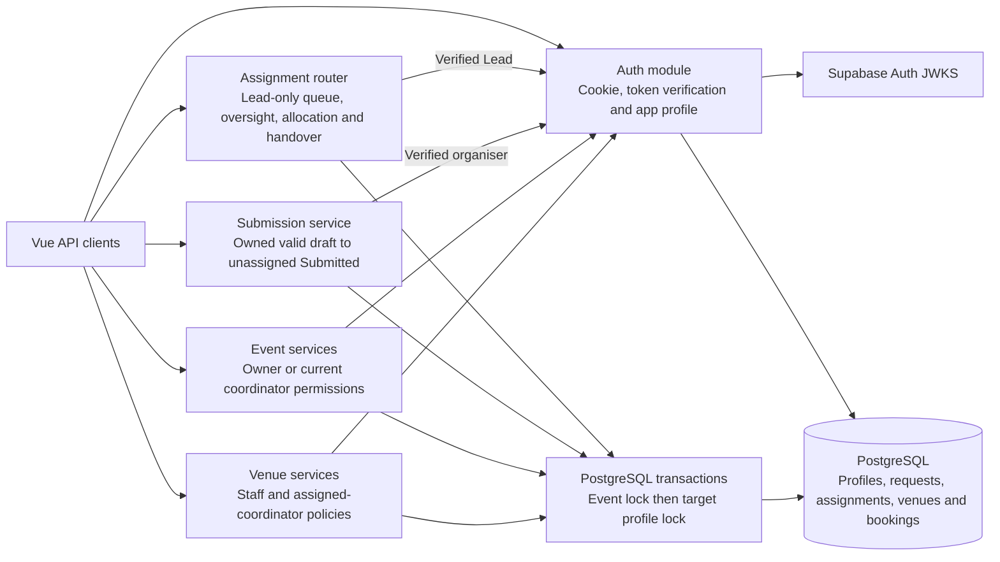
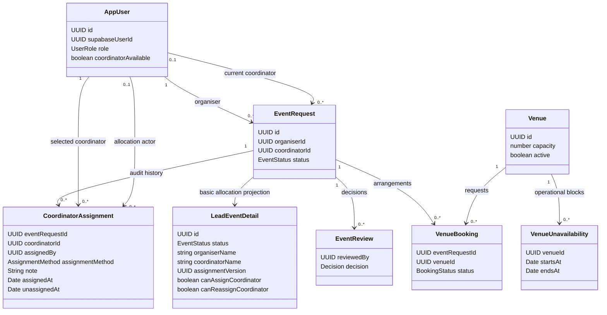
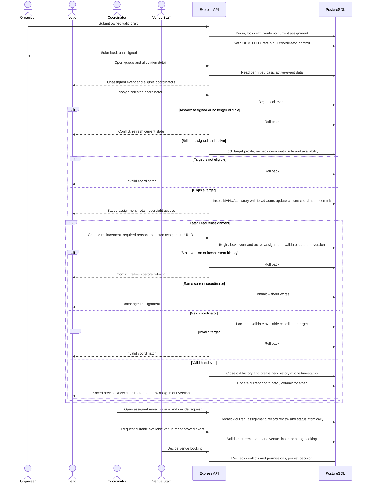
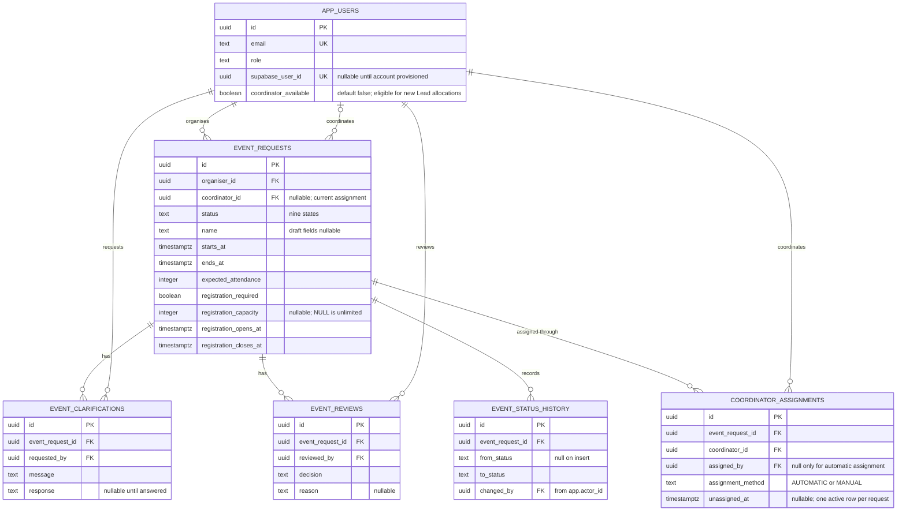

# Architecture

ConnectSphere uses one Git repository, one Vue frontend, one Express backend, Supabase PostgreSQL and Supabase Auth. The backend is a modular monolith: domain modules run in the same process and database transaction boundary. The team selected this structure during Sprint 1 planning to keep development and integration manageable across the six workstreams. Supabase was selected for database hosting on 8 September 2026; its authentication integration is recorded in the 15 September decision log.

## C4 system context

The context diagram includes the KAN-79 Coordinator Lead role and KAN-65 reassignment implemented on this branch on **19 October 2026**. The Safety Officer remains planned under KAN-84. KAN-79 replaces automatic initial allocation with a Lead queue: valid submissions remain unassigned, Leads allocate available coordinators, and ordinary coordinators manage only their assigned events. KAN-65 adds versioned handover with a required reason and retained history; the new coordinator gains assignment-derived access and the old coordinator loses it. Separate basic oversight endpoints do not grant Leads review, booking-decision or attendee-roster authority. Migration 007 and Lead login were reported successful; full shared workflow acceptance remains **Not executed**, and KAN-64 notification integration remains pending. No schema change is added for KAN-65. See the [change register](../requirements/change-requests.md) and [test evidence](../testing/test-evidence.md).

Implemented request workflows also include draft creation/editing, clarification, review decisions and read-only status history. KAN-51 provides the internal availability calendar and KAN-12 venue search is integrated. KAN-8 adds staff booking decisions and assigned-coordinator outcomes. KAN-52 provides read-only event-specific suitability and KAN-55 provides Venue Staff block management. KAN-53 booking submission was integrated on this branch on 5 October with current reservation/block checks. Catalogue maintenance is implemented; its stale-save defect and four other original-story gaps carry into Sprint 3 for correction and verification. Equipment, registration and notification workflows remain to implement; migration 004 provides supporting tables and guards. The [current sprint plan](../scrum/sprint-03/planning.md) separates existing repairs from new customer requirements. The test evidence register separates local automated results from the hosted Sprint 1 observations below; the diagram does not imply acceptance. Final confirmation, cancellation/completion and notification generation remain deferred after the 30 September audit. Venue Staff, Technical Support Staff and Attendee accounts need trusted Supabase Auth provisioning and an `app_users.supabase_user_id` mapping before their workflows can be tested.

The organiser's approved outcome and rejected status/reason remained visible after refresh in the 17 September hosted check (MAN-20260917-01). Reopening a request URL after sign-out showed a sign-in prompt without request details or the review reason (MAN-20260917-02). Draft and Submitted detail statuses and their no-decision messages also passed (MAN-20260917-03). A second organiser received the unavailable/no-permission message for the first organiser's request and saw an empty request list (MAN-20260917-04). Opening `/events` directly after signing out showed a sign-in prompt without request names or statuses (MAN-20260917-05). The request list showed matching Draft, Submitted, Rejected and Approved labels, and Draft/Submitted detail statuses and review messages remained correct after refresh (MAN-20260917-06). The remaining submission-to-status check is in the [test evidence](../testing/test-evidence.md).

## C4 containers

In local development Vite proxies `/api` to Express; the browser needs no database credentials or direct database access. Supabase hosts PostgreSQL, while the frontend and API run locally. Deployment of the frontend and API is not configured. Plan HTTPS and same-origin API routing when deployment enters scope.

Application tables remain in the `public` schema. Supabase's unused Data API is disabled; the hardening migration enables row-level security and removes Data API roles' access to application tables. Express uses its server database connection for application reads/writes and enforces roles, ownership and coordinator assignment. Supabase Auth remains available independently of the Data API.

The browser obtains a Supabase access token through sign-in and exchanges it at `POST /api/auth/login`. Express verifies the token and stores it in an HttpOnly session cookie, revalidating it for later API calls. The token subject maps through `app_users.supabase_user_id` to the application's trusted ID and role. Session lifetime follows the token's expiry; automatic session refresh is not implemented. Public signing keys are retrieved from the project's JWKS; the backend-only HS256 secret is an optional compatibility path for legacy projects.

## Module boundaries

| Area          | Responsibility                                                        | Current state                                    |
| ------------- | --------------------------------------------------------------------- | ------------------------------------------------ |
| auth          | Identity, session lifecycle, role and event access policies           | Supabase sign-in, token verification, mapped profiles and sessions |
| events        | Requests, drafts, assignment/reassignment, review and status | Draft creation/edit/submit, shared detail, assigned-coordinator queue and decisions, Lead queue/oversight and initial allocation, versioned reassignment with retained history, review start, clarification and protected read-only status history. Later lifecycle writes and significant changes are deferred. Dated validation is in the test evidence register. |
| venues        | Catalogue, suitability, availability, booking decisions and conflicts | Tables and the booking-conflict trigger exist in migration 004. The read-only KAN-51 availability calendar (`GET /api/venues/availability`, `/venues/availability`) is implemented with automated tests for the three internal roles; hosted acceptance and peer review remain. KAN-12 search and KAN-8 pending-booking decisions/outcomes are integrated. KAN-8 rechecks conflicts during approval; KAN-52 assesses latest event/venue data with explicitly interpreted requirements and explained tri-state checks; KAN-55 creates/lists/removes operational blocks. KAN-53 now creates pending bookings after current approved-booking/block checks under the venue lock. KAN-50 catalogue maintenance is implemented; its recorded stale-save repair remains pending; full KAN-54 acceptance, policy review and hosted workflow evidence remain pending |
| equipment     | Requests, quantity availability, reservations                         | Tables and the pooled-peak trigger exist in migrations 004/005; no services or pages. Planned |
| registrations | Attendee eligibility, registration and withdrawal                     | Tables and the capacity trigger exist in migration 004; no services or pages. Planned |
| notifications | Relevant recipients and notification delivery                         | KAN-64 (21 October 2026): `modules/notifications` writes in-app notifications inside the request, clarification, review, assignment and venue-decision transactions and serves `/api/notifications`; the UI has a bell and `/notifications`. KAN-80 owns later triggers. Migration 008 not yet applied to shared Supabase |

Keep controllers thin: parse requests and call services. Services own permissions and workflow consistency; repositories own parameterized SQL. Add subfolders when real files justify them rather than pre-creating empty controller/service/repository trees. Avoid a global bucket of unrelated utilities. Cross-domain workflows should call explicit services and share a transaction when several reservations or statuses must change together.

The backend is laid out under `backend/src/modules/`; see its README for paths. Database migrations live at root in `database/` to make shared schema changes visible to all workstreams. Documentation and tests live with their consumers. The component, class and sequence views below describe the current branch; future release workflows remain explicitly separate.

## C4 components (C3)

The API is one process. Every protected router resolves the verified session to the current trusted application profile. KAN-79 allocation reads use their own DTOs rather than widening coordinator review access.

The displayed authentication dependencies are policy checks, not a second sign-in operation. Assignment services use parameterized SQL through the shared pool; queue/oversight reads have no write side effects. Reassignment checks the active-history version under event/history locks before changing linkage. Assignment, clarification and status-history reads hold a shared event lock across authorisation and their data query; a handover cannot expose newly protected rows through an earlier permission check.

## Class diagram

These domain types describe persisted relationships and API boundaries. A Lead is a trusted `AppUser.role`, not a second coordinator assignment on the event.

`coordinatorId`, `assignmentVersion` and automatic-history `assignedBy` may be null. A partial unique index permits at most one assignment with null `unassignedAt` per event. New initial allocations and handovers are MANUAL with the Lead actor; historical AUTOMATIC rows retain their null actor. `assignmentVersion` is the UUID of matching active history rather than a new database column. Handover records its required reason in `note` and uses the same instant for the old end/new start. Venue relationships are unchanged by KAN-79/KAN-65.

## Sequence diagrams

KAN-79 changes submission and allocation; KAN-65 adds a later explicit handover while retaining the existing assigned-coordinator review and venue workflow.

Two Lead writes serialize on the event lock. An initial-allocation loser receives `409 COORDINATOR_ALREADY_ASSIGNED`; a stale handover receives `409 ASSIGNMENT_VERSION_CONFLICT`. Neither overwrites the winner. Valid same-coordinator requests preserve the version and all history. Any persistence failure rolls back the history and linkage together. The coordinator in the later review/venue steps must be the currently assigned coordinator: after handover, the former coordinator is denied. Protected multi-query history reads take a shared event lock, so assignment cannot change between authorisation and fetching those records. KAN-64 transactional notifications remain pending and are not depicted as delivered.

## Diagram exports

GitHub's Mermaid rendering is not part of the submission. The current PNG exports are in `docs/architecture/exports/`: `c1-context.png`, `c2-containers.png`, `c3-components.png`, `class.png`, `seq-lead-assignment.png`, `erd-events.png` and `erd-planning.png`. Re-export after design changes. These depict implementation boundaries, not hosted acceptance.

## ERD

Migrations 001–003 provide the Sprint 1 request/authentication foundation. Migration 004 adds the
broader first-release tables, 005 corrects the equipment availability guard and 006 adds
historical automatic coordinator assignment fields. Migration 007 adds the trusted Lead role to the profile constraint without rewriting assignments. The diagram omits
housekeeping timestamps, migration metadata and the unused legacy auth fields/tables.
[docs/database-diagram.md](../database-diagram.md) holds the detailed schema reference and its verification dates, including foreign keys this curated view leaves out. Local migration 007 tests passed, and its shared application plus Lead login were subsequently reported successful. Full hosted workflow acceptance remains pending. KAN-65 uses the existing fields and active-row constraint without a new migration.

### Sprint 1 request workflow

### Venues, equipment, registration and notifications

```mermaid
erDiagram
  EVENT_REQUESTS ||--o{ VENUE_BOOKINGS : reserves
  EVENT_REQUESTS ||--o{ EQUIPMENT_REQUESTS : needs
  EVENT_REQUESTS ||--o{ EVENT_REGISTRATIONS : "opens to"
  EVENT_REQUESTS ||--o{ EVENT_CHANGE_REQUESTS : "amended by"
  EVENT_REQUESTS o|--o{ NOTIFICATIONS : concerns
  VENUES ||--o{ VENUE_BOOKINGS : "booked as"
  VENUES ||--o{ VENUE_UNAVAILABILITY : blocks
  EQUIPMENT_TYPES ||--o{ EQUIPMENT_REQUESTS : "drawn from"
  APP_USERS ||--o{ EVENT_REGISTRATIONS : attends
  APP_USERS ||--o{ NOTIFICATIONS : receives
  VENUES {
    uuid id PK
    text name UK
    integer capacity
    text_array layouts
    text_array facilities
    text_array accessibility_features
    boolean wheelchair_accessible
    time opens_at "nullable operating hours"
    time closes_at
    boolean is_active
  }
  VENUE_UNAVAILABILITY {
    uuid id PK
    uuid venue_id FK
    timestamptz starts_at
    timestamptz ends_at
    text reason "nullable"
  }
  VENUE_BOOKINGS {
    uuid id PK
    uuid event_request_id FK
    uuid venue_id FK
    uuid requested_by FK
    text status "PENDING APPROVED REJECTED CANCELLED"
    timestamptz starts_at
    timestamptz ends_at
    text layout "nullable"
    uuid decided_by FK "set with decided_at on a decision"
  }
  EQUIPMENT_TYPES {
    uuid id PK
    text name UK
    text category "nullable"
    integer total_quantity "pooled by type"
    boolean is_active
  }
  EQUIPMENT_REQUESTS {
    uuid id PK
    uuid event_request_id FK
    uuid equipment_type_id FK
    uuid requested_by FK
    integer quantity
    text status "REQUESTED RESERVED REJECTED CANCELLED"
    timestamptz starts_at
    timestamptz ends_at
    uuid decided_by FK "set with decided_at on a decision"
  }
  EVENT_REGISTRATIONS {
    uuid id PK
    uuid event_request_id FK
    uuid attendee_id FK
    text status "REGISTERED WITHDRAWN"
    timestamptz withdrawn_at "nullable"
  }
  EVENT_CHANGE_REQUESTS {
    uuid id PK
    uuid event_request_id FK
    uuid requested_by FK
    text status "PENDING APPROVED REJECTED WITHDRAWN"
    jsonb proposed_changes "non-empty object of event fields"
    text reason
    uuid decided_by FK "nullable until decided"
  }
  NOTIFICATIONS {
    uuid id PK
    uuid recipient_id FK
    uuid event_request_id FK "nullable"
    uuid venue_booking_id FK "nullable"
    text dedupe_key "nullable, unique per recipient"
    text type
    text title
    timestamptz read_at "nullable until read"
  }
```

Database triggers enforce the invariants that concurrent requests could otherwise break:
the status-history record, one approved booking per venue and period, the pooled equipment
peak, and the registration capacity. Roles, ownership and transition validity remain
service responsibilities; `event_registrations` is unique per attendee and event.

Numbered migrations define the reproducible local and CI schema; coordinate equivalent dashboard changes in the shared Supabase project with Arvin. The ERD omits housekeeping fields, migration metadata and unused legacy auth fields/tables. Credentials are managed by Supabase Auth; the nullable historical `password_hash` field is not used by the current authentication code. Role checks, event ownership, transition validity and atomic decisions belong to services, with database constraints providing additional integrity.

## Decisions and tradeoffs

- Use one repository and modular backend to keep setup and integration manageable for six developers. There are no independently deployed business services.
- Use TypeScript across Vue and Express for consistent types and tooling. HTTP contracts still need runtime validation; static types do not validate user input.
- Use hosted Supabase PostgreSQL and explicit SQL migrations for visible schema changes and future reservation transactions. Retain `pg` and the Express service boundary. The small migration runner is forward-only, transactional, checksummed, and tested for repeat execution. Evaluate a fuller migration tool if lifecycle needs grow.
- Use a direct database connection where the network supports it, or the session pooler on port 5432 for IPv4 development. Connections verify TLS certificates. Compose remains available for optional local databases and isolated tests; GitHub Actions uses its own temporary PostgreSQL service.
- Coordinate changes against the shared development database. A feature branch isolates code, but it does not isolate Supabase tables or data. Keep schema changes in migrations and agree their order before applying them.
- Keep credentials out of the repository. Seed profiles have no login credentials; provision Supabase Auth accounts and map them to application profiles through `app_users.supabase_user_id` before sign-in, including the Venue Staff, Technical Support Staff and Attendee accounts the new routes need. `database/seed.ts` also adds fictional venues once migration 004 has run; equipment sample generation is removed. All mounted routes verify the application session.
- Use current coordinator assignment as the relationship rule. `event_requests.coordinator_id` refers to `app_users.id`, not the Supabase UUID. KAN-79 replaces automatic selection with a Lead-only initial assignment transaction: lock the active event, check it is still unassigned, lock the target profile and recheck its role/availability, then commit history and coordinator together. New submissions need no available coordinator. KAN-65 permits explicit versioned handover with a reason and nonoverlapping assignment intervals; the version is checked before a same-coordinator no-op. Missing/mismatched legacy history is preserved for reconciliation, never reconstructed with invented provenance. Migration 007 adds the Lead role without rewriting migrations 001–006 or previous acceptance; KAN-65 adds no schema change. Review and venue operations continue to require their existing role and current event relationship; Lead oversight uses a separate limited projection. KAN-64 notification integration remains pending.
- Keep optional draft values nullable. Do not reuse draft validation as submission validation. Record confirmed required fields in the clarification log.
- Use the nine statuses defined by migration 004: `DRAFT`, `SUBMITTED`, `UNDER_REVIEW`, `CLARIFICATION_REQUESTED`, `APPROVED`, `REJECTED`, `CONFIRMED`, `CANCELLED` and `COMPLETED`. The six Sprint 1 statuses are unchanged; the migration adds the three later lifecycle states. Implemented transitions are draft submission, review start, clarification and its answer, and initial approval/rejection. Later status values remain readable for compatibility with existing records and KAN-29 workload counting; the application cannot confirm, cancel or complete events. Request approval remains distinct from future final confirmation.
- A coordinator may record an initial decision from `SUBMITTED` or `UNDER_REVIEW`, so starting a review does not block the decision it precedes. A pending clarification must be answered first, which returns the request to `SUBMITTED`.
- The 26 September scope correction removed the broader venue, equipment, registration, change-request and notification feature modules. Their schema and database guards remain, but do not establish working interfaces or accepted stories. The 4 October integration adds KAN-12 search, KAN-51 availability and KAN-8 booking decisions within Sprint 2 scope. Equipment, attendee registration and change-request application workflows remain absent. Notification application workflows are limited to the KAN-64 inbox for request, assignment and venue outcomes (see the notifications row above).

Record significant changes in the [decision log](../requirements/assumptions-and-questions.md), including context, options, the chosen approach, consequences, linked stories and any superseded decision. Keep implementation assumptions separate from customer clarifications.

## Planned customer-change design work — 16 October 2026

Customer changes received 2 October are represented by KAN-77/78/79/81/82/83/84; the complete [design/test impact register](../requirements/change-requests.md#design-and-test-impact-planned-work) and Sprint 3/4 cards allocate the work. This is planned design work, not a claim that new roles, APIs, migrations or diagram exports already exist.

Implementers must update C3/class/sequence/data/API views for venue buffers, outage recovery, timed holds and its scheduler, Lead authorization, independent arrangements, revision-bound safety and preparation, plus notification integration. Preserve existing diagrams as the current implementation until code changes; add numbered migrations rather than editing applied history. Re-export affected diagrams in the same story PR. Safety review remains separate from event confirmation: readiness permits review, while preparation requires both a confirmed event and current safety approval, avoiding a circular prerequisite.
