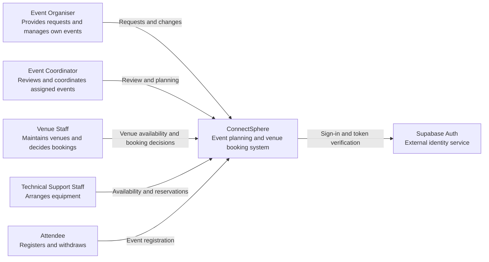
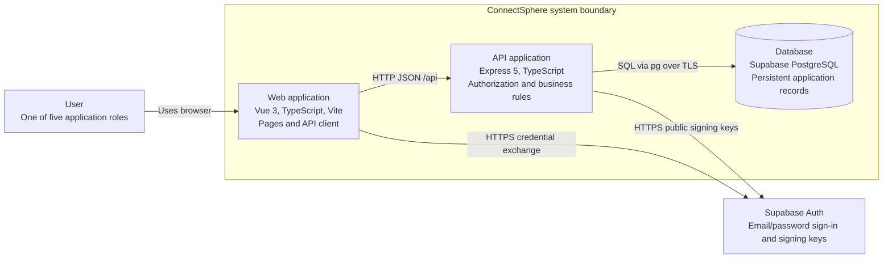
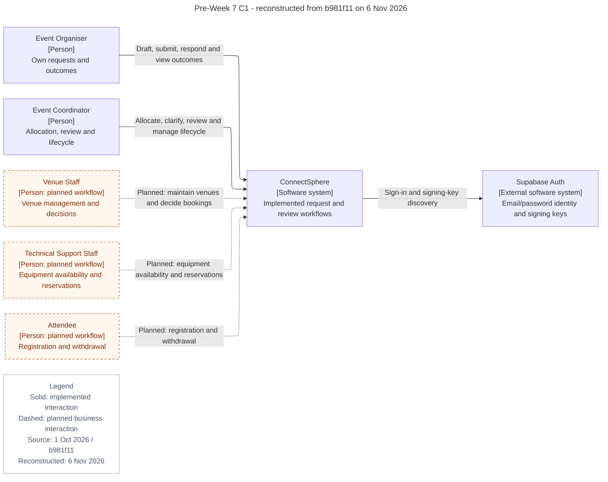
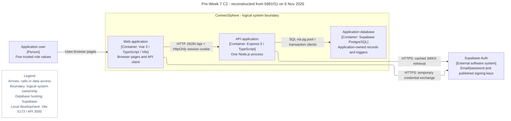
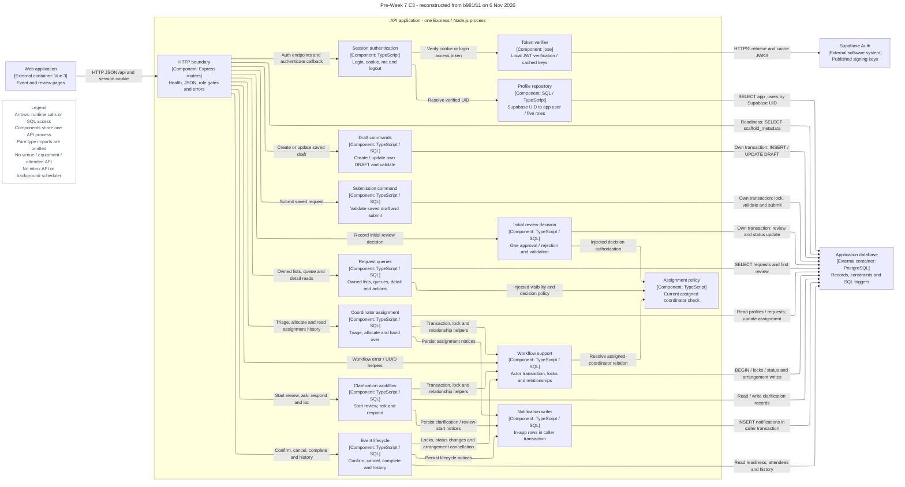

# Pre-Week 7 C4 originals and retrospective audit

Prepared on **6 November 2026** from commit `b981f1133750e7ddd42ac412651c915cb4485418` (1 October), before receipt of the customer changes on 2 October. [Open the diagram gallery](c4-gallery.html).

The original C1/C2 Mermaid below is unchanged. Their PNG/SVG files are **new renders**, not evidence of exports made in October. The separate C1/C2/C3 reconstructions describe the pinned code and explicitly mark planned business workflows. An original C3 is **Not recorded**. The three original Markdown files and preservation manifest remain unchanged.

## Audit scope and findings

- Every displayed node, directed connection and boundary has an individual row below. Application elements have pinned code/schema anchors in [models.json](../../../scrum/sprint-03/evidence/pre-week-7-c4-audit-20261106/models.json); the three new notation legends are checked against their diagram definitions.
- Original C1 described an intended first release: venue, equipment and attendee interactions were planned. The role enum and SQL schema existed, but their feature APIs/pages did not. Later prose in the old architecture document overstated implementation; the Git tree and mounted routes govern these reconstructions.
- Coordinators could allocate unassigned requests and the current coordinator could hand over. No Lead Coordinator, Safety Officer, safety review or Week 7 temporary-hold scheduler existed in this snapshot.
- Supabase Auth handles the browser credential exchange. Express verifies JWTs locally using cached JWKS or an optional local HS256 secret, then resolves `app_users`. No separate server session table, browser database access or per-request remote identity lookup is shown.
- The database boundary is logical application ownership. Supabase hosts PostgreSQL; TLS verify-full is required for Supabase connections. Local development uses Vite 5173 with an `/api` proxy to Express 3000.
- C3 groups 14 code components inside one API process. All backend source files are partitioned into those components or explicit bootstrap/shared-type support. Every cross-component runtime import and both injected assignment policies are checked; type-only imports are omitted.
- Draft, submission and initial-review commands manage their own SQL transactions. Only assignment, clarification and lifecycle call the notification writer; it inserts in-app records in the caller transaction. There is no inbox API, email delivery service or notification worker in this snapshot.
- This audit is static documentation work. Application suites: **Not executed**. Live integrated acceptance: **Not assessed**. Independent review: **Not recorded**.

Source inventory, absence checks, component partition, hashes, rendering checks and reproduction instructions are in [S3-E32 evidence](../../../scrum/sprint-03/evidence/pre-week-7-c4-audit-20261106/README.md).

## Original C1 - pre-Week 7 intended release

**Original**. 7 blocks, 6 connections, 0 boundaries. Legend blocks are counted and labelled as notation.

[SVG](c4-exports/c1-context-original.svg) · [PNG](c4-exports/c1-context-original.png) · [Mermaid source](c4-source/original/c1-context.mmd)

| Element | Label / endpoints | Assessment and qualification | Pinned source |
| --- | --- | --- | --- |
| Node `organiser` | Event Organiser Provides requests and manages own events | Implemented.  | [backend/src/modules/auth/types.ts:3](https://github.com/MochaLxtte/ConnectSphere/blob/b981f1133750e7ddd42ac412651c915cb4485418/backend/src/modules/auth/types.ts#L3) |
| Node `coordinator` | Event Coordinator Reviews and coordinates assigned events | Implemented.  | [backend/src/modules/auth/types.ts:4](https://github.com/MochaLxtte/ConnectSphere/blob/b981f1133750e7ddd42ac412651c915cb4485418/backend/src/modules/auth/types.ts#L4) |
| Node `venue` | Venue Staff Maintains venues and decides bookings | Planned workflow. Role exists; maintenance/booking API and UI absent (N1). | [backend/src/modules/auth/types.ts:5](https://github.com/MochaLxtte/ConnectSphere/blob/b981f1133750e7ddd42ac412651c915cb4485418/backend/src/modules/auth/types.ts#L5) |
| Node `technical` | Technical Support Staff Arranges equipment | Planned workflow. Role and equipment schema exist; business API/UI absent (N1). | [backend/src/modules/auth/types.ts:6](https://github.com/MochaLxtte/ConnectSphere/blob/b981f1133750e7ddd42ac412651c915cb4485418/backend/src/modules/auth/types.ts#L6) |
| Node `attendee` | Attendee Registers and withdraws | Planned workflow. Role and registration schema exist; business API/UI absent (N1). | [backend/src/modules/auth/types.ts:7](https://github.com/MochaLxtte/ConnectSphere/blob/b981f1133750e7ddd42ac412651c915cb4485418/backend/src/modules/auth/types.ts#L7) |
| Node `system` | ConnectSphere Event planning and venue booking system | Mixed implemented/planned. System description is intended-release scope, not a claim that venue booking was working. | [backend/src/app.ts:33](https://github.com/MochaLxtte/ConnectSphere/blob/b981f1133750e7ddd42ac412651c915cb4485418/backend/src/app.ts#L33) [frontend/src/app/router.ts:14](https://github.com/MochaLxtte/ConnectSphere/blob/b981f1133750e7ddd42ac412651c915cb4485418/frontend/src/app/router.ts#L14) |
| Node `identity` | Supabase Auth External identity service | Implemented.  | [frontend/src/features/auth/supabase-client.ts:32](https://github.com/MochaLxtte/ConnectSphere/blob/b981f1133750e7ddd42ac412651c915cb4485418/frontend/src/features/auth/supabase-client.ts#L32) [backend/src/modules/auth/supabase.ts:40](https://github.com/MochaLxtte/ConnectSphere/blob/b981f1133750e7ddd42ac412651c915cb4485418/backend/src/modules/auth/supabase.ts#L40) |
| Edge `organiser__system` | `organiser` → `system`: Requests and changes | Implemented subset. Owned draft create/update, submit, outcomes and clarification/cancellation; not arbitrary post-submission change approval. | [frontend/src/features/events/api/event-requests.ts:118](https://github.com/MochaLxtte/ConnectSphere/blob/b981f1133750e7ddd42ac412651c915cb4485418/frontend/src/features/events/api/event-requests.ts#L118) [backend/src/modules/events/update-draft.ts:85](https://github.com/MochaLxtte/ConnectSphere/blob/b981f1133750e7ddd42ac412651c915cb4485418/backend/src/modules/events/update-draft.ts#L85) |
| Edge `coordinator__system` | `coordinator` → `system`: Review and planning | Implemented.  | [backend/src/modules/events/assignment-router.ts:16](https://github.com/MochaLxtte/ConnectSphere/blob/b981f1133750e7ddd42ac412651c915cb4485418/backend/src/modules/events/assignment-router.ts#L16) [backend/src/modules/events/review-router.ts:26](https://github.com/MochaLxtte/ConnectSphere/blob/b981f1133750e7ddd42ac412651c915cb4485418/backend/src/modules/events/review-router.ts#L26) |
| Edge `venue__system` | `venue` → `system`: Venue availability and booking decisions | Planned workflow. Schema only; no corresponding route/page (N1). | [database/migrations/005_core_feature_schema.sql:108](https://github.com/MochaLxtte/ConnectSphere/blob/b981f1133750e7ddd42ac412651c915cb4485418/database/migrations/005_core_feature_schema.sql#L108) |
| Edge `technical__system` | `technical` → `system`: Availability and reservations | Planned workflow. Schema only; no corresponding route/page (N1). | [database/migrations/005_core_feature_schema.sql:174](https://github.com/MochaLxtte/ConnectSphere/blob/b981f1133750e7ddd42ac412651c915cb4485418/database/migrations/005_core_feature_schema.sql#L174) |
| Edge `attendee__system` | `attendee` → `system`: Event registration | Planned workflow. Schema only; no corresponding route/page (N1). | [database/migrations/005_core_feature_schema.sql:224](https://github.com/MochaLxtte/ConnectSphere/blob/b981f1133750e7ddd42ac412651c915cb4485418/database/migrations/005_core_feature_schema.sql#L224) |
| Edge `system__identity` | `system` → `identity`: Sign-in and token verification | Implemented with qualification. Browser exchanges credentials; API verifies locally with cached JWKS, or local legacy HS256 secret. Not a per-request remote verification call. | [frontend/src/features/auth/supabase-client.ts:32](https://github.com/MochaLxtte/ConnectSphere/blob/b981f1133750e7ddd42ac412651c915cb4485418/frontend/src/features/auth/supabase-client.ts#L32) [backend/src/modules/auth/supabase.ts:36](https://github.com/MochaLxtte/ConnectSphere/blob/b981f1133750e7ddd42ac412651c915cb4485418/backend/src/modules/auth/supabase.ts#L36) |

## Original C2 - pre-Week 7 containers

**Original**. 5 blocks, 5 connections, 1 boundaries. Legend blocks are counted and labelled as notation.

[SVG](c4-exports/c2-containers-original.svg) · [PNG](c4-exports/c2-containers-original.png) · [Mermaid source](c4-source/original/c2-containers.mmd)

| Element | Label / endpoints | Assessment and qualification | Pinned source |
| --- | --- | --- | --- |
| Node `user` | User One of five application roles | Implemented.  | [backend/src/modules/auth/types.ts:2](https://github.com/MochaLxtte/ConnectSphere/blob/b981f1133750e7ddd42ac412651c915cb4485418/backend/src/modules/auth/types.ts#L2) |
| Node `identity` | Supabase Auth Email/password sign-in and signing keys | Implemented.  | [frontend/src/features/auth/supabase-client.ts:32](https://github.com/MochaLxtte/ConnectSphere/blob/b981f1133750e7ddd42ac412651c915cb4485418/frontend/src/features/auth/supabase-client.ts#L32) [backend/src/modules/auth/supabase.ts:36](https://github.com/MochaLxtte/ConnectSphere/blob/b981f1133750e7ddd42ac412651c915cb4485418/backend/src/modules/auth/supabase.ts#L36) |
| Node `web` | Web application Vue 3, TypeScript, Vite Pages and API client | Implemented.  | [frontend/src/app/router.ts:14](https://github.com/MochaLxtte/ConnectSphere/blob/b981f1133750e7ddd42ac412651c915cb4485418/frontend/src/app/router.ts#L14) [frontend/package.json:14](https://github.com/MochaLxtte/ConnectSphere/blob/b981f1133750e7ddd42ac412651c915cb4485418/frontend/package.json#L14) |
| Node `api` | API application Express 5, TypeScript Authorization and business rules | Implemented.  | [backend/src/app.ts:33](https://github.com/MochaLxtte/ConnectSphere/blob/b981f1133750e7ddd42ac412651c915cb4485418/backend/src/app.ts#L33) [backend/package.json:19](https://github.com/MochaLxtte/ConnectSphere/blob/b981f1133750e7ddd42ac412651c915cb4485418/backend/package.json#L19) |
| Node `db` | Database Supabase PostgreSQL Persistent application records | Implemented.  | [backend/src/db/pool.ts:15](https://github.com/MochaLxtte/ConnectSphere/blob/b981f1133750e7ddd42ac412651c915cb4485418/backend/src/db/pool.ts#L15) [backend/src/db/connection.ts:21](https://github.com/MochaLxtte/ConnectSphere/blob/b981f1133750e7ddd42ac412651c915cb4485418/backend/src/db/connection.ts#L21) |
| Edge `user__web` | `user` → `web`: Uses browser | Implemented.  | [frontend/src/app/router.ts:14](https://github.com/MochaLxtte/ConnectSphere/blob/b981f1133750e7ddd42ac412651c915cb4485418/frontend/src/app/router.ts#L14) |
| Edge `web__api` | `web` → `api`: HTTP JSON /api | Implemented.  | [frontend/src/lib/api-client.ts:29](https://github.com/MochaLxtte/ConnectSphere/blob/b981f1133750e7ddd42ac412651c915cb4485418/frontend/src/lib/api-client.ts#L29) [frontend/vite.config.ts:18](https://github.com/MochaLxtte/ConnectSphere/blob/b981f1133750e7ddd42ac412651c915cb4485418/frontend/vite.config.ts#L18) |
| Edge `web__identity` | `web` → `identity`: HTTPS credential exchange | Implemented.  | [frontend/src/features/auth/supabase-client.ts:32](https://github.com/MochaLxtte/ConnectSphere/blob/b981f1133750e7ddd42ac412651c915cb4485418/frontend/src/features/auth/supabase-client.ts#L32) |
| Edge `api__identity` | `api` → `identity`: HTTPS public signing keys | Conditional JWKS fetch. Cached key retrieval, not one remote request per API call; HS256 fallback uses a local secret. | [backend/src/modules/auth/supabase.ts:36](https://github.com/MochaLxtte/ConnectSphere/blob/b981f1133750e7ddd42ac412651c915cb4485418/backend/src/modules/auth/supabase.ts#L36) |
| Edge `api__db` | `api` → `db`: SQL via pg over TLS | Supabase configuration. TLS verify-full required for Supabase; local PostgreSQL can use a non-TLS connection. | [backend/src/db/pool.ts:15](https://github.com/MochaLxtte/ConnectSphere/blob/b981f1133750e7ddd42ac412651c915cb4485418/backend/src/db/pool.ts#L15) [backend/src/db/connection.ts:21](https://github.com/MochaLxtte/ConnectSphere/blob/b981f1133750e7ddd42ac412651c915cb4485418/backend/src/db/connection.ts#L21) |
| Boundary `boundary` | `web`, `api`, `db` | Logical ownership of application data, not physical hosting or a single deployment. Supabase Auth remains external. | [backend/src/app.ts:33](https://github.com/MochaLxtte/ConnectSphere/blob/b981f1133750e7ddd42ac412651c915cb4485418/backend/src/app.ts#L33) [frontend/src/app/router.ts:14](https://github.com/MochaLxtte/ConnectSphere/blob/b981f1133750e7ddd42ac412651c915cb4485418/frontend/src/app/router.ts#L14) [backend/src/db/pool.ts:15](https://github.com/MochaLxtte/ConnectSphere/blob/b981f1133750e7ddd42ac412651c915cb4485418/backend/src/db/pool.ts#L15) |

## Pre-Week 7 C1 - reconstructed from b981f11 on 6 Nov 2026

**Reconstruction**. 8 blocks, 6 connections, 0 boundaries. Legend blocks are counted and labelled as notation.

[SVG](c4-exports/c1-context-reconstructed.svg) · [PNG](c4-exports/c1-context-reconstructed.png) · [Mermaid source](c4-source/reconstructed/c1-context.mmd)

| Element | Label / endpoints | Assessment and qualification | Pinned source |
| --- | --- | --- | --- |
| Node `organiser` | Event Organiser [Person] Own requests and outcomes | Implemented.  | [backend/src/modules/auth/types.ts:3](https://github.com/MochaLxtte/ConnectSphere/blob/b981f1133750e7ddd42ac412651c915cb4485418/backend/src/modules/auth/types.ts#L3) |
| Node `coordinator` | Event Coordinator [Person] Allocation, review and lifecycle | Implemented.  | [backend/src/modules/auth/types.ts:4](https://github.com/MochaLxtte/ConnectSphere/blob/b981f1133750e7ddd42ac412651c915cb4485418/backend/src/modules/auth/types.ts#L4) |
| Node `venue` | Venue Staff [Person: planned workflow] Venue management and decisions | Planned workflow. Role enum exists; feature absent (N1). | [backend/src/modules/auth/types.ts:5](https://github.com/MochaLxtte/ConnectSphere/blob/b981f1133750e7ddd42ac412651c915cb4485418/backend/src/modules/auth/types.ts#L5) |
| Node `technical` | Technical Support Staff [Person: planned workflow] Equipment availability and reservations | Planned workflow. Role enum exists; feature absent (N1). | [backend/src/modules/auth/types.ts:6](https://github.com/MochaLxtte/ConnectSphere/blob/b981f1133750e7ddd42ac412651c915cb4485418/backend/src/modules/auth/types.ts#L6) |
| Node `attendee` | Attendee [Person: planned workflow] Registration and withdrawal | Planned workflow. Role enum exists; feature absent (N1). | [backend/src/modules/auth/types.ts:7](https://github.com/MochaLxtte/ConnectSphere/blob/b981f1133750e7ddd42ac412651c915cb4485418/backend/src/modules/auth/types.ts#L7) |
| Node `system` | ConnectSphere [Software system] Implemented request and review workflows | Implemented.  | [backend/src/app.ts:33](https://github.com/MochaLxtte/ConnectSphere/blob/b981f1133750e7ddd42ac412651c915cb4485418/backend/src/app.ts#L33) [frontend/src/app/router.ts:14](https://github.com/MochaLxtte/ConnectSphere/blob/b981f1133750e7ddd42ac412651c915cb4485418/frontend/src/app/router.ts#L14) |
| Node `identity` | Supabase Auth [External software system] Email/password identity and signing keys | Implemented.  | [frontend/src/features/auth/supabase-client.ts:32](https://github.com/MochaLxtte/ConnectSphere/blob/b981f1133750e7ddd42ac412651c915cb4485418/frontend/src/features/auth/supabase-client.ts#L32) [backend/src/modules/auth/supabase.ts:36](https://github.com/MochaLxtte/ConnectSphere/blob/b981f1133750e7ddd42ac412651c915cb4485418/backend/src/modules/auth/supabase.ts#L36) |
| Node `legend` | Legend Solid: implemented interaction Dashed: planned business interaction Source: 1 Oct 2026 / b981f11 Reconstructed: 6 Nov 2026 | Notation. Retrospective notation added on 6 November; checked against this diagram definition, with no application-code counterpart. | [Diagram definition](c4-source/reconstructed/c1-context.mmd) |
| Edge `organiser__system` | `organiser` → `system`: Draft, submit, respond and view outcomes | Implemented.  | [backend/src/modules/events/submitted-requests-router.ts:109](https://github.com/MochaLxtte/ConnectSphere/blob/b981f1133750e7ddd42ac412651c915cb4485418/backend/src/modules/events/submitted-requests-router.ts#L109) [backend/src/modules/events/clarifications.ts:85](https://github.com/MochaLxtte/ConnectSphere/blob/b981f1133750e7ddd42ac412651c915cb4485418/backend/src/modules/events/clarifications.ts#L85) |
| Edge `coordinator__system` | `coordinator` → `system`: Allocate, clarify, review and manage lifecycle | Implemented.  | [backend/src/modules/events/assignment.ts:113](https://github.com/MochaLxtte/ConnectSphere/blob/b981f1133750e7ddd42ac412651c915cb4485418/backend/src/modules/events/assignment.ts#L113) [backend/src/modules/events/lifecycle.ts:41](https://github.com/MochaLxtte/ConnectSphere/blob/b981f1133750e7ddd42ac412651c915cb4485418/backend/src/modules/events/lifecycle.ts#L41) [backend/src/modules/events/review-decision.ts:45](https://github.com/MochaLxtte/ConnectSphere/blob/b981f1133750e7ddd42ac412651c915cb4485418/backend/src/modules/events/review-decision.ts#L45) |
| Edge `venue__system` | `venue` → `system`: Planned: maintain venues and decide bookings | Planned workflow. Schema only; N1. | [database/migrations/005_core_feature_schema.sql:108](https://github.com/MochaLxtte/ConnectSphere/blob/b981f1133750e7ddd42ac412651c915cb4485418/database/migrations/005_core_feature_schema.sql#L108) |
| Edge `technical__system` | `technical` → `system`: Planned: equipment availability and reservations | Planned workflow. Schema only; N1. | [database/migrations/005_core_feature_schema.sql:174](https://github.com/MochaLxtte/ConnectSphere/blob/b981f1133750e7ddd42ac412651c915cb4485418/database/migrations/005_core_feature_schema.sql#L174) |
| Edge `attendee__system` | `attendee` → `system`: Planned: registration and withdrawal | Planned workflow. Schema only; N1. | [database/migrations/005_core_feature_schema.sql:224](https://github.com/MochaLxtte/ConnectSphere/blob/b981f1133750e7ddd42ac412651c915cb4485418/database/migrations/005_core_feature_schema.sql#L224) |
| Edge `system__identity` | `system` → `identity`: Sign-in and signing-key discovery | Implemented with qualification. Context-level aggregate: browser credential exchange and API cached JWKS retrieval; local JWT verification. HS256 fallback has no remote key request. | [frontend/src/features/auth/supabase-client.ts:32](https://github.com/MochaLxtte/ConnectSphere/blob/b981f1133750e7ddd42ac412651c915cb4485418/frontend/src/features/auth/supabase-client.ts#L32) [backend/src/modules/auth/supabase.ts:36](https://github.com/MochaLxtte/ConnectSphere/blob/b981f1133750e7ddd42ac412651c915cb4485418/backend/src/modules/auth/supabase.ts#L36) |

## Pre-Week 7 C2 - reconstructed from b981f11 on 6 Nov 2026

**Reconstruction**. 6 blocks, 5 connections, 1 boundaries. Legend blocks are counted and labelled as notation.

[SVG](c4-exports/c2-containers-reconstructed.svg) · [PNG](c4-exports/c2-containers-reconstructed.png) · [Mermaid source](c4-source/reconstructed/c2-containers.mmd)

| Element | Label / endpoints | Assessment and qualification | Pinned source |
| --- | --- | --- | --- |
| Node `user` | Application user [Person] Five trusted role values | Implemented. Business UI exists only for organiser/coordinator workflows; other provisioned roles can authenticate. | [backend/src/modules/auth/types.ts:2](https://github.com/MochaLxtte/ConnectSphere/blob/b981f1133750e7ddd42ac412651c915cb4485418/backend/src/modules/auth/types.ts#L2) |
| Node `identity` | Supabase Auth [External software system] Email/password and published signing keys | Implemented.  | [frontend/src/features/auth/supabase-client.ts:32](https://github.com/MochaLxtte/ConnectSphere/blob/b981f1133750e7ddd42ac412651c915cb4485418/frontend/src/features/auth/supabase-client.ts#L32) [backend/src/modules/auth/supabase.ts:36](https://github.com/MochaLxtte/ConnectSphere/blob/b981f1133750e7ddd42ac412651c915cb4485418/backend/src/modules/auth/supabase.ts#L36) |
| Node `web` | Web application [Container: Vue 3 / TypeScript / Vite] Browser pages and API client | Implemented.  | [frontend/src/app/router.ts:14](https://github.com/MochaLxtte/ConnectSphere/blob/b981f1133750e7ddd42ac412651c915cb4485418/frontend/src/app/router.ts#L14) [frontend/package.json:14](https://github.com/MochaLxtte/ConnectSphere/blob/b981f1133750e7ddd42ac412651c915cb4485418/frontend/package.json#L14) |
| Node `api` | API application [Container: Express 5 / TypeScript] One Node.js process | Implemented.  | [backend/src/app.ts:33](https://github.com/MochaLxtte/ConnectSphere/blob/b981f1133750e7ddd42ac412651c915cb4485418/backend/src/app.ts#L33) [backend/src/server.ts:12](https://github.com/MochaLxtte/ConnectSphere/blob/b981f1133750e7ddd42ac412651c915cb4485418/backend/src/server.ts#L12) |
| Node `db` | Application database [Container: Supabase PostgreSQL] Application-owned records and triggers | Implemented.  | [backend/src/db/pool.ts:15](https://github.com/MochaLxtte/ConnectSphere/blob/b981f1133750e7ddd42ac412651c915cb4485418/backend/src/db/pool.ts#L15) [database/migrations/005_core_feature_schema.sql:281](https://github.com/MochaLxtte/ConnectSphere/blob/b981f1133750e7ddd42ac412651c915cb4485418/database/migrations/005_core_feature_schema.sql#L281) |
| Node `legend` | Legend Arrows: calls or data access Boundary: logical system ownership Database hosting: Supabase Local development: Vite 5173 / API 3000 | Notation. Retrospective notation added on 6 November; checked against this diagram definition, with no application-code counterpart. | [Diagram definition](c4-source/reconstructed/c2-containers.mmd) |
| Edge `user__web` | `user` → `web`: Uses browser pages | Implemented.  | [frontend/src/app/router.ts:14](https://github.com/MochaLxtte/ConnectSphere/blob/b981f1133750e7ddd42ac412651c915cb4485418/frontend/src/app/router.ts#L14) |
| Edge `web__api` | `web` → `api`: HTTP JSON /api + HttpOnly session cookie | Implemented. Development /api proxy targets API3000; same-origin fetch carries the Path=/api cookie. No deployment claim. | [frontend/src/lib/api-client.ts:29](https://github.com/MochaLxtte/ConnectSphere/blob/b981f1133750e7ddd42ac412651c915cb4485418/frontend/src/lib/api-client.ts#L29) [frontend/vite.config.ts:18](https://github.com/MochaLxtte/ConnectSphere/blob/b981f1133750e7ddd42ac412651c915cb4485418/frontend/vite.config.ts#L18) [backend/src/modules/auth/router.ts:43](https://github.com/MochaLxtte/ConnectSphere/blob/b981f1133750e7ddd42ac412651c915cb4485418/backend/src/modules/auth/router.ts#L43) |
| Edge `web__identity` | `web` → `identity`: HTTPS: temporary credential exchange | Implemented. SDK session discarded locally after extracting token; Express owns durable browser cookie. | [frontend/src/features/auth/supabase-client.ts:32](https://github.com/MochaLxtte/ConnectSphere/blob/b981f1133750e7ddd42ac412651c915cb4485418/frontend/src/features/auth/supabase-client.ts#L32) [frontend/src/features/auth/supabase-client.ts:20](https://github.com/MochaLxtte/ConnectSphere/blob/b981f1133750e7ddd42ac412651c915cb4485418/frontend/src/features/auth/supabase-client.ts#L20) |
| Edge `api__identity` | `api` → `identity`: HTTPS: cached JWKS retrieval | Conditional JWKS fetch. JWT verified locally; optional legacy SUPABASE_JWT_SECRET path makes no JWKS request. | [backend/src/modules/auth/supabase.ts:36](https://github.com/MochaLxtte/ConnectSphere/blob/b981f1133750e7ddd42ac412651c915cb4485418/backend/src/modules/auth/supabase.ts#L36) |
| Edge `api__db` | `api` → `db`: SQL via pg pool / transaction clients | Implemented. TLS verify-full for Supabase; direct/session pooler supported. Browser does not use the Data API. | [backend/src/db/pool.ts:15](https://github.com/MochaLxtte/ConnectSphere/blob/b981f1133750e7ddd42ac412651c915cb4485418/backend/src/db/pool.ts#L15) [backend/src/db/connection.ts:21](https://github.com/MochaLxtte/ConnectSphere/blob/b981f1133750e7ddd42ac412651c915cb4485418/backend/src/db/connection.ts#L21) |
| Boundary `systemBoundary` | `web`, `api`, `db` | Logical ownership of application data, not physical hosting or a single deployment. Supabase Auth remains external. | [backend/src/app.ts:33](https://github.com/MochaLxtte/ConnectSphere/blob/b981f1133750e7ddd42ac412651c915cb4485418/backend/src/app.ts#L33) [frontend/src/app/router.ts:14](https://github.com/MochaLxtte/ConnectSphere/blob/b981f1133750e7ddd42ac412651c915cb4485418/frontend/src/app/router.ts#L14) [backend/src/db/pool.ts:15](https://github.com/MochaLxtte/ConnectSphere/blob/b981f1133750e7ddd42ac412651c915cb4485418/backend/src/db/pool.ts#L15) |

## Pre-Week 7 C3 - reconstructed from b981f11 on 6 Nov 2026

**Reconstruction**. 18 blocks, 33 connections, 1 boundaries. Legend blocks are counted and labelled as notation.

[SVG](c4-exports/c3-components-reconstructed.svg) · [PNG](c4-exports/c3-components-reconstructed.png) · [Mermaid source](c4-source/reconstructed/c3-components.mmd)

| Element | Label / endpoints | Assessment and qualification | Pinned source |
| --- | --- | --- | --- |
| Node `web` | Web application [External container: Vue 3] Event and review pages | Implemented.  | [frontend/src/app/router.ts:14](https://github.com/MochaLxtte/ConnectSphere/blob/b981f1133750e7ddd42ac412651c915cb4485418/frontend/src/app/router.ts#L14) |
| Node `identity` | Supabase Auth [External software system] Published signing keys | Implemented.  | [backend/src/modules/auth/supabase.ts:36](https://github.com/MochaLxtte/ConnectSphere/blob/b981f1133750e7ddd42ac412651c915cb4485418/backend/src/modules/auth/supabase.ts#L36) |
| Node `db` | Application database [External container: PostgreSQL] Records, constraints and SQL triggers | Implemented.  | [backend/src/db/pool.ts:15](https://github.com/MochaLxtte/ConnectSphere/blob/b981f1133750e7ddd42ac412651c915cb4485418/backend/src/db/pool.ts#L15) [database/migrations/005_core_feature_schema.sql:281](https://github.com/MochaLxtte/ConnectSphere/blob/b981f1133750e7ddd42ac412651c915cb4485418/database/migrations/005_core_feature_schema.sql#L281) |
| Node `legend` | Legend Arrows: runtime calls or SQL access Components share one API process Pure type imports are omitted No venue / equipment / attendee API No inbox API or background scheduler | Notation. Retrospective notation added on 6 November; checked against this diagram definition, with no application-code counterpart. | [Diagram definition](c4-source/reconstructed/c3-components.mmd) |
| Node `http` | HTTP boundary [Component: Express routers] Health, JSON, role gates and errors | Implemented.  | [backend/src/app.ts:33](https://github.com/MochaLxtte/ConnectSphere/blob/b981f1133750e7ddd42ac412651c915cb4485418/backend/src/app.ts#L33) |
| Node `session` | Session authentication [Component: TypeScript] Login, cookie, me and logout | Implemented.  | [backend/src/modules/auth/router.ts:60](https://github.com/MochaLxtte/ConnectSphere/blob/b981f1133750e7ddd42ac412651c915cb4485418/backend/src/modules/auth/router.ts#L60) |
| Node `tokens` | Token verifier [Component: jose] Local JWT verification / cached keys | Implemented.  | [backend/src/modules/auth/supabase.ts:40](https://github.com/MochaLxtte/ConnectSphere/blob/b981f1133750e7ddd42ac412651c915cb4485418/backend/src/modules/auth/supabase.ts#L40) |
| Node `profiles` | Profile repository [Component: SQL / TypeScript] Supabase UID to app user / five roles | Implemented.  | [backend/src/modules/auth/user-repository.ts:24](https://github.com/MochaLxtte/ConnectSphere/blob/b981f1133750e7ddd42ac412651c915cb4485418/backend/src/modules/auth/user-repository.ts#L24) |
| Node `queries` | Request queries [Component: TypeScript / SQL] Owned lists, queues, detail and actions | Implemented.  | [backend/src/modules/events/submitted-requests.ts:54](https://github.com/MochaLxtte/ConnectSphere/blob/b981f1133750e7ddd42ac412651c915cb4485418/backend/src/modules/events/submitted-requests.ts#L54) |
| Node `drafts` | Draft commands [Component: TypeScript / SQL] Create / update own DRAFT and validate | Implemented.  | [backend/src/modules/events/update-draft.ts:85](https://github.com/MochaLxtte/ConnectSphere/blob/b981f1133750e7ddd42ac412651c915cb4485418/backend/src/modules/events/update-draft.ts#L85) |
| Node `submission` | Submission command [Component: TypeScript / SQL] Validate saved draft and submit | Implemented.  | [backend/src/modules/events/submit-request.ts:57](https://github.com/MochaLxtte/ConnectSphere/blob/b981f1133750e7ddd42ac412651c915cb4485418/backend/src/modules/events/submit-request.ts#L57) |
| Node `assignment` | Coordinator assignment [Component: TypeScript / SQL] Triage, allocate and hand over | Implemented.  | [backend/src/modules/events/assignment.ts:113](https://github.com/MochaLxtte/ConnectSphere/blob/b981f1133750e7ddd42ac412651c915cb4485418/backend/src/modules/events/assignment.ts#L113) |
| Node `clarification` | Clarification workflow [Component: TypeScript / SQL] Start review, ask and respond | Implemented.  | [backend/src/modules/events/clarifications.ts:53](https://github.com/MochaLxtte/ConnectSphere/blob/b981f1133750e7ddd42ac412651c915cb4485418/backend/src/modules/events/clarifications.ts#L53) |
| Node `review` | Initial review decision [Component: TypeScript / SQL] One approval / rejection and validation | Implemented.  | [backend/src/modules/events/review-decision.ts:45](https://github.com/MochaLxtte/ConnectSphere/blob/b981f1133750e7ddd42ac412651c915cb4485418/backend/src/modules/events/review-decision.ts#L45) |
| Node `lifecycle` | Event lifecycle [Component: TypeScript / SQL] Confirm, cancel, complete and history | Implemented.  | [backend/src/modules/events/lifecycle.ts:41](https://github.com/MochaLxtte/ConnectSphere/blob/b981f1133750e7ddd42ac412651c915cb4485418/backend/src/modules/events/lifecycle.ts#L41) |
| Node `workflow` | Workflow support [Component: TypeScript / SQL] Actor transaction, locks and relationships | Implemented.  | [backend/src/modules/events/workflow-support.ts:114](https://github.com/MochaLxtte/ConnectSphere/blob/b981f1133750e7ddd42ac412651c915cb4485418/backend/src/modules/events/workflow-support.ts#L114) |
| Node `policy` | Assignment policy [Component: TypeScript] Current assigned coordinator check | Implemented.  | [backend/src/modules/events/coordinator-access.ts:5](https://github.com/MochaLxtte/ConnectSphere/blob/b981f1133750e7ddd42ac412651c915cb4485418/backend/src/modules/events/coordinator-access.ts#L5) |
| Node `notices` | Notification writer [Component: TypeScript / SQL] In-app rows in caller transaction | Implemented.  | [backend/src/modules/notifications/notify.ts:18](https://github.com/MochaLxtte/ConnectSphere/blob/b981f1133750e7ddd42ac412651c915cb4485418/backend/src/modules/notifications/notify.ts#L18) |
| Edge `web__http` | `web` → `http`: HTTP JSON /api and session cookie | Implemented.  | [frontend/src/lib/api-client.ts:29](https://github.com/MochaLxtte/ConnectSphere/blob/b981f1133750e7ddd42ac412651c915cb4485418/frontend/src/lib/api-client.ts#L29) [frontend/vite.config.ts:18](https://github.com/MochaLxtte/ConnectSphere/blob/b981f1133750e7ddd42ac412651c915cb4485418/frontend/vite.config.ts#L18) [backend/src/modules/auth/router.ts:43](https://github.com/MochaLxtte/ConnectSphere/blob/b981f1133750e7ddd42ac412651c915cb4485418/backend/src/modules/auth/router.ts#L43) |
| Edge `http__session` | `http` → `session`: Auth endpoints and authenticate callback | Implemented.  | [backend/src/app.ts:62](https://github.com/MochaLxtte/ConnectSphere/blob/b981f1133750e7ddd42ac412651c915cb4485418/backend/src/app.ts#L62) [backend/src/runtime-app.ts:21](https://github.com/MochaLxtte/ConnectSphere/blob/b981f1133750e7ddd42ac412651c915cb4485418/backend/src/runtime-app.ts#L21) |
| Edge `session__tokens` | `session` → `tokens`: Verify cookie or login access token | Implemented.  | [backend/src/modules/auth/router.ts:19](https://github.com/MochaLxtte/ConnectSphere/blob/b981f1133750e7ddd42ac412651c915cb4485418/backend/src/modules/auth/router.ts#L19) |
| Edge `tokens__identity` | `tokens` → `identity`: HTTPS: retrieve and cache JWKS | Conditional JWKS fetch. HS256 secret fallback is local, without this remote call. | [backend/src/modules/auth/supabase.ts:36](https://github.com/MochaLxtte/ConnectSphere/blob/b981f1133750e7ddd42ac412651c915cb4485418/backend/src/modules/auth/supabase.ts#L36) |
| Edge `session__profiles` | `session` → `profiles`: Resolve verified UID | Implemented.  | [backend/src/modules/auth/router.ts:67](https://github.com/MochaLxtte/ConnectSphere/blob/b981f1133750e7ddd42ac412651c915cb4485418/backend/src/modules/auth/router.ts#L67) |
| Edge `profiles__db` | `profiles` → `db`: SELECT app_users by Supabase UID | Implemented.  | [backend/src/modules/auth/user-repository.ts:30](https://github.com/MochaLxtte/ConnectSphere/blob/b981f1133750e7ddd42ac412651c915cb4485418/backend/src/modules/auth/user-repository.ts#L30) |
| Edge `http__queries` | `http` → `queries`: Owned lists, queue and detail reads | Implemented.  | [backend/src/modules/events/submitted-requests-router.ts:63](https://github.com/MochaLxtte/ConnectSphere/blob/b981f1133750e7ddd42ac412651c915cb4485418/backend/src/modules/events/submitted-requests-router.ts#L63) |
| Edge `queries__policy` | `queries` → `policy`: Injected visibility and decision policy | Implemented.  | [backend/src/modules/events/submitted-requests.ts:85](https://github.com/MochaLxtte/ConnectSphere/blob/b981f1133750e7ddd42ac412651c915cb4485418/backend/src/modules/events/submitted-requests.ts#L85) [backend/src/modules/events/event-request-detail.ts:83](https://github.com/MochaLxtte/ConnectSphere/blob/b981f1133750e7ddd42ac412651c915cb4485418/backend/src/modules/events/event-request-detail.ts#L83) [backend/src/runtime-app.ts:22](https://github.com/MochaLxtte/ConnectSphere/blob/b981f1133750e7ddd42ac412651c915cb4485418/backend/src/runtime-app.ts#L22) |
| Edge `queries__db` | `queries` → `db`: SELECT requests and first review | Implemented.  | [backend/src/modules/events/event-request-detail.ts:51](https://github.com/MochaLxtte/ConnectSphere/blob/b981f1133750e7ddd42ac412651c915cb4485418/backend/src/modules/events/event-request-detail.ts#L51) |
| Edge `http__drafts` | `http` → `drafts`: Create or update saved draft | Implemented.  | [backend/src/modules/events/submitted-requests-router.ts:109](https://github.com/MochaLxtte/ConnectSphere/blob/b981f1133750e7ddd42ac412651c915cb4485418/backend/src/modules/events/submitted-requests-router.ts#L109) [backend/src/modules/events/submitted-requests-router.ts:182](https://github.com/MochaLxtte/ConnectSphere/blob/b981f1133750e7ddd42ac412651c915cb4485418/backend/src/modules/events/submitted-requests-router.ts#L182) |
| Edge `drafts__db` | `drafts` → `db`: Own transaction: INSERT / UPDATE DRAFT | Implemented.  | [backend/src/modules/events/create-draft.ts:43](https://github.com/MochaLxtte/ConnectSphere/blob/b981f1133750e7ddd42ac412651c915cb4485418/backend/src/modules/events/create-draft.ts#L43) [backend/src/modules/events/update-draft.ts:100](https://github.com/MochaLxtte/ConnectSphere/blob/b981f1133750e7ddd42ac412651c915cb4485418/backend/src/modules/events/update-draft.ts#L100) |
| Edge `http__submission` | `http` → `submission`: Submit saved request | Implemented.  | [backend/src/modules/events/submitted-requests-router.ts:230](https://github.com/MochaLxtte/ConnectSphere/blob/b981f1133750e7ddd42ac412651c915cb4485418/backend/src/modules/events/submitted-requests-router.ts#L230) |
| Edge `submission__db` | `submission` → `db`: Own transaction: lock, validate and submit | Implemented.  | [backend/src/modules/events/submit-request.ts:71](https://github.com/MochaLxtte/ConnectSphere/blob/b981f1133750e7ddd42ac412651c915cb4485418/backend/src/modules/events/submit-request.ts#L71) |
| Edge `http__assignment` | `http` → `assignment`: Triage, allocate and read assignment history | Implemented.  | [backend/src/modules/events/assignment-router.ts:4](https://github.com/MochaLxtte/ConnectSphere/blob/b981f1133750e7ddd42ac412651c915cb4485418/backend/src/modules/events/assignment-router.ts#L4) |
| Edge `assignment__workflow` | `assignment` → `workflow`: Transaction, lock and relationship helpers | Implemented.  | [backend/src/modules/events/assignment.ts:8](https://github.com/MochaLxtte/ConnectSphere/blob/b981f1133750e7ddd42ac412651c915cb4485418/backend/src/modules/events/assignment.ts#L8) |
| Edge `assignment__db` | `assignment` → `db`: Read profiles / requests; update assignment | Implemented.  | [backend/src/modules/events/assignment.ts:133](https://github.com/MochaLxtte/ConnectSphere/blob/b981f1133750e7ddd42ac412651c915cb4485418/backend/src/modules/events/assignment.ts#L133) |
| Edge `assignment__notices` | `assignment` → `notices`: Persist assignment notices | Implemented.  | [backend/src/modules/events/assignment.ts:182](https://github.com/MochaLxtte/ConnectSphere/blob/b981f1133750e7ddd42ac412651c915cb4485418/backend/src/modules/events/assignment.ts#L182) |
| Edge `http__clarification` | `http` → `clarification`: Start review, ask, respond and list | Implemented.  | [backend/src/modules/events/clarification-router.ts:4](https://github.com/MochaLxtte/ConnectSphere/blob/b981f1133750e7ddd42ac412651c915cb4485418/backend/src/modules/events/clarification-router.ts#L4) |
| Edge `clarification__workflow` | `clarification` → `workflow`: Transaction, lock and relationship helpers | Implemented.  | [backend/src/modules/events/clarifications.ts:6](https://github.com/MochaLxtte/ConnectSphere/blob/b981f1133750e7ddd42ac412651c915cb4485418/backend/src/modules/events/clarifications.ts#L6) |
| Edge `clarification__db` | `clarification` → `db`: Read / write clarification records | Implemented.  | [backend/src/modules/events/clarifications.ts:66](https://github.com/MochaLxtte/ConnectSphere/blob/b981f1133750e7ddd42ac412651c915cb4485418/backend/src/modules/events/clarifications.ts#L66) |
| Edge `clarification__notices` | `clarification` → `notices`: Persist clarification / review-start notices | Implemented.  | [backend/src/modules/events/clarifications.ts:44](https://github.com/MochaLxtte/ConnectSphere/blob/b981f1133750e7ddd42ac412651c915cb4485418/backend/src/modules/events/clarifications.ts#L44) |
| Edge `http__review` | `http` → `review`: Record initial review decision | Implemented.  | [backend/src/modules/events/review-router.ts:53](https://github.com/MochaLxtte/ConnectSphere/blob/b981f1133750e7ddd42ac412651c915cb4485418/backend/src/modules/events/review-router.ts#L53) |
| Edge `review__policy` | `review` → `policy`: Injected decision authorization | Implemented.  | [backend/src/modules/events/review-decision.ts:70](https://github.com/MochaLxtte/ConnectSphere/blob/b981f1133750e7ddd42ac412651c915cb4485418/backend/src/modules/events/review-decision.ts#L70) [backend/src/runtime-app.ts:23](https://github.com/MochaLxtte/ConnectSphere/blob/b981f1133750e7ddd42ac412651c915cb4485418/backend/src/runtime-app.ts#L23) |
| Edge `review__db` | `review` → `db`: Own transaction: review and status update | Implemented.  | [backend/src/modules/events/review-decision.ts:60](https://github.com/MochaLxtte/ConnectSphere/blob/b981f1133750e7ddd42ac412651c915cb4485418/backend/src/modules/events/review-decision.ts#L60) |
| Edge `http__lifecycle` | `http` → `lifecycle`: Confirm, cancel, complete and history | Implemented.  | [backend/src/modules/events/lifecycle-router.ts:2](https://github.com/MochaLxtte/ConnectSphere/blob/b981f1133750e7ddd42ac412651c915cb4485418/backend/src/modules/events/lifecycle-router.ts#L2) |
| Edge `lifecycle__workflow` | `lifecycle` → `workflow`: Locks, status changes and arrangement cancellation | Implemented.  | [backend/src/modules/events/lifecycle.ts:7](https://github.com/MochaLxtte/ConnectSphere/blob/b981f1133750e7ddd42ac412651c915cb4485418/backend/src/modules/events/lifecycle.ts#L7) |
| Edge `lifecycle__db` | `lifecycle` → `db`: Read readiness, attendees and history | Implemented.  | [backend/src/modules/events/lifecycle.ts:51](https://github.com/MochaLxtte/ConnectSphere/blob/b981f1133750e7ddd42ac412651c915cb4485418/backend/src/modules/events/lifecycle.ts#L51) |
| Edge `lifecycle__notices` | `lifecycle` → `notices`: Persist lifecycle notices | Implemented.  | [backend/src/modules/events/lifecycle.ts:122](https://github.com/MochaLxtte/ConnectSphere/blob/b981f1133750e7ddd42ac412651c915cb4485418/backend/src/modules/events/lifecycle.ts#L122) |
| Edge `workflow__policy` | `workflow` → `policy`: Resolve assigned-coordinator relation | Implemented.  | [backend/src/modules/events/workflow-support.ts:86](https://github.com/MochaLxtte/ConnectSphere/blob/b981f1133750e7ddd42ac412651c915cb4485418/backend/src/modules/events/workflow-support.ts#L86) |
| Edge `workflow__db` | `workflow` → `db`: BEGIN / locks / status and arrangement writes | Implemented.  | [backend/src/modules/events/workflow-support.ts:57](https://github.com/MochaLxtte/ConnectSphere/blob/b981f1133750e7ddd42ac412651c915cb4485418/backend/src/modules/events/workflow-support.ts#L57) |
| Edge `notices__db` | `notices` → `db`: INSERT notifications in caller transaction | Implemented.  | [backend/src/modules/notifications/notify.ts:29](https://github.com/MochaLxtte/ConnectSphere/blob/b981f1133750e7ddd42ac412651c915cb4485418/backend/src/modules/notifications/notify.ts#L29) |
| Edge `http__db` | `http` → `db`: Readiness: SELECT scaffold_metadata | Implemented.  | [backend/src/app.ts:48](https://github.com/MochaLxtte/ConnectSphere/blob/b981f1133750e7ddd42ac412651c915cb4485418/backend/src/app.ts#L48) |
| Edge `http__workflow` | `http` → `workflow`: Workflow error / UUID helpers | Implemented.  | [backend/src/modules/events/workflow-http.ts:4](https://github.com/MochaLxtte/ConnectSphere/blob/b981f1133750e7ddd42ac412651c915cb4485418/backend/src/modules/events/workflow-http.ts#L4) |
| Boundary `apiBoundary` | `http`, `session`, `tokens`, `profiles`, `queries`, `drafts`, `submission`, `assignment`, `clarification`, `review`, `lifecycle`, `workflow`, `policy`, `notices` | Code components in one process; PostgreSQL and Auth are external to this container. Routers grouped into HTTP boundary; reusable type declarations and bootstrap are catalogued separately. | [backend/src/runtime-app.ts:26](https://github.com/MochaLxtte/ConnectSphere/blob/b981f1133750e7ddd42ac412651c915cb4485418/backend/src/runtime-app.ts#L26) [backend/src/server.ts:12](https://github.com/MochaLxtte/ConnectSphere/blob/b981f1133750e7ddd42ac412651c915cb4485418/backend/src/server.ts#L12) |

