# Detailed design reference

This is the full reference behind the concise [system design report](README.md): every Mermaid source, class, sequence and data view, and the dated design history. Read the report first; use this page when you need the detailed diagram source or an earlier checkpoint.

**Frozen build of 1 November 2026 (`fb6d8d9`), reviewed on 6 November 2026.** The application implements all seven application roles and the event lifecycle from draft submission through assignment, review, arrangements, confirmation, safety/preparation, registration, cancellation and completion. The views below describe the mounted application in `backend/src/app.ts` and `frontend/src/app/router.ts`; they do not establish story acceptance or code-freeze readiness. Migration 023 adds permanent safety-approval invalidation and supplemental context baselines. Its shared application and the three focused connected regression checks passed on 1 November in `MAN-20261101-03`; see the [rollout checkpoint](../../database/README.md#1-november-2026--shared-023-rollout-and-connected-retests). See the [API contract](api-contract.md), [current database model](../database-diagram.md), and [test evidence](../testing/test-evidence.md) for the separate automated, connected and release-review boundaries.

**How to read this document:** start with the C4 views — [C1 context](#c4-system-context), [C2 containers](#c4-containers) and [C3 components](#c4-components-c3) — then the [design decisions](#design-decisions-and-trade-offs), [principles and patterns](#design-principles-and-patterns) and [customer-change impact](#customer-changes-and-design-impact). Class, sequence and data views follow as supporting detail. Dated history is kept at the end under [Earlier design notes](#earlier-design-notes-historical).

ConnectSphere uses one Git repository, a Vue frontend, an Express backend, Supabase PostgreSQL and Supabase Auth. Its backend is a modular monolith. The domain modules share a process and can participate in one database transaction. The 7 September repository record describes that structure and attributes the choice to Sprint 1 planning. At the 8 September standup, Arvin reported that the team had chosen Supabase for the database while Ryan was still assessing authentication. At the 15 September standup, Ryan reported that sign-in and coordinator access were connected, with checks on other pages still outstanding. [7 September design record](https://github.com/MochaLxtte/ConnectSphere/blob/01e6283/docs/architecture/README.md) · [Sprint 1 standups 01 and 03, cues 01–02](../scrum/sprint-01/evidence/meetings/current/daily.docx) · [15 September decision log](../requirements/archive/2026-11-05/assumptions-and-questions.md#15-september-2026--supabase-auth-and-assigned-coordinator-access)

## C4 system context

Seven roles use the same application with different server-enforced permissions. Organisers manage their own requests; assigned coordinators plan and review events; Coordinator Leads allocate and hand over responsibility without inheriting coordinator decision powers. Venue Staff maintain and decide venue arrangements. Technical Support Staff maintain pooled stock and decide equipment requests. Attendees register for eligible confirmed events and withdraw their own registrations. Safety Officers assess submitted arrangement snapshots, while preparation requires current safety approval and a confirmed, ready event.

Initial submission leaves a request unassigned for the Lead queue. Approval of the event request, approval of individual venue/equipment arrangements, final event confirmation and safety approval are distinct transitions. The application preserves this separation in its pages, APIs, audit records and notifications.

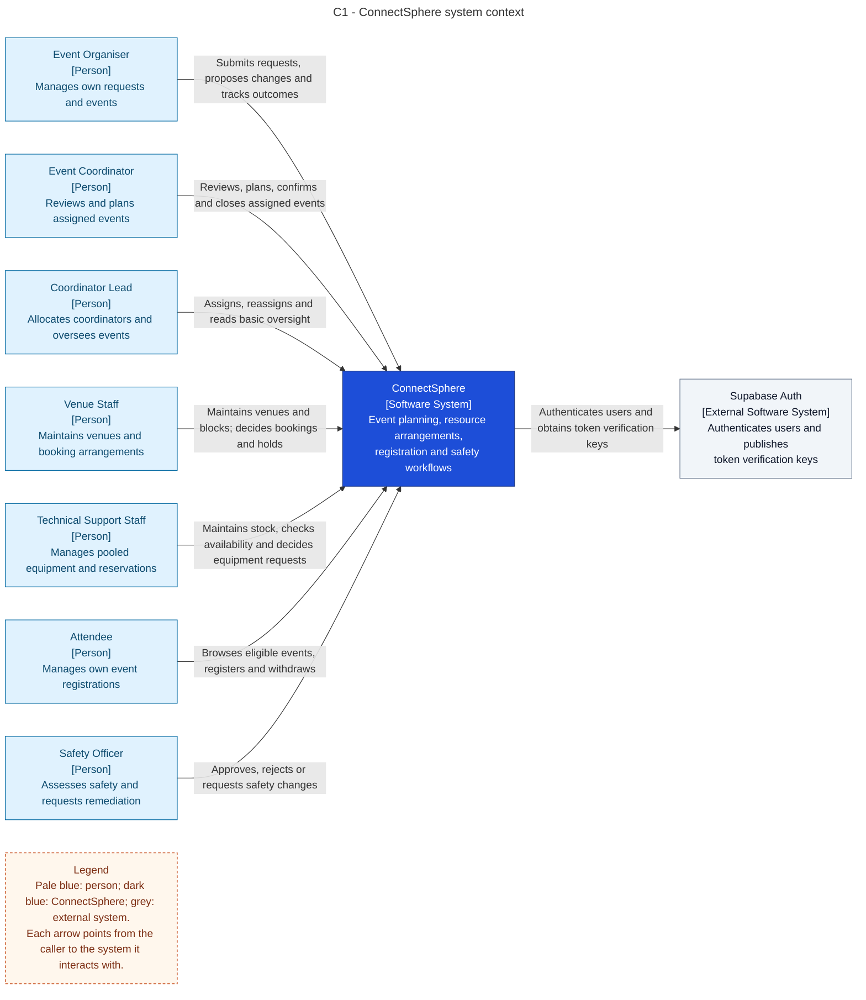

## C4 containers

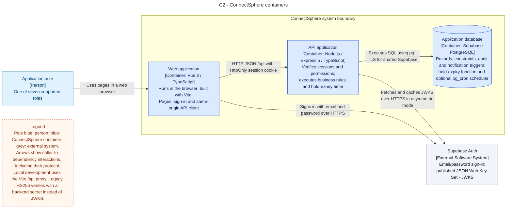

In local development Vite proxies `/api` to Express; the browser needs no database credentials or direct database access. Supabase hosts PostgreSQL, while the frontend and API run locally. Deployment of the frontend and API is not configured. Plan HTTPS and same-origin API routing when deployment enters scope.

Application tables remain in the `public` schema. The deployment instructions call for disabling the unused Supabase Data API. The hardening migration enables row-level security and removes Data API roles’ access to application tables. Express uses its server database connection for application reads/writes and enforces roles, ownership and coordinator assignment. Supabase Auth remains available independently of the Data API.

The browser obtains a Supabase access token through sign-in, clears the temporary SDK session, and exchanges the token at `POST /api/auth/login`. Express verifies the token and stores it in an HttpOnly session cookie, revalidating it for later API calls. The token subject maps through `app_users.supabase_user_id` to the application's trusted ID and role. The cookie expires at the earlier of the token's expiry and the application's five-day cap; automatic session refresh is not implemented. Logout clears the API cookie and local application state; it does not revoke a previously copied access token before its expiry. Public signing keys are retrieved from the project's JWKS; the backend-only HS256 secret is an optional compatibility path for legacy projects.

The API runs the idempotent hold-expiry function at startup and every minute; the shared development database also has the recorded `pg_cron` schedule. These are two callers of the same database operation, not separate booking authorities. Queries stop counting a hold at its database-clock deadline even if a cleanup call has not yet updated its status.

## Module boundaries

| Area | Responsibility and current implementation | Main implementation reference |
| --- | --- | --- |
| auth | Supabase sign-in exchange, verified HttpOnly session, trusted profile/role mapping. Service modules own event-access policies. | [Auth module](../../backend/src/modules/auth/README.md) |
| events | Owned drafts/submission, Lead assignment/handover, clarification, initial review, planning edits and reviewed significant changes; shared readiness, confirmation, cancellation, completion and status history. | [Events module](../../backend/src/modules/events/README.md) |
| venues | Catalogue and buffers, search/calendar, advisory suitability for event or selected arrangement, booking/hold decisions, independent cancellation/replacement, operational blocks and outage recovery. | [Venues module](../../backend/src/modules/venues/README.md) |
| equipment | Stock/loss audit, read-only saved/what-if availability, coordinator request/replacement/cancellation and Technical Support review/full reservation; live readiness, terminal release and restricted technical-remediation work. | [Equipment module](../../backend/src/modules/equipment/README.md) |
| registrations | Confirmed-event eligibility, attendee registration and withdrawal, duplicate/capacity/time guards, attendee records and owner/current-coordinator roster access. | [Registrations module](../../backend/src/modules/registrations/README.md) |
| safety | Versioned review rounds and Safety Officer decisions, requested-area remediation, current approval and preparation gates; immutable baselines and permanent invalidation in migration 023. | [Safety module](../../backend/src/modules/safety/README.md) |
| notifications | Transactional outcome notices, deduplication, recipient/current-target access, inbox and read state. Submission of a significant change is the coordinator's request for action; there is no additional action-request transition. | [Notifications module](../../backend/src/modules/notifications/README.md) |

Routers validate transport input, resolve the actor and call services. Services enforce role, relationship and transition rules and use parameterized SQL through the shared pool or transaction client. This codebase does not introduce a separate repository class for every service. Small input/rule modules isolate deterministic calculations; shared readiness and arrangement-locking helpers coordinate cross-domain transitions. Database constraints and triggers provide additional protection for direct SQL and concurrent writers.

The backend is under `backend/src/modules/`, frontend pages/components under `frontend/src/features/`, and migrations at root in `database/`. Module READMEs retain their dated implementation checkpoints; the table above and mounted routes identify the current scope. The detailed database diagram records schema state, while execution and acceptance remain in the testing and sprint records.

## C4 components (C3)

The API is one process. Every protected router resolves the verified session to the current trusted application profile. KAN-79 allocation reads use their own DTOs rather than widening coordinator review access. The view decomposes the API container; the browser application, Supabase Auth and PostgreSQL are supporting elements outside that boundary. Arrows represent calls/dependencies, not a mandatory request sequence.

```mermaid
---
title: "C3 - Components of the ConnectSphere API"
config:
  layout: elk
---
flowchart LR
  browser["Web application<br/>[Container: Vue 3 / TypeScript]<br/>Browser pages and API clients"]:::container
  identity["Supabase Auth<br/>[External Software System]<br/>Published JSON Web Key Set - JWKS"]:::external
  subgraph apiBoundary["API application - container boundary: Node.js / Express 5 / TypeScript"]
    routes["HTTP routers<br/>[Component: Express / TypeScript]<br/>Session and role gates, input validation,<br/>service dispatch and error mapping"]:::component
    auth["Session authentication<br/>[Component: jose / TypeScript]<br/>Verifies cookie token; loads trusted<br/>application profile and role"]:::component
    subgraph eventModule["Events module"]
      events["Event workflows<br/>[Component: TypeScript]<br/>Drafts, submission, assignment, review,<br/>planning edits, change requests,<br/>lifecycle and access rules"]:::component
      readiness["Readiness and arrangement locks<br/>[Component: TypeScript]<br/>Coordinates live venue, equipment<br/>and pending-change checks"]:::component
    end
    venues["Venue services<br/>[Component: TypeScript]<br/>Catalogue, search, suitability, bookings,<br/>holds, expiry and outage recovery"]:::component
    equipment["Equipment services<br/>[Component: TypeScript]<br/>Stock, availability, requests,<br/>reservation decisions and release"]:::component
    registrations["Registration services<br/>[Component: TypeScript]<br/>Eligibility, capacity, registration,<br/>withdrawal and authorised rosters"]:::component
    subgraph safetyModule["Safety module"]
      safety["Safety reviews and preparation<br/>[Component: TypeScript]<br/>Review rounds, decisions, snapshots<br/>and current-approval gates"]:::component
      remediation["Technical remediation policy<br/>[Component: TypeScript]<br/>Permits confirmed-event equipment edits<br/>during requested technical changes"]:::component
    end
    notifications["Notifications<br/>[Component: TypeScript]<br/>Caller-scoped inbox and read state;<br/>transactional deduplicated notice writer"]:::component
    expiry["Hold-expiry timer<br/>[Component: Node.js / TypeScript]<br/>Calls expiry at startup and every minute"]:::component
    connections["Database connections<br/>[Component: pg / TypeScript]<br/>Shared connection pool and borrowed clients;<br/>SQL queries and transaction execution"]:::component
  end
  db[("Application database<br/>[Container: Supabase PostgreSQL]<br/>Records, integrity guards and audit;<br/>SQL notification and safety-invalidation triggers;<br/>expiry function and optional database pg_cron")]:::container
  browser -->|HTTP JSON /api; session cookie| routes
  routes -->|Verifies session and actor| auth
  routes -->|Queries public database-readiness status| connections
  routes -->|Calls event workflows| events
  routes -->|Calls venue services| venues
  routes -->|Calls equipment services| equipment
  routes -->|Calls registration services| registrations
  routes -->|Calls safety and preparation| safety
  routes -->|Lists inbox; marks notices read| notifications
  auth -->|HTTPS: cached JWKS in asymmetric mode| identity
  auth -->|Queries trusted profile| connections
  events -->|Checks readiness; locks arrangements| readiness
  safety -->|Reuses readiness and locks| readiness
  readiness -->|Checks live venue readiness| venues
  readiness -->|Reads equipment readiness| equipment
  readiness -->|Runs readiness and lock SQL| connections
  equipment -->|Checks technical edit policy| remediation
  remediation -->|Reads latest safety round| connections
  events -->|Calls notice writer| notifications
  venues -->|Calls notice writer| notifications
  equipment -->|Calls notice writer| notifications
  safety -->|Calls notice writer| notifications
  events -->|Pool reads; transaction writes| connections
  venues -->|Pool/client queries; expiry SQL| connections
  equipment -->|Pool/client queries| connections
  registrations -->|Reads; writes under locks| connections
  safety -->|Review and preparation SQL| connections
  notifications -->|Inbox reads; caller-client inserts| connections
  expiry -->|Calls expiry wrapper| venues
  connections -->|PostgreSQL via pg; TLS for shared Supabase| db
  key["Legend<br/>Pale blue: API component; blue: supporting container; grey: external system.<br/>Labelled arrows show calls/dependencies. Nested groups identify module ownership.<br/>SQL triggers and pg_cron execute inside PostgreSQL. Legacy HS256 uses a backend secret instead of JWKS."]:::legend
  classDef component fill:#eff6ff,stroke:#2563eb,color:#172554
  classDef container fill:#dbeafe,stroke:#1d4ed8,color:#172554
  classDef external fill:#f1f5f9,stroke:#64748b,color:#0f172a
  classDef legend fill:#fff7ed,stroke:#c2410c,color:#7c2d12,stroke-dasharray:4 3
```

<details>
<summary>C3 overview source (slide-sized, rendered 6 November 2026)</summary>

Identical to the C3 source above except for the title, the legend sentence about labels, and arrows without labels.

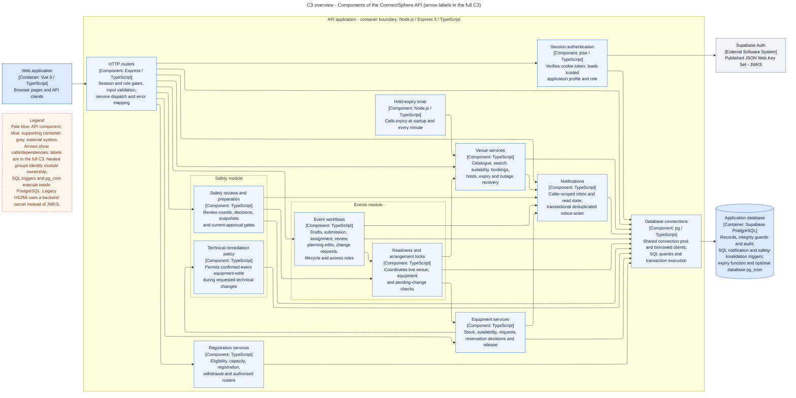

</details>

The authentication component verifies the session and maps its subject to the current application profile. HTTP handlers apply route-level role gates; services and their policy helpers enforce role, ownership, assignment and transition rules, including checks under database locks. Public health endpoints and the sign-in exchange are exceptions to the protected-route session gate. The Auth dependency retrieves and caches public verification keys; token verification itself is local. The optional legacy HS256 mode uses a backend secret instead.

Database connections represents the shared `pg.Pool` and its borrowed clients, not a repository/service layer that owns business rules or lock ordering. Read-only searches, availability and queues can call `pool.query` directly. Services execute parameterized SQL and choose their locks; `inActorTransaction` and the older explicit transaction bodies manage begin/commit/rollback. Readiness and arrangement-lock helpers live in the events module (`confirmation.ts`, `arrangement-locks.ts`); source-revision policies remain with their event, venue and equipment consumers. The equipment services call the separate `safety/remediation.ts` policy when considering technical edits on a confirmed event.

Assignment services use parameterized SQL through the shared pool; queue/oversight reads have no write side effects. Reassignment checks the active-history version under event/history locks before changing linkage. Assignment, clarification and status-history reads hold a shared event lock across authorisation and their data query; a handover cannot expose newly protected rows through an earlier permission check. Event, venue, equipment and safety services call the KAN-64 writer with their existing transaction client: business changes and notification rows commit or roll back together. A unique recipient/outcome key suppresses duplicate writer inserts. Registration/withdrawal, final event confirmation and stock-shortfall notices use the database triggers in migration 019 instead; event cancellation uses the application writer; expiry notices are written within `expire_venue_holds()`. These SQL writers run inside PostgreSQL in the source transaction, not as API components or separate delivery workers. Inbox queries recheck the current recipient, role and target access. Delivery is in-app polling.

The API timer calls the venue expiry wrapper, which executes `SELECT expire_venue_holds()`. The optional database `pg_cron` job calls that same function independently inside PostgreSQL. The shared job's last verified configuration is recorded in [the database setup evidence](../scrum/sprint-03/evidence/supabase-hold-expiry-20261025.json); the diagram does not assert a fresh check of running infrastructure.

Availability and suitability are advisory reads; booking, reservation, confirmation and safety writes re-evaluate live state under their own locks. Readiness combines venue, equipment and pending-change state without treating advisory success as permission to commit. Technical remediation on a confirmed event is restricted to a current changes-requested safety round that names the technical area; normal request/reservation editing remains subject to its lifecycle restrictions.

Safety decisions retain immutable reviewed snapshots. Current approval requires matching arrangement/context fingerprints, live readiness and no permanent invalidation. Migration 023 records invalidation in the source transaction without adding reverse-order event/review locks to stock or venue writes. Restoring an approved value does not restore the approval. Pending-round restoration and post-decision invalidation remain distinct rules.

<details>
<summary>Original equipment integration checkpoint — retained verbatim</summary>

KAN-9's equipment service has its own minimal approved/confirmed event projection rather than widening shared event-detail access. One SQL statement reads source requirements, saved requests, stock and relevant reservations; the service validates the source version and calculates advisory quantities without joining a write transaction or notification flow. What-if input is explicitly unsaved; saved input reloads persisted lines and excludes only its own reserved IDs. Migration 014 provides damaged/maintenance quantities. KAN-26 uses a separate mutation service for full saved requests on approved events, locking current source/pools/lines before checking capacity and writing notices. Migration 015 protects operational stock, immutable allocation/release history and one-time terminal release. KAN-63 adds coordinator request entry and Technical Support review, using explicit manual release metadata for cancellation/replacement. KAN-62 changes event status in the same transaction as its audit and notices; the migration-015 trigger releases RESERVED equipment while KAN-62 cancels remaining REQUESTED/REJECTED lines. Migration 018 adds the remaining event/request planning state.

</details>

## Design decisions and trade-offs

Each row records a significant choice, why it was made, what it costs, and where it is implemented. Earlier checkpoints are retained under [Earlier design notes](#earlier-design-notes-historical).

| Current choice | Reason and tradeoff | Implementation boundary |
| --- | --- | --- |
| One modular monolith and database | Cross-domain actions can share a transaction and local setup stays manageable. Modules are not independently deployed or scaled. | `backend/src/app.ts`, `runtime-app.ts`; explicit services under `modules/` |
| TypeScript with runtime boundary validation | Shared language reduces translation, but static types cannot validate HTTP data or enforce permissions. | Router/input modules plus trusted server policies |
| Supabase identity with local application profiles | Signing verification proves identity; the current `app_users` row determines role and relationships. Session expiry and logout semantics remain explicit. | `modules/auth/supabase.ts`, `router.ts`, `session.ts` |
| Explicit SQL, transactions and database invariants | Ordered locks and constraints protect competing writes; SQL and migration maintenance require deliberate review. This is not an ORM repository layer. | Workflow services, `workflow-support.ts`, forward-only checksummed migrations |
| Optimistic revisions plus locked revalidation | Stale forms fail without overwriting newer state; locks protect the final decision. A previously successful advisory read cannot authorize a later write. | Event revisions, assignment version, booking/source fingerprints and equipment plan revision |
| Current assignment controls event authority | A handover changes access immediately while preserving assignment history. Lead oversight uses limited projections instead of coordinator powers. | Assignment service and shared event-access policies |
| Advisory assessments separate from binding decisions | Suitability and equipment availability explain current constraints; reservation/confirmation/safety check live state again. Suitability does not silently impose a new automatic capacity-refusal policy. | Venue suitability, equipment availability, booking/reservation and readiness services |
| Atomic in-app outcome notices | Business outcomes and deduplicated notices commit or roll back together. Inbox reads recheck current access; there is no email delivery service or outbox worker. | Notification writer, outcome triggers and inbox service |
| Independent venue arrangements with shared readiness | Each booking retains its own interval, layout, cancellation/replacement and decision. Event confirmation aggregates live arrangement requirements. | Venue booking services and `eventReadiness` |
| Versioned safety evidence and permanent invalidation | Decisions remain immutable; changes after approval require a fresh round even if values are restored. Migration 023 cannot reconstruct already-restored pre-upgrade changes. | Safety service, migrations 021–023 and preparation gate |
| Database-clock holds with idempotent expiry | Reads stop counting expired holds immediately. API timer and `pg_cron` may safely call the same function; late cleanup cannot extend a hold. | Hold expiry function and `hold-expiry-scheduler.ts` |
| Frontend responses belong to their initiating context | Route/account changes discard stale reads and writes. Failed write reconciliation disables decisions until current server state is known. | Session generation and safety/planning page request guards |

Current lifecycle transitions cover `DRAFT`, `SUBMITTED`, `UNDER_REVIEW`, `CLARIFICATION_REQUESTED`, `APPROVED`, `REJECTED`, `CONFIRMED`, `CANCELLED` and `COMPLETED`. Initial approval accepts the event request; confirmation requires ready arrangements; preparation additionally requires current safety approval. Cancellation and completion retain history and release relevant allocations rather than deleting planning records.

## Design principles and patterns

| Principle or pattern | Where it is applied | Why it was chosen |
| --- | --- | --- |
| Modular monolith with domain modules | `backend/src/modules/{auth,events,venues,equipment,registrations,safety,notifications}`; one Express process and one database | Cross-domain actions (confirmation, cancellation, safety) can share one transaction; each module still owns its rules and SQL |
| Layered router → service → SQL | Routers wrap handlers in `workflowRoute` (`events/workflow-http.ts`) for session, role and input checks; services enforce business rules; parameterized SQL through `pg` | Transport concerns stay out of business rules, and the same service is reused by several routes and tests |
| Dependency injection | `createApp` (`app.ts`) and every `create*Router(dependencies)` receive their database and auth dependencies | Unit and integration tests replace the database or identity provider without changing production code |
| Pure rule modules (policy objects) | `suitability-rules.ts`, `availability-rules.ts`, `stock-rules.ts`, `registration-rules.ts`, `planning-edit-policy.ts`, `safety/remediation.ts` | Deterministic decisions are isolated from I/O, so they are unit tested directly and reused by reads and writes |
| Optimistic concurrency with revision tokens | `event_requests.revision` (migration 016), `equipment_types.stock_revision` (020); clients send `expectedRevision` | A stale form fails with a conflict instead of overwriting newer data |
| Pessimistic row locks in a fixed order | `lockEventRequest` (`events/workflow-support.ts`), `events/arrangement-locks.ts`; `FOR UPDATE` in 19 service files | Concurrent bookings, reservations and confirmations cannot both succeed against the same capacity |
| Unit of work for business change and notification | `inActorTransaction` (`events/workflow-support.ts`); the notice writer (`notifications/notify.ts`) takes the caller's transaction client; migration 019 triggers | An outcome and its notice commit or roll back together, so users are never notified of a change that did not happen |
| Idempotent operations | The API timer and `pg_cron` both call `expire_venue_holds()`. Mark-as-read keeps the first `readAt`. | Repeating a withdrawal returns `changed: false` while the event is open and before its start. At or after the start, or for a cancelled or completed event, the service refuses even a repeat. [Withdrawal logic](../../backend/src/modules/registrations/service.ts) |
| Advisory read vs binding write | Suitability and equipment availability are read-only; booking, reservation, confirmation and safety writes re-check live state under locks | A successful check never authorizes a later write on its own |
| Immutable audit and snapshot evidence | `event_status_history`, `equipment_stock_changes`, safety review fingerprints and baselines (021–023), `safety_approval_invalidations` | Decisions remain explainable after later changes; restoring a value cannot silently restore an approval |
| Defence in depth | The API checks the role and the caller’s relationship to the event. PostgreSQL constraints protect data integrity. Deployment instructions call for disabling the unused Data API. Migration 002 restricts direct table access by its roles. | For example, the roster service checks that the caller owns the event or is its assigned coordinator before returning attendee details. [Roster check](../../backend/src/modules/registrations/service.ts) · [Database access restrictions](../../database/migrations/002_restrict_data_api_access.sql) |

## Customer changes and design impact

The six Week 7 customer changes were received on **2 October 2026** and are traced to stories in the [change register](../requirements/change-requests.md). The table shows how the existing structure absorbed each change.

| Change | Design response | Where it shows in the design | What was preserved |
| --- | --- | --- | --- |
| **CR-1** Setup and turnaround buffers (KAN-77, KAN-78) | Venues store buffer minutes; occupancy and conflict checks use buffered intervals, with booking-time snapshots | Migrations 009 and 012; venue services; [venue write locking](#venue-writers---gates-precede-booking-and-event-row-locks) | Existing access rules and booking decisions; event-only times remain visible |
| **CR-2** Booked venue becomes unavailable (KAN-81) | An outage over approved bookings is recorded with impact rows and recovery actions instead of being refused | Migration 010; `venues/outage-impact.ts`; [venue outage sequence](#venue-outage---preserve-approved-booking-and-recover-arrangements) | Approved history is kept; an outage is not a silent cancellation; unaffected arrangements are untouched |
| **CR-3** Independent venue arrangements (KAN-82) | Each booking has its own interval, layout, cancellation and linked replacement; confirmation aggregates live readiness | Migration 011; readiness and arrangement locks in C3; [event confirmation](#event-confirmation---live-readiness-under-shared-arrangement-locks) | Acting on one arrangement never changes another; event-wide cancellation stays separate |
| **CR-4** Expiring temporary holds (KAN-83) | Explicit live holds with a database-clock deadline and idempotent expiry | Migration 013; hold-expiry timer in C2/C3; [venue hold sequence](#venue-temporary-hold---deadline-and-automatic-expiry) | Ordinary pending requests still reserve nothing; late cleanup cannot extend a hold |
| **CR-5** Coordinator Lead allocation (KAN-79, KAN-65) | New role; submissions enter a Lead queue; versioned handover with a required reason | Migration 007; Coordinator Lead in C1; [lead allocation sequence](#lead-allocation-and-handover---versioned-assignment-history) | Original automatic assignment (KAN-29) is kept as history; current assignment controls access |
| **CR-6** Safety review (KAN-84) | New Safety Officer role; review rounds bound to an arrangement fingerprint; preparation requires current approval; later changes invalidate approval permanently | Migrations 021–023; safety module and remediation policy in C3; [safety review sequence](#safety-review-rounds-and-preparation---current-approval-required) | Safety approval stays distinct from initial approval and advisory suitability |

The modular structure meant each change landed mainly in one module plus shared readiness, which is the trade-off recorded in [Design decisions and trade-offs](#design-decisions-and-trade-offs).

## Current design reference — 6 November 2026

[Open the diagram gallery](exports/index.html) to browse the current PNG and SVG exports.

These class, sequence and domain data views describe source build `fb6d8d93f721b114accc9857a05d62e859987e23` and migrations 001–023. The C1–C3 sources above retain the preceding C4 accuracy corrections. [Current API contract](api-contract.md) · [Complete data model and column dictionary](../database-diagram.md) · [Node and connection audit](../scrum/sprint-03/evidence/design-audit-20261106/README.md).

Originals are preserved separately: [genuine Pre-Week 7 customer changes, 1 October](archive/pre-week-7-customer-changes/README.md) and [before this update, including existing Week 7 models](archive/before-2026-11-06-update/README.md). Class and sequence diagrams are **Not recorded** in the genuine pre-change snapshot; later diagrams have not been relabelled as pre-change evidence.

## Class diagram

This is a domain model of **22 persisted SQL record types**, not a runtime class hierarchy or ORM. The implementation uses TypeScript services/types and explicit SQL. The complete view contains all **55 declared FK associations**, including actor roles, optional notification references, equipment stock history, clarification/edit history, preparation’s review reference and the three safety supplement records. Class names are title-cased SQL table names; attribute names retain their actual SQL spelling. No derived projection is depicted as a persisted class.

Association labels use `column [parents per child / children per parent]`; source is the referenced parent and arrow target is the FK-owning child. Cardinalities are placed with each label so the many independent user-actor references remain readable. Types use Mermaid-safe aliases (`textArray` = `text[]`, `timestamptz` = timestamp with time zone). Multiplicities describe the migrated SQL constraints: nullable FK → zero/one parent; required FK → one parent; a parent can have zero/many children unless the child FK is unique. No composition or inheritance is inferred. In particular, initial reviews are not SQL-enforced one-per-event; cancellations and safety supplements use shared primary keys. The diagram curates scalar fields; the [dictionary](../database-diagram.md#column-dictionary) lists all columns, SQL types, defaults and nullability. The domain detail views show additional attributes and retain each child table’s complete FK set.

### Domain records - all 22 persisted application records

```mermaid
---
config:
  layout: elk
title: Domain records - all 22 persisted application records
---
classDiagram
  direction TB
  class AppUsers {
    <<SQL record>>
    uuid id
    text role
  }
  class CoordinatorAssignments {
    <<SQL record>>
    uuid id
    uuid event_request_id
    uuid coordinator_id
    uuid assigned_by
    text assignment_method
  }
  class EquipmentRequests {
    <<SQL record>>
    uuid id
    uuid event_request_id
    uuid equipment_type_id
    uuid requested_by
    integer quantity
    text status
    timestamptz starts_at
    timestamptz ends_at
    uuid decided_by
    uuid released_by
    integer revision
  }
  class EquipmentStockChanges {
    <<SQL record>>
    uuid id
    uuid equipment_type_id
    integer revision
    uuid changed_by
  }
  class EquipmentTypes {
    <<SQL record>>
    uuid id
    integer total_quantity
    integer damaged_quantity
    integer maintenance_quantity
  }
  class EventCancellations {
    <<SQL record>>
    uuid event_request_id
    uuid cancelled_by
  }
  class EventChangeRequests {
    <<SQL record>>
    uuid id
    uuid event_request_id
    uuid requested_by
    text status
    uuid decided_by
  }
  class EventClarifications {
    <<SQL record>>
    uuid id
    uuid event_request_id
    uuid requested_by
  }
  class EventRegistrations {
    <<SQL record>>
    uuid id
    uuid event_request_id
    uuid attendee_id
    text status
  }
  class EventRequestEdits {
    <<SQL record>>
    uuid id
    uuid event_request_id
    integer revision
    uuid edited_by
  }
  class EventRequests {
    <<SQL record>>
    uuid id
    uuid organiser_id
    uuid coordinator_id
    text status
    timestamptz starts_at
    timestamptz ends_at
    integer revision
    text equipment_plan_status
    uuid preparation_started_by
    uuid preparation_safety_review_id
  }
  class EventReviews {
    <<SQL record>>
    uuid id
    uuid event_request_id
    uuid reviewed_by
  }
  class EventStatusHistory {
    <<SQL record>>
    uuid id
    uuid event_request_id
    uuid changed_by
  }
  class Notifications {
    <<SQL record>>
    uuid id
    uuid recipient_id
    uuid event_request_id
    uuid venue_booking_id
    uuid equipment_request_id
    uuid registration_id
    uuid change_request_id
    uuid safety_review_id
  }
  class SafetyApprovalInvalidations {
    <<SQL record>>
    uuid review_id
  }
  class SafetyReviewChangeBaselines {
    <<SQL record>>
    uuid review_id
  }
  class SafetyReviewContextBaselines {
    <<SQL record>>
    uuid review_id
  }
  class SafetyReviews {
    <<SQL record>>
    uuid id
    uuid event_request_id
    integer round
    text status
    uuid submitted_by
    uuid decided_by
  }
  class VenueBookings {
    <<SQL record>>
    uuid id
    uuid event_request_id
    uuid venue_id
    uuid requested_by
    text status
    timestamptz starts_at
    timestamptz ends_at
    uuid decided_by
    uuid replaces_booking_id
    timestamptz hold_expires_at
    uuid held_by
    uuid cancelled_by
  }
  class VenueOutageImpacts {
    <<SQL record>>
    uuid id
    uuid unavailability_id
    uuid venue_booking_id
    uuid venue_id
    text status
    uuid recorded_by
  }
  class VenueUnavailability {
    <<SQL record>>
    uuid id
    uuid venue_id
    timestamptz starts_at
    timestamptz ends_at
    uuid created_by
  }
  class Venues {
    <<SQL record>>
    uuid id
    integer setup_minutes
    integer turnaround_minutes
  }
  AppUsers --> CoordinatorAssignments : assigned_by [0..1 / 0..*]
  AppUsers --> CoordinatorAssignments : coordinator_id [1 / 0..*]
  EventRequests --> CoordinatorAssignments : event_request_id [1 / 0..*]
  AppUsers --> EquipmentRequests : decided_by [0..1 / 0..*]
  EquipmentTypes --> EquipmentRequests : equipment_type_id [1 / 0..*]
  EventRequests --> EquipmentRequests : event_request_id [1 / 0..*]
  AppUsers --> EquipmentRequests : released_by [0..1 / 0..*]
  AppUsers --> EquipmentRequests : requested_by [1 / 0..*]
  AppUsers --> EquipmentStockChanges : changed_by [1 / 0..*]
  EquipmentTypes --> EquipmentStockChanges : equipment_type_id [1 / 0..*]
  AppUsers --> EventCancellations : cancelled_by [1 / 0..*]
  EventRequests --> EventCancellations : event_request_id [1 / 0..1]
  AppUsers --> EventChangeRequests : decided_by [0..1 / 0..*]
  EventRequests --> EventChangeRequests : event_request_id [1 / 0..*]
  AppUsers --> EventChangeRequests : requested_by [1 / 0..*]
  EventRequests --> EventClarifications : event_request_id [1 / 0..*]
  AppUsers --> EventClarifications : requested_by [1 / 0..*]
  AppUsers --> EventRegistrations : attendee_id [1 / 0..*]
  EventRequests --> EventRegistrations : event_request_id [1 / 0..*]
  AppUsers --> EventRequestEdits : edited_by [1 / 0..*]
  EventRequests --> EventRequestEdits : event_request_id [1 / 0..*]
  AppUsers --> EventRequests : coordinator_id [0..1 / 0..*]
  AppUsers --> EventRequests : organiser_id [1 / 0..*]
  SafetyReviews --> EventRequests : preparation_safety_review_id [0..1 / 0..*]
  AppUsers --> EventRequests : preparation_started_by [0..1 / 0..*]
  EventRequests --> EventReviews : event_request_id [1 / 0..*]
  AppUsers --> EventReviews : reviewed_by [1 / 0..*]
  AppUsers --> EventStatusHistory : changed_by [0..1 / 0..*]
  EventRequests --> EventStatusHistory : event_request_id [1 / 0..*]
  EventChangeRequests --> Notifications : change_request_id [0..1 / 0..*]
  EquipmentRequests --> Notifications : equipment_request_id [0..1 / 0..*]
  EventRequests --> Notifications : event_request_id [0..1 / 0..*]
  AppUsers --> Notifications : recipient_id [1 / 0..*]
  EventRegistrations --> Notifications : registration_id [0..1 / 0..*]
  SafetyReviews --> Notifications : safety_review_id [0..1 / 0..*]
  VenueBookings --> Notifications : venue_booking_id [0..1 / 0..*]
  SafetyReviews --> SafetyApprovalInvalidations : review_id [1 / 0..1]
  SafetyReviews --> SafetyReviewChangeBaselines : review_id [1 / 0..1]
  SafetyReviews --> SafetyReviewContextBaselines : review_id [1 / 0..1]
  AppUsers --> SafetyReviews : decided_by [0..1 / 0..*]
  EventRequests --> SafetyReviews : event_request_id [1 / 0..*]
  AppUsers --> SafetyReviews : submitted_by [1 / 0..*]
  AppUsers --> VenueBookings : cancelled_by [0..1 / 0..*]
  AppUsers --> VenueBookings : decided_by [0..1 / 0..*]
  EventRequests --> VenueBookings : event_request_id [1 / 0..*]
  AppUsers --> VenueBookings : held_by [0..1 / 0..*]
  VenueBookings --> VenueBookings : replaces_booking_id [0..1 / 0..*]
  AppUsers --> VenueBookings : requested_by [1 / 0..*]
  Venues --> VenueBookings : venue_id [1 / 0..*]
  AppUsers --> VenueOutageImpacts : recorded_by [0..1 / 0..*]
  VenueUnavailability --> VenueOutageImpacts : unavailability_id [0..1 / 0..*]
  VenueBookings --> VenueOutageImpacts : venue_booking_id [1 / 0..*]
  Venues --> VenueOutageImpacts : venue_id [1 / 0..*]
  AppUsers --> VenueUnavailability : created_by [0..1 / 0..*]
  Venues --> VenueUnavailability : venue_id [1 / 0..*]
```

[PNG](exports/class.png) · [SVG](exports/class.svg)

### Domain detail - events

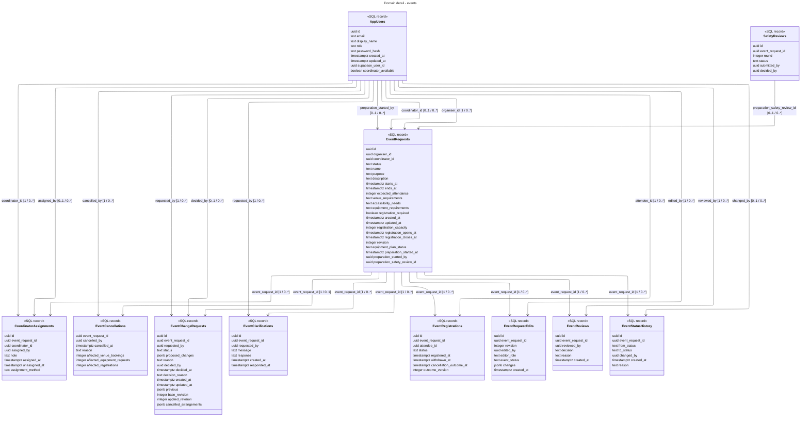

[PNG](exports/class-events.png) · [SVG](exports/class-events.svg)

### Domain detail - planning

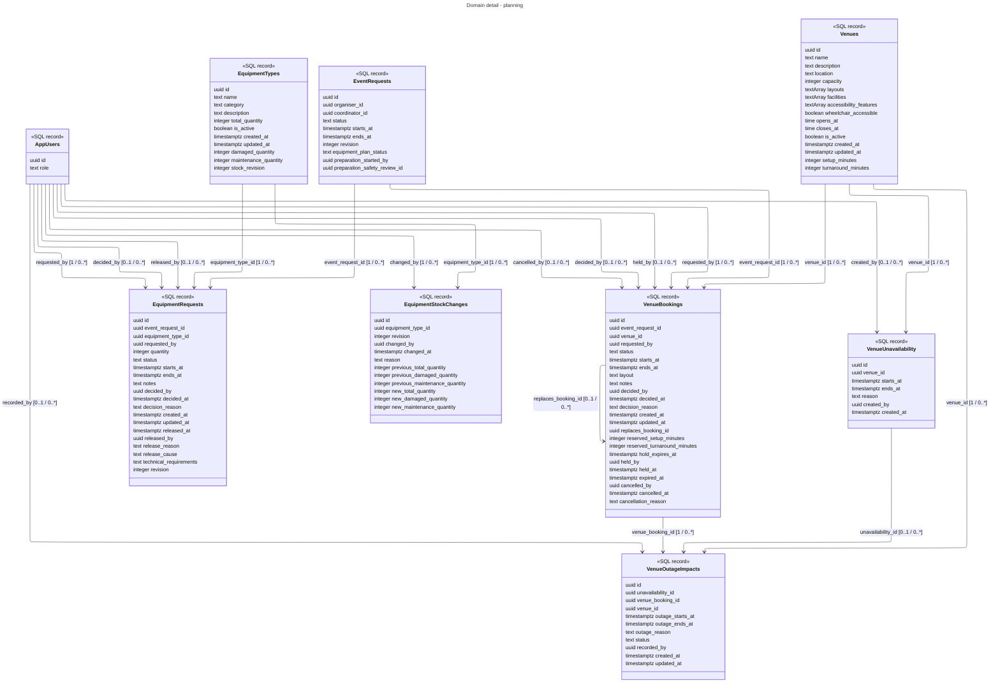

[PNG](exports/class-planning.png) · [SVG](exports/class-planning.svg)

### Domain detail - safety

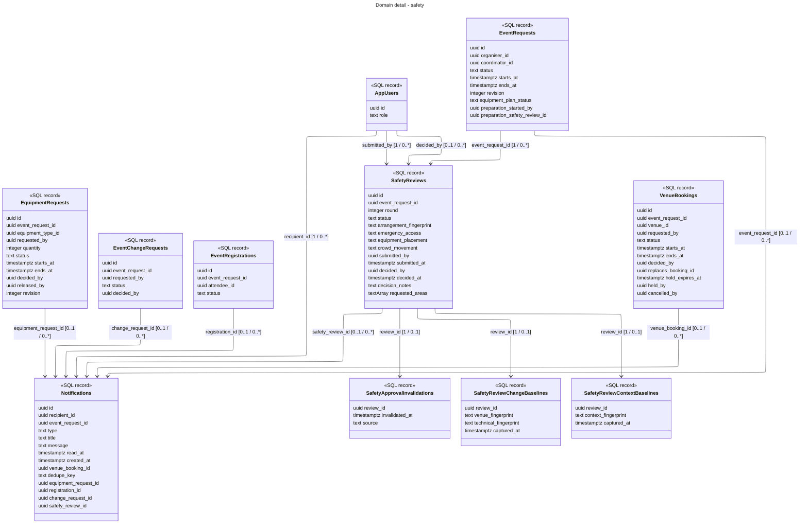

[PNG](exports/class-safety.png) · [SVG](exports/class-safety.svg)

## Current workflow sequences

The [original sequence audit](../scrum/sprint-03/evidence/design-audit-20261106/sequence-audit.json) maps participants and messages in the integrated version to source. Four sequences were refined during submission review. Their [correction table](#diagram-exports) links to the frozen services and identifies both Mermaid versions. Each diagram groups related SQL calls and validations while showing the order of authorisation, transaction boundaries and notification writes. “Client” denotes the caller of the HTTP API. The server resolves identity and checks ownership, state and versions before allowing changes.

### Registration withdrawal - owned record and event-start cutoff

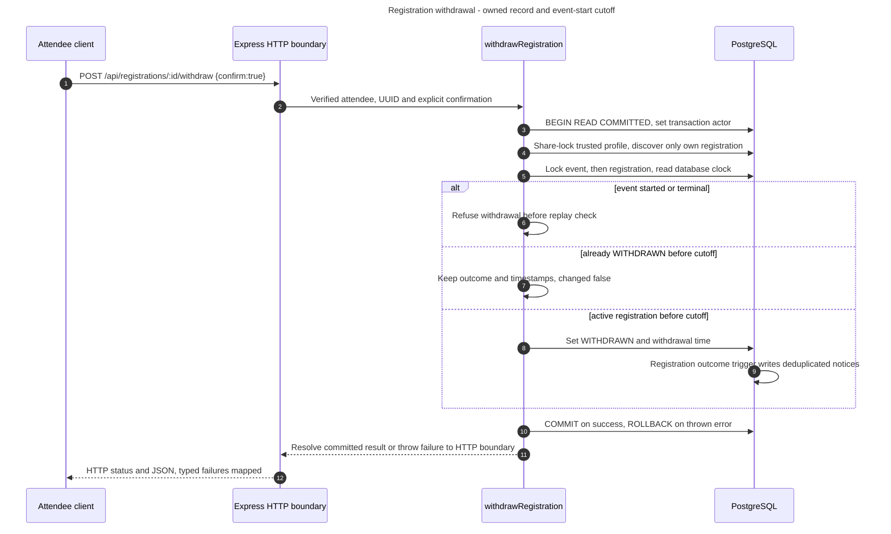

[PNG](exports/seq-registration-withdrawal.png) · [SVG](exports/seq-registration-withdrawal.svg)

Only an active owned registration can change. A replay after the event-start cutoff is refused. Capacity comes from active rows; no stock-style counter is incremented. Notices are stored in the same transaction, with no push to an inbox client.

### Event confirmation - live readiness under shared arrangement locks

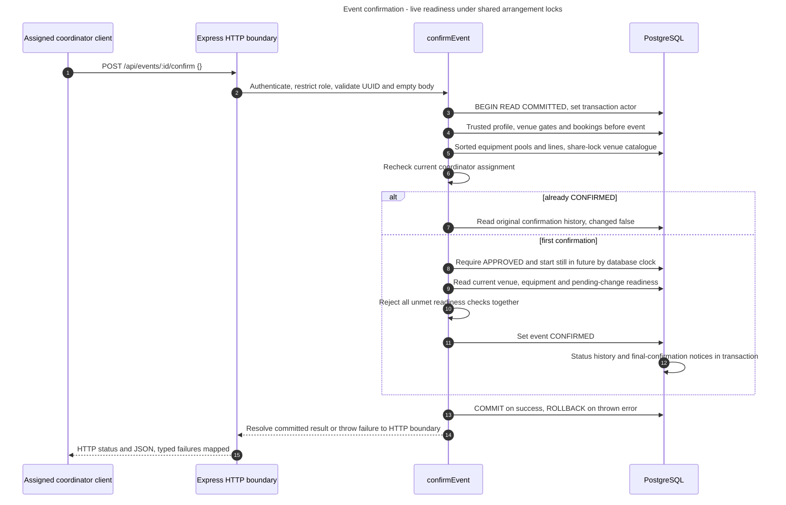

[PNG](exports/seq-event-confirmation.png) · [SVG](exports/seq-event-confirmation.svg)

The already-confirmed branch precedes first-confirmation state, clock and readiness checks. Safety approval is a separate preparation gate; it is not an extra confirmation precondition. GET /confirmation supplies the panel, and POST wraps the result in {confirmation}.

### Event cancellation - arrangements and notices commit together

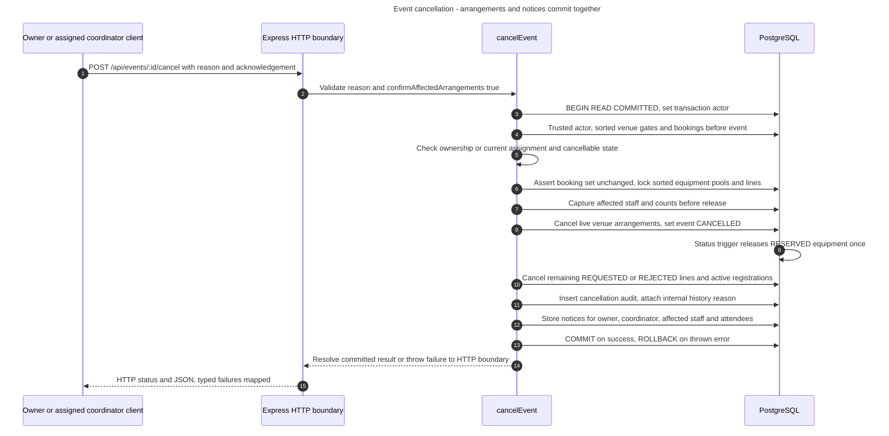

[PNG](exports/seq-event-cancellation-equipment.png) · [SVG](exports/seq-event-cancellation-equipment.svg)

Repeated whole-event cancellation returns a state conflict. Equipment release preserves allocation history and does not increment pooled stock. Attendee notices omit the internal cancellation reason; only affected staff are selected before updates. Completion is shown separately below.

### Lead allocation and handover - versioned assignment history

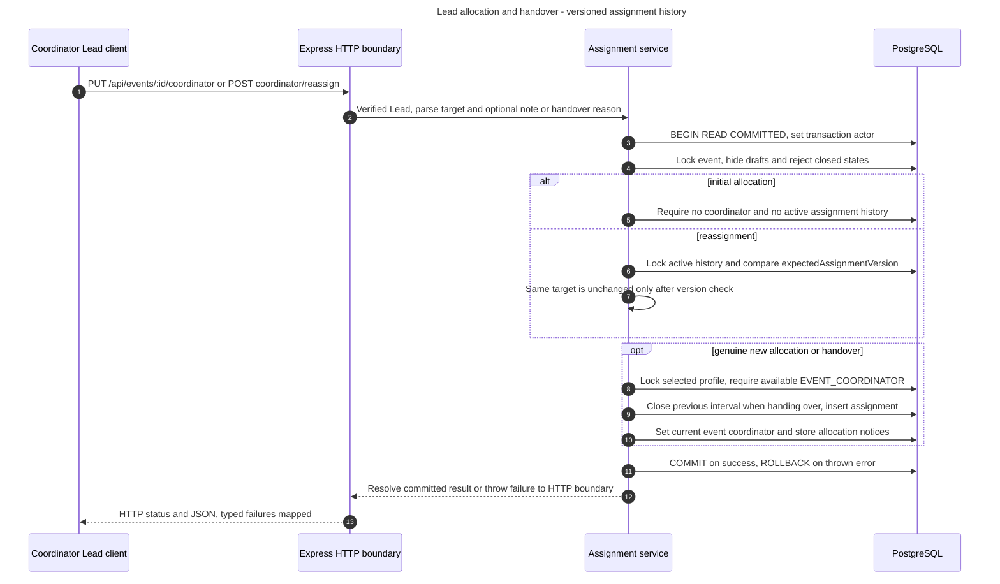

[PNG](exports/seq-lead-assignment.png) · [SVG](exports/seq-lead-assignment.svg)

Initial allocation inserts directly; only reassignment closes a previous interval. Reassignment checks the assignment-row UUID before its same-target no-op, preventing an A → B → A stale form from succeeding. Submission leaves the request unassigned for Lead allocation; historical AUTOMATIC assignment_method rows remain valid history. Lead reads do not widen the ordinary event-detail policy.

### Equipment availability - advisory saved or what-if assessment

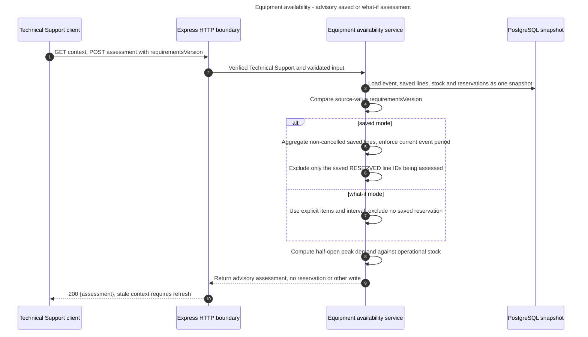

[PNG](exports/seq-equipment-availability.png) · [SVG](exports/seq-equipment-availability.svg)

Each check is a fresh advisory snapshot. Inactive stock is zero; exact adjacency does not overlap. What-if mode includes reservations of the same event. The later reservation action performs its own live locked check.

### Equipment reservation - serialized stock and replay checks

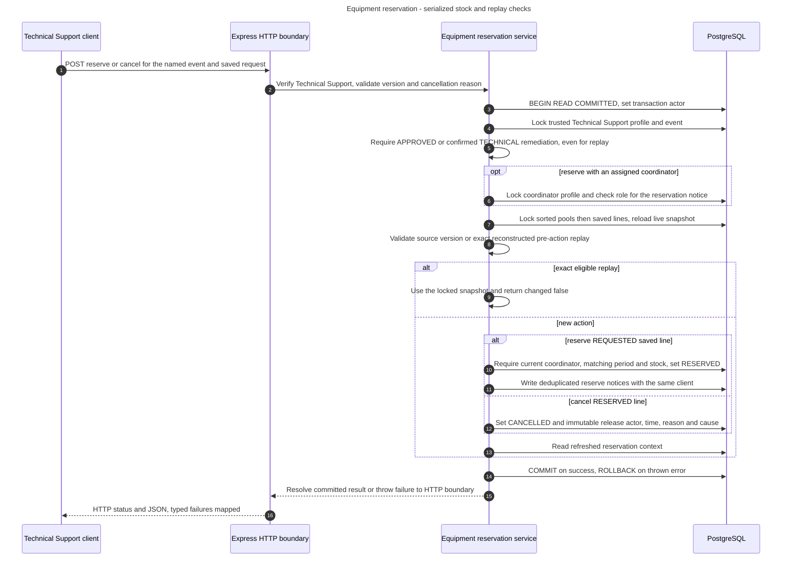

[PNG](exports/seq-equipment-reservation.png) · [SVG](exports/seq-equipment-reservation.svg)

The input never supplies quantity/type/period. An exact eligible replay returns changed:false without rewriting the allocation or release. Both reservation and saved-request mutation services allow APPROVED, or CONFIRMED only while the latest safety round requests TECHNICAL changes. Other confirmed events are read-only. State eligibility is checked before the replay no-op.

### Safety review rounds and preparation - current approval required

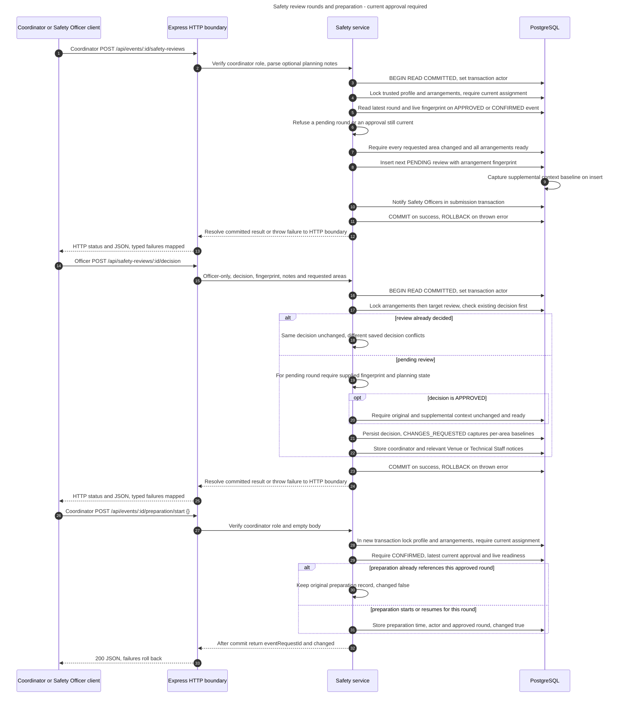

[PNG](exports/seq-safety-review.png) · [SVG](exports/seq-safety-review.svg)

Each HTTP action has its own transaction. Identical decided-round retries are handled before fingerprint validation; pending approval still requires the submitted fingerprint and both live context checks. Requested-area baselines fail closed if missing. Preparation validates current approval before its same-round no-op.

### Venue writers - gates precede booking and event row locks

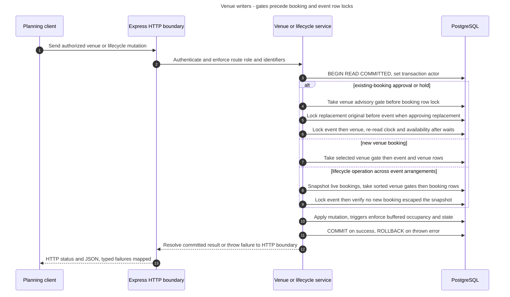

[PNG](exports/seq-venue-write-locking.png) · [SVG](exports/seq-venue-write-locking.svg)

This shows the shared venue-gate ordering, not one universal lock list. The existing-booking branch models approval and hold placement; a rejection skips the approval-only event/venue eligibility checks. Venue catalogue edits lock the venue row and check expected buffer values. Outage writers use gate → venue → overlapping hold rows; they do not lock reverse event/review rows. Confirmation additionally locks equipment rows and share-locks venues. A newly discovered arrangement yields a conflict instead of taking a gate after the event.

### Venue temporary hold - deadline and automatic expiry

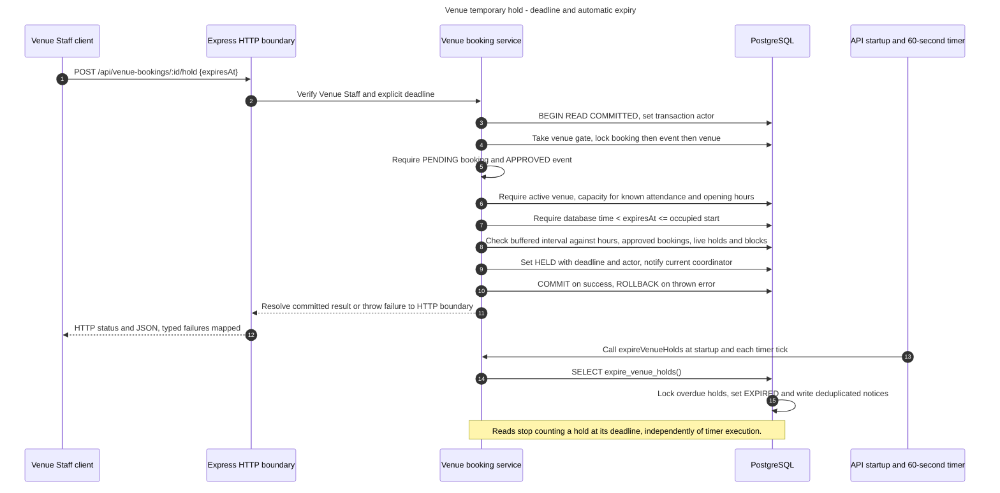

[PNG](exports/seq-venue-hold.png) · [SVG](exports/seq-venue-hold.svg)

An approval must finish its deadline check while owning current locks. Staff cancellation needs a reason; an outage can also release an overlapping live hold. Optional pg_cron is another caller of the same idempotent SQL function, not a required extension or browser timer.

### Venue outage - preserve approved booking and recover arrangements

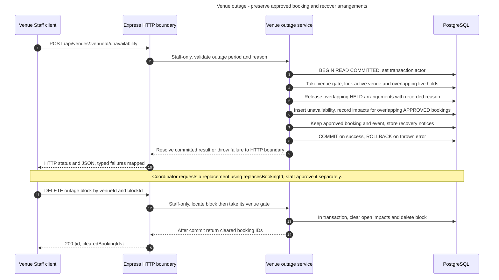

[PNG](exports/seq-venue-recovery.png) · [SVG](exports/seq-venue-recovery.svg)

Approved bookings are retained with RECOVERY_REQUIRED impacts. A successfully approved replacement resolves the original recovery and cancels the superseded arrangement in the booking decision transaction. Removing one block clears only its impacts; other outages can still block readiness. The implemented DELETE looks up blockId and does not verify it belongs to the venueId path segment; documented as a limitation, not silently fixed in a diagram.

### Event completion - ended confirmed event and equipment release

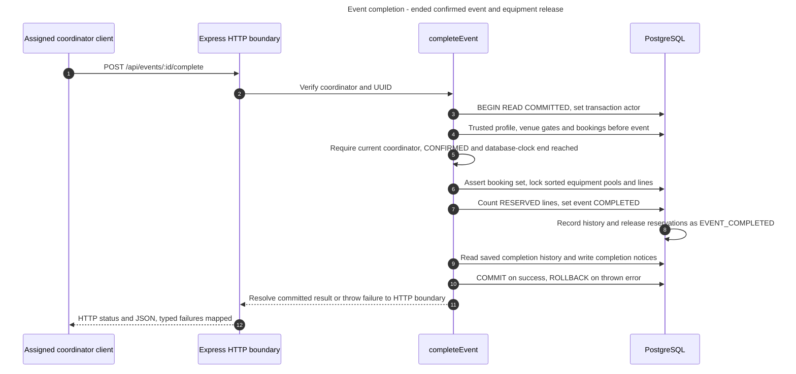

[PNG](exports/seq-event-completion.png) · [SVG](exports/seq-event-completion.svg)

Completion leaves registrations and venue bookings as history; it does not cancel them. Repeated completion conflicts with EVENT_ALREADY_COMPLETED. The route does not inspect the request body. GET /completion returns {completion:null} for unrelated, absent or not-completed records.

### Significant planning change - reviewed revision and arrangement impact

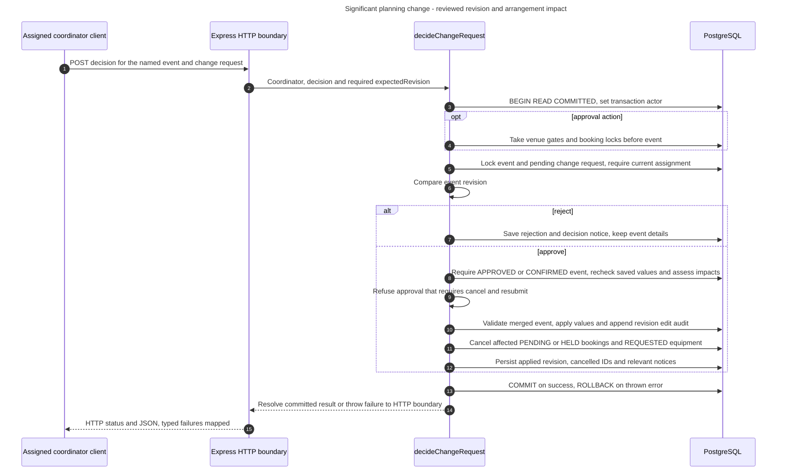

[PNG](exports/seq-planning-change.png) · [SVG](exports/seq-planning-change.svg)

The owner submits the change with `expectedRevision`. The assigned coordinator can reject it even after planning has ended. For approval, the impact check blocks changes that affect an `APPROVED` booking, `RESERVED` equipment or an active registration, and changes that affect arrangements on a `CONFIRMED` event. When approval can proceed, it cancels only the affected `PENDING` or `HELD` bookings and `REQUESTED` equipment. Ordinary name and description edits use `PATCH /api/events/:id`. [Change impact rules](../../backend/src/modules/events/change-request-impact.ts) · [Decision transaction](../../backend/src/modules/events/change-requests.ts)

## Current domain data views

These are readable slices of the physical data model. All attributes of each slice’s primary tables are shown; referenced tables outside the slice are context nodes with selected keys. Relationships are included for every FK whose child belongs to the slice. The [complete model](../database-diagram.md#complete-relationship-model) covers all 24 tables, including two infrastructure tables, and all 55 FKs. A layout edge or near placement never creates a relationship; only the drawn, named FK does.

### Physical model - events detail

```mermaid
---
config:
  layout: elk
title: Physical model - events detail
---
erDiagram
  direction TB
  app_users {
    uuid id PK "NOT NULL"
    text email "NOT NULL"
    text display_name "NOT NULL"
    text role "NOT NULL"
    text password_hash "nullable"
    timestamptz created_at "NOT NULL"
    timestamptz updated_at "NOT NULL"
    uuid supabase_user_id "nullable"
    boolean coordinator_available "NOT NULL"
  }
  coordinator_assignments {
    uuid id PK "NOT NULL"
    uuid event_request_id FK "NOT NULL"
    uuid coordinator_id FK "NOT NULL"
    uuid assigned_by FK "nullable"
    text note "nullable"
    timestamptz assigned_at "NOT NULL"
    timestamptz unassigned_at "nullable"
    text assignment_method "NOT NULL"
  }
  event_cancellations {
    uuid event_request_id PK,FK "NOT NULL"
    uuid cancelled_by FK "NOT NULL"
    timestamptz cancelled_at "NOT NULL"
    text reason "NOT NULL"
    integer affected_venue_bookings "NOT NULL"
    integer affected_equipment_requests "NOT NULL"
    integer affected_registrations "NOT NULL"
  }
  event_change_requests {
    uuid id PK "NOT NULL"
    uuid event_request_id FK "NOT NULL"
    uuid requested_by FK "NOT NULL"
    text status "NOT NULL"
    jsonb proposed_changes "NOT NULL"
    text reason "nullable"
    uuid decided_by FK "nullable"
    timestamptz decided_at "nullable"
    text decision_reason "nullable"
    timestamptz created_at "NOT NULL"
    timestamptz updated_at "NOT NULL"
    jsonb previous "NOT NULL"
    integer base_revision "NOT NULL"
    integer applied_revision "nullable"
    jsonb cancelled_arrangements "nullable"
  }
  event_clarifications {
    uuid id PK "NOT NULL"
    uuid event_request_id FK "NOT NULL"
    uuid requested_by FK "NOT NULL"
    text message "NOT NULL"
    text response "nullable"
    timestamptz created_at "NOT NULL"
    timestamptz responded_at "nullable"
  }
  event_registrations {
    uuid id PK "NOT NULL"
    uuid event_request_id FK "NOT NULL"
    uuid attendee_id FK "NOT NULL"
    text status "NOT NULL"
    timestamptz registered_at "NOT NULL"
    timestamptz withdrawn_at "nullable"
    timestamptz cancellation_outcome_at "nullable"
    integer outcome_version "NOT NULL"
  }
  event_request_edits {
    uuid id PK "NOT NULL"
    uuid event_request_id FK "NOT NULL"
    integer revision "NOT NULL"
    uuid edited_by FK "NOT NULL"
    text editor_role "NOT NULL"
    text event_status "NOT NULL"
    jsonb changes "NOT NULL"
    timestamptz created_at "NOT NULL"
  }
  event_requests {
    uuid id PK "NOT NULL"
    uuid organiser_id FK "NOT NULL"
    uuid coordinator_id FK "nullable"
    text status "NOT NULL"
    text name "nullable"
    text purpose "nullable"
    text description "nullable"
    timestamptz starts_at "nullable"
    timestamptz ends_at "nullable"
    integer expected_attendance "nullable"
    text venue_requirements "nullable"
    text accessibility_needs "nullable"
    text equipment_requirements "nullable"
    boolean registration_required "nullable"
    timestamptz created_at "NOT NULL"
    timestamptz updated_at "NOT NULL"
    integer registration_capacity "nullable"
    timestamptz registration_opens_at "nullable"
    timestamptz registration_closes_at "nullable"
    integer revision "NOT NULL"
    text equipment_plan_status "NOT NULL"
    timestamptz preparation_started_at "nullable"
    uuid preparation_started_by FK "nullable"
    uuid preparation_safety_review_id FK "nullable"
  }
  event_reviews {
    uuid id PK "NOT NULL"
    uuid event_request_id FK "NOT NULL"
    uuid reviewed_by FK "NOT NULL"
    text decision "NOT NULL"
    text reason "nullable"
    timestamptz created_at "NOT NULL"
  }
  event_status_history {
    uuid id PK "NOT NULL"
    uuid event_request_id FK "NOT NULL"
    text from_status "nullable"
    text to_status "NOT NULL"
    uuid changed_by FK "nullable"
    timestamptz created_at "NOT NULL"
    text reason "nullable"
  }
  safety_reviews {
    uuid id PK "NOT NULL"
    uuid event_request_id FK "NOT NULL"
    integer round "NOT NULL"
    text status "NOT NULL"
    uuid submitted_by FK "NOT NULL"
    uuid decided_by FK "nullable"
  }
  app_users |o..o{ coordinator_assignments : "assigned_by"
  app_users ||..o{ coordinator_assignments : "coordinator_id"
  event_requests ||..o{ coordinator_assignments : "event_request_id"
  app_users ||..o{ event_cancellations : "cancelled_by"
  event_requests ||--o| event_cancellations : "event_request_id"
  app_users |o..o{ event_change_requests : "decided_by"
  event_requests ||..o{ event_change_requests : "event_request_id"
  app_users ||..o{ event_change_requests : "requested_by"
  event_requests ||..o{ event_clarifications : "event_request_id"
  app_users ||..o{ event_clarifications : "requested_by"
  app_users ||..o{ event_registrations : "attendee_id"
  event_requests ||..o{ event_registrations : "event_request_id"
  app_users ||..o{ event_request_edits : "edited_by"
  event_requests ||..o{ event_request_edits : "event_request_id"
  app_users |o..o{ event_requests : "coordinator_id"
  app_users ||..o{ event_requests : "organiser_id"
  safety_reviews |o..o{ event_requests : "preparation_safety_review_id"
  app_users |o..o{ event_requests : "preparation_started_by"
  event_requests ||..o{ event_reviews : "event_request_id"
  app_users ||..o{ event_reviews : "reviewed_by"
  app_users |o..o{ event_status_history : "changed_by"
  event_requests ||..o{ event_status_history : "event_request_id"
```

[PNG](exports/erd-events.png) · [SVG](exports/erd-events.svg)

### Physical model - planning detail

```mermaid
---
config:
  layout: elk
title: Physical model - planning detail
---
erDiagram
  direction TB
  app_users {
    uuid id PK "NOT NULL"
    text role "NOT NULL"
  }
  equipment_requests {
    uuid id PK "NOT NULL"
    uuid event_request_id FK "NOT NULL"
    uuid equipment_type_id FK "NOT NULL"
    uuid requested_by FK "NOT NULL"
    integer quantity "NOT NULL"
    text status "NOT NULL"
    timestamptz starts_at "NOT NULL"
    timestamptz ends_at "NOT NULL"
    text notes "nullable"
    uuid decided_by FK "nullable"
    timestamptz decided_at "nullable"
    text decision_reason "nullable"
    timestamptz created_at "NOT NULL"
    timestamptz updated_at "NOT NULL"
    timestamptz released_at "nullable"
    uuid released_by FK "nullable"
    text release_reason "nullable"
    text release_cause "nullable"
    text technical_requirements "nullable"
    integer revision "NOT NULL"
  }
  equipment_stock_changes {
    uuid id PK "NOT NULL"
    uuid equipment_type_id FK "NOT NULL"
    integer revision "NOT NULL"
    uuid changed_by FK "NOT NULL"
    timestamptz changed_at "NOT NULL"
    text reason "NOT NULL"
    integer previous_total_quantity "NOT NULL"
    integer previous_damaged_quantity "NOT NULL"
    integer previous_maintenance_quantity "NOT NULL"
    integer new_total_quantity "NOT NULL"
    integer new_damaged_quantity "NOT NULL"
    integer new_maintenance_quantity "NOT NULL"
  }
  equipment_types {
    uuid id PK "NOT NULL"
    text name "NOT NULL"
    text category "nullable"
    text description "nullable"
    integer total_quantity "NOT NULL"
    boolean is_active "NOT NULL"
    timestamptz created_at "NOT NULL"
    timestamptz updated_at "NOT NULL"
    integer damaged_quantity "NOT NULL"
    integer maintenance_quantity "NOT NULL"
    integer stock_revision "NOT NULL"
  }
  event_requests {
    uuid id PK "NOT NULL"
    uuid organiser_id FK "NOT NULL"
    uuid coordinator_id FK "nullable"
    text status "NOT NULL"
    timestamptz starts_at "nullable"
    timestamptz ends_at "nullable"
    integer revision "NOT NULL"
    text equipment_plan_status "NOT NULL"
    uuid preparation_started_by FK "nullable"
    uuid preparation_safety_review_id FK "nullable"
  }
  venue_bookings {
    uuid id PK "NOT NULL"
    uuid event_request_id FK "NOT NULL"
    uuid venue_id FK "NOT NULL"
    uuid requested_by FK "NOT NULL"
    text status "NOT NULL"
    timestamptz starts_at "NOT NULL"
    timestamptz ends_at "NOT NULL"
    text layout "nullable"
    text notes "nullable"
    uuid decided_by FK "nullable"
    timestamptz decided_at "nullable"
    text decision_reason "nullable"
    timestamptz created_at "NOT NULL"
    timestamptz updated_at "NOT NULL"
    uuid replaces_booking_id FK "nullable"
    integer reserved_setup_minutes "NOT NULL"
    integer reserved_turnaround_minutes "NOT NULL"
    timestamptz hold_expires_at "nullable"
    uuid held_by FK "nullable"
    timestamptz held_at "nullable"
    timestamptz expired_at "nullable"
    uuid cancelled_by FK "nullable"
    timestamptz cancelled_at "nullable"
    text cancellation_reason "nullable"
  }
  venue_outage_impacts {
    uuid id PK "NOT NULL"
    uuid unavailability_id FK "nullable"
    uuid venue_booking_id FK "NOT NULL"
    uuid venue_id FK "NOT NULL"
    timestamptz outage_starts_at "NOT NULL"
    timestamptz outage_ends_at "NOT NULL"
    text outage_reason "NOT NULL"
    text status "NOT NULL"
    uuid recorded_by FK "nullable"
    timestamptz created_at "NOT NULL"
    timestamptz updated_at "NOT NULL"
  }
  venue_unavailability {
    uuid id PK "NOT NULL"
    uuid venue_id FK "NOT NULL"
    timestamptz starts_at "NOT NULL"
    timestamptz ends_at "NOT NULL"
    text reason "nullable"
    uuid created_by FK "nullable"
    timestamptz created_at "NOT NULL"
  }
  venues {
    uuid id PK "NOT NULL"
    text name "NOT NULL"
    text description "nullable"
    text location "nullable"
    integer capacity "NOT NULL"
    textArray layouts "NOT NULL"
    textArray facilities "NOT NULL"
    textArray accessibility_features "NOT NULL"
    boolean wheelchair_accessible "NOT NULL"
    time opens_at "nullable"
    time closes_at "nullable"
    boolean is_active "NOT NULL"
    timestamptz created_at "NOT NULL"
    timestamptz updated_at "NOT NULL"
    integer setup_minutes "NOT NULL"
    integer turnaround_minutes "NOT NULL"
  }
  app_users |o..o{ equipment_requests : "decided_by"
  equipment_types ||..o{ equipment_requests : "equipment_type_id"
  event_requests ||..o{ equipment_requests : "event_request_id"
  app_users |o..o{ equipment_requests : "released_by"
  app_users ||..o{ equipment_requests : "requested_by"
  app_users ||..o{ equipment_stock_changes : "changed_by"
  equipment_types ||..o{ equipment_stock_changes : "equipment_type_id"
  app_users |o..o{ venue_bookings : "cancelled_by"
  app_users |o..o{ venue_bookings : "decided_by"
  event_requests ||..o{ venue_bookings : "event_request_id"
  app_users |o..o{ venue_bookings : "held_by"
  venue_bookings |o..o{ venue_bookings : "replaces_booking_id"
  app_users ||..o{ venue_bookings : "requested_by"
  venues ||..o{ venue_bookings : "venue_id"
  app_users |o..o{ venue_outage_impacts : "recorded_by"
  venue_unavailability |o..o{ venue_outage_impacts : "unavailability_id"
  venue_bookings ||..o{ venue_outage_impacts : "venue_booking_id"
  venues ||..o{ venue_outage_impacts : "venue_id"
  app_users |o..o{ venue_unavailability : "created_by"
  venues ||..o{ venue_unavailability : "venue_id"
```

[PNG](exports/erd-planning.png) · [SVG](exports/erd-planning.svg)

### Physical model - safety detail

```mermaid
---
config:
  layout: elk
title: Physical model - safety detail
---
erDiagram
  direction TB
  app_users {
    uuid id PK "NOT NULL"
    text role "NOT NULL"
  }
  equipment_requests {
    uuid id PK "NOT NULL"
    uuid event_request_id FK "NOT NULL"
    uuid equipment_type_id FK "NOT NULL"
    uuid requested_by FK "NOT NULL"
    integer quantity "NOT NULL"
    text status "NOT NULL"
    timestamptz starts_at "NOT NULL"
    timestamptz ends_at "NOT NULL"
    uuid decided_by FK "nullable"
    uuid released_by FK "nullable"
    integer revision "NOT NULL"
  }
  event_change_requests {
    uuid id PK "NOT NULL"
    uuid event_request_id FK "NOT NULL"
    uuid requested_by FK "NOT NULL"
    text status "NOT NULL"
    uuid decided_by FK "nullable"
  }
  event_registrations {
    uuid id PK "NOT NULL"
    uuid event_request_id FK "NOT NULL"
    uuid attendee_id FK "NOT NULL"
    text status "NOT NULL"
  }
  event_requests {
    uuid id PK "NOT NULL"
    uuid organiser_id FK "NOT NULL"
    uuid coordinator_id FK "nullable"
    text status "NOT NULL"
    timestamptz starts_at "nullable"
    timestamptz ends_at "nullable"
    integer revision "NOT NULL"
    text equipment_plan_status "NOT NULL"
    uuid preparation_started_by FK "nullable"
    uuid preparation_safety_review_id FK "nullable"
  }
  notifications {
    uuid id PK "NOT NULL"
    uuid recipient_id FK "NOT NULL"
    uuid event_request_id FK "nullable"
    text type "NOT NULL"
    text title "NOT NULL"
    text message "NOT NULL"
    timestamptz read_at "nullable"
    timestamptz created_at "NOT NULL"
    uuid venue_booking_id FK "nullable"
    text dedupe_key "nullable"
    uuid equipment_request_id FK "nullable"
    uuid registration_id FK "nullable"
    uuid change_request_id FK "nullable"
    uuid safety_review_id FK "nullable"
  }
  safety_approval_invalidations {
    uuid review_id PK,FK "NOT NULL"
    timestamptz invalidated_at "NOT NULL"
    text source "NOT NULL"
  }
  safety_review_change_baselines {
    uuid review_id PK,FK "NOT NULL"
    text venue_fingerprint "NOT NULL"
    text technical_fingerprint "NOT NULL"
    timestamptz captured_at "NOT NULL"
  }
  safety_review_context_baselines {
    uuid review_id PK,FK "NOT NULL"
    text context_fingerprint "NOT NULL"
    timestamptz captured_at "NOT NULL"
  }
  safety_reviews {
    uuid id PK "NOT NULL"
    uuid event_request_id FK "NOT NULL"
    integer round "NOT NULL"
    text status "NOT NULL"
    text arrangement_fingerprint "NOT NULL"
    text emergency_access "nullable"
    text equipment_placement "nullable"
    text crowd_movement "nullable"
    uuid submitted_by FK "NOT NULL"
    timestamptz submitted_at "NOT NULL"
    uuid decided_by FK "nullable"
    timestamptz decided_at "nullable"
    text decision_notes "nullable"
    textArray requested_areas "nullable"
  }
  venue_bookings {
    uuid id PK "NOT NULL"
    uuid event_request_id FK "NOT NULL"
    uuid venue_id FK "NOT NULL"
    uuid requested_by FK "NOT NULL"
    text status "NOT NULL"
    timestamptz starts_at "NOT NULL"
    timestamptz ends_at "NOT NULL"
    uuid decided_by FK "nullable"
    uuid replaces_booking_id FK "nullable"
    timestamptz hold_expires_at "nullable"
    uuid held_by FK "nullable"
    uuid cancelled_by FK "nullable"
  }
  event_change_requests |o..o{ notifications : "change_request_id"
  equipment_requests |o..o{ notifications : "equipment_request_id"
  event_requests |o..o{ notifications : "event_request_id"
  app_users ||..o{ notifications : "recipient_id"
  event_registrations |o..o{ notifications : "registration_id"
  safety_reviews |o..o{ notifications : "safety_review_id"
  venue_bookings |o..o{ notifications : "venue_booking_id"
  safety_reviews ||--o| safety_approval_invalidations : "review_id"
  safety_reviews ||--o| safety_review_change_baselines : "review_id"
  safety_reviews ||--o| safety_review_context_baselines : "review_id"
  app_users |o..o{ safety_reviews : "decided_by"
  event_requests ||..o{ safety_reviews : "event_request_id"
  app_users ||..o{ safety_reviews : "submitted_by"
```

[PNG](exports/erd-safety-invalidation.png) · [SVG](exports/erd-safety-invalidation.svg)

## Diagram exports

| View | PNG | Scalable SVG |
| --- | --- | --- |
| C1 context | [PNG](exports/c1-context.png) | [SVG](exports/c1-context.svg) |
| C2 containers | [PNG](exports/c2-containers.png) | [SVG](exports/c2-containers.svg) |
| C3 components | [PNG](exports/c3-components.png) | [SVG](exports/c3-components.svg) |
| C3 overview (slide-sized, arrow labels omitted) | [PNG](exports/c3-components-overview.png) | [SVG](exports/c3-components-overview.svg) |
| Domain records - all 22 persisted application records | [PNG](exports/class.png) | [SVG](exports/class.svg) |
| Domain detail - events | [PNG](exports/class-events.png) | [SVG](exports/class-events.svg) |
| Domain detail - planning | [PNG](exports/class-planning.png) | [SVG](exports/class-planning.svg) |
| Domain detail - safety | [PNG](exports/class-safety.png) | [SVG](exports/class-safety.svg) |
| Physical model - all 24 tables and 55 foreign keys | [PNG](exports/erd-database.png) | [SVG](exports/erd-database.svg) |
| Physical model - events detail | [PNG](exports/erd-events.png) | [SVG](exports/erd-events.svg) |
| Physical model - planning detail | [PNG](exports/erd-planning.png) | [SVG](exports/erd-planning.svg) |
| Physical model - safety detail | [PNG](exports/erd-safety-invalidation.png) | [SVG](exports/erd-safety-invalidation.svg) |
| Registration withdrawal - owned record and event-start cutoff | [PNG](exports/seq-registration-withdrawal.png) | [SVG](exports/seq-registration-withdrawal.svg) |
| Event confirmation - live readiness under shared arrangement locks | [PNG](exports/seq-event-confirmation.png) | [SVG](exports/seq-event-confirmation.svg) |
| Event cancellation - arrangements and notices commit together | [PNG](exports/seq-event-cancellation-equipment.png) | [SVG](exports/seq-event-cancellation-equipment.svg) |
| Lead allocation and handover - versioned assignment history | [PNG](exports/seq-lead-assignment.png) | [SVG](exports/seq-lead-assignment.svg) |
| Equipment availability - advisory saved or what-if assessment | [PNG](exports/seq-equipment-availability.png) | [SVG](exports/seq-equipment-availability.svg) |
| Equipment reservation - serialized stock and replay checks | [PNG](exports/seq-equipment-reservation.png) | [SVG](exports/seq-equipment-reservation.svg) |
| Safety review rounds and preparation - current approval required | [PNG](exports/seq-safety-review.png) | [SVG](exports/seq-safety-review.svg) |
| Venue writers - gates precede booking and event row locks | [PNG](exports/seq-venue-write-locking.png) | [SVG](exports/seq-venue-write-locking.svg) |
| Venue temporary hold - deadline and automatic expiry | [PNG](exports/seq-venue-hold.png) | [SVG](exports/seq-venue-hold.svg) |
| Venue outage - preserve approved booking and recover arrangements | [PNG](exports/seq-venue-recovery.png) | [SVG](exports/seq-venue-recovery.svg) |
| Event completion - ended confirmed event and equipment release | [PNG](exports/seq-event-completion.png) | [SVG](exports/seq-event-completion.svg) |
| Significant planning change - reviewed revision and arrangement impact | [PNG](exports/seq-planning-change.png) | [SVG](exports/seq-planning-change.svg) |

The full physical model displays keys, foreign keys and selected workflow fields, including the setup and turnaround minutes for venues. The [column dictionary](../database-diagram.md#column-dictionary) lists all 243 columns. The smaller domain views are designed for reading and presentation. Use the all-record views when you need to zoom in on a relationship.

**6 November 2026 workflow corrections.** Four current PNG/SVG pairs were rendered from the updated Mermaid blocks on this page. The source identifiers below are the first 12 hexadecimal characters of the SHA-256 of each block’s UTF-8 text, with LF line endings and the final newline. The earlier audit manifest identifies the versions captured before these corrections. [Earlier source manifest](../scrum/sprint-03/evidence/design-audit-20261106/models.json) · [Earlier images and integration record](archive/2026-11-06-integration/README.md)

| Sequence | Correction checked against the frozen service | Earlier source | Current source |
| --- | --- | --- | --- |
| Equipment reservation | [Only a reserve with an assigned coordinator locks the recipient profile. An eligible replay uses the locked snapshot.](../../backend/src/modules/equipment/reservation-service.ts) | `d8f06b53ae34` | `93843073bd67` |
| Safety review and preparation | [The coordinator rechecks current approval and readiness. A repeat for the same round keeps the original preparation record.](../../backend/src/modules/safety/service.ts) | `55f159e26d94` | `0de5033fa4fc` |
| Venue hold | [Hold placement checks attendance against capacity, opening hours, database time and buffered occupancy.](../../backend/src/modules/venues/booking-service.ts) | `c21b01165ded` | `d88d9f55dcad` |
| Significant planning change | [An approved change cancels affected `PENDING` or `HELD` bookings and `REQUESTED` equipment.](../../backend/src/modules/events/change-requests.ts) | `4c697ff12b33` | `62b6cf761720` |

## Design review

The WS2 review record is kept in the [system design report](README.md#team-input-needed).

## Earlier design notes (historical)

The 16 October customer-change design entry below records the design work identified at Sprint 3 planning on 4 October. Use the meeting account to date the planning decisions and the administrative record to trace the resulting backlog allocation. [Sprint 3 planning chronology](../scrum/sprint-03/planning.md#customer-change-chronology)

The October integration entries distinguish work on feature branches from merges into main. KAN-53 booking submission reached its branch on 5 October and main on 8 October. KAN-78 occupied-interval changes reached its branch on 21 October and main on 22 October. For venue locking, the team captured the tested working tree on 25 October. Git records the revised diagram and fixes on 26 October at 04:42 SGT, with the merge at 05:00 SGT. [Branch and main integration records](api-contract.md#earlier-contract-records-historical) · [25 October build record](../scrum/sprint-03/evidence/closeout-build-20261025.json) · [26 October closeout commit](https://github.com/MochaLxtte/ConnectSphere/commit/8f9c9eeb9bf5d2ef33f41992f61300662f81ef09) · [Merge](https://github.com/MochaLxtte/ConnectSphere/commit/c849ebf134ba464a621e273ef2cd632712efe659)

<details>
<summary>Preserved design history from before the 6 November update; current diagrams above take precedence</summary>

### Earlier implementation and context checkpoints — moved from the top on 6 November 2026

<details>
<summary>Earlier implementation checkpoints — retained as dated history</summary>

**Current implementation — 25 October 2026.** Lead assignment/reassignment and notification integration, strict search/draft validation, catalogue repair, buffers, outage recovery and holds are implemented. The current closeout branch repairs confirmed-event replacement controls, outage/hold concurrency, PostgreSQL date bounds and Singapore/buffer-warning displays. The shared venue gate is documented below. Shared migration 013 is verified; the approved Supabase expiry job is enabled and successful runs observed. Earlier dated pending-implementation/rollout notes retain their original checkpoint. Automated evidence and team-reported manual results are separate from review acceptance; final lifecycle/safety consumers remain Sprint 4 work.

**Arvin KAN-78/KAN-34 integration readback — 25 October 2026.** Current source is `main` `96a0d10`. KAN-78 is implemented and integrated through PR #48/#54: shared venue duration columns are migration 009, occupied endpoints/approval snapshots/warnings are **012**, and live holds extend them in **013**. Five venue consumers use buffered intervals; catalogue saves report affected bookings without changing their status/time. KAN-81 permits later outages over approved bookings and flags buffered overlaps; outage-only warnings use recovery instead of the decision queue. The dated pre-integration migration/dependency statements below retain their original checkpoint and are superseded for these details. [Current verification](../testing/test-evidence.md#25-october-2026--arvin-kan-78-and-kan-34-documentation-reconciliation) is automated evidence; hosted acceptance remains Not executed. The class, planning ERD and workflow sequence exports are refreshed from the current inline Mermaid sources in this update.

**25 October 2026 documentation follow-up.** [Reported original-story manual results](../testing/test-evidence.md#25-october-2026--reported-manual-results-for-original-stories) now accompany the implementation and automated evidence for the seven original stories. This update corrects current implementation/setup prose, keeps dated design and test history, and does not change diagram structure or claim a new combined diagram export.

**27 October 2026 — KAN-62/KAN-63 rebase reconciliation.** Event cancellation and equipment request/review routes are mounted in the backend, and the Technical Support request queue has a frontend route. Equipment cancellation reuses migration 015's immutable `released_*` audit fields and event-terminal trigger; migration 018 adds the event cancellation record and equipment planning fields. Updated inline C3/class/sequence design below. Automated checks passed; PostgreSQL integration and connected acceptance remain **Not executed**. Mermaid CLI is unavailable in this workspace, so existing PNG exports were not regenerated in this follow-up.

</details>

<details>
<summary>Earlier context and acceptance checkpoints — retained verbatim</summary>

The context diagram includes the KAN-79 Coordinator Lead role and KAN-65 reassignment implemented on **19 October 2026**, with KAN-64 notifications integrated on **21 October 2026**. The Safety Officer remains planned under KAN-84. KAN-79 replaces automatic initial allocation with a Lead queue: valid submissions remain unassigned, Leads allocate available coordinators, and ordinary coordinators manage only their assigned events. KAN-65 adds versioned handover with a required reason and retained history; the new coordinator gains assignment-derived access and the old coordinator loses it. Separate basic oversight endpoints do not grant Leads review, booking-decision or attendee-roster authority. Migration 007 and Lead login were reported successful. The 25 October original-story report records successful localhost manual scenarios for KAN-79/KAN-65; deployed-environment acceptance remains **Not assessed**. KAN-64 writes the relevant in-app notices in the same transaction as the action. Migration 008 adds notification inbox fields and 009 adds venue buffers. The 25 October KAN-60/KAN-83 run records a shared Supabase ledger check showing migrations 001–013 applied; that ledger check is distinct from the earlier structural schema audit. No schema change is added for KAN-65. See the [change register](../requirements/change-requests.md) and [test evidence](../testing/test-evidence.md).

Implemented request workflows also include draft creation/editing, clarification, review decisions and read-only status history. KAN-51 provides the internal availability calendar and KAN-12 venue search is integrated. KAN-8 adds staff booking decisions and assigned-coordinator outcomes. KAN-52 provides read-only event-specific suitability and KAN-55 provides Venue Staff block management. KAN-53 booking submission was integrated on 5 October with current reservation/block checks. Catalogue maintenance and the KAN-50 stale-save repair are merged, including PR #56 on 25 October. KAN-77 stores and exposes setup/turnaround minutes; KAN-78 applies buffered occupancy and affected-booking warnings. These implementation updates do not supply another owner's missing acceptance results. KAN-64 provides an in-app inbox for submission, clarification, review, assignment and venue-decision outcomes. KAN-9 availability, KAN-26 saved equipment reservations, KAN-63 request entry/review and KAN-62 event cancellation are implemented in source. KAN-18 stock editing, attendee registration, significant event changes and event completion remain separate workflows; KAN-80 owns notification triggers beyond the reservation/cancellation slices implemented so far. Migration 018 adds request/cancellation state after the migration-015 equipment release model. The [current sprint plan](../scrum/sprint-04/planning.md) separates existing repairs from new customer requirements. The test evidence register separates local automated results from the hosted Sprint 1 observations below; the diagrams do not imply acceptance. Venue Staff, Technical Support Staff and Attendee accounts need trusted Supabase Auth provisioning and an `app_users.supabase_user_id` mapping before connected role workflows can be tested.

The organiser's approved outcome and rejected status/reason remained visible after refresh in the 17 September hosted check (MAN-20260917-01). Reopening a request URL after sign-out showed a sign-in prompt without request details or the review reason (MAN-20260917-02). Draft and Submitted detail statuses and their no-decision messages also passed (MAN-20260917-03). A second organiser received the unavailable/no-permission message for the first organiser's request and saw an empty request list (MAN-20260917-04). Opening `/events` directly after signing out showed a sign-in prompt without request names or statuses (MAN-20260917-05). The request list showed matching Draft, Submitted, Rejected and Approved labels, and Draft/Submitted detail statuses and review messages remained correct after refresh (MAN-20260917-06). The remaining submission-to-status check is in the [test evidence](../testing/test-evidence.md).

</details>

## Class diagram

The diagram is a curated domain model of persisted records and derived API projections, not an ORM class hierarchy. Runtime services use TypeScript types and explicit SQL. A Lead is an `AppUser.role`, not an additional coordinator assignment. Confirmation/completion are event transitions with status history; there are no separate confirmation or completion tables. See the [database model](../database-diagram.md) for full columns and foreign keys.

```mermaid
classDiagram
  direction LR
  class AppUser {
    UUID id
    UUID supabaseUserId
    UserRole role
    boolean coordinatorAvailable
  }
  class EventRequest {
    UUID id
    UUID organiserId
    UUID coordinatorId
    EventStatus status
    integer revision
    EquipmentPlanStatus equipmentPlanStatus
    UUID preparationSafetyReviewId
  }
  class CoordinatorAssignment {
    UUID coordinatorId
    UUID assignedBy
    Date assignedAt
    Date unassignedAt
    String note
  }
  class EventReview {
    UUID reviewedBy
    Decision decision
  }
  class EventStatusHistory {
    EventStatus fromStatus
    EventStatus toStatus
    UUID changedBy
    Date createdAt
  }
  class EventChangeRequest {
    ChangeStatus status
    integer baseRevision
    integer appliedRevision
    JSON proposedChanges
    JSON previous
  }
  class EventCancellation {
    UUID cancelledBy
    Date cancelledAt
    String internalReason
  }
  class Venue {
    UUID id
    integer capacity
    integer setupMinutes
    integer turnaroundMinutes
    boolean active
  }
  class VenueBooking {
    UUID venueId
    BookingStatus status
    Date startsAt
    Date endsAt
    Date holdExpiresAt
    UUID replacesBookingId
  }
  class VenueUnavailability {
    Date startsAt
    Date endsAt
  }
  class VenueOutageImpact {
    RecoveryStatus status
    UUID venueBookingId
    UUID unavailabilityId
  }
  class EquipmentType {
    UUID id
    integer totalQuantity
    integer damagedQuantity
    integer maintenanceQuantity
    boolean active
  }
  class EquipmentRequest {
    UUID equipmentTypeId
    integer quantity
    RequestStatus status
    String technicalRequirements
    UUID decidedBy
    UUID releasedBy
    String releaseReason
  }
  class EventRegistration {
    UUID attendeeId
    RegistrationStatus status
    Date registeredAt
    Date withdrawnAt
    integer outcomeVersion
  }
  class SafetyReview {
    UUID id
    integer round
    SafetyStatus status
    String arrangementFingerprint
    String decisionNotes
    String[] requestedAreas
  }
  class SafetyChangeBaseline {
    String venueFingerprint
    String technicalFingerprint
  }
  class SafetyContextBaseline {
    String contextFingerprint
    Date capturedAt
  }
  class SafetyApprovalInvalidation {
    Date invalidatedAt
    String source
  }
  class Notification {
    UUID recipientId
    UUID safetyReviewId
    String type
    String dedupeKey
    Date readAt
  }
  class EventReadiness {
    <<derived projection>>
    boolean ready
    ReadinessCheck[] checks
  }
  class EquipmentAvailabilityAssessment {
    <<derived projection>>
    String mode
    String outcome
    boolean advisory
  }
  AppUser "1" --> "0..*" EventRequest : organiser
  AppUser "0..1" --> "0..*" EventRequest : current coordinator
  EventRequest "1" --> "0..*" CoordinatorAssignment : handover history
  EventRequest "1" --> "0..*" EventReview : initial decisions
  EventRequest "1" --> "0..*" EventStatusHistory : lifecycle history
  EventRequest "1" --> "0..*" EventChangeRequest : significant changes
  EventRequest "1" --> "0..1" EventCancellation : cancellation audit
  EventRequest "1" --> "0..*" VenueBooking : arrangements
  Venue "1" --> "0..*" VenueBooking : venue
  Venue "1" --> "0..*" VenueUnavailability : outages
  VenueBooking "1" --> "0..*" VenueOutageImpact : recovery
  VenueUnavailability "0..1" --> "0..*" VenueOutageImpact : affected bookings
  EventRequest "1" --> "0..*" EquipmentRequest : saved requirements
  EquipmentType "1" --> "0..*" EquipmentRequest : stock pool
  EventRequest "1" --> "0..*" EventRegistration : registrations
  AppUser "1" --> "0..*" EventRegistration : attendee
  EventRequest "1" --> "0..*" SafetyReview : review rounds
  SafetyReview "1" --> "0..1" SafetyChangeBaseline : requested-area baseline
  SafetyReview "1" --> "0..1" SafetyContextBaseline : supplemental baseline
  SafetyReview "1" --> "0..1" SafetyApprovalInvalidation : permanent invalidation
  AppUser "1" --> "0..*" Notification : recipient
  SafetyReview "0..1" --> "0..*" Notification : safety outcome
  EventRequest "0..1" --> "0..*" Notification : event outcome
  EventReadiness ..> VenueBooking : checks live arrangements
  EventReadiness ..> EquipmentRequest : checks live allocation
  EventReadiness ..> EventChangeRequest : checks pending changes
  EquipmentAvailabilityAssessment ..> EquipmentType : reads operational stock
  EquipmentAvailabilityAssessment ..> EquipmentRequest : reads competing reservations
```

Safety baseline and invalidation entities supplement immutable review decisions; migration 023 must be applied before this branch's safety services run. The class view omits scalar audit columns and optional notification foreign keys for readability; omission does not remove them from the schema. Derived readiness and availability are recomputed and are not persisted approval records.

## Registration withdrawal sequence (KAN-17 / KAN-80)

```mermaid
sequenceDiagram
  actor Attendee
  participant UI as Registration page
  participant API as Registration API
  participant DB as PostgreSQL
  participant Inbox as Notification inbox
  Attendee->>UI: Select own registration
  UI-->>Attendee: Confirm release and re-registration conditions
  Attendee->>UI: Confirm withdrawal
  UI->>API: POST withdrawal with confirmation
  API->>DB: Begin actor transaction and lock event then registration
  DB-->>API: Current owner, status and event start
  alt active, non-terminal event and before start
    API->>DB: Mark withdrawn and record outcome version
    DB->>DB: Insert attendee and manager notices once
    DB-->>API: Commit registration and notices
    API-->>UI: Saved withdrawal
    UI->>API: Refresh own registrations
    Attendee->>Inbox: Open own outcome
  else ineligible, unrelated, failed or already withdrawn
    API-->>UI: Refusal or unchanged replay without another release
  end
```

## Event confirmation sequence (KAN-61)

The assigned coordinator confirms an APPROVED event only when the shared readiness check passes. The check and the status write happen in one transaction after the arrangement locks, so a concurrent outage, booking change, equipment change or change request is either already visible or waits.

```mermaid
sequenceDiagram
  actor C as Assigned coordinator
  participant UI as EventConfirmationPanel
  participant API as confirmation-router
  participant S as confirmation.ts
  participant DB as PostgreSQL
  UI->>API: GET /api/events/:id/confirmation
  API->>S: getEventConfirmation
  S->>DB: event FOR SHARE, eventReadiness (venue, equipment, change requests)
  S-->>UI: checklist, canConfirm, saved confirmation
  C->>UI: tick acknowledgement, Confirm event
  UI->>API: POST /api/events/:id/confirm
  API->>S: confirmEvent
  S->>DB: recheck role, then lock venue gates and bookings, event, equipment types and requests
  alt not assigned, not APPROVED, started or not ready
    S-->>UI: 403/404/409 with reason, nothing written
  else already CONFIRMED
    S-->>UI: 200 changed=false, saved actor and time
  else ready
    S->>DB: UPDATE status = CONFIRMED
    DB->>DB: status-history trigger (actor, time), migration 019 EVENT_CONFIRMED notices
    S-->>UI: 200 changed=true
  end
  UI->>API: re-read checklist and confirmation
```

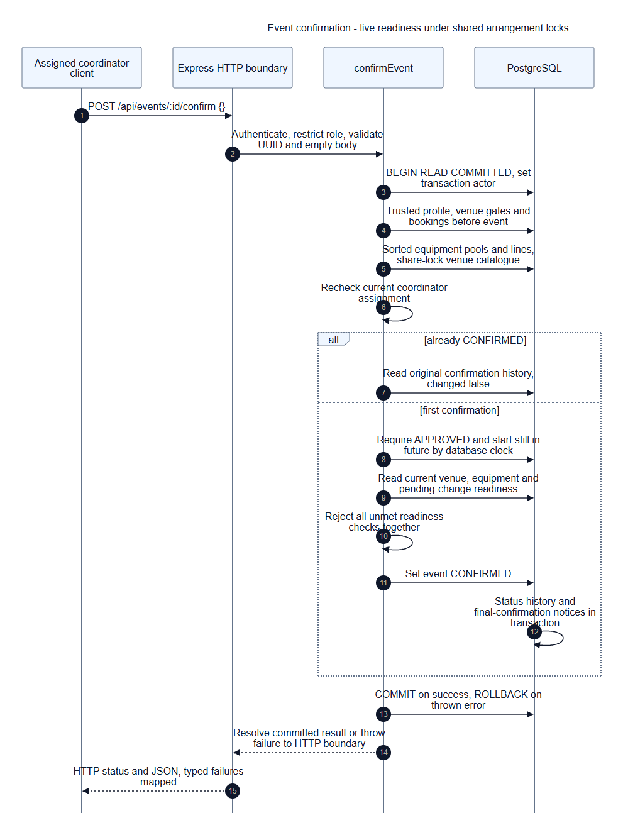

## Safety review and preparation sequence (KAN-84)

A round records the arrangement fingerprint it was submitted against. Approval counts only while the original and supplemental fingerprints match, the arrangements remain ready, and no permanent invalidation exists. Migration 023 source-write triggers record relevant changes to approved rounds in the same transaction; restoring values cannot revive approval. Preparation stays blocked until a fresh round is approved. Pending rounds retain current-value comparison before their first decision. Migration 022 preserves original 021 and adds immutable, per-area remediation baselines. A change-request decision captures current venue and technical digests; every requested area must change before resubmission. Safety notes and unrelated-area edits do not satisfy this check. A changed digest still requires current readiness and a fresh officer decision.

```mermaid
sequenceDiagram
  actor C as Assigned coordinator
  actor O as Safety Officer
  participant API as safety router
  participant S as safety/service.ts
  participant DB as PostgreSQL
  C->>API: POST /events/:id/safety-reviews (safety notes)
  API->>S: submitSafetyReview
  S->>DB: lock arrangements (KAN-61 order), read latest round and readiness
  opt latest decision requests changes
    S->>DB: compare requested area digests with immutable baseline
  end
  alt not ready, unresolved area, pending round or current approval
    S-->>C: 409 with reason, nothing written
  else ready
    S->>DB: INSERT round N, capture original and supplemental context, notify officers
    S-->>C: 201 round N
  end
  O->>API: GET /safety-reviews/:id
  API->>S: getSafetyReview
  S-->>O: arrangements, notes, stale flag, fingerprint and readiness blockers
  O->>API: POST /safety-reviews/:id/decision (decision, fingerprint)
  API->>S: decideSafetyReview
  S->>DB: lock arrangements, lock round
  alt conflicting prior decision, fingerprint differs or approval not ready/current
    S-->>O: 409, nothing written
  else identical prior decision
    S-->>O: 200 changed=false, preserve saved decision
  else decision allowed
    S->>DB: record immutable decision
    opt CHANGES_REQUESTED
      S->>DB: INSERT immutable venue and technical baseline digests
    end
    S->>DB: notify coordinator and requested-area staff in same transaction
    S-->>O: 200
  end
  opt latest decision requests changes
    C->>API: update requested planning areas through existing workflows
    Note over C,DB: Confirmed equipment remediation requires latest TECHNICAL request
    C->>API: resubmit after every requested area changes and readiness passes
  end
  opt relevant source changes after approval
    Note over API,DB: Venue, event, equipment or operational availability changes
    API->>DB: write changed source under existing locks
    DB->>DB: INSERT immutable invalidation in same transaction
    Note over C,DB: Restoring old values does not remove invalidation
  end
  C->>API: POST /events/:id/preparation/start
  API->>S: startPreparation
  S->>DB: lock arrangements, require CONFIRMED, non-invalidated current approval and readiness
  S-->>C: 200 started or 409 with reason
```

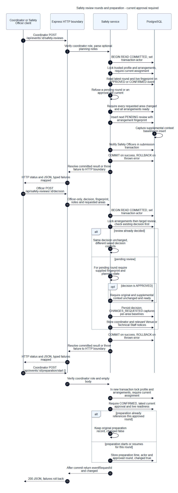

<details>
<summary>29 October upgrade checkpoint — shared rollout status is historical</summary>

The 021 → 022 upgrade retains decided rounds and any existing preparation record. Existing change-request decisions receive conservative baselines from upgrade-time current arrangements; this cannot prove that earlier remediation was performed. Original approvals may become stale when the stronger full fingerprint includes venue hours and buffers. See the [migration procedure](../../database/README.md#kan-84-forward-upgrade--migration-022-29-october-2026) and [baseline relationship](../database-diagram.md#29-october-2026--migration-022-safety-remediation-baselines-kan-84). Shared 022 rollout and connected manual acceptance remain **Not executed** in this review run.

</details>

## Event cancellation and equipment request sequence (KAN-62 / KAN-63)

```mermaid
sequenceDiagram
  actor Manager as Organiser or current coordinator
  actor Coordinator
  actor Tech as Technical Support
  participant UI as ConnectSphere UI
  participant API as Express API
  participant DB as PostgreSQL
  participant Notify as KAN-64 notification writer
  Manager->>UI: Enter trimmed reason and confirm arrangements
  UI->>API: POST /api/events/id/cancel
  API->>DB: Begin, set actor, lock current profile
  API->>DB: Lock sorted venue gates and known bookings
  API->>DB: Lock event, verify actor and eligible status
  API->>DB: Refuse new un-locked bookings with conflict
  API->>DB: Lock sorted equipment pools and lines and count live arrangements
  API->>DB: Update event to CANCELLED
  DB->>DB: Migration 015 releases RESERVED equipment once
  API->>DB: Cancel remaining REQUESTED/REJECTED lines with EVENT_CANCELLED audit
  API->>DB: Cancel active venue bookings and registrations and insert cancellation history
  API->>Notify: Notify managers and affected attendees in transaction
  Notify->>DB: Insert deduplicated notices without attendee reason
  API->>DB: Commit all outcomes together
  Coordinator->>UI: Save equipment lines for an APPROVED assigned event
  UI->>API: POST equipment requests with opaque plan revision
  API->>DB: Lock actor, event, pools and lines and verify assignment and source version
  API->>DB: Save REQUESTED lines and retained predecessor history
  Tech->>UI: Review a requested line
  UI->>API: POST review with current opaque plan revision
  API->>DB: Verify Technical Support, save full RESERVED or reasoned REJECTED result
  DB->>DB: Shared KAN-26 writer rechecks capacity and writes reservation notices
  API->>DB: Commit once - replay or stale version changes nothing
  Coordinator->>API: Explicit replacement with current revision
  API->>DB: Cancel original reservation and insert REQUESTED successor atomically
  Note over Tech,DB: Replacement requires a fresh staff availability decision
```

`coordinatorId`, `assignmentVersion` and automatic-history `assignedBy` may be null. A partial unique index permits at most one assignment with null `unassignedAt` per event. New initial allocations and handovers are MANUAL with the Lead actor; historical AUTOMATIC rows retain their null actor. `assignmentVersion` is the UUID of matching active history rather than a new database column. Handover records its required reason in `note` and uses the same instant for the old end/new start. Notification event/booking/equipment-request links, legacy `dedupeKey` and unread `readAt` may be null; `(recipientId, dedupeKey)` is unique for keyed outcomes. Venue buffer values are integers from 0 to 1,440, defaulting to 0. They are returned as planning inputs; no buffered occupancy calculation or affected-booking warning is implemented yet. KAN-83 adds `HELD`/`EXPIRED` booking states and a hold deadline: `occupiesVenue()` is the shared rule in `occupancy.ts` (approved, or held with the deadline still in the future), and `expire_venue_holds()` marks overdue holds expired.

## Sequence diagrams

KAN-79 changes submission and allocation; KAN-65 adds a later explicit handover while retaining the existing assigned-coordinator review and venue workflow. KAN-64 writes notices before each relevant transaction commits.

```mermaid
sequenceDiagram
  actor Organiser
  actor Lead
  actor Coordinator
  actor Staff as Venue Staff
  participant API as Express API
  participant Notify as Notification writer
  participant DB as PostgreSQL
  Organiser->>API: Submit owned valid draft
  API->>DB: Begin, lock draft, verify no current assignment
  API->>DB: Set SUBMITTED, retain null coordinator
  API->>Notify: Submission acknowledgement, same transaction
  Notify->>DB: Insert organiser notice with outcome key
  API->>DB: Commit action and notification
  API-->>Organiser: Submitted, unassigned
  Lead->>API: Open queue and allocation detail
  API->>DB: Read permitted basic active-event data
  API-->>Lead: Unassigned event and eligible coordinators
  Lead->>API: Assign selected coordinator
  API->>DB: Begin, lock event
  alt Already assigned or no longer eligible
    API->>DB: Roll back
    API-->>Lead: Conflict, refresh current state
  else Still unassigned and active
    API->>DB: Lock target profile, recheck coordinator role and availability
    alt Target is not eligible
      API->>DB: Roll back
      API-->>Lead: Invalid coordinator
    else Eligible target
      API->>DB: Insert MANUAL history with Lead actor, update current coordinator
      API->>Notify: Initial allocation, same transaction
      Notify->>DB: Insert organiser and new-coordinator notices
      API->>DB: Commit assignment and notifications
      API-->>Lead: Saved assignment, retain oversight access
    end
  end
  opt Later Lead reassignment
    Lead->>API: Choose replacement, required reason, expected assignment UUID
    API->>DB: Begin, lock event and active assignment, validate state and version
    alt Stale version or inconsistent history
      API->>DB: Roll back
      API-->>Lead: Conflict, refresh before retrying
    else Same current coordinator
      API->>DB: Commit without history or notification writes
      API-->>Lead: Unchanged assignment
    else New coordinator
      API->>DB: Lock and validate available coordinator target
      alt Invalid target
        API->>DB: Roll back
        API-->>Lead: Invalid coordinator
      else Valid handover
        API->>DB: Close old history and create new history at one timestamp
        API->>DB: Update current coordinator
        API->>Notify: Handover, same transaction
        Notify->>DB: Organiser, new coordinator, minimal previous-coordinator notice
        API->>DB: Commit handover and notifications together
        API-->>Lead: Saved previous/new coordinator and new assignment version
      end
    end
  end
  Coordinator->>API: Open assigned review queue and decide request
  API->>DB: Recheck current assignment, record review and status atomically
  API->>Notify: Review outcome, same transaction
  Notify->>DB: Insert organiser notice
  API->>DB: Commit review and notification
  Coordinator->>API: Request suitable available venue for approved event
  API->>DB: Lock event and venue and check current occupied interval, hours and blocks
  API->>DB: Insert pending booking without reserving time
  Staff->>API: Decide venue booking
  API->>DB: Lock booking, event and venue and recheck current buffers and occupied conflicts
  API->>DB: Snapshot buffers and persist approval atomically
  API->>Notify: Venue decision, same transaction
  Notify->>DB: Organiser, current coordinator and deciding staff notices
  API->>DB: Commit booking decision and notifications
  Organiser->>API: Read inbox or mark a notice read
  API->>DB: Scope to recipient and current target access
  API-->>Organiser: Permitted notices and links, persisted read state
```

Two Lead writes serialize on the event lock. An initial-allocation loser receives `409 COORDINATOR_ALREADY_ASSIGNED`; a stale handover receives `409 ASSIGNMENT_VERSION_CONFLICT`. Neither overwrites the winner. Valid same-coordinator requests preserve the version and all history and create no notification. Any persistence failure, including a notification insert failure, rolls back the action and its notices together. The coordinator in the later review/venue steps must be the currently assigned coordinator: after handover, the former coordinator is denied. Protected multi-query history reads take a shared event lock, so assignment cannot change between authorisation and fetching those records. The previous coordinator receives only a minimal reassignment notice; protected event and booking links are omitted when current access is absent. Clarification requests also notify the organiser in their transaction. Inbox reads/mark-read actions are separate from the business transaction; these diagrams describe implementation, not observed hosted delivery or acceptance.

## Equipment availability sequence (KAN-9)

```mermaid
sequenceDiagram
  actor Staff as Technical Support
  participant UI as Equipment page
  participant API as Equipment service
  participant Auth as Verified session
  participant DB as PostgreSQL
  participant Rules as Availability rules
  Staff->>UI: Select approved or confirmed event
  UI->>API: GET events/id
  API->>Auth: Require Technical Support role
  API->>DB: Read minimal event, saved lines and catalogue
  DB-->>API: Current source values
  API-->>UI: Context and requirementsVersion
  Staff->>UI: Select saved or unsaved what-if mode
  UI->>API: POST events/id with source version and mode
  API->>Auth: Revalidate current role
  API->>API: Validate input fields, quantities and dates
  API->>DB: One SELECT snapshot of source, stock and reservations
  DB-->>API: Coherent current snapshot
  alt Source version changed
    API-->>UI: 409 EQUIPMENT_CONTEXT_CHANGED
    UI->>UI: Clear result and unsaved form<br/>then reload context
  else Source matches
    API->>Rules: Reconcile saved period and aggregate demand
    Note over API,Rules: Saved excludes only its reserved IDs, what-if excludes none
    Rules->>Rules: Operational stock minus<br/>simultaneous reserved peak
    Rules-->>API: Per-item available quantity and deficit
    API-->>UI: Advisory FULFILLABLE or SHORTFALL result
  end
  Note over UI,DB: No requests, reservations, status, history or notifications are written
```

The result is valid only for the snapshot checked. KAN-26 rechecks operational capacity under the equipment-pool lock in its separate reservation sequence below; the availability sequence never reserves equipment. Venue confirmation is not a precondition. Missing saved requirements and mismatched saved periods return explicit errors rather than empty success or silent date changes.

## Equipment reservation sequence (KAN-26)

```mermaid
sequenceDiagram
  actor TS as Technical Support
  participant UI as Saved reservation panel
  participant API as Equipment API
  participant DB as PostgreSQL
  participant Notify as Transactional notification writer
  TS->>UI: Load saved requests and current readiness
  UI->>API: GET reservations/events/id
  API->>DB: Read eligible event, all saved lines and current stock
  DB-->>API: One snapshot including retained release history
  API-->>UI: Context, source version, action flags and readiness
  TS->>UI: Confirm full saved request
  UI->>UI: Clear old advisory and pending readiness success
  UI->>API: POST requests/requestId/reserve with version
  API->>DB: BEGIN, verify trusted Technical Support profile
  API->>DB: Lock approved event and assigned coordinator profile
  API->>DB: Lock ordered pools and saved requests
  API->>DB: Read live operational stock and overlapping reservations
  alt Stale source, invalid request or insufficient stock
    API->>DB: ROLLBACK
    API-->>UI: 409 conflict
    UI->>API: Reload saved context without repeating mutation
  else Exact already-applied action
    API->>DB: COMMIT without new allocation or notice
    API-->>UI: changed false and current context
  else Whole request fits current capacity
    API->>DB: Mark saved line RESERVED and record actor/time
    DB->>DB: Enforce approved period and operational peak guard
    API->>Notify: EQUIPMENT_RESERVED for coordinator and actor
    Notify->>DB: Insert deduplicated notices on same transaction
    Note over API,DB: Any notice failure rolls back reservation and notices
    API->>DB: Read new context and COMMIT
    API-->>UI: changed true, saved status and current readiness
    UI->>API: Refresh advisory source before another check
  end
  Note over TS,DB: Manual cancel uses the same locks/version and a required reason, retaining the original decision
  Note over API,DB: Terminal transitions release live lines once<br/>Lifecycle APIs remain separate
```

The request row is both the requirement and, while `RESERVED`, its reservation. Cancellation adds release metadata without rewriting its original allocation/decision. Readiness re-evaluates current stock rather than trusting the saved status: empty requirements are not ready, and stock loss can make all-reserved requirements unfulfillable. KAN-63 owns request creation; what-if checks supply no mutation input. Migration 015 also supports the implemented KAN-62 cancellation and KAN-10 completion transitions; those services provide the actor and commit event status, release effects and outcome notices atomically.

## Diagram exports

**5 November 2026 — C4 accuracy correction.** C1, C2 and C3 were checked against application source and migrations at `main` `fb6d8d93f721b114accc9857a05d62e859987e23`. The revised views contain 29 functional blocks, 43 labelled relationships, three legends and four system/container/module boundaries. Every functional block, relationship and boundary has a source reference in the [element-by-element audit](../scrum/sprint-03/evidence/c4-audit-20261105/audit.json), with its rendering checks in the [evidence folder](../scrum/sprint-03/evidence/c4-audit-20261105/render-validation.json) (the S3-E30 register entry was not included in the 6 November package). The exported titles, types, technology labels and legends follow the [C4 notation recommendations](https://c4model.com/diagrams/notation); C3 scopes its components to the API container. The current API contract and database model were cross-checked for these boundaries; this is a documentation correction with no endpoint or schema change.

| View | PNG export | Scalable SVG export | Functional blocks / relationships |
| --- | --- | --- | --- |
| C1 system context | [c1-context.png](archive/before-2026-11-06-update/exports/c1-context.png) | [c1-context.svg](archive/before-2026-11-06-update/exports/c1-context.svg) | 9 / 8 |
| C2 containers | [c2-containers.png](archive/before-2026-11-06-update/exports/c2-containers.png) | [c2-containers.svg](archive/before-2026-11-06-update/exports/c2-containers.svg) | 5 / 5 |
| C3 API components | [c3-components.png](archive/before-2026-11-06-update/exports/c3-components.png) | [c3-components.svg](archive/before-2026-11-06-update/exports/c3-components.svg) | 15 / 30 |

All six exports were generated with Mermaid CLI 11.17.1 / Mermaid 11.17.2 and visually inspected. [Rendering instructions](../scrum/sprint-03/evidence/c4-audit-20261105/render.py), [configuration](../scrum/sprint-03/evidence/c4-audit-20261105/mermaid-config.json) and [render checks](../scrum/sprint-03/evidence/c4-audit-20261105/render-validation.json) retain reproducibility and label-fit evidence. The checks found all 43 rendered arrows labelled, with no clipped node labels, edge-label/node overlaps or edge-label overlaps. C3 uses the ELK layout declared in its Mermaid front matter. These checks establish source/export consistency and diagram readability; application tests, integrated acceptance and a fresh shared database/job check were **Not executed** in this audit.

On **1 November 2026**, C1 context, C2 containers, C3 components and the class view were regenerated from this file for all seven roles and currently mounted workflows, including safety, registration, stock, significant changes and lifecycle transitions. Migration 023 was pending shared application at that rendering checkpoint; the [later rollout checkpoint](../../database/README.md#1-november-2026--shared-023-rollout-and-connected-retests) verifies its application and focused connected retests without changing the diagram structure. Rendering and visual inspection are design verification; they do not replace connected acceptance. Other exported sequences retain their documented generation dates. The automated test-hardening record is `AUTO-20261101-TEST-HARDENING` in [test evidence](../testing/test-evidence.md).

On 29 October 2026 the C3, class and planning ERD exports were refreshed for registration and notification outcomes. The new `seq-registration-withdrawal.png` and `erd-database.png` exports depict the current withdrawal sequence and detailed database diagram. These exports are design evidence, not execution or acceptance results.

GitHub's Mermaid rendering is not part of the submission. PNG exports live in `docs/architecture/exports/`: `c1-context.png`, `c2-containers.png`, `c3-components.png`, `class.png`, `seq-lead-assignment.png`, `seq-venue-write-locking.png`, `seq-equipment-availability.png`, `seq-equipment-reservation.png`, `erd-events.png` and `erd-planning.png`. On 26 October 2026 the affected C3, class and planning-ERD images were re-exported from the current source for KAN-9 and KAN-26, with separate availability and reservation sequences, using Mermaid CLI. These depict implementation boundaries, not manual acceptance. Re-export affected diagrams after subsequent design changes.

## ERD

The detailed [database model](../database-diagram.md) is the current schema reference through migration 023. The curated historical views below focus on request and planning relationships; the class view above and detailed model include the newer safety entities. Numbered migrations preserve applied history and checksums. Shared Supabase was verified through 023 on 1 November, followed by the focused connected retests in `MAN-20261101-03`. The [shared rollout evidence](../../database/README.md#1-november-2026--shared-023-rollout-and-connected-retests) is separate from disposable-database verification.

<details>
<summary>Earlier schema checkpoints — retained verbatim</summary>

Migrations 001–003 provide the Sprint 1 request/authentication foundation. Migration 004 adds the
broader first-release tables, 005 corrects the equipment availability guard and 006 adds
historical automatic coordinator assignment fields. Migration 007 adds the trusted Lead role to the profile constraint without rewriting assignments. Migration 008 (KAN-64) adds notification booking links and deduplication keys. Migration 009 (KAN-77) adds per-venue setup and turnaround minutes, defaulting to 0; KAN-78 will apply them to occupancy. Migration 010 adds per-outage booking recovery flags with retained outage history. The diagram omits
housekeeping timestamps, migration metadata and the unused legacy auth fields/tables. Migration 014 adds zero-default damaged and maintenance quantities to equipment types; their nonnegative sum cannot exceed total stock. Migration 015 adds request release metadata, equipment notification linkage, operational-capacity guards and terminal release. Migration 014/account setup is reported complete; shared 015 application is Not executed.
[docs/database-diagram.md](../database-diagram.md) holds the detailed schema reference and its verification dates, including foreign keys this curated view leaves out. Local migration 007 tests passed, and its shared application plus Lead login were subsequently reported successful. Full hosted workflow acceptance remains pending. KAN-65 uses the existing fields and active-row constraint without a new migration.

</details>

### Sprint 1 request workflow

```mermaid
erDiagram
  APP_USERS ||--o{ EVENT_REQUESTS : organises
  APP_USERS o|--o{ EVENT_REQUESTS : coordinates
  EVENT_REQUESTS ||--o{ EVENT_CLARIFICATIONS : has
  EVENT_REQUESTS ||--o{ EVENT_REVIEWS : has
  EVENT_REQUESTS ||--o{ EVENT_STATUS_HISTORY : records
  EVENT_REQUESTS ||--o{ EVENT_REQUEST_EDITS : edits
  EVENT_REQUESTS ||--o| EVENT_CANCELLATIONS : cancels
  APP_USERS ||--o{ EVENT_CANCELLATIONS : actor
  EVENT_REQUESTS ||--o{ COORDINATOR_ASSIGNMENTS : "assigned through"
  APP_USERS ||--o{ EVENT_CLARIFICATIONS : requests
  APP_USERS ||--o{ EVENT_REVIEWS : reviews
  APP_USERS ||--o{ COORDINATOR_ASSIGNMENTS : coordinates
  APP_USERS {
    uuid id PK
    text email UK
    text role
    uuid supabase_user_id UK "nullable until account provisioned"
    boolean coordinator_available "default false; eligible for new Lead allocations"
  }
  EVENT_REQUESTS {
    uuid id PK
    uuid organiser_id FK
    uuid coordinator_id FK "nullable; current assignment"
    text status "nine states"
    text name "draft fields nullable"
    timestamptz starts_at
    timestamptz ends_at
    integer expected_attendance
    integer revision "migration 016"
    text equipment_plan_status "migration 018"
    boolean registration_required
    integer registration_capacity "nullable; NULL is unlimited"
    timestamptz registration_opens_at
    timestamptz registration_closes_at
  }
  EVENT_CLARIFICATIONS {
    uuid id PK
    uuid event_request_id FK
    uuid requested_by FK
    text message
    text response "nullable until answered"
  }
  EVENT_REVIEWS {
    uuid id PK
    uuid event_request_id FK
    uuid reviewed_by FK
    text decision
    text reason "nullable"
  }
  EVENT_REQUEST_EDITS {
    uuid id PK
    uuid event_request_id FK
    uuid edited_by FK
    integer revision
    jsonb changes
  }
  EVENT_CANCELLATIONS {
    uuid event_request_id PK,FK
    uuid cancelled_by FK
    timestamptz cancelled_at
    text reason "internal"
    integer affected_venue_bookings
    integer affected_equipment_requests
    integer affected_registrations
  }
  EVENT_STATUS_HISTORY {
    uuid id PK
    uuid event_request_id FK
    text from_status "null on insert"
    text to_status
    uuid changed_by FK "from app.actor_id"
    text reason "nullable; migration 018"
  }
  COORDINATOR_ASSIGNMENTS {
    uuid id PK
    uuid event_request_id FK
    uuid coordinator_id FK
    uuid assigned_by FK "null only for automatic assignment"
    text assignment_method "AUTOMATIC or MANUAL"
    timestamptz unassigned_at "nullable; one active row per request"
  }
```

### Venues, equipment, registration and notifications

```mermaid
erDiagram
  EVENT_REQUESTS ||--o{ VENUE_BOOKINGS : reserves
  EVENT_REQUESTS ||--o{ EQUIPMENT_REQUESTS : needs
  EVENT_REQUESTS ||--o{ EVENT_REGISTRATIONS : "opens to"
  EVENT_REQUESTS ||--o{ EVENT_CHANGE_REQUESTS : "amended by"
  EVENT_REQUESTS o|--o{ NOTIFICATIONS : concerns
  VENUE_BOOKINGS o|--o{ NOTIFICATIONS : outcome
  VENUES ||--o{ VENUE_BOOKINGS : "booked as"
  VENUES ||--o{ VENUE_UNAVAILABILITY : blocks
  VENUE_UNAVAILABILITY |o--o{ VENUE_OUTAGE_IMPACTS : affects
  VENUE_BOOKINGS ||--o{ VENUE_OUTAGE_IMPACTS : "flagged by"
  VENUE_BOOKINGS |o--o{ VENUE_BOOKINGS : "replaced by"
  EQUIPMENT_TYPES ||--o{ EQUIPMENT_REQUESTS : "drawn from"
  EQUIPMENT_REQUESTS o|--o{ NOTIFICATIONS : "reservation outcome"
  EVENT_REGISTRATIONS o|--o{ NOTIFICATIONS : "registration outcome"
  EVENT_CHANGE_REQUESTS o|--o{ NOTIFICATIONS : "change outcome"
  APP_USERS |o--o{ EQUIPMENT_REQUESTS : "release actor"
  APP_USERS ||--o{ EVENT_REGISTRATIONS : attends
  APP_USERS ||--o{ NOTIFICATIONS : receives
  VENUES {
    uuid id PK
    text name UK
    integer capacity
    text_array layouts
    text_array facilities
    text_array accessibility_features
    boolean wheelchair_accessible
    time opens_at "nullable operating hours"
    time closes_at
    integer setup_minutes "0-1440, migration 009"
    integer turnaround_minutes "0-1440, migration 009"
    boolean is_active
  }
  VENUE_UNAVAILABILITY {
    uuid id PK
    uuid venue_id FK
    timestamptz starts_at
    timestamptz ends_at
    text reason "nullable"
  }
  VENUE_OUTAGE_IMPACTS {
    uuid id PK
    uuid unavailability_id FK "nullable, KAN-81"
    uuid venue_booking_id FK
    text status "RECOVERY_REQUIRED RESOLVED CLEARED"
  }
  VENUE_BOOKINGS {
    integer reserved_setup_minutes
    integer reserved_turnaround_minutes
    uuid id PK
    uuid event_request_id FK
    uuid venue_id FK
    uuid requested_by FK
    text status "PENDING HELD APPROVED REJECTED CANCELLED EXPIRED"
    timestamptz starts_at
    timestamptz ends_at
    text layout "nullable"
    uuid decided_by FK "set with decided_at on a decision"
    uuid replaces_booking_id FK "nullable, KAN-81 replacement"
    timestamptz hold_expires_at "KAN-83 deadline, nullable"
    uuid held_by FK "KAN-83, nullable"
    timestamptz expired_at "KAN-83, nullable"
    text cancellation_reason "KAN-83, nullable"
  }
  EQUIPMENT_TYPES {
    uuid id PK
    text name UK
    text category "nullable"
    integer total_quantity "pooled by type"
    integer damaged_quantity "nonnegative; migration 014"
    integer maintenance_quantity "nonnegative; combined losses <= total"
    boolean is_active
  }
  EQUIPMENT_REQUESTS {
    uuid id PK
    uuid event_request_id FK
    uuid equipment_type_id FK
    uuid requested_by FK
    integer quantity
    text status "REQUESTED RESERVED REJECTED CANCELLED"
    text technical_requirements "nullable"
    integer revision "stored counter; API version is opaque"
    timestamptz starts_at
    timestamptz ends_at
    uuid decided_by FK "set with decided_at on a decision"
    timestamptz decided_at "nullable until decided"
    timestamptz released_at "nullable; migration 015"
    uuid released_by FK "nullable actor"
    text release_reason "nullable, retained"
    text release_cause "manual cancellation or terminal event"
  }
  EVENT_REGISTRATIONS {
    uuid id PK
    uuid event_request_id FK
    uuid attendee_id FK
    text status "REGISTERED WITHDRAWN CANCELLED"
    integer outcome_version "incremented on status transition"
    timestamptz cancellation_outcome_at "required exactly when cancelled"
    timestamptz withdrawn_at "nullable"
  }
  EVENT_CHANGE_REQUESTS {
    uuid id PK
    uuid event_request_id FK
    uuid requested_by FK
    text status "PENDING APPROVED REJECTED WITHDRAWN"
    jsonb proposed_changes "non-empty object of event fields"
    jsonb previous "migration 017"
    integer base_revision
    integer applied_revision "nullable until approval"
    jsonb cancelled_arrangements
    text reason
    uuid decided_by FK "nullable until decided"
  }
  NOTIFICATIONS {
    uuid id PK
    uuid recipient_id FK
    uuid event_request_id FK "nullable"
    uuid venue_booking_id FK "nullable"
    uuid equipment_request_id FK "nullable, migration 015"
    uuid registration_id FK "nullable, migration 019"
    uuid change_request_id FK "nullable, migration 019"
    text dedupe_key "nullable, unique per recipient"
    text type
    text title
    timestamptz read_at "nullable until read"
  }
```

Database triggers enforce the invariants that concurrent requests could otherwise break:
the status-history record, one approved booking per venue and period, the pooled equipment
peak, and the registration capacity. Roles, ownership and transition validity remain
service responsibilities; `event_registrations` is unique per attendee and event.

Numbered migrations define the reproducible local and CI schema; coordinate equivalent dashboard changes in the shared Supabase project with Arvin. The ERD omits housekeeping fields, migration metadata and unused legacy auth fields/tables. Credentials are managed by Supabase Auth; the nullable historical `password_hash` field is not used by the current authentication code. Role checks, event ownership, transition validity and atomic decisions belong to services, with database constraints providing additional integrity.

## Decisions and tradeoffs (earlier checkpoints)

The current decisions table now appears in [Design decisions and trade-offs](#design-decisions-and-trade-offs). The earlier checkpoints below are retained as history.

<details>
<summary>Earlier design and scope checkpoints — retained verbatim</summary>

- Use one repository and modular backend to keep setup and integration manageable for six developers. There are no independently deployed business services.
- Use TypeScript across Vue and Express for consistent types and tooling. HTTP contracts still need runtime validation; static types do not validate user input.
- Use hosted Supabase PostgreSQL and explicit SQL migrations for visible schema changes and future reservation transactions. Retain `pg` and the Express service boundary. The small migration runner is forward-only, transactional, checksummed, and tested for repeat execution. Evaluate a fuller migration tool if lifecycle needs grow.
- Use a direct database connection where the network supports it, or the session pooler on port 5432 for IPv4 development. Connections verify TLS certificates. Compose remains available for optional local databases and isolated tests; GitHub Actions uses its own temporary PostgreSQL service.
- Coordinate changes against the shared development database. A feature branch isolates code, but it does not isolate Supabase tables or data. Keep schema changes in migrations and agree their order before applying them.
- Keep credentials out of the repository. Seed profiles have no login credentials; provision Supabase Auth accounts and map them to application profiles through `app_users.supabase_user_id` before sign-in, including the Venue Staff, Technical Support Staff and Attendee accounts the new routes need. `database/seed.ts` also adds fictional venues once migration 004 has run; equipment sample generation is removed. All mounted routes verify the application session.
- Use current coordinator assignment as the relationship rule. `event_requests.coordinator_id` refers to `app_users.id`, not the Supabase UUID. KAN-79 replaces automatic selection with a Lead-only initial assignment transaction: lock the active event, check it is still unassigned, lock the target profile and recheck its role/availability, then commit history and coordinator together. New submissions need no available coordinator. KAN-65 permits explicit versioned handover with a reason and nonoverlapping assignment intervals; the version is checked before a same-coordinator no-op. Missing/mismatched legacy history is preserved for reconciliation, never reconstructed with invented provenance. Migration 007 adds the Lead role without rewriting migrations 001–006 or previous acceptance; KAN-65 adds no schema change. Review and venue operations continue to require their existing role and current event relationship; Lead oversight uses a separate limited projection. KAN-64 commits keyed in-app notification rows with the relevant action. The 25 October KAN-60/KAN-83 record confirms shared migration application through 013; the original-story report separately records reported localhost allocation/handover verification. Deployed acceptance remains Not assessed.
- Keep optional draft values nullable. Do not reuse draft validation as submission validation. Record confirmed required fields in the clarification log.
- Use the nine statuses defined by migration 004: `DRAFT`, `SUBMITTED`, `UNDER_REVIEW`, `CLARIFICATION_REQUESTED`, `APPROVED`, `REJECTED`, `CONFIRMED`, `CANCELLED` and `COMPLETED`. The six Sprint 1 statuses are unchanged; the migration adds the three later lifecycle states. Implemented transitions are draft submission, review start, clarification and its answer, and initial approval/rejection. Later status values remain readable for compatibility with existing records and KAN-29 workload counting; the application cannot confirm, cancel or complete events. Request approval remains distinct from future final confirmation.
- A coordinator may record an initial decision from `SUBMITTED` or `UNDER_REVIEW`, so starting a review does not block the decision it precedes. A pending clarification must be answered first, which returns the request to `SUBMITTED`.
- The 26 September scope correction removed the broader venue, equipment, registration, change-request and notification feature modules. Their schema and database guards remain, but do not establish working interfaces or accepted stories. The 4 October integration adds KAN-12 search, KAN-51 availability and KAN-8 booking decisions within Sprint 2 scope. KAN-9 subsequently adds read-only equipment assessment on 26 October and KAN-26 adds full saved-line reservations, release history and current readiness. Equipment stock maintenance, request editing and lifecycle APIs remain pending, alongside attendee registration and change-request application workflows. Notification application workflows include the KAN-64 inbox for request, assignment and venue outcomes plus KAN-26’s equipment-reserved slice (see the notifications row above).

</details>

Record significant changes in the [decision log](../requirements/assumptions-and-questions.md), including context, options, the chosen approach, consequences, linked stories and any superseded decision. Keep implementation assumptions separate from customer clarifications.

## Planned customer-change design work — 16 October 2026

Customer changes received 2 October are represented by KAN-77/78/79/81/82/83/84; the complete [design/test impact register](../requirements/change-requests.md#design-and-test-impact-planned-work) and Sprint 3/4 cards allocate the work. This is planned design work, not a claim that new roles, APIs, migrations or diagram exports already exist.

Implementers must update C3/class/sequence/data/API views for venue buffers, outage recovery, timed holds and its scheduler, Lead authorization, independent arrangements, revision-bound safety and preparation, plus notification integration. Preserve existing diagrams as the current implementation until code changes; add numbered migrations rather than editing applied history. Re-export affected diagrams in the same story PR. Safety review remains separate from event confirmation: readiness permits review, while preparation requires both a confirmed event and current safety approval, avoiding a circular prerequisite.

**21 October implementation follow-up:** Lead allocation/reassignment and the KAN-64 inbox are reflected in the current C3, class and sequence views above. Migration 009 and the venue fields implement KAN-77 AC1–AC5; buffer application and affected-booking warnings remain KAN-78/KAN-77 AC6 work. The 16 October paragraph is the original design plan, not the current implementation status.

## KAN-78 occupied interval evaluation — 21 October 2026

The API's venue module now shares SQL occupied-interval calculation across search, calendar, suitability and booking writes. Migration 008 centralises occupied endpoints and operating-hour eligibility. The internal view selects current durations for live bookings and approval snapshots for ended/completed history. Computed warnings identify both affected overlaps and operational violations after buffer edits; no background job or booking cancellation is introduced. Existing API/module boundaries stay the same. KAN-77's configuration editor remains a separate dependency. The updated class, planning ERD and workflow sequence PNGs accompany this source.

## 25 October 2026 — Arvin contribution reconciliation (Sprints 1–3)

This is a dated evidence backfill prepared with Codex on 25 October, not a new ceremony, Jira transition, test execution or acceptance decision. Historical entries, other members’ ownership and agreed estimates are preserved.

KAN-24’s schema/ERD work and KAN-51’s navigation/access fixes are historical contributions; current diagrams describe the integrated system rather than every workflow once present in PR #10. The 12 October C4 preparation record is retained as a historical TXT snapshot in Sprint 3 evidence; its export/review/delivery claims must not be substituted for current design or independent review. KAN-81 stale-write refresh corrections came from Arvin’s review follow-up; Kai Jie retains the feature ownership.

## Venue write ordering — 25 October 2026

The per-venue advisory transaction gate precedes row locks for booking and outage mutations. This closes the skipped-hold race without a schema change; expiry remains idempotent and checks the current row after any wait.

```mermaid
---
config:
  theme: base
  themeVariables:
    fontFamily: Arial, sans-serif
    primaryColor: '#eef5f1'
    primaryTextColor: '#183d33'
    primaryBorderColor: '#497264'
    lineColor: '#497264'
    signalColor: '#234e42'
    signalTextColor: '#183d33'
    noteBkgColor: '#fff7db'
    noteBorderColor: '#b99a43'
    noteTextColor: '#3d3521'
  sequence:
    actorFontFamily: Arial
    noteFontFamily: Arial
    messageFontFamily: Arial
    mirrorActors: false
    actorMargin: 35
    width: 150
    messageMargin: 26
    diagramMarginX: 25
    diagramMarginY: 20
---
sequenceDiagram
  title Venue writes: approval and overlapping outage
  actor Staff as Venue Staff
  participant API as Venue API
  participant Gate as PostgreSQL<br/>venue gate
  participant DB as PostgreSQL<br/>rows and notices

  Staff->>API: Concurrent approval + outage requests
  API->>API: Verify role and validate input
  API->>DB: BEGIN each request transaction
  API->>Gate: Acquire the same venue advisory key
  Note over API,Gate: First writer proceeds, competitor waits.<br/>Commit or rollback releases the gate.

  alt Approval acquires the gate first
    Gate-->>API: Approval proceeds
    API->>DB: Lock booking, event, then venue<br/>Recheck live deadline and availability
    API->>DB: Set APPROVED + insert notices<br/>COMMIT atomically
    DB-->>Gate: Release gate
    Gate-->>API: Waiting outage proceeds
    API->>DB: Lock venue and record outage<br/>Keep approval, add RECOVERY_REQUIRED<br/>+ notices, COMMIT
    API-->>Staff: Approval saved, outage recovery required
  else Outage acquires the gate first
    Gate-->>API: Outage proceeds
    API->>DB: Lock venue and overlapping held rows<br/>Cancel holds + record outage + notices<br/>COMMIT atomically
    DB-->>Gate: Release gate
    Gate-->>API: Waiting approval proceeds
    API->>DB: Lock booking, observe CANCELLED<br/>ROLLBACK without decision or notices
    API-->>Staff: Approval refused: HTTP 409<br/>BOOKING_ALREADY_DECIDED
  end
  Note over API,DB: Each request writes its outcome and notices in one transaction.<br/>This diagram describes implementation, not manual acceptance evidence.
```

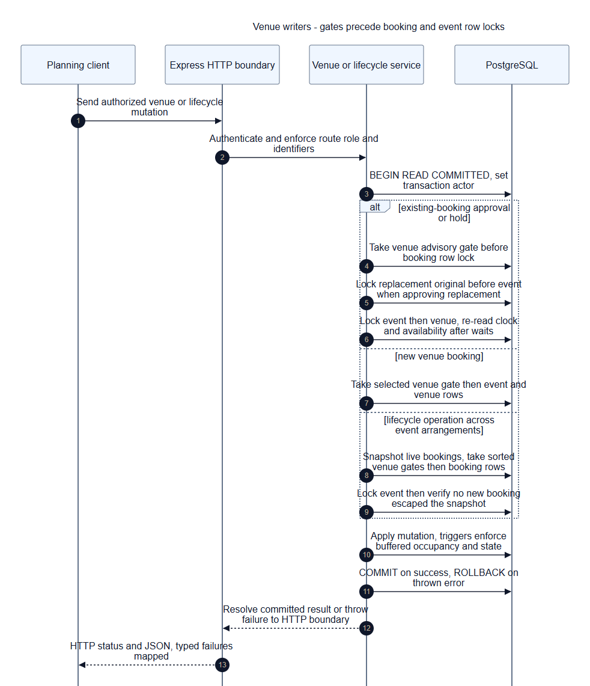

Export generated from the source above on 25 October. State/notices commit atomically. This is an implementation diagram, not a manual acceptance result.

## 26 October 2026 — KAN-66 planning edits

The events component gains `planning-edit-policy.ts` (edit rules by status, role and relationship) used by the detail read and the PATCH write. `event_requests.revision` (migration 016, originally numbered 014) gives every writer an optimistic-concurrency token; edits and reviewer actions compare it under the existing row lock, so no new lock ordering is introduced. The class diagram, ERD and C3 exports do not yet show these additions; the combined re-export remains **pending**. See the [API contract](api-contract.md#kan-66-planning-edits-and-revisions--26-october-2026).

## 27 October 2026 — KAN-15 change requests

The events component gains `change-requests.ts` and `change-request-impact.ts`: owners propose significant-field changes, assigned coordinators approve (values applied, affected pending venue/equipment arrangements cancelled, KAN-66 edit audit written) or reject, all in one transaction checked against the KAN-66 revision. Approval is refused when confirmed arrangements, a confirmed event or registrations are affected (cancel and resubmit). The approval locks venue bookings before the event, matching Venue Staff decisions. Notifications reuse the KAN-64 inbox. The C4 diagram exports are not yet regenerated for this change.

## 28 October 2026 — Integrated diagram refresh

C3, class, event/planning ERDs and the cancellation/equipment sequence were re-exported from the current source through migrations 016–018. This supersedes the pending-export notes above, not their historical shared-migration status. The new export is [seq-event-cancellation-equipment.png](exports/seq-event-cancellation-equipment.png). The lock sequence and opaque plan version are application protocols, not additional database tables. Real isolated PostgreSQL verification is in AUTO-20261028-PR63-01; shared schema rollout and manual acceptance remain separate.

## 28 October 2026 — KAN-82 independent venue arrangements

The venues component adds coordinator cancellation of one venue arrangement and replacement requests linked to a cancelled arrangement, without a schema change. Venue readiness is derived from booking rows for later confirmation (KAN-61) and safety review (KAN-84). Notifications reuse the KAN-64 inbox. The C4 diagram exports are not regenerated for this change.


### 1 November 2026 — permanent safety invalidation (migration 023)

The [023 schema](../database-diagram.md#1-november-2026--migration-023-permanent-safety-invalidation) supplements the historical 021/022 design without changing public decision bodies or rewriting decisions. Triggers record invalidation without acquiring reverse-order event/review locks from venue or equipment stock writes. Supplemental baselines cover facilities and line technical requirements, displayed to the officer. Upgrade backfills detectable differences and buffered operational-block overlaps; it cannot reconstruct a change already restored before upgrade. See the [current migration procedure](../../database/README.md#kan-84-persistent-invalidation--migration-023-1-november-2026).

**Later 1 November rollout checkpoint:** shared 023 was applied with checksum validation and a no-op repeat, preserving all 30 existing reviews and 10 preparation records. `MAN-20261101-03` then passed TC-06-446 (permanent invalidation after exact restoration, followed by a new approved round and resumed preparation), TC-06-447 (live confirmation readiness refresh after a pending venue request and cancellation), and TC-15-108 (separate equipment decision/release reasons). The [rollout record](../../database/README.md#1-november-2026--shared-023-rollout-and-connected-retests) links persisted snapshots and connected evidence. These results verify the described boundaries; exact-commit CI and independent review remain separate release requirements.


</details>
