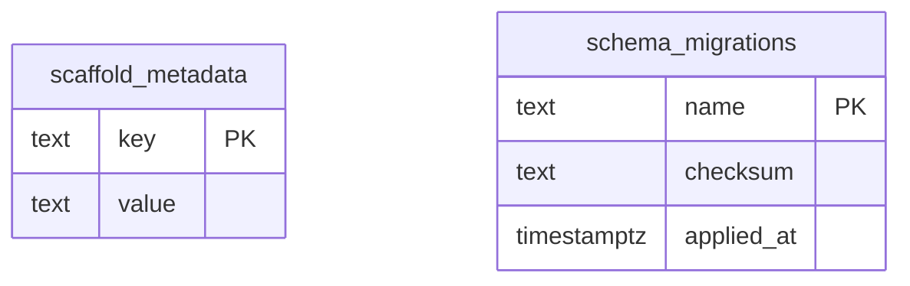

# ConnectSphere Database Diagram

**KAN-62 / KAN-63 schema update — 26 October 2026.** Migration 014 adds `event_cancellations`
(one immutable row per cancelled event, with actor, timestamp, internal reason and
affected-arrangement counts). `event_status_history.reason` retains the cancellation
explanation alongside the trigger-recorded status change. `event_registrations` retains rows
with `status = CANCELLED` and `cancellation_outcome_at`; `equipment_requests` retains cancelled
request/reservation rows with actor, time and reason, plus technical requirements and a revision
counter. `event_requests` stores equipment planning state (`REQUIRED` or `NOT_REQUIRED`).
Existing rows are not deleted and unrelated event arrangements remain unchanged.

**KAN-78 schema reconciliation — 25 October 2026.** For current source `96a0d10`, venue duration columns come from migration **009**, while approval snapshots, internal interval/hours helpers and `venue_booking_warnings` come from **012_venue_occupied_intervals.sql**. Migration **013** rebuilds the interval view with hold/cancellation fields and extends the occupancy guard. `venue_booking_intervals` is a view, not an extra stored table. The dated 21 October schema and private migration-008 descriptions below are historical. The [25 October shared-development run](testing/test-evidence.md#25-october-2026--kan-60-and-kan-83-manual-hosted-runs) reports migrations 001–013 present in `schema_migrations`; this is a reported setup check, not a newly executed complete schema audit or KAN-78/KAN-34 hosted acceptance. Existing rows, ownership and approval history are preserved.

**25 October 2026 verification note.** [Original-story manual results](testing/test-evidence.md#25-october-2026--reported-manual-results-for-original-stories) are reported against the original sprint versions. KAN-29 automatic assignment remains historical; KAN-79/KAN-65 use the current Lead workflow. Original KAN-52 evidence does not complete the later revised story. No schema or relationship changes are made by recording these results.

The base diagram records the schema through migration 009 on 21 October 2026; later migration sections below document subsequent additions. Migration 008 adds notification booking links and outcome deduplication; migration 009 adds venue setup/turnaround minutes. The last full shared Supabase structure verification was on 30 September for migrations 001–006. A separate ledger check in the 25 October KAN-60/KAN-83 run reports migrations 001–013 applied; it does not replace a full structural audit or the pending combined diagram export.

**19 October implementation checkpoint:** migration 007 expanded the allowed application roles without changing tables, columns or relationships. Its application to shared Supabase was not recorded at that checkpoint.

**19 October follow-up:** migration 007 application and Coordinator Lead login were subsequently reported successful. This does not replace the earlier structural verification or establish manual workflow acceptance. KAN-65 uses the existing assignment fields and adds no schema migration or relationship; see the [verification record](testing/test-evidence.md#19-october-2026--kan-65-coordinator-reassignment).

`PK` marks primary keys, `FK` marks foreign keys, and `UK` marks a single-column unique key. Columns labelled `nullable` accept NULL; all other columns are `NOT NULL`. `text_array` represents PostgreSQL `text[]`.

Relationship labels name the foreign-key column in the child table. `||` means exactly one parent, `|o` means zero or one parent, and `o{` means zero or more child rows.

**26 October KAN-9 update:** the equipment type below now includes `damaged_quantity` and `maintenance_quantity` from additive migration 014. Both default to zero, cannot be negative and together cannot exceed total stock. Existing stock, requests and reservation history are preserved. The repository model and isolated migration tests include 014. At the initial KAN-9 checkpoint, shared application and the write workflows were pending. The later 26 October follow-up reports 014 and test accounts ready; KAN-26 is now covered by the separate migration-015 section below, while KAN-18/KAN-63 remain pending.

## Application tables

```mermaid
erDiagram
    app_users |o..o{ coordinator_assignments : "assigned_by"
    app_users ||..o{ coordinator_assignments : "coordinator_id"
    event_requests ||..o{ coordinator_assignments : "event_request_id"
    app_users |o..o{ equipment_requests : "decided_by"
    app_users |o..o{ equipment_requests : "released_by"
    equipment_types ||..o{ equipment_requests : "equipment_type_id"
    event_requests ||..o{ equipment_requests : "event_request_id"
    app_users ||..o{ equipment_requests : "requested_by"
    app_users |o..o{ event_change_requests : "decided_by"
    event_requests ||..o{ event_change_requests : "event_request_id"
    app_users ||..o{ event_change_requests : "requested_by"
    event_requests ||..o{ event_clarifications : "event_request_id"
    app_users ||..o{ event_clarifications : "requested_by"
    app_users ||..o{ event_registrations : "attendee_id"
    event_requests ||..o{ event_registrations : "event_request_id"
    app_users |o..o{ event_requests : "coordinator_id"
    app_users ||..o{ event_requests : "organiser_id"
    event_requests ||..o{ event_reviews : "event_request_id"
    app_users ||..o{ event_reviews : "reviewed_by"
    app_users |o..o{ event_status_history : "changed_by"
    event_requests ||..o{ event_status_history : "event_request_id"
    event_requests |o..o{ notifications : "event_request_id"
    app_users ||..o{ notifications : "recipient_id"
    venue_bookings |o..o{ notifications : "venue_booking_id"
    equipment_requests |o..o{ notifications : "equipment_request_id"
    app_users |o..o{ venue_bookings : "decided_by"
    app_users |o..o{ venue_bookings : "held_by"
    app_users |o..o{ venue_bookings : "cancelled_by"
    event_requests ||..o{ venue_bookings : "event_request_id"
    app_users ||..o{ venue_bookings : "requested_by"
    venues ||..o{ venue_bookings : "venue_id"
    app_users |o..o{ venue_unavailability : "created_by"
    venues ||..o{ venue_unavailability : "venue_id"
    venue_unavailability |o..o{ venue_outage_impacts : "unavailability_id"
    venue_bookings ||..o{ venue_outage_impacts : "venue_booking_id"
    venue_bookings |o..o{ venue_bookings : "replaces_booking_id"

    app_users {
        uuid id PK
        text email
        text display_name
        text role
        text password_hash "nullable"
        timestamptz created_at
        timestamptz updated_at
        uuid supabase_user_id UK "nullable"
        boolean coordinator_available
    }

    event_requests {
        uuid id PK
        uuid organiser_id FK
        uuid coordinator_id FK "nullable"
        text status
        text name "nullable"
        text purpose "nullable"
        text description "nullable"
        timestamptz starts_at "nullable"
        timestamptz ends_at "nullable"
        integer expected_attendance "nullable"
        text venue_requirements "nullable"
        text accessibility_needs "nullable"
        text equipment_requirements "nullable"
        boolean registration_required "nullable"
        timestamptz created_at
        timestamptz updated_at
        integer registration_capacity "nullable"
        timestamptz registration_opens_at "nullable"
        timestamptz registration_closes_at "nullable"
    }

    coordinator_assignments {
        uuid id PK
        uuid event_request_id FK
        uuid coordinator_id FK
        uuid assigned_by FK "nullable"
        text note "nullable"
        timestamptz assigned_at
        timestamptz unassigned_at "nullable"
        text assignment_method
    }

    event_clarifications {
        uuid id PK
        uuid event_request_id FK
        uuid requested_by FK
        text message
        text response "nullable"
        timestamptz created_at
        timestamptz responded_at "nullable"
    }

    event_reviews {
        uuid id PK
        uuid event_request_id FK
        uuid reviewed_by FK
        text decision
        text reason "nullable"
        timestamptz created_at
    }

    event_status_history {
        uuid id PK
        uuid event_request_id FK
        text from_status "nullable"
        text to_status
        uuid changed_by FK "nullable"
        timestamptz created_at
    }

    venues {
        uuid id PK
        text name
        text description "nullable"
        text location "nullable"
        integer capacity
        text_array layouts
        text_array facilities
        text_array accessibility_features
        boolean wheelchair_accessible
        time opens_at "nullable"
        time closes_at "nullable"
        integer setup_minutes "0-1440, migration 009"
        integer turnaround_minutes "0-1440, migration 009"
        boolean is_active
        timestamptz created_at
        timestamptz updated_at
    }

    venue_unavailability {
        uuid id PK
        uuid venue_id FK
        timestamptz starts_at
        timestamptz ends_at
        text reason "nullable"
        uuid created_by FK "nullable"
        timestamptz created_at
    }

    venue_outage_impacts {
        uuid id PK
        uuid unavailability_id FK "nullable, migration 010"
        uuid venue_booking_id FK
        uuid venue_id FK
        timestamptz outage_starts_at
        timestamptz outage_ends_at
        text outage_reason
        text status "RECOVERY_REQUIRED RESOLVED CLEARED"
        uuid recorded_by FK "nullable"
        timestamptz created_at
        timestamptz updated_at
    }

    venue_bookings {
        integer reserved_setup_minutes "approval history"
        integer reserved_turnaround_minutes "approval history"
        uuid id PK
        uuid event_request_id FK
        uuid venue_id FK
        uuid requested_by FK
        text status
        timestamptz starts_at
        timestamptz ends_at
        text layout "nullable"
        text notes "nullable"
        uuid decided_by FK "nullable"
        timestamptz decided_at "nullable"
        text decision_reason "nullable"
        timestamptz hold_expires_at "nullable, KAN-83"
        uuid held_by FK "nullable, KAN-83"
        timestamptz held_at "nullable, KAN-83"
        timestamptz expired_at "nullable, KAN-83"
        uuid cancelled_by FK "nullable, KAN-83"
        timestamptz cancelled_at "nullable, KAN-83"
        text cancellation_reason "nullable, KAN-83"
        timestamptz created_at
        uuid replaces_booking_id FK "nullable, migration 011"
        timestamptz updated_at
    }

    equipment_types {
        uuid id PK
        text name
        text category "nullable"
        text description "nullable"
        integer total_quantity
        integer damaged_quantity "default 0, nonnegative; migration 014"
        integer maintenance_quantity "default 0, nonnegative; combined losses <= total"
        boolean is_active
        timestamptz created_at
        timestamptz updated_at
    }

    equipment_requests {
        uuid id PK
        uuid event_request_id FK
        uuid equipment_type_id FK
        uuid requested_by FK
        integer quantity
        text status
        timestamptz starts_at
        timestamptz ends_at
        text notes "nullable"
        uuid decided_by FK "nullable"
        timestamptz decided_at "nullable"
        text decision_reason "nullable"
        timestamptz released_at "nullable, migration 015"
        uuid released_by FK "nullable, migration 015"
        text release_reason "nullable, retained"
        text release_cause "nullable, manual or terminal release"
        timestamptz created_at
        timestamptz updated_at
    }

    event_registrations {
        uuid id PK
        uuid event_request_id FK
        uuid attendee_id FK
        text status
        timestamptz registered_at
        timestamptz withdrawn_at "nullable"
    }

    event_change_requests {
        uuid id PK
        uuid event_request_id FK
        uuid requested_by FK
        text status
        jsonb proposed_changes
        text reason
        uuid decided_by FK "nullable"
        timestamptz decided_at "nullable"
        text decision_reason "nullable"
        timestamptz created_at
        timestamptz updated_at
    }

    notifications {
        uuid id PK
        uuid recipient_id FK
        uuid event_request_id FK "nullable"
        uuid venue_booking_id FK "nullable, migration 008"
        uuid equipment_request_id FK "nullable, migration 015"
        text dedupe_key "nullable, unique with recipient_id, migration 008"
        text type
        text title
        text message
        timestamptz read_at "nullable"
        timestamptz created_at
    }
```

## Support tables

`scaffold_metadata` supports the database readiness check. `schema_migrations` records applied migration names, checksums and timestamps. Neither table has a foreign-key relationship.

## Relationship rules

- `event_requests.organiser_id` and `coordinator_id` reference application profiles in `app_users`. A request can have no coordinator while it is a draft or remains unassigned.
- `app_users.supabase_user_id` is a nullable, unique login mapping. It has no declared database foreign key to `auth.users`.
- Migration `007_add_coordinator_lead.sql` extends `app_users.role` to allow `EVENT_COORDINATOR_LEAD` alongside `EVENT_ORGANISER`, `EVENT_COORDINATOR`, `VENUE_STAFF`, `TECHNICAL_SUPPORT_STAFF` and `ATTENDEE`. Lead privileges come from trusted application-profile provisioning, not client-editable authentication metadata.
- `app_users.coordinator_available` is required and defaults to `false`. KAN-79 permits an initial assignment only to an available `EVENT_COORDINATOR`; changing availability does not remove an existing assignment.
- Assignment history permits multiple rows per request, with at most one active row (`unassigned_at IS NULL`). `assignment_method` defaults to `MANUAL`: manual rows require `assigned_by`, while `AUTOMATIC` rows require it to be NULL.
- KAN-79 leaves new submissions unassigned and records the Lead's application ID when an initial manual assignment is made. The event linkage, history and KAN-64 organiser/new-coordinator notices commit together. Previously assigned events and historical automatic records remain unchanged.
- KAN-65 permits explicit Lead reassignment using the active history row's UUID as `expectedAssignmentVersion`. It requires the current linkage and exactly one active history row to agree. The old row's `unassigned_at` and the new row's `assigned_at` share one database timestamp; the new MANUAL row stores the Lead and required reason in `assigned_by`/`note`. History, `event_requests.coordinator_id` and KAN-64 handover notices change atomically. Same-coordinator requests with a current version do not write; stale versions and inconsistent legacy history fail without replacing records. The 25 October original-story report records successful localhost allocation/handover scenarios with the exact tested local commit Not recorded. Deployed-environment acceptance remains Not assessed.
- KAN-64 migration 008 adds `notifications.venue_booking_id` (nullable, `ON DELETE SET NULL`) and `notifications.dedupe_key` (nullable, non-blank). A unique index on `(recipient_id, dedupe_key)` makes a repeated outcome a no-op; rows written before the migration have no key and never conflict. The 25 October KAN-60/KAN-83 run checked the shared Supabase migration ledger and recorded migrations 001–013 applied, including 008.
- KAN-77 migration 009 adds `venues.setup_minutes` and `venues.turnaround_minutes`, both non-null integers from 0 to 1,440 with default 0. Buffer updates compare each changed field against the value the editor loaded under the venue lock; conflicts write nothing. KAN-78 migration 012 now supplies buffered occupied intervals and re-evaluation warnings; migration 013 extends reservation checks to live holds. The shared migration ledger through 013 was checked in the 25 October KAN-60/KAN-83 run.
- Migration `013_venue_holds.sql` (KAN-83) adds `HELD` and `EXPIRED` to `venue_bookings.status`, the hold deadline/audit columns and cancellation columns. `HELD` requires a deadline; `EXPIRED` requires `expired_at`; hold columns are set together and kept after approval, rejection, expiry or cancellation. An `APPROVED` row or a `HELD` row whose `hold_expires_at` is still in the future occupies its venue; the `venue_bookings_conflict` trigger now guards both. `expire_venue_holds()` marks overdue holds `EXPIRED` and inserts one coordinator notification each.
- `event_reviews.event_request_id` has no unique constraint; its one-to-many relationship reflects the database structure. The review service prevents repeated initial decisions.
- Registrations are unique per `(event_request_id, attendee_id)` pair. Neither foreign key is individually unique.
- User email addresses, venue names and equipment-type names have case-insensitive unique indexes using `lower(...)`.

The diagrams describe stored tables and relationships. The [database guide](../database/README.md) documents integrity guards and setup; the [scope record](requirements/README.md#30-september-sprint-scope-audit) distinguishes current workflows from later features.

## KAN-78 internal interval model — 21 October 2026

Migration 009 adds the two zero-default constrained venue duration columns; migration 012 adds the two booking approval-snapshot columns and interval objects. This corrects the earlier migration-008 reference. `venue_booking_intervals` is an internal view, not another persistent table: live non-completed bookings use current venue durations; ended/completed bookings use the recorded snapshots. `venue_booking_warnings(uuid)` derives current conflicts/operational violations without writing bookings. These database objects do not grant a new Data API access path.

## 25 October 2026 — Arvin contribution reconciliation (Sprints 1–3)

This is a dated evidence backfill prepared with Codex on 25 October, not a new ceremony, Jira transition, test execution or acceptance decision. Historical entries, other members’ ownership and agreed estimates are preserved.

Arvin’s KAN-24 schema/ERD work merged in PR #10; its subsequently removed application workflows do not imply their current availability. Shared migration 008/009 ledger/schema verification on 21 October is retained in `docs/scrum/sprint-03/evidence/shared-migrations-008-009-20261021.json`. It confirms rollout checks, not hosted behavior or ownership of the dependent stories.

## 25 October 2026 — Expiry scheduling verification

No table, relationship or numbered migration changes in the closeout repair. The shared migration-013 checksum matches the repository. `pg_cron` 1.6.4 is now enabled with the named every-minute `public.expire_venue_holds()` job; successful runs were observed from 21:58 SGT. This is operational configuration, not a new application table or proof of an expiry journey with a test hold. See [configuration evidence](scrum/sprint-03/evidence/supabase-hold-expiry-20261025.json).

## KAN-9 operational equipment model — 26 October 2026

Migration `014_equipment_operational_quantities.sql` adds two `integer NOT NULL DEFAULT 0` columns to `equipment_types`. `damaged_quantity >= 0`, `maintenance_quantity >= 0`, and `damaged_quantity::bigint + maintenance_quantity::bigint <= total_quantity::bigint` are database constraints. The widened sum avoids integer-overflow bypasses. No table, relationship, policy, trigger or existing reservation is removed or rewritten.

The derived assessment is not a stored table. For an active type it subtracts damaged and maintenance quantities, then peak simultaneous `RESERVED` demand in a half-open period; inactive types have zero operational stock. Saved mode excludes only the exact reserved lines under assessment. Unsaved mode excludes none. Both preserve requests, event status/history and notifications. Migration 005 still enforces historical total-capacity reservations; KAN-26 must add operational-capacity revalidation under the pool lock. The user subsequently reported migration 014/account setup complete. Connected manual checks remain **Not executed**; migration 015 below supersedes the earlier reservation-trigger dependency.

## KAN-26 reservation and release model — 26 October 2026

The current equipment/notification sections in the diagram include migration `015_equipment_reservations.sql`. Its four nullable release columns on `equipment_requests` preserve who released a reservation (when known), when, why and whether the cause was manual cancellation, event cancellation or completion. `released_by` references `app_users`; `notifications.equipment_request_id` references the original request. Existing cancelled rows retain null metadata, and existing decisions/allocations remain unchanged. Release metadata must be wholly absent or describe a cancelled line with time, nonempty reason and a valid cause; manual cancellation requires an actor.

The same request row changes from `REQUESTED` to `RESERVED`, then optionally `CANCELLED`; there is no extra reservation table or incrementing/decrementing stock balance. The history trigger forbids rewriting reserved/released allocation and decision fields, reusing a cancelled row or changing recorded release metadata. API mutations additionally require Technical Support and an approved event; confirmed events are read-only.

Migration 015 replaces the historical total-capacity reservation check described above. New reservations lock event/pool rows, require the current approved event period and compare peak overlapping reserved demand against operational capacity after damage/maintenance losses. Later stock loss retains existing reservations and is exposed as a readiness shortfall. An actual event-status transition to `CANCELLED`/`COMPLETED` releases only live reservations once, preserving their original decision and recording release cause/time/reason and transaction actor when available. KAN-62/KAN-10 lifecycle APIs are still pending; the database trigger does not create those user workflows.

The notification FK links the KAN-80 `EQUIPMENT_RESERVED` slice to the exact saved request. Reservation and coordinator/acting-staff notices commit or roll back together. Current C3, class, equipment-reservation sequence and planning ERD exports are in [architecture exports](architecture/README.md#diagram-exports). Shared migration 015 application and connected manual acceptance are **Not executed**.
