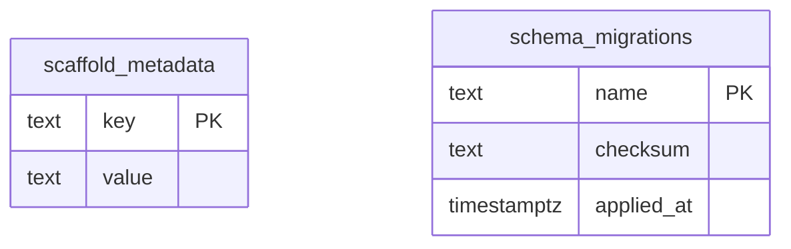

# ConnectSphere Database Diagram

Repository schema through migration 007, updated on 19 October 2026. The last recorded shared Supabase structure verification was on 30 September for migrations 001-006. Migration 007 expands the allowed application roles and leaves the 14 application tables, two support tables, columns and relationships below unchanged. Its application to shared Supabase is not recorded by this implementation.

**19 October follow-up:** migration 007 application and Coordinator Lead login were subsequently reported successful. This does not replace the earlier structural verification or establish manual workflow acceptance. KAN-65 uses the existing assignment fields and adds no schema migration or relationship; see the [verification record](testing/test-evidence.md#19-october-2026--kan-65-coordinator-reassignment).

`PK` marks primary keys, `FK` marks foreign keys, and `UK` marks a single-column unique key. Columns labelled `nullable` accept NULL; all other columns are `NOT NULL`. `text_array` represents PostgreSQL `text[]`.

Relationship labels name the foreign-key column in the child table. `||` means exactly one parent, `|o` means zero or one parent, and `o{` means zero or more child rows.

## Application tables

```mermaid
erDiagram
    app_users |o..o{ coordinator_assignments : "assigned_by"
    app_users ||..o{ coordinator_assignments : "coordinator_id"
    event_requests ||..o{ coordinator_assignments : "event_request_id"
    app_users |o..o{ equipment_requests : "decided_by"
    equipment_types ||..o{ equipment_requests : "equipment_type_id"
    event_requests ||..o{ equipment_requests : "event_request_id"
    app_users ||..o{ equipment_requests : "requested_by"
    app_users |o..o{ event_change_requests : "decided_by"
    event_requests ||..o{ event_change_requests : "event_request_id"
    app_users ||..o{ event_change_requests : "requested_by"
    event_requests ||..o{ event_clarifications : "event_request_id"
    app_users ||..o{ event_clarifications : "requested_by"
    app_users ||..o{ event_registrations : "attendee_id"
    event_requests ||..o{ event_registrations : "event_request_id"
    app_users |o..o{ event_requests : "coordinator_id"
    app_users ||..o{ event_requests : "organiser_id"
    event_requests ||..o{ event_reviews : "event_request_id"
    app_users ||..o{ event_reviews : "reviewed_by"
    app_users |o..o{ event_status_history : "changed_by"
    event_requests ||..o{ event_status_history : "event_request_id"
    event_requests |o..o{ notifications : "event_request_id"
    app_users ||..o{ notifications : "recipient_id"
    app_users |o..o{ venue_bookings : "decided_by"
    event_requests ||..o{ venue_bookings : "event_request_id"
    app_users ||..o{ venue_bookings : "requested_by"
    venues ||..o{ venue_bookings : "venue_id"
    app_users |o..o{ venue_unavailability : "created_by"
    venues ||..o{ venue_unavailability : "venue_id"

    app_users {
        uuid id PK
        text email
        text display_name
        text role
        text password_hash "nullable"
        timestamptz created_at
        timestamptz updated_at
        uuid supabase_user_id UK "nullable"
        boolean coordinator_available
    }

    event_requests {
        uuid id PK
        uuid organiser_id FK
        uuid coordinator_id FK "nullable"
        text status
        text name "nullable"
        text purpose "nullable"
        text description "nullable"
        timestamptz starts_at "nullable"
        timestamptz ends_at "nullable"
        integer expected_attendance "nullable"
        text venue_requirements "nullable"
        text accessibility_needs "nullable"
        text equipment_requirements "nullable"
        boolean registration_required "nullable"
        timestamptz created_at
        timestamptz updated_at
        integer registration_capacity "nullable"
        timestamptz registration_opens_at "nullable"
        timestamptz registration_closes_at "nullable"
    }

    coordinator_assignments {
        uuid id PK
        uuid event_request_id FK
        uuid coordinator_id FK
        uuid assigned_by FK "nullable"
        text note "nullable"
        timestamptz assigned_at
        timestamptz unassigned_at "nullable"
        text assignment_method
    }

    event_clarifications {
        uuid id PK
        uuid event_request_id FK
        uuid requested_by FK
        text message
        text response "nullable"
        timestamptz created_at
        timestamptz responded_at "nullable"
    }

    event_reviews {
        uuid id PK
        uuid event_request_id FK
        uuid reviewed_by FK
        text decision
        text reason "nullable"
        timestamptz created_at
    }

    event_status_history {
        uuid id PK
        uuid event_request_id FK
        text from_status "nullable"
        text to_status
        uuid changed_by FK "nullable"
        timestamptz created_at
    }

    venues {
        integer setup_minutes "0..1440, default 0"
        integer turnaround_minutes "0..1440, default 0"
        uuid id PK
        text name
        text description "nullable"
        text location "nullable"
        integer capacity
        text_array layouts
        text_array facilities
        text_array accessibility_features
        boolean wheelchair_accessible
        time opens_at "nullable"
        time closes_at "nullable"
        boolean is_active
        timestamptz created_at
        timestamptz updated_at
    }

    venue_unavailability {
        uuid id PK
        uuid venue_id FK
        timestamptz starts_at
        timestamptz ends_at
        text reason "nullable"
        uuid created_by FK "nullable"
        timestamptz created_at
    }

    venue_bookings {
        integer reserved_setup_minutes "approval history"
        integer reserved_turnaround_minutes "approval history"
        uuid id PK
        uuid event_request_id FK
        uuid venue_id FK
        uuid requested_by FK
        text status
        timestamptz starts_at
        timestamptz ends_at
        text layout "nullable"
        text notes "nullable"
        uuid decided_by FK "nullable"
        timestamptz decided_at "nullable"
        text decision_reason "nullable"
        timestamptz created_at
        timestamptz updated_at
    }

    equipment_types {
        uuid id PK
        text name
        text category "nullable"
        text description "nullable"
        integer total_quantity
        boolean is_active
        timestamptz created_at
        timestamptz updated_at
    }

    equipment_requests {
        uuid id PK
        uuid event_request_id FK
        uuid equipment_type_id FK
        uuid requested_by FK
        integer quantity
        text status
        timestamptz starts_at
        timestamptz ends_at
        text notes "nullable"
        uuid decided_by FK "nullable"
        timestamptz decided_at "nullable"
        text decision_reason "nullable"
        timestamptz created_at
        timestamptz updated_at
    }

    event_registrations {
        uuid id PK
        uuid event_request_id FK
        uuid attendee_id FK
        text status
        timestamptz registered_at
        timestamptz withdrawn_at "nullable"
    }

    event_change_requests {
        uuid id PK
        uuid event_request_id FK
        uuid requested_by FK
        text status
        jsonb proposed_changes
        text reason
        uuid decided_by FK "nullable"
        timestamptz decided_at "nullable"
        text decision_reason "nullable"
        timestamptz created_at
        timestamptz updated_at
    }

    notifications {
        uuid id PK
        uuid recipient_id FK
        uuid event_request_id FK "nullable"
        text type
        text title
        text message
        timestamptz read_at "nullable"
        timestamptz created_at
    }
```

## Support tables

`scaffold_metadata` supports the database readiness check. `schema_migrations` records applied migration names, checksums and timestamps. Neither table has a foreign-key relationship.

## Relationship rules

- `event_requests.organiser_id` and `coordinator_id` reference application profiles in `app_users`. A request can have no coordinator while it is a draft or remains unassigned.
- `app_users.supabase_user_id` is a nullable, unique login mapping. It has no declared database foreign key to `auth.users`.
- Migration `007_add_coordinator_lead.sql` extends `app_users.role` to allow `EVENT_COORDINATOR_LEAD` alongside `EVENT_ORGANISER`, `EVENT_COORDINATOR`, `VENUE_STAFF`, `TECHNICAL_SUPPORT_STAFF` and `ATTENDEE`. Lead privileges come from trusted application-profile provisioning, not client-editable authentication metadata.
- `app_users.coordinator_available` is required and defaults to `false`. KAN-79 permits an initial assignment only to an available `EVENT_COORDINATOR`; changing availability does not remove an existing assignment.
- Assignment history permits multiple rows per request, with at most one active row (`unassigned_at IS NULL`). `assignment_method` defaults to `MANUAL`: manual rows require `assigned_by`, while `AUTOMATIC` rows require it to be NULL.
- KAN-79 leaves new submissions unassigned and records the Lead's application ID when an initial manual assignment is made. The event linkage and history write commit together. Previously assigned events and historical automatic records remain unchanged; KAN-65 reassignment and KAN-64 notifications are separate dependencies.
- KAN-65 now permits explicit Lead reassignment using the active history row's UUID as `expectedAssignmentVersion`. It requires the current linkage and exactly one active history row to agree. The old row's `unassigned_at` and the new row's `assigned_at` share one database timestamp; the new MANUAL row stores the Lead and required reason in `assigned_by`/`note`. History and `event_requests.coordinator_id` change atomically. Same-coordinator requests with a current version do not write; stale versions and inconsistent legacy history fail without replacing records. KAN-64 notification integration and hosted acceptance remain pending.
- `event_reviews.event_request_id` has no unique constraint; its one-to-many relationship reflects the database structure. The review service prevents repeated initial decisions.
- Registrations are unique per `(event_request_id, attendee_id)` pair. Neither foreign key is individually unique.
- User email addresses, venue names and equipment-type names have case-insensitive unique indexes using `lower(...)`.

The diagrams describe stored tables and relationships. The [database guide](../database/README.md) documents integrity guards and setup; the [scope record](requirements/README.md#30-september-sprint-scope-audit) distinguishes current workflows from later features.

## KAN-78 internal interval model — 21 October 2026

Migration 008 adds two zero-default constrained venue duration columns and two booking approval-snapshot columns shown above. `venue_booking_intervals` is an internal view, not another persistent table: live non-completed bookings use current venue durations; ended/completed bookings use the recorded snapshots. `venue_booking_warnings(uuid)` derives current conflicts/operational violations without writing bookings. These database objects do not grant a new Data API access path.
