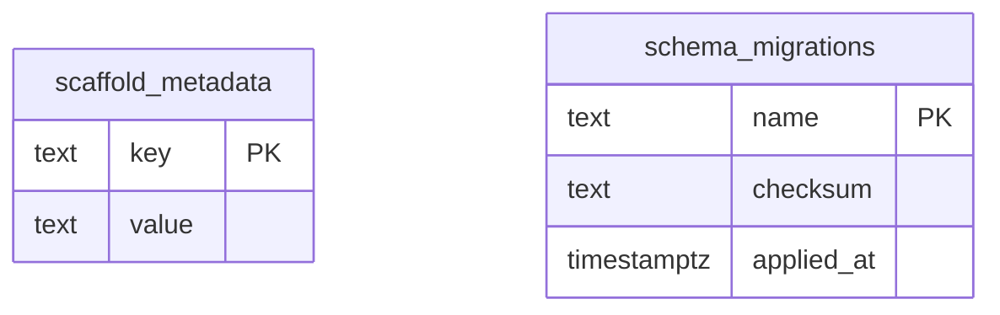
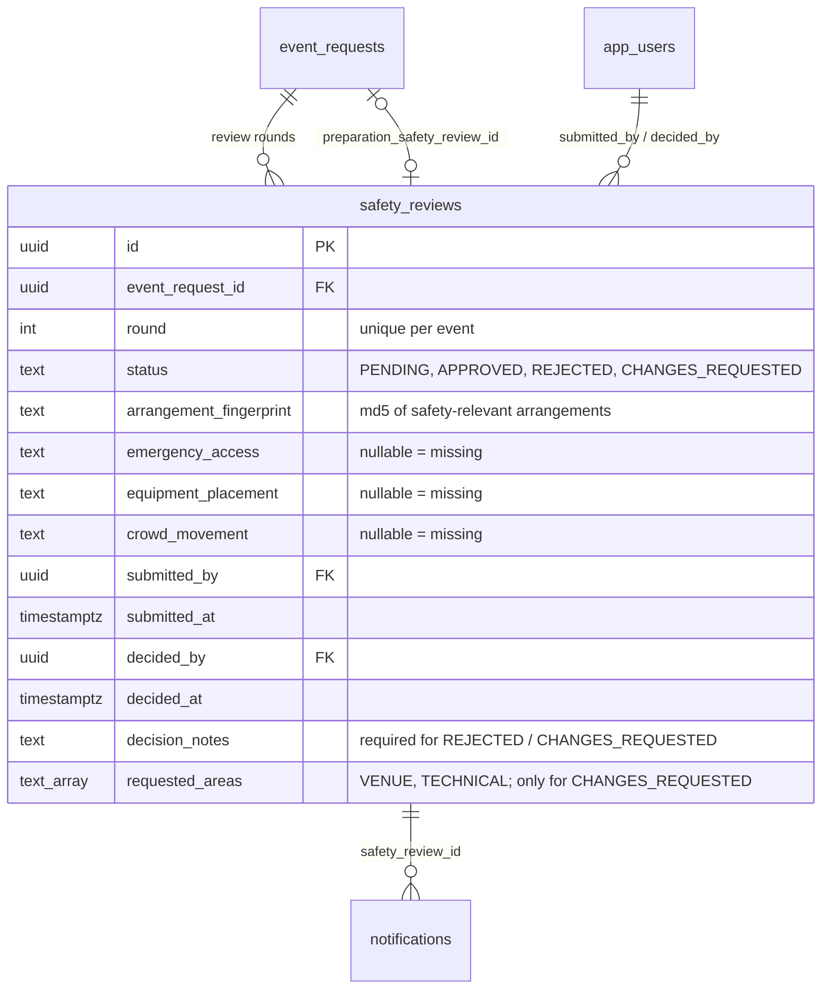
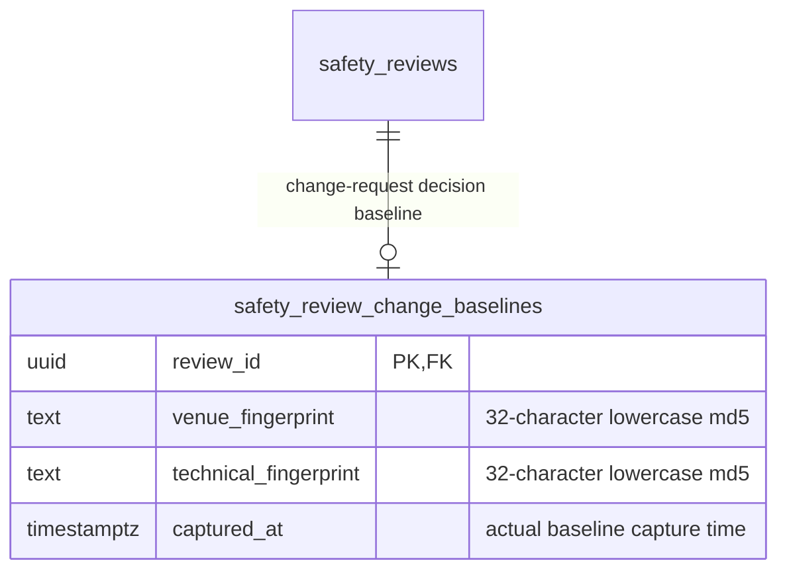
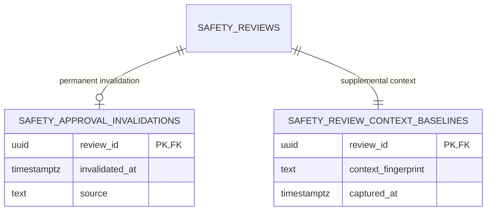
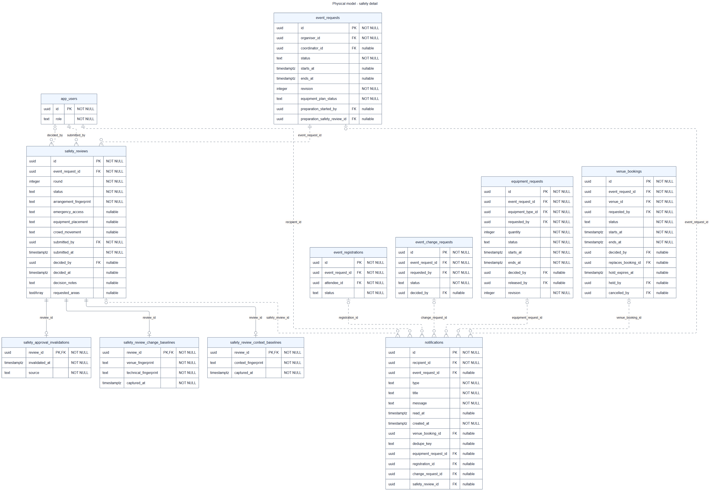

# ConnectSphere data model

**Current implementation: 6 November 2026**, source build `fb6d8d93f721b114accc9857a05d62e859987e23`, migrations 001–023. This is the implemented schema, not proof of the shared database deployment. All migrations were applied to a disposable PostgreSQL 17 container with no network or host ports, no host bind mounts and no application data.

There are **22 application tables**, two infrastructure tables (`schema_migrations`, `scaffold_metadata`), **243 columns**, **55 foreign keys**, one view and 26 non-internal triggers. Authentication verifies Supabase identities and maps them through nullable, unique `app_users.supabase_user_id`; no current `auth_sessions` table exists. Legacy nullable `password_hash` remains in SQL but is not the current login mechanism.

The [audit](scrum/sprint-03/evidence/design-audit-20261106/README.md) contains the exact catalog, migration checksums and per-node/per-connection inventory. [Pre-Week 7 originals](architecture/archive/pre-week-7-customer-changes/README.md) and [before-update copies](architecture/archive/before-2026-11-06-update/README.md) are retained.

## Complete relationship model

Every table and every declared FK appears below. Attributes here are curated keys/statuses; the dictionary below contains **every column**. Crow’s-foot ends come from FK nullability and nonpartial unique constraints, not assumed business intent: a child may have many siblings unless its FK is unique. In particular, `event_reviews.event_request_id` is not unique, while cancellation and the three safety supplement tables have shared primary keys. Solid lines identify FK columns in the child primary key; dotted lines are other FK associations. A nullable FK points to zero or one parent. A parent has zero or more children unless the child FK is unique.

```mermaid
---
config:
  layout: elk
title: Physical model - all 24 tables and 55 foreign keys
---
erDiagram
  direction TB
  app_users {
    uuid id PK "NOT NULL"
    text role "NOT NULL"
  }
  coordinator_assignments {
    uuid id PK "NOT NULL"
    uuid event_request_id FK "NOT NULL"
    uuid coordinator_id FK "NOT NULL"
    uuid assigned_by FK "nullable"
    text assignment_method "NOT NULL"
  }
  equipment_requests {
    uuid id PK "NOT NULL"
    uuid event_request_id FK "NOT NULL"
    uuid equipment_type_id FK "NOT NULL"
    uuid requested_by FK "NOT NULL"
    integer quantity "NOT NULL"
    text status "NOT NULL"
    timestamptz starts_at "NOT NULL"
    timestamptz ends_at "NOT NULL"
    uuid decided_by FK "nullable"
    uuid released_by FK "nullable"
    integer revision "NOT NULL"
  }
  equipment_stock_changes {
    uuid id PK "NOT NULL"
    uuid equipment_type_id FK "NOT NULL"
    integer revision "NOT NULL"
    uuid changed_by FK "NOT NULL"
  }
  equipment_types {
    uuid id PK "NOT NULL"
    integer total_quantity "NOT NULL"
    integer damaged_quantity "NOT NULL"
    integer maintenance_quantity "NOT NULL"
  }
  event_cancellations {
    uuid event_request_id PK,FK "NOT NULL"
    uuid cancelled_by FK "NOT NULL"
  }
  event_change_requests {
    uuid id PK "NOT NULL"
    uuid event_request_id FK "NOT NULL"
    uuid requested_by FK "NOT NULL"
    text status "NOT NULL"
    uuid decided_by FK "nullable"
  }
  event_clarifications {
    uuid id PK "NOT NULL"
    uuid event_request_id FK "NOT NULL"
    uuid requested_by FK "NOT NULL"
  }
  event_registrations {
    uuid id PK "NOT NULL"
    uuid event_request_id FK "NOT NULL"
    uuid attendee_id FK "NOT NULL"
    text status "NOT NULL"
  }
  event_request_edits {
    uuid id PK "NOT NULL"
    uuid event_request_id FK "NOT NULL"
    integer revision "NOT NULL"
    uuid edited_by FK "NOT NULL"
  }
  event_requests {
    uuid id PK "NOT NULL"
    uuid organiser_id FK "NOT NULL"
    uuid coordinator_id FK "nullable"
    text status "NOT NULL"
    timestamptz starts_at "nullable"
    timestamptz ends_at "nullable"
    integer revision "NOT NULL"
    text equipment_plan_status "NOT NULL"
    uuid preparation_started_by FK "nullable"
    uuid preparation_safety_review_id FK "nullable"
  }
  event_reviews {
    uuid id PK "NOT NULL"
    uuid event_request_id FK "NOT NULL"
    uuid reviewed_by FK "NOT NULL"
  }
  event_status_history {
    uuid id PK "NOT NULL"
    uuid event_request_id FK "NOT NULL"
    uuid changed_by FK "nullable"
  }
  notifications {
    uuid id PK "NOT NULL"
    uuid recipient_id FK "NOT NULL"
    uuid event_request_id FK "nullable"
    uuid venue_booking_id FK "nullable"
    uuid equipment_request_id FK "nullable"
    uuid registration_id FK "nullable"
    uuid change_request_id FK "nullable"
    uuid safety_review_id FK "nullable"
  }
  safety_approval_invalidations {
    uuid review_id PK,FK "NOT NULL"
  }
  safety_review_change_baselines {
    uuid review_id PK,FK "NOT NULL"
  }
  safety_review_context_baselines {
    uuid review_id PK,FK "NOT NULL"
  }
  safety_reviews {
    uuid id PK "NOT NULL"
    uuid event_request_id FK "NOT NULL"
    integer round "NOT NULL"
    text status "NOT NULL"
    uuid submitted_by FK "NOT NULL"
    uuid decided_by FK "nullable"
  }
  scaffold_metadata {
    text key PK "NOT NULL"
  }
  schema_migrations {
    text name PK "NOT NULL"
  }
  venue_bookings {
    uuid id PK "NOT NULL"
    uuid event_request_id FK "NOT NULL"
    uuid venue_id FK "NOT NULL"
    uuid requested_by FK "NOT NULL"
    text status "NOT NULL"
    timestamptz starts_at "NOT NULL"
    timestamptz ends_at "NOT NULL"
    uuid decided_by FK "nullable"
    uuid replaces_booking_id FK "nullable"
    timestamptz hold_expires_at "nullable"
    uuid held_by FK "nullable"
    uuid cancelled_by FK "nullable"
  }
  venue_outage_impacts {
    uuid id PK "NOT NULL"
    uuid unavailability_id FK "nullable"
    uuid venue_booking_id FK "NOT NULL"
    uuid venue_id FK "NOT NULL"
    text status "NOT NULL"
    uuid recorded_by FK "nullable"
  }
  venue_unavailability {
    uuid id PK "NOT NULL"
    uuid venue_id FK "NOT NULL"
    timestamptz starts_at "NOT NULL"
    timestamptz ends_at "NOT NULL"
    uuid created_by FK "nullable"
  }
  venues {
    uuid id PK "NOT NULL"
    integer setup_minutes "NOT NULL"
    integer turnaround_minutes "NOT NULL"
  }
  app_users |o..o{ coordinator_assignments : "assigned_by"
  app_users ||..o{ coordinator_assignments : "coordinator_id"
  event_requests ||..o{ coordinator_assignments : "event_request_id"
  app_users |o..o{ equipment_requests : "decided_by"
  equipment_types ||..o{ equipment_requests : "equipment_type_id"
  event_requests ||..o{ equipment_requests : "event_request_id"
  app_users |o..o{ equipment_requests : "released_by"
  app_users ||..o{ equipment_requests : "requested_by"
  app_users ||..o{ equipment_stock_changes : "changed_by"
  equipment_types ||..o{ equipment_stock_changes : "equipment_type_id"
  app_users ||..o{ event_cancellations : "cancelled_by"
  event_requests ||--o| event_cancellations : "event_request_id"
  app_users |o..o{ event_change_requests : "decided_by"
  event_requests ||..o{ event_change_requests : "event_request_id"
  app_users ||..o{ event_change_requests : "requested_by"
  event_requests ||..o{ event_clarifications : "event_request_id"
  app_users ||..o{ event_clarifications : "requested_by"
  app_users ||..o{ event_registrations : "attendee_id"
  event_requests ||..o{ event_registrations : "event_request_id"
  app_users ||..o{ event_request_edits : "edited_by"
  event_requests ||..o{ event_request_edits : "event_request_id"
  app_users |o..o{ event_requests : "coordinator_id"
  app_users ||..o{ event_requests : "organiser_id"
  safety_reviews |o..o{ event_requests : "preparation_safety_review_id"
  app_users |o..o{ event_requests : "preparation_started_by"
  event_requests ||..o{ event_reviews : "event_request_id"
  app_users ||..o{ event_reviews : "reviewed_by"
  app_users |o..o{ event_status_history : "changed_by"
  event_requests ||..o{ event_status_history : "event_request_id"
  event_change_requests |o..o{ notifications : "change_request_id"
  equipment_requests |o..o{ notifications : "equipment_request_id"
  event_requests |o..o{ notifications : "event_request_id"
  app_users ||..o{ notifications : "recipient_id"
  event_registrations |o..o{ notifications : "registration_id"
  safety_reviews |o..o{ notifications : "safety_review_id"
  venue_bookings |o..o{ notifications : "venue_booking_id"
  safety_reviews ||--o| safety_approval_invalidations : "review_id"
  safety_reviews ||--o| safety_review_change_baselines : "review_id"
  safety_reviews ||--o| safety_review_context_baselines : "review_id"
  app_users |o..o{ safety_reviews : "decided_by"
  event_requests ||..o{ safety_reviews : "event_request_id"
  app_users ||..o{ safety_reviews : "submitted_by"
  app_users |o..o{ venue_bookings : "cancelled_by"
  app_users |o..o{ venue_bookings : "decided_by"
  event_requests ||..o{ venue_bookings : "event_request_id"
  app_users |o..o{ venue_bookings : "held_by"
  venue_bookings |o..o{ venue_bookings : "replaces_booking_id"
  app_users ||..o{ venue_bookings : "requested_by"
  venues ||..o{ venue_bookings : "venue_id"
  app_users |o..o{ venue_outage_impacts : "recorded_by"
  venue_unavailability |o..o{ venue_outage_impacts : "unavailability_id"
  venue_bookings ||..o{ venue_outage_impacts : "venue_booking_id"
  venues ||..o{ venue_outage_impacts : "venue_id"
  app_users |o..o{ venue_unavailability : "created_by"
  venues ||..o{ venue_unavailability : "venue_id"
```

[PNG overview](architecture/exports/erd-database.png) · [SVG overview](architecture/exports/erd-database.svg). Readable domain views: [events](architecture/README.md#current-domain-data-views), [planning](architecture/exports/erd-planning.svg), [safety and notices](architecture/exports/erd-safety-invalidation.svg).

## Column dictionary

SQL types/defaults are transcribed from PostgreSQL. `NULL` means the column is nullable; it does not imply the API may accept null. API projections use camelCase and have separate visibility rules. Empty default cells mean no SQL default. FK targets and ON DELETE/UPDATE behavior follow in the relationship register.

### app_users

| Column | SQL type | Nullability | Default | Key |
| --- | --- | --- | --- | --- |
| `id` | `uuid` | NOT NULL | `gen_random_uuid()` | PK |
| `email` | `text` | NOT NULL |  |  |
| `display_name` | `text` | NOT NULL |  |  |
| `role` | `text` | NOT NULL |  |  |
| `password_hash` | `text` | NULL |  |  |
| `created_at` | `timestamp with time zone` | NOT NULL | `now()` |  |
| `updated_at` | `timestamp with time zone` | NOT NULL | `now()` |  |
| `supabase_user_id` | `uuid` | NULL |  |  |
| `coordinator_available` | `boolean` | NOT NULL | `false` |  |

### coordinator_assignments

| Column | SQL type | Nullability | Default | Key |
| --- | --- | --- | --- | --- |
| `id` | `uuid` | NOT NULL | `gen_random_uuid()` | PK |
| `event_request_id` | `uuid` | NOT NULL |  | FK |
| `coordinator_id` | `uuid` | NOT NULL |  | FK |
| `assigned_by` | `uuid` | NULL |  | FK |
| `note` | `text` | NULL |  |  |
| `assigned_at` | `timestamp with time zone` | NOT NULL | `now()` |  |
| `unassigned_at` | `timestamp with time zone` | NULL |  |  |
| `assignment_method` | `text` | NOT NULL | `'MANUAL'::text` |  |

### equipment_requests

| Column | SQL type | Nullability | Default | Key |
| --- | --- | --- | --- | --- |
| `id` | `uuid` | NOT NULL | `gen_random_uuid()` | PK |
| `event_request_id` | `uuid` | NOT NULL |  | FK |
| `equipment_type_id` | `uuid` | NOT NULL |  | FK |
| `requested_by` | `uuid` | NOT NULL |  | FK |
| `quantity` | `integer` | NOT NULL |  |  |
| `status` | `text` | NOT NULL | `'REQUESTED'::text` |  |
| `starts_at` | `timestamp with time zone` | NOT NULL |  |  |
| `ends_at` | `timestamp with time zone` | NOT NULL |  |  |
| `notes` | `text` | NULL |  |  |
| `decided_by` | `uuid` | NULL |  | FK |
| `decided_at` | `timestamp with time zone` | NULL |  |  |
| `decision_reason` | `text` | NULL |  |  |
| `created_at` | `timestamp with time zone` | NOT NULL | `now()` |  |
| `updated_at` | `timestamp with time zone` | NOT NULL | `now()` |  |
| `released_at` | `timestamp with time zone` | NULL |  |  |
| `released_by` | `uuid` | NULL |  | FK |
| `release_reason` | `text` | NULL |  |  |
| `release_cause` | `text` | NULL |  |  |
| `technical_requirements` | `text` | NULL |  |  |
| `revision` | `integer` | NOT NULL | `1` |  |

### equipment_stock_changes

| Column | SQL type | Nullability | Default | Key |
| --- | --- | --- | --- | --- |
| `id` | `uuid` | NOT NULL | `gen_random_uuid()` | PK |
| `equipment_type_id` | `uuid` | NOT NULL |  | FK |
| `revision` | `integer` | NOT NULL |  |  |
| `changed_by` | `uuid` | NOT NULL |  | FK |
| `changed_at` | `timestamp with time zone` | NOT NULL | `clock_timestamp()` |  |
| `reason` | `text` | NOT NULL |  |  |
| `previous_total_quantity` | `integer` | NOT NULL |  |  |
| `previous_damaged_quantity` | `integer` | NOT NULL |  |  |
| `previous_maintenance_quantity` | `integer` | NOT NULL |  |  |
| `new_total_quantity` | `integer` | NOT NULL |  |  |
| `new_damaged_quantity` | `integer` | NOT NULL |  |  |
| `new_maintenance_quantity` | `integer` | NOT NULL |  |  |

### equipment_types

| Column | SQL type | Nullability | Default | Key |
| --- | --- | --- | --- | --- |
| `id` | `uuid` | NOT NULL | `gen_random_uuid()` | PK |
| `name` | `text` | NOT NULL |  |  |
| `category` | `text` | NULL |  |  |
| `description` | `text` | NULL |  |  |
| `total_quantity` | `integer` | NOT NULL |  |  |
| `is_active` | `boolean` | NOT NULL | `true` |  |
| `created_at` | `timestamp with time zone` | NOT NULL | `now()` |  |
| `updated_at` | `timestamp with time zone` | NOT NULL | `now()` |  |
| `damaged_quantity` | `integer` | NOT NULL | `0` |  |
| `maintenance_quantity` | `integer` | NOT NULL | `0` |  |
| `stock_revision` | `integer` | NOT NULL | `0` |  |

### event_cancellations

| Column | SQL type | Nullability | Default | Key |
| --- | --- | --- | --- | --- |
| `event_request_id` | `uuid` | NOT NULL |  | PK, FK |
| `cancelled_by` | `uuid` | NOT NULL |  | FK |
| `cancelled_at` | `timestamp with time zone` | NOT NULL | `now()` |  |
| `reason` | `text` | NOT NULL |  |  |
| `affected_venue_bookings` | `integer` | NOT NULL |  |  |
| `affected_equipment_requests` | `integer` | NOT NULL |  |  |
| `affected_registrations` | `integer` | NOT NULL |  |  |

### event_change_requests

| Column | SQL type | Nullability | Default | Key |
| --- | --- | --- | --- | --- |
| `id` | `uuid` | NOT NULL | `gen_random_uuid()` | PK |
| `event_request_id` | `uuid` | NOT NULL |  | FK |
| `requested_by` | `uuid` | NOT NULL |  | FK |
| `status` | `text` | NOT NULL | `'PENDING'::text` |  |
| `proposed_changes` | `jsonb` | NOT NULL |  |  |
| `reason` | `text` | NULL |  |  |
| `decided_by` | `uuid` | NULL |  | FK |
| `decided_at` | `timestamp with time zone` | NULL |  |  |
| `decision_reason` | `text` | NULL |  |  |
| `created_at` | `timestamp with time zone` | NOT NULL | `now()` |  |
| `updated_at` | `timestamp with time zone` | NOT NULL | `now()` |  |
| `previous` | `jsonb` | NOT NULL |  |  |
| `base_revision` | `integer` | NOT NULL |  |  |
| `applied_revision` | `integer` | NULL |  |  |
| `cancelled_arrangements` | `jsonb` | NULL |  |  |

### event_clarifications

| Column | SQL type | Nullability | Default | Key |
| --- | --- | --- | --- | --- |
| `id` | `uuid` | NOT NULL | `gen_random_uuid()` | PK |
| `event_request_id` | `uuid` | NOT NULL |  | FK |
| `requested_by` | `uuid` | NOT NULL |  | FK |
| `message` | `text` | NOT NULL |  |  |
| `response` | `text` | NULL |  |  |
| `created_at` | `timestamp with time zone` | NOT NULL | `now()` |  |
| `responded_at` | `timestamp with time zone` | NULL |  |  |

### event_registrations

| Column | SQL type | Nullability | Default | Key |
| --- | --- | --- | --- | --- |
| `id` | `uuid` | NOT NULL | `gen_random_uuid()` | PK |
| `event_request_id` | `uuid` | NOT NULL |  | FK |
| `attendee_id` | `uuid` | NOT NULL |  | FK |
| `status` | `text` | NOT NULL | `'REGISTERED'::text` |  |
| `registered_at` | `timestamp with time zone` | NOT NULL | `now()` |  |
| `withdrawn_at` | `timestamp with time zone` | NULL |  |  |
| `cancellation_outcome_at` | `timestamp with time zone` | NULL |  |  |
| `outcome_version` | `integer` | NOT NULL | `1` |  |

### event_request_edits

| Column | SQL type | Nullability | Default | Key |
| --- | --- | --- | --- | --- |
| `id` | `uuid` | NOT NULL | `gen_random_uuid()` | PK |
| `event_request_id` | `uuid` | NOT NULL |  | FK |
| `revision` | `integer` | NOT NULL |  |  |
| `edited_by` | `uuid` | NOT NULL |  | FK |
| `editor_role` | `text` | NOT NULL |  |  |
| `event_status` | `text` | NOT NULL |  |  |
| `changes` | `jsonb` | NOT NULL |  |  |
| `created_at` | `timestamp with time zone` | NOT NULL | `now()` |  |

### event_requests

| Column | SQL type | Nullability | Default | Key |
| --- | --- | --- | --- | --- |
| `id` | `uuid` | NOT NULL | `gen_random_uuid()` | PK |
| `organiser_id` | `uuid` | NOT NULL |  | FK |
| `coordinator_id` | `uuid` | NULL |  | FK |
| `status` | `text` | NOT NULL | `'DRAFT'::text` |  |
| `name` | `text` | NULL |  |  |
| `purpose` | `text` | NULL |  |  |
| `description` | `text` | NULL |  |  |
| `starts_at` | `timestamp with time zone` | NULL |  |  |
| `ends_at` | `timestamp with time zone` | NULL |  |  |
| `expected_attendance` | `integer` | NULL |  |  |
| `venue_requirements` | `text` | NULL |  |  |
| `accessibility_needs` | `text` | NULL |  |  |
| `equipment_requirements` | `text` | NULL |  |  |
| `registration_required` | `boolean` | NULL |  |  |
| `created_at` | `timestamp with time zone` | NOT NULL | `now()` |  |
| `updated_at` | `timestamp with time zone` | NOT NULL | `now()` |  |
| `registration_capacity` | `integer` | NULL |  |  |
| `registration_opens_at` | `timestamp with time zone` | NULL |  |  |
| `registration_closes_at` | `timestamp with time zone` | NULL |  |  |
| `revision` | `integer` | NOT NULL | `1` |  |
| `equipment_plan_status` | `text` | NOT NULL | `'REQUIRED'::text` |  |
| `preparation_started_at` | `timestamp with time zone` | NULL |  |  |
| `preparation_started_by` | `uuid` | NULL |  | FK |
| `preparation_safety_review_id` | `uuid` | NULL |  | FK |

### event_reviews

| Column | SQL type | Nullability | Default | Key |
| --- | --- | --- | --- | --- |
| `id` | `uuid` | NOT NULL | `gen_random_uuid()` | PK |
| `event_request_id` | `uuid` | NOT NULL |  | FK |
| `reviewed_by` | `uuid` | NOT NULL |  | FK |
| `decision` | `text` | NOT NULL |  |  |
| `reason` | `text` | NULL |  |  |
| `created_at` | `timestamp with time zone` | NOT NULL | `now()` |  |

### event_status_history

| Column | SQL type | Nullability | Default | Key |
| --- | --- | --- | --- | --- |
| `id` | `uuid` | NOT NULL | `gen_random_uuid()` | PK |
| `event_request_id` | `uuid` | NOT NULL |  | FK |
| `from_status` | `text` | NULL |  |  |
| `to_status` | `text` | NOT NULL |  |  |
| `changed_by` | `uuid` | NULL |  | FK |
| `created_at` | `timestamp with time zone` | NOT NULL | `now()` |  |
| `reason` | `text` | NULL |  |  |

### notifications

| Column | SQL type | Nullability | Default | Key |
| --- | --- | --- | --- | --- |
| `id` | `uuid` | NOT NULL | `gen_random_uuid()` | PK |
| `recipient_id` | `uuid` | NOT NULL |  | FK |
| `event_request_id` | `uuid` | NULL |  | FK |
| `type` | `text` | NOT NULL |  |  |
| `title` | `text` | NOT NULL |  |  |
| `message` | `text` | NOT NULL |  |  |
| `read_at` | `timestamp with time zone` | NULL |  |  |
| `created_at` | `timestamp with time zone` | NOT NULL | `now()` |  |
| `venue_booking_id` | `uuid` | NULL |  | FK |
| `dedupe_key` | `text` | NULL |  |  |
| `equipment_request_id` | `uuid` | NULL |  | FK |
| `registration_id` | `uuid` | NULL |  | FK |
| `change_request_id` | `uuid` | NULL |  | FK |
| `safety_review_id` | `uuid` | NULL |  | FK |

### safety_approval_invalidations

| Column | SQL type | Nullability | Default | Key |
| --- | --- | --- | --- | --- |
| `review_id` | `uuid` | NOT NULL |  | PK, FK |
| `invalidated_at` | `timestamp with time zone` | NOT NULL | `clock_timestamp()` |  |
| `source` | `text` | NOT NULL |  |  |

### safety_review_change_baselines

| Column | SQL type | Nullability | Default | Key |
| --- | --- | --- | --- | --- |
| `review_id` | `uuid` | NOT NULL |  | PK, FK |
| `venue_fingerprint` | `text` | NOT NULL |  |  |
| `technical_fingerprint` | `text` | NOT NULL |  |  |
| `captured_at` | `timestamp with time zone` | NOT NULL | `now()` |  |

### safety_review_context_baselines

| Column | SQL type | Nullability | Default | Key |
| --- | --- | --- | --- | --- |
| `review_id` | `uuid` | NOT NULL |  | PK, FK |
| `context_fingerprint` | `text` | NOT NULL |  |  |
| `captured_at` | `timestamp with time zone` | NOT NULL | `clock_timestamp()` |  |

### safety_reviews

| Column | SQL type | Nullability | Default | Key |
| --- | --- | --- | --- | --- |
| `id` | `uuid` | NOT NULL | `gen_random_uuid()` | PK |
| `event_request_id` | `uuid` | NOT NULL |  | FK |
| `round` | `integer` | NOT NULL |  |  |
| `status` | `text` | NOT NULL | `'PENDING'::text` |  |
| `arrangement_fingerprint` | `text` | NOT NULL |  |  |
| `emergency_access` | `text` | NULL |  |  |
| `equipment_placement` | `text` | NULL |  |  |
| `crowd_movement` | `text` | NULL |  |  |
| `submitted_by` | `uuid` | NOT NULL |  | FK |
| `submitted_at` | `timestamp with time zone` | NOT NULL | `now()` |  |
| `decided_by` | `uuid` | NULL |  | FK |
| `decided_at` | `timestamp with time zone` | NULL |  |  |
| `decision_notes` | `text` | NULL |  |  |
| `requested_areas` | `text[]` | NULL |  |  |

### scaffold_metadata

| Column | SQL type | Nullability | Default | Key |
| --- | --- | --- | --- | --- |
| `key` | `text` | NOT NULL |  | PK |
| `value` | `text` | NOT NULL |  |  |

### schema_migrations

| Column | SQL type | Nullability | Default | Key |
| --- | --- | --- | --- | --- |
| `name` | `text` | NOT NULL |  | PK |
| `checksum` | `text` | NOT NULL |  |  |
| `applied_at` | `timestamp with time zone` | NOT NULL | `now()` |  |

### venue_bookings

| Column | SQL type | Nullability | Default | Key |
| --- | --- | --- | --- | --- |
| `id` | `uuid` | NOT NULL | `gen_random_uuid()` | PK |
| `event_request_id` | `uuid` | NOT NULL |  | FK |
| `venue_id` | `uuid` | NOT NULL |  | FK |
| `requested_by` | `uuid` | NOT NULL |  | FK |
| `status` | `text` | NOT NULL | `'PENDING'::text` |  |
| `starts_at` | `timestamp with time zone` | NOT NULL |  |  |
| `ends_at` | `timestamp with time zone` | NOT NULL |  |  |
| `layout` | `text` | NULL |  |  |
| `notes` | `text` | NULL |  |  |
| `decided_by` | `uuid` | NULL |  | FK |
| `decided_at` | `timestamp with time zone` | NULL |  |  |
| `decision_reason` | `text` | NULL |  |  |
| `created_at` | `timestamp with time zone` | NOT NULL | `now()` |  |
| `updated_at` | `timestamp with time zone` | NOT NULL | `now()` |  |
| `replaces_booking_id` | `uuid` | NULL |  | FK |
| `reserved_setup_minutes` | `integer` | NOT NULL | `0` |  |
| `reserved_turnaround_minutes` | `integer` | NOT NULL | `0` |  |
| `hold_expires_at` | `timestamp with time zone` | NULL |  |  |
| `held_by` | `uuid` | NULL |  | FK |
| `held_at` | `timestamp with time zone` | NULL |  |  |
| `expired_at` | `timestamp with time zone` | NULL |  |  |
| `cancelled_by` | `uuid` | NULL |  | FK |
| `cancelled_at` | `timestamp with time zone` | NULL |  |  |
| `cancellation_reason` | `text` | NULL |  |  |

### venue_outage_impacts

| Column | SQL type | Nullability | Default | Key |
| --- | --- | --- | --- | --- |
| `id` | `uuid` | NOT NULL | `gen_random_uuid()` | PK |
| `unavailability_id` | `uuid` | NULL |  | FK |
| `venue_booking_id` | `uuid` | NOT NULL |  | FK |
| `venue_id` | `uuid` | NOT NULL |  | FK |
| `outage_starts_at` | `timestamp with time zone` | NOT NULL |  |  |
| `outage_ends_at` | `timestamp with time zone` | NOT NULL |  |  |
| `outage_reason` | `text` | NOT NULL |  |  |
| `status` | `text` | NOT NULL | `'RECOVERY_REQUIRED'::text` |  |
| `recorded_by` | `uuid` | NULL |  | FK |
| `created_at` | `timestamp with time zone` | NOT NULL | `now()` |  |
| `updated_at` | `timestamp with time zone` | NOT NULL | `now()` |  |

### venue_unavailability

| Column | SQL type | Nullability | Default | Key |
| --- | --- | --- | --- | --- |
| `id` | `uuid` | NOT NULL | `gen_random_uuid()` | PK |
| `venue_id` | `uuid` | NOT NULL |  | FK |
| `starts_at` | `timestamp with time zone` | NOT NULL |  |  |
| `ends_at` | `timestamp with time zone` | NOT NULL |  |  |
| `reason` | `text` | NULL |  |  |
| `created_by` | `uuid` | NULL |  | FK |
| `created_at` | `timestamp with time zone` | NOT NULL | `now()` |  |

### venues

| Column | SQL type | Nullability | Default | Key |
| --- | --- | --- | --- | --- |
| `id` | `uuid` | NOT NULL | `gen_random_uuid()` | PK |
| `name` | `text` | NOT NULL |  |  |
| `description` | `text` | NULL |  |  |
| `location` | `text` | NULL |  |  |
| `capacity` | `integer` | NOT NULL |  |  |
| `layouts` | `text[]` | NOT NULL | `'{}'::text[]` |  |
| `facilities` | `text[]` | NOT NULL | `'{}'::text[]` |  |
| `accessibility_features` | `text[]` | NOT NULL | `'{}'::text[]` |  |
| `wheelchair_accessible` | `boolean` | NOT NULL | `false` |  |
| `opens_at` | `time without time zone` | NULL |  |  |
| `closes_at` | `time without time zone` | NULL |  |  |
| `is_active` | `boolean` | NOT NULL | `true` |  |
| `created_at` | `timestamp with time zone` | NOT NULL | `now()` |  |
| `updated_at` | `timestamp with time zone` | NOT NULL | `now()` |  |
| `setup_minutes` | `integer` | NOT NULL | `0` |  |
| `turnaround_minutes` | `integer` | NOT NULL | `0` |  |

## Foreign-key register

Each row is one actual database constraint; all actor references and all seven notification references are included.

| Constraint | Child columns → parent columns | Parent per child | Children per parent | SQL behavior |
| --- | --- | --- | --- | --- |
| `coordinator_assignments_assigned_by_fkey` | `coordinator_assignments.assigned_by` → `app_users.id` | 0..1 | 0..* | `FOREIGN KEY (assigned_by) REFERENCES app_users(id)` |
| `coordinator_assignments_coordinator_id_fkey` | `coordinator_assignments.coordinator_id` → `app_users.id` | 1 | 0..* | `FOREIGN KEY (coordinator_id) REFERENCES app_users(id)` |
| `coordinator_assignments_event_request_id_fkey` | `coordinator_assignments.event_request_id` → `event_requests.id` | 1 | 0..* | `FOREIGN KEY (event_request_id) REFERENCES event_requests(id) ON DELETE CASCADE` |
| `equipment_requests_decided_by_fkey` | `equipment_requests.decided_by` → `app_users.id` | 0..1 | 0..* | `FOREIGN KEY (decided_by) REFERENCES app_users(id)` |
| `equipment_requests_equipment_type_id_fkey` | `equipment_requests.equipment_type_id` → `equipment_types.id` | 1 | 0..* | `FOREIGN KEY (equipment_type_id) REFERENCES equipment_types(id)` |
| `equipment_requests_event_request_id_fkey` | `equipment_requests.event_request_id` → `event_requests.id` | 1 | 0..* | `FOREIGN KEY (event_request_id) REFERENCES event_requests(id)` |
| `equipment_requests_released_by_fkey` | `equipment_requests.released_by` → `app_users.id` | 0..1 | 0..* | `FOREIGN KEY (released_by) REFERENCES app_users(id)` |
| `equipment_requests_requested_by_fkey` | `equipment_requests.requested_by` → `app_users.id` | 1 | 0..* | `FOREIGN KEY (requested_by) REFERENCES app_users(id)` |
| `equipment_stock_changes_changed_by_fkey` | `equipment_stock_changes.changed_by` → `app_users.id` | 1 | 0..* | `FOREIGN KEY (changed_by) REFERENCES app_users(id)` |
| `equipment_stock_changes_equipment_type_id_fkey` | `equipment_stock_changes.equipment_type_id` → `equipment_types.id` | 1 | 0..* | `FOREIGN KEY (equipment_type_id) REFERENCES equipment_types(id)` |
| `event_cancellations_cancelled_by_fkey` | `event_cancellations.cancelled_by` → `app_users.id` | 1 | 0..* | `FOREIGN KEY (cancelled_by) REFERENCES app_users(id)` |
| `event_cancellations_event_request_id_fkey` | `event_cancellations.event_request_id` → `event_requests.id` | 1 | 0..1 | `FOREIGN KEY (event_request_id) REFERENCES event_requests(id)` |
| `event_change_requests_decided_by_fkey` | `event_change_requests.decided_by` → `app_users.id` | 0..1 | 0..* | `FOREIGN KEY (decided_by) REFERENCES app_users(id)` |
| `event_change_requests_event_request_id_fkey` | `event_change_requests.event_request_id` → `event_requests.id` | 1 | 0..* | `FOREIGN KEY (event_request_id) REFERENCES event_requests(id)` |
| `event_change_requests_requested_by_fkey` | `event_change_requests.requested_by` → `app_users.id` | 1 | 0..* | `FOREIGN KEY (requested_by) REFERENCES app_users(id)` |
| `event_clarifications_event_request_id_fkey` | `event_clarifications.event_request_id` → `event_requests.id` | 1 | 0..* | `FOREIGN KEY (event_request_id) REFERENCES event_requests(id)` |
| `event_clarifications_requested_by_fkey` | `event_clarifications.requested_by` → `app_users.id` | 1 | 0..* | `FOREIGN KEY (requested_by) REFERENCES app_users(id)` |
| `event_registrations_attendee_id_fkey` | `event_registrations.attendee_id` → `app_users.id` | 1 | 0..* | `FOREIGN KEY (attendee_id) REFERENCES app_users(id)` |
| `event_registrations_event_request_id_fkey` | `event_registrations.event_request_id` → `event_requests.id` | 1 | 0..* | `FOREIGN KEY (event_request_id) REFERENCES event_requests(id)` |
| `event_request_edits_edited_by_fkey` | `event_request_edits.edited_by` → `app_users.id` | 1 | 0..* | `FOREIGN KEY (edited_by) REFERENCES app_users(id)` |
| `event_request_edits_event_request_id_fkey` | `event_request_edits.event_request_id` → `event_requests.id` | 1 | 0..* | `FOREIGN KEY (event_request_id) REFERENCES event_requests(id) ON DELETE CASCADE` |
| `event_requests_coordinator_id_fkey` | `event_requests.coordinator_id` → `app_users.id` | 0..1 | 0..* | `FOREIGN KEY (coordinator_id) REFERENCES app_users(id)` |
| `event_requests_organiser_id_fkey` | `event_requests.organiser_id` → `app_users.id` | 1 | 0..* | `FOREIGN KEY (organiser_id) REFERENCES app_users(id)` |
| `event_requests_preparation_safety_review_id_fkey` | `event_requests.preparation_safety_review_id` → `safety_reviews.id` | 0..1 | 0..* | `FOREIGN KEY (preparation_safety_review_id) REFERENCES safety_reviews(id)` |
| `event_requests_preparation_started_by_fkey` | `event_requests.preparation_started_by` → `app_users.id` | 0..1 | 0..* | `FOREIGN KEY (preparation_started_by) REFERENCES app_users(id)` |
| `event_reviews_event_request_id_fkey` | `event_reviews.event_request_id` → `event_requests.id` | 1 | 0..* | `FOREIGN KEY (event_request_id) REFERENCES event_requests(id)` |
| `event_reviews_reviewed_by_fkey` | `event_reviews.reviewed_by` → `app_users.id` | 1 | 0..* | `FOREIGN KEY (reviewed_by) REFERENCES app_users(id)` |
| `event_status_history_changed_by_fkey` | `event_status_history.changed_by` → `app_users.id` | 0..1 | 0..* | `FOREIGN KEY (changed_by) REFERENCES app_users(id)` |
| `event_status_history_event_request_id_fkey` | `event_status_history.event_request_id` → `event_requests.id` | 1 | 0..* | `FOREIGN KEY (event_request_id) REFERENCES event_requests(id) ON DELETE CASCADE` |
| `notifications_change_request_id_fkey` | `notifications.change_request_id` → `event_change_requests.id` | 0..1 | 0..* | `FOREIGN KEY (change_request_id) REFERENCES event_change_requests(id)` |
| `notifications_equipment_request_id_fkey` | `notifications.equipment_request_id` → `equipment_requests.id` | 0..1 | 0..* | `FOREIGN KEY (equipment_request_id) REFERENCES equipment_requests(id)` |
| `notifications_event_request_id_fkey` | `notifications.event_request_id` → `event_requests.id` | 0..1 | 0..* | `FOREIGN KEY (event_request_id) REFERENCES event_requests(id) ON DELETE CASCADE` |
| `notifications_recipient_id_fkey` | `notifications.recipient_id` → `app_users.id` | 1 | 0..* | `FOREIGN KEY (recipient_id) REFERENCES app_users(id) ON DELETE CASCADE` |
| `notifications_registration_id_fkey` | `notifications.registration_id` → `event_registrations.id` | 0..1 | 0..* | `FOREIGN KEY (registration_id) REFERENCES event_registrations(id)` |
| `notifications_safety_review_id_fkey` | `notifications.safety_review_id` → `safety_reviews.id` | 0..1 | 0..* | `FOREIGN KEY (safety_review_id) REFERENCES safety_reviews(id)` |
| `notifications_venue_booking_id_fkey` | `notifications.venue_booking_id` → `venue_bookings.id` | 0..1 | 0..* | `FOREIGN KEY (venue_booking_id) REFERENCES venue_bookings(id) ON DELETE SET NULL` |
| `safety_approval_invalidations_review_id_fkey` | `safety_approval_invalidations.review_id` → `safety_reviews.id` | 1 | 0..1 | `FOREIGN KEY (review_id) REFERENCES safety_reviews(id)` |
| `safety_review_change_baselines_review_id_fkey` | `safety_review_change_baselines.review_id` → `safety_reviews.id` | 1 | 0..1 | `FOREIGN KEY (review_id) REFERENCES safety_reviews(id)` |
| `safety_review_context_baselines_review_id_fkey` | `safety_review_context_baselines.review_id` → `safety_reviews.id` | 1 | 0..1 | `FOREIGN KEY (review_id) REFERENCES safety_reviews(id)` |
| `safety_reviews_decided_by_fkey` | `safety_reviews.decided_by` → `app_users.id` | 0..1 | 0..* | `FOREIGN KEY (decided_by) REFERENCES app_users(id)` |
| `safety_reviews_event_request_id_fkey` | `safety_reviews.event_request_id` → `event_requests.id` | 1 | 0..* | `FOREIGN KEY (event_request_id) REFERENCES event_requests(id)` |
| `safety_reviews_submitted_by_fkey` | `safety_reviews.submitted_by` → `app_users.id` | 1 | 0..* | `FOREIGN KEY (submitted_by) REFERENCES app_users(id)` |
| `venue_bookings_cancelled_by_fkey` | `venue_bookings.cancelled_by` → `app_users.id` | 0..1 | 0..* | `FOREIGN KEY (cancelled_by) REFERENCES app_users(id)` |
| `venue_bookings_decided_by_fkey` | `venue_bookings.decided_by` → `app_users.id` | 0..1 | 0..* | `FOREIGN KEY (decided_by) REFERENCES app_users(id)` |
| `venue_bookings_event_request_id_fkey` | `venue_bookings.event_request_id` → `event_requests.id` | 1 | 0..* | `FOREIGN KEY (event_request_id) REFERENCES event_requests(id)` |
| `venue_bookings_held_by_fkey` | `venue_bookings.held_by` → `app_users.id` | 0..1 | 0..* | `FOREIGN KEY (held_by) REFERENCES app_users(id)` |
| `venue_bookings_replaces_booking_id_fkey` | `venue_bookings.replaces_booking_id` → `venue_bookings.id` | 0..1 | 0..* | `FOREIGN KEY (replaces_booking_id) REFERENCES venue_bookings(id)` |
| `venue_bookings_requested_by_fkey` | `venue_bookings.requested_by` → `app_users.id` | 1 | 0..* | `FOREIGN KEY (requested_by) REFERENCES app_users(id)` |
| `venue_bookings_venue_id_fkey` | `venue_bookings.venue_id` → `venues.id` | 1 | 0..* | `FOREIGN KEY (venue_id) REFERENCES venues(id)` |
| `venue_outage_impacts_recorded_by_fkey` | `venue_outage_impacts.recorded_by` → `app_users.id` | 0..1 | 0..* | `FOREIGN KEY (recorded_by) REFERENCES app_users(id)` |
| `venue_outage_impacts_unavailability_id_fkey` | `venue_outage_impacts.unavailability_id` → `venue_unavailability.id` | 0..1 | 0..* | `FOREIGN KEY (unavailability_id) REFERENCES venue_unavailability(id) ON DELETE SET NULL` |
| `venue_outage_impacts_venue_booking_id_fkey` | `venue_outage_impacts.venue_booking_id` → `venue_bookings.id` | 1 | 0..* | `FOREIGN KEY (venue_booking_id) REFERENCES venue_bookings(id)` |
| `venue_outage_impacts_venue_id_fkey` | `venue_outage_impacts.venue_id` → `venues.id` | 1 | 0..* | `FOREIGN KEY (venue_id) REFERENCES venues(id)` |
| `venue_unavailability_created_by_fkey` | `venue_unavailability.created_by` → `app_users.id` | 0..1 | 0..* | `FOREIGN KEY (created_by) REFERENCES app_users(id)` |
| `venue_unavailability_venue_id_fkey` | `venue_unavailability.venue_id` → `venues.id` | 1 | 0..* | `FOREIGN KEY (venue_id) REFERENCES venues(id) ON DELETE CASCADE` |

## Other constraints, indexes, view and triggers

The catalog is the authority for the final migrated schema; retained migrations are immutable source history. All 169 constraints, 62 indexes, the `venue_booking_intervals` view and 26 triggers are included in [schema.json](scrum/sprint-03/evidence/design-audit-20261106/schema.json). Unique partial indexes impose workflow rules beyond FK cardinality (for example, active assignments and pending changes); they do not make every historical row one-to-one.

### Unique and check constraints

| Table | Constraint | Definition |
| --- | --- | --- |
| `app_users` | `app_users_role_check` | `CHECK (role = ANY (ARRAY['EVENT_ORGANISER'::text, 'EVENT_COORDINATOR'::text, 'EVENT_COORDINATOR_LEAD'::text, 'VENUE_STAFF'::text, 'TECHNICAL_SUPPORT_STAFF'::text, 'ATTENDEE'::text, 'SAFETY_OFFICER'::text]))` |
| `coordinator_assignments` | `coordinator_assignments_check` | `CHECK (unassigned_at IS NULL OR unassigned_at >= assigned_at)` |
| `coordinator_assignments` | `coordinator_assignments_method_actor_check` | `CHECK (assignment_method = 'MANUAL'::text AND assigned_by IS NOT NULL OR assignment_method = 'AUTOMATIC'::text AND assigned_by IS NULL)` |
| `equipment_requests` | `equipment_release_metadata` | `CHECK (released_at IS NULL AND released_by IS NULL AND release_reason IS NULL AND release_cause IS NULL OR status = 'CANCELLED'::text AND released_at IS NOT NULL AND release_reason IS NOT NULL AND length(TRIM(BOTH FROM release_reason)) > 0 AND release_cause IS NOT NULL AND (release_cause = ANY (ARRAY['MANUAL_CANCELLATION'::text, 'EVENT_CANCELLED'::text, 'EVENT_COMPLETED'::text])) AND (release_cause <> 'MANUAL_CANCELLATION'::text OR released_by IS NOT NULL))` |
| `equipment_requests` | `equipment_requests_check` | `CHECK (ends_at > starts_at)` |
| `equipment_requests` | `equipment_requests_check1` | `CHECK ((status = ANY (ARRAY['RESERVED'::text, 'REJECTED'::text])) = (decided_by IS NOT NULL AND decided_at IS NOT NULL) OR status = 'CANCELLED'::text)` |
| `equipment_requests` | `equipment_requests_quantity_check` | `CHECK (quantity > 0)` |
| `equipment_requests` | `equipment_requests_revision_check` | `CHECK (revision > 0)` |
| `equipment_requests` | `equipment_requests_status_check` | `CHECK (status = ANY (ARRAY['REQUESTED'::text, 'RESERVED'::text, 'REJECTED'::text, 'CANCELLED'::text]))` |
| `equipment_stock_changes` | `equipment_stock_changes_equipment_type_id_revision_key` | `UNIQUE (equipment_type_id, revision)` |
| `equipment_stock_changes` | `equipment_stock_changes_new_damaged_quantity_check` | `CHECK (new_damaged_quantity >= 0)` |
| `equipment_stock_changes` | `equipment_stock_changes_new_maintenance_quantity_check` | `CHECK (new_maintenance_quantity >= 0)` |
| `equipment_stock_changes` | `equipment_stock_changes_new_total_quantity_check` | `CHECK (new_total_quantity >= 0)` |
| `equipment_stock_changes` | `equipment_stock_changes_new_within_total` | `CHECK ((new_damaged_quantity::bigint + new_maintenance_quantity::bigint) <= new_total_quantity::bigint)` |
| `equipment_stock_changes` | `equipment_stock_changes_previous_damaged_quantity_check` | `CHECK (previous_damaged_quantity >= 0)` |
| `equipment_stock_changes` | `equipment_stock_changes_previous_maintenance_quantity_check` | `CHECK (previous_maintenance_quantity >= 0)` |
| `equipment_stock_changes` | `equipment_stock_changes_previous_total_quantity_check` | `CHECK (previous_total_quantity >= 0)` |
| `equipment_stock_changes` | `equipment_stock_changes_reason_check` | `CHECK (length(TRIM(BOTH FROM reason)) > 0 AND length(reason) <= 500)` |
| `equipment_stock_changes` | `equipment_stock_changes_revision_check` | `CHECK (revision >= 1)` |
| `equipment_types` | `equipment_damaged_quantity_nonnegative` | `CHECK (damaged_quantity >= 0)` |
| `equipment_types` | `equipment_maintenance_quantity_nonnegative` | `CHECK (maintenance_quantity >= 0)` |
| `equipment_types` | `equipment_operational_quantities_within_total` | `CHECK ((damaged_quantity::bigint + maintenance_quantity::bigint) <= total_quantity::bigint)` |
| `equipment_types` | `equipment_types_name_check` | `CHECK (length(TRIM(BOTH FROM name)) > 0)` |
| `equipment_types` | `equipment_types_stock_revision_check` | `CHECK (stock_revision >= 0)` |
| `equipment_types` | `equipment_types_total_quantity_check` | `CHECK (total_quantity >= 0)` |
| `event_cancellations` | `event_cancellations_affected_equipment_requests_check` | `CHECK (affected_equipment_requests >= 0)` |
| `event_cancellations` | `event_cancellations_affected_registrations_check` | `CHECK (affected_registrations >= 0)` |
| `event_cancellations` | `event_cancellations_affected_venue_bookings_check` | `CHECK (affected_venue_bookings >= 0)` |
| `event_cancellations` | `event_cancellations_reason_check` | `CHECK (length(TRIM(BOTH FROM reason)) > 0)` |
| `event_change_requests` | `event_change_requests_applied_check` | `CHECK ((status = 'APPROVED'::text) = (applied_revision IS NOT NULL)) NOT VALID` |
| `event_change_requests` | `event_change_requests_applied_revision_check` | `CHECK (applied_revision >= 2)` |
| `event_change_requests` | `event_change_requests_base_revision_check` | `CHECK (base_revision >= 1)` |
| `event_change_requests` | `event_change_requests_cancelled_check` | `CHECK (cancelled_arrangements IS NULL OR jsonb_typeof(cancelled_arrangements) = 'object'::text)` |
| `event_change_requests` | `event_change_requests_decision_check` | `CHECK ((status = 'PENDING'::text) = (decided_at IS NULL) AND (decided_at IS NULL) = (decided_by IS NULL)) NOT VALID` |
| `event_change_requests` | `event_change_requests_previous_check` | `CHECK (jsonb_typeof(previous) = 'object'::text)` |
| `event_change_requests` | `event_change_requests_proposed_changes_check` | `CHECK (jsonb_typeof(proposed_changes) = 'object'::text AND proposed_changes <> '{}'::jsonb)` |
| `event_change_requests` | `event_change_requests_reason_text_check` | `CHECK (reason IS NULL OR length(TRIM(BOTH FROM reason)) > 0)` |
| `event_change_requests` | `event_change_requests_rejection_reason_check` | `CHECK (status <> 'REJECTED'::text OR length(TRIM(BOTH FROM COALESCE(decision_reason, ''::text))) > 0)` |
| `event_change_requests` | `event_change_requests_status_check` | `CHECK (status = ANY (ARRAY['PENDING'::text, 'APPROVED'::text, 'REJECTED'::text, 'WITHDRAWN'::text]))` |
| `event_clarifications` | `event_clarifications_message_check` | `CHECK (length(TRIM(BOTH FROM message)) > 0)` |
| `event_registrations` | `event_registrations_cancelled_at_check` | `CHECK ((status = 'CANCELLED'::text) = (cancellation_outcome_at IS NOT NULL))` |
| `event_registrations` | `event_registrations_check` | `CHECK ((status = 'WITHDRAWN'::text) = (withdrawn_at IS NOT NULL))` |
| `event_registrations` | `event_registrations_event_request_id_attendee_id_key` | `UNIQUE (event_request_id, attendee_id)` |
| `event_registrations` | `event_registrations_outcome_version_check` | `CHECK (outcome_version > 0)` |
| `event_registrations` | `event_registrations_status_check` | `CHECK (status = ANY (ARRAY['REGISTERED'::text, 'WITHDRAWN'::text, 'CANCELLED'::text]))` |
| `event_request_edits` | `event_request_edits_changes_check` | `CHECK (jsonb_typeof(changes) = 'object'::text AND changes <> '{}'::jsonb)` |
| `event_request_edits` | `event_request_edits_editor_role_check` | `CHECK (editor_role = ANY (ARRAY['EVENT_ORGANISER'::text, 'EVENT_COORDINATOR'::text]))` |
| `event_request_edits` | `event_request_edits_event_request_id_revision_key` | `UNIQUE (event_request_id, revision)` |
| `event_request_edits` | `event_request_edits_revision_check` | `CHECK (revision >= 2)` |
| `event_requests` | `event_requests_equipment_plan_status_check` | `CHECK (equipment_plan_status = ANY (ARRAY['REQUIRED'::text, 'NOT_REQUIRED'::text]))` |
| `event_requests` | `event_requests_expected_attendance_check` | `CHECK (expected_attendance >= 0)` |
| `event_requests` | `event_requests_preparation_check` | `CHECK ((preparation_started_at IS NULL) = (preparation_started_by IS NULL) AND (preparation_started_at IS NULL) = (preparation_safety_review_id IS NULL))` |
| `event_requests` | `event_requests_registration_capacity_check` | `CHECK (registration_capacity >= 0)` |
| `event_requests` | `event_requests_revision_check` | `CHECK (revision >= 1)` |
| `event_requests` | `event_requests_status_check` | `CHECK (status = ANY (ARRAY['DRAFT'::text, 'SUBMITTED'::text, 'UNDER_REVIEW'::text, 'CLARIFICATION_REQUESTED'::text, 'APPROVED'::text, 'REJECTED'::text, 'CONFIRMED'::text, 'CANCELLED'::text, 'COMPLETED'::text]))` |
| `event_reviews` | `event_reviews_decision_check` | `CHECK (decision = ANY (ARRAY['APPROVED'::text, 'REJECTED'::text]))` |
| `notifications` | `notifications_dedupe_key_check` | `CHECK (dedupe_key IS NULL OR length(TRIM(BOTH FROM dedupe_key)) > 0)` |
| `notifications` | `notifications_title_check` | `CHECK (length(TRIM(BOTH FROM title)) > 0)` |
| `notifications` | `notifications_type_check` | `CHECK (length(TRIM(BOTH FROM type)) > 0)` |
| `safety_review_change_baselines` | `safety_review_change_baselines_technical_fingerprint_check` | `CHECK (technical_fingerprint ~ '^[0-9a-f]{32}$'::text)` |
| `safety_review_change_baselines` | `safety_review_change_baselines_venue_fingerprint_check` | `CHECK (venue_fingerprint ~ '^[0-9a-f]{32}$'::text)` |
| `safety_review_context_baselines` | `safety_review_context_baselines_context_fingerprint_check` | `CHECK (context_fingerprint ~ '^[0-9a-f]{32}$'::text)` |
| `safety_reviews` | `safety_reviews_arrangement_fingerprint_check` | `CHECK (length(arrangement_fingerprint) = 32)` |
| `safety_reviews` | `safety_reviews_check` | `CHECK ((status = 'PENDING'::text) = (decided_at IS NULL) AND (decided_at IS NULL) = (decided_by IS NULL))` |
| `safety_reviews` | `safety_reviews_check1` | `CHECK ((status = ANY (ARRAY['PENDING'::text, 'APPROVED'::text])) OR decision_notes IS NOT NULL)` |
| `safety_reviews` | `safety_reviews_check2` | `CHECK ((status = 'CHANGES_REQUESTED'::text) = (requested_areas IS NOT NULL))` |
| `safety_reviews` | `safety_reviews_crowd_movement_check` | `CHECK (crowd_movement IS NULL OR length(TRIM(BOTH FROM crowd_movement)) >= 1 AND length(TRIM(BOTH FROM crowd_movement)) <= 2000)` |
| `safety_reviews` | `safety_reviews_decision_notes_check` | `CHECK (decision_notes IS NULL OR length(TRIM(BOTH FROM decision_notes)) >= 1 AND length(TRIM(BOTH FROM decision_notes)) <= 2000)` |
| `safety_reviews` | `safety_reviews_emergency_access_check` | `CHECK (emergency_access IS NULL OR length(TRIM(BOTH FROM emergency_access)) >= 1 AND length(TRIM(BOTH FROM emergency_access)) <= 2000)` |
| `safety_reviews` | `safety_reviews_equipment_placement_check` | `CHECK (equipment_placement IS NULL OR length(TRIM(BOTH FROM equipment_placement)) >= 1 AND length(TRIM(BOTH FROM equipment_placement)) <= 2000)` |
| `safety_reviews` | `safety_reviews_event_request_id_round_key` | `UNIQUE (event_request_id, round)` |
| `safety_reviews` | `safety_reviews_requested_areas_check` | `CHECK (requested_areas IS NULL OR cardinality(requested_areas) > 0 AND requested_areas <@ ARRAY['VENUE'::text, 'TECHNICAL'::text])` |
| `safety_reviews` | `safety_reviews_round_check` | `CHECK (round > 0)` |
| `safety_reviews` | `safety_reviews_status_check` | `CHECK (status = ANY (ARRAY['PENDING'::text, 'APPROVED'::text, 'REJECTED'::text, 'CHANGES_REQUESTED'::text]))` |
| `venue_bookings` | `venue_bookings_cancellation_check` | `CHECK ((cancelled_at IS NULL) = (cancelled_by IS NULL) AND (cancelled_at IS NULL OR length(TRIM(BOTH FROM cancellation_reason)) > 0))` |
| `venue_bookings` | `venue_bookings_check` | `CHECK (ends_at > starts_at)` |
| `venue_bookings` | `venue_bookings_check1` | `CHECK ((status = ANY (ARRAY['APPROVED'::text, 'REJECTED'::text])) = (decided_by IS NOT NULL AND decided_at IS NOT NULL) OR status = 'CANCELLED'::text)` |
| `venue_bookings` | `venue_bookings_expired_check` | `CHECK ((status = 'EXPIRED'::text) = (expired_at IS NOT NULL) AND (status <> 'EXPIRED'::text OR hold_expires_at IS NOT NULL))` |
| `venue_bookings` | `venue_bookings_held_has_deadline_check` | `CHECK (status <> 'HELD'::text OR hold_expires_at IS NOT NULL)` |
| `venue_bookings` | `venue_bookings_hold_fields_check` | `CHECK ((hold_expires_at IS NULL) = (held_by IS NULL) AND (held_by IS NULL) = (held_at IS NULL))` |
| `venue_bookings` | `venue_bookings_status_check` | `CHECK (status = ANY (ARRAY['PENDING'::text, 'HELD'::text, 'APPROVED'::text, 'REJECTED'::text, 'CANCELLED'::text, 'EXPIRED'::text]))` |
| `venue_outage_impacts` | `venue_outage_impacts_check` | `CHECK (outage_ends_at > outage_starts_at)` |
| `venue_outage_impacts` | `venue_outage_impacts_outage_reason_check` | `CHECK (length(TRIM(BOTH FROM outage_reason)) > 0)` |
| `venue_outage_impacts` | `venue_outage_impacts_status_check` | `CHECK (status = ANY (ARRAY['RECOVERY_REQUIRED'::text, 'RESOLVED'::text, 'CLEARED'::text]))` |
| `venues` | `venues_capacity_check` | `CHECK (capacity > 0)` |
| `venues` | `venues_check` | `CHECK (opens_at IS NULL OR closes_at IS NULL OR closes_at > opens_at)` |
| `venues` | `venues_name_check` | `CHECK (length(TRIM(BOTH FROM name)) > 0)` |
| `venues` | `venues_setup_minutes_check` | `CHECK (setup_minutes >= 0 AND setup_minutes <= 1440)` |
| `venues` | `venues_turnaround_minutes_check` | `CHECK (turnaround_minutes >= 0 AND turnaround_minutes <= 1440)` |
| `venue_unavailability` | `venue_unavailability_check` | `CHECK (ends_at > starts_at)` |

### Trigger inventory

| Table | Trigger | Function |
| --- | --- | --- |
| `equipment_requests` | `equipment_requests_overbooking` | `prevent_equipment_overbooking` |
| `equipment_requests` | `equipment_requests_preserve_reservation` | `protect_equipment_reservation_history` |
| `equipment_requests` | `invalidate_safety_equipment` | `invalidate_safety_on_arrangement_change` |
| `equipment_stock_changes` | `equipment_stock_changes_append_only` | `equipment_stock_changes_append_only` |
| `equipment_types` | `invalidate_safety_stock` | `invalidate_safety_on_arrangement_change` |
| `equipment_types` | `notify_equipment_shortfall` | `notify_equipment_shortfall` |
| `event_registrations` | `event_registrations_capacity` | `prevent_registration_overflow` |
| `event_registrations` | `notify_registration_outcome` | `notify_registration_outcome` |
| `event_registrations` | `registration_outcome_version` | `registration_outcome_version` |
| `event_requests` | `event_requests_advance_revision` | `advance_event_request_revision` |
| `event_requests` | `event_requests_release_equipment` | `release_terminal_event_equipment` |
| `event_requests` | `event_requests_status_insert` | `record_event_status_change` |
| `event_requests` | `event_requests_status_update` | `record_event_status_change` |
| `event_requests` | `invalidate_safety_event` | `invalidate_safety_on_arrangement_change` |
| `event_requests` | `notify_final_event_outcome` | `notify_final_event_outcome` |
| `safety_approval_invalidations` | `protect_safety_invalidation_evidence` | `protect_safety_invalidation_evidence` |
| `safety_review_change_baselines` | `protect_safety_change_baseline` | `protect_safety_change_baseline` |
| `safety_review_context_baselines` | `protect_safety_context_baseline` | `protect_safety_invalidation_evidence` |
| `safety_reviews` | `capture_safety_review_context` | `capture_safety_review_context` |
| `safety_reviews` | `protect_decided_safety_review` | `protect_decided_safety_review` |
| `venue_bookings` | `invalidate_safety_booking` | `invalidate_safety_on_arrangement_change` |
| `venue_bookings` | `venue_bookings_conflict` | `prevent_venue_booking_conflict` |
| `venue_outage_impacts` | `invalidate_safety_outage` | `invalidate_safety_on_arrangement_change` |
| `venues` | `invalidate_safety_venue` | `invalidate_safety_on_arrangement_change` |
| `venue_unavailability` | `invalidate_safety_unavailability` | `invalidate_safety_on_unavailability` |
| `venue_unavailability` | `venue_blocks_conflict` | `prevent_blocking_occupied_booking` |

## Runtime meaning

- Venue occupied periods include setup and turnaround buffers. Live HELD rows occupy only until the database-clock deadline; APPROVED rows occupy their interval. Outages retain separate impact history and never silently reject or move approved bookings. Replacement is a nullable self-FK, not a new event.
- Equipment stock is pooled: operational quantity is total minus damaged and maintenance (zero for inactive types). Reservations are saved request states, not a decrementing stock counter. Release fields preserve the original allocation and its later cancellation/completion.
- Confirmation and completion use `event_requests.status` and `event_status_history`; there are no separate confirmation/completion tables. Cancellation has its own one-per-event audit record. Registrations retain withdrawal/cancellation outcomes and an outcome version for notification deduplication.
- Safety review rounds and decisions are retained. Migration 022 records requested-area baselines; 023 records supplemental context baselines and permanent approval invalidations. Restoring an old arrangement does not revive a latched invalid approval. Preparation on the event refers to the specific safety round.
- Notifications are in-app persisted records. Application notification writers use the caller’s transaction; registration, final confirmation and stock-shortfall notices also have explicit SQL-trigger owners. Hold expiry notices are written inside `expire_venue_holds()`. No email transport is implied.

## Earlier data-model notes (historical)

Preserved notes from before the 6 November update; current schema above takes precedence

# ConnectSphere Database Diagram

**Current additive schema:** migrations 001–023. The dated sections retain their rollout checkpoints; [migration 023](#1-november-2026--migration-023-permanent-safety-invalidation) adds persistent invalidation and supplemental context. Shared 023 application and its focused connected retests were verified on 1 November 2026; see the [current rollout checkpoint](../database/README.md#1-november-2026--shared-023-rollout-and-connected-retests).

## 29 October 2026 — registration and notification outcomes (migration 019)

`event_registrations.outcome_version` is a positive integer, initialized to 1 and incremented on a status transition. The existing unique `(event_request_id, attendee_id)` row, `registered_at`, `withdrawn_at`, and `cancellation_outcome_at` remain the history and capacity inputs; only `REGISTERED` contributes to capacity. `notifications.registration_id` optionally references `event_registrations.id`, and `notifications.change_request_id` optionally references `event_change_requests.id`. The existing recipient/outcome unique index remains the deduplication boundary. Migration 019 adds actor-transaction triggers for registration status outcomes, final confirmation/cancellation and affected equipment shortfalls; their inserted notifications roll back with their source transaction. The KAN-15 service inserts accepted attendee-change notices through the same writer.

The migration was exercised against isolated PostgreSQL only; application to the shared database is **Not executed**. Existing data is retained; new references are nullable and the registration version defaults to 1. See the [API contract](architecture/api-contract.md#29-october-2026--kan-17-kan-67-and-kan-80-registration-outcomes) and [run evidence](testing/test-evidence.md#29-october-2026--kan-17-kan-67-and-kan-80-implementation-verification).

**KAN-62 / KAN-63 schema update — 27 October 2026.** Migration 018 adds `event_cancellations`
(one immutable row per cancelled event, with actor, timestamp, internal reason and
affected-arrangement counts). `event_status_history.reason` retains the cancellation
explanation alongside the trigger-recorded status change. `event_registrations` retains rows
with `status = CANCELLED` and `cancellation_outcome_at`; `equipment_requests` retains cancelled
request/reservation rows using migration 015's `released_*` fields and release causes, plus
technical requirements and a revision counter. Event-wide cancellation releases RESERVED lines
through migration 015's terminal-event trigger; migration 018 records `event_cancellations` and
marks remaining REQUESTED/REJECTED lines with `EVENT_CANCELLED`. `event_requests` stores equipment
planning state (`REQUIRED` or `NOT_REQUIRED`).
Existing rows are not deleted and unrelated event arrangements remain unchanged.

**KAN-78 schema reconciliation — 25 October 2026.** For current source `96a0d10`, venue duration columns come from migration **009**, while approval snapshots, internal interval/hours helpers and `venue_booking_warnings` come from **012_venue_occupied_intervals.sql**. Migration **013** rebuilds the interval view with hold/cancellation fields and extends the occupancy guard. `venue_booking_intervals` is a view, not an extra stored table. The dated 21 October schema and private migration-008 descriptions below are historical. The [25 October shared-development run](testing/test-evidence.md#25-october-2026--kan-60-and-kan-83-manual-hosted-runs) reports migrations 001–013 present in `schema_migrations`; this is a reported setup check, not a newly executed complete schema audit or KAN-78/KAN-34 hosted acceptance. Existing rows, ownership and approval history are preserved.

**25 October 2026 verification note.** [Original-story manual results](testing/test-evidence.md#25-october-2026--reported-manual-results-for-original-stories) are reported against the original sprint versions. KAN-29 automatic assignment remains historical; KAN-79/KAN-65 use the current Lead workflow. Original KAN-52 evidence does not complete the later revised story. No schema or relationship changes are made by recording these results.

The base diagram records the schema through migration 009 on 21 October 2026; later migration sections below document subsequent additions. Migration 008 adds notification booking links and outcome deduplication; migration 009 adds venue setup/turnaround minutes. The last full shared Supabase structure verification was on 30 September for migrations 001–006. A separate ledger check in the 25 October KAN-60/KAN-83 run reports migrations 001–013 applied; it does not replace a full structural audit or the pending combined diagram export.

**19 October implementation checkpoint:** migration 007 expanded the allowed application roles without changing tables, columns or relationships. Its application to shared Supabase was not recorded at that checkpoint.

**19 October follow-up:** migration 007 application and Coordinator Lead login were subsequently reported successful. This does not replace the earlier structural verification or establish manual workflow acceptance. KAN-65 uses the existing assignment fields and adds no schema migration or relationship; see the [verification record](testing/test-evidence.md#19-october-2026--kan-65-coordinator-reassignment).

`PK` marks primary keys, `FK` marks foreign keys, and `UK` marks a single-column unique key. Columns labelled `nullable` accept NULL; all other columns are `NOT NULL`. `text_array` represents PostgreSQL `text[]`.

Relationship labels name the foreign-key column in the child table. `||` means exactly one parent, `|o` means zero or one parent, and `o{` means zero or more child rows.

**26 October KAN-9 update:** the equipment type below now includes `damaged_quantity` and `maintenance_quantity` from additive migration 014. Both default to zero, cannot be negative and together cannot exceed total stock. Existing stock, requests and reservation history are preserved. The repository model and isolated migration tests include 014. At the initial KAN-9 checkpoint, shared application and the write workflows were pending. The later 26 October follow-up reports 014 and test accounts ready; KAN-26 is now covered by the separate migration-015 section below, while KAN-18/KAN-63 remain pending.

## Application tables

```mermaid
erDiagram
    app_users |o..o{ coordinator_assignments : "assigned_by"
    app_users ||..o{ coordinator_assignments : "coordinator_id"
    event_requests ||..o{ coordinator_assignments : "event_request_id"
    event_requests ||..o{ event_request_edits : "event_request_id"
    app_users ||..o{ event_request_edits : "edited_by"
    app_users |o..o{ equipment_requests : "decided_by"
    app_users |o..o{ equipment_requests : "released_by"
    equipment_types ||..o{ equipment_requests : "equipment_type_id"
    equipment_types ||..o{ equipment_stock_changes : "equipment_type_id"
    app_users ||..o{ equipment_stock_changes : "changed_by"
    event_requests ||..o{ equipment_requests : "event_request_id"
    app_users ||..o{ equipment_requests : "requested_by"
    app_users |o..o{ event_change_requests : "decided_by"
    event_requests ||..o{ event_change_requests : "event_request_id"
    app_users ||..o{ event_change_requests : "requested_by"
    event_requests ||..o{ event_clarifications : "event_request_id"
    app_users ||..o{ event_clarifications : "requested_by"
    app_users ||..o{ event_registrations : "attendee_id"
    event_requests ||..o{ event_registrations : "event_request_id"
    app_users |o..o{ event_requests : "coordinator_id"
    app_users ||..o{ event_requests : "organiser_id"
    event_requests ||..o{ event_reviews : "event_request_id"
    app_users ||..o{ event_reviews : "reviewed_by"
    app_users |o..o{ event_status_history : "changed_by"
    event_requests ||..o{ event_status_history : "event_request_id"
    event_requests ||--o| event_cancellations : "event_request_id"
    app_users ||..o{ event_cancellations : "cancelled_by"
    event_requests |o..o{ notifications : "event_request_id"
    app_users ||..o{ notifications : "recipient_id"
    venue_bookings |o..o{ notifications : "venue_booking_id"
    equipment_requests |o..o{ notifications : "equipment_request_id"
    event_registrations |o..o{ notifications : "registration_id"
    event_change_requests |o..o{ notifications : "change_request_id"
    app_users |o..o{ venue_bookings : "decided_by"
    app_users |o..o{ venue_bookings : "held_by"
    app_users |o..o{ venue_bookings : "cancelled_by"
    event_requests ||..o{ venue_bookings : "event_request_id"
    app_users ||..o{ venue_bookings : "requested_by"
    venues ||..o{ venue_bookings : "venue_id"
    app_users |o..o{ venue_unavailability : "created_by"
    venues ||..o{ venue_unavailability : "venue_id"
    venue_unavailability |o..o{ venue_outage_impacts : "unavailability_id"
    venue_bookings ||..o{ venue_outage_impacts : "venue_booking_id"
    venue_bookings |o..o{ venue_bookings : "replaces_booking_id"

    app_users {
        uuid id PK
        text email
        text display_name
        text role
        text password_hash "nullable"
        timestamptz created_at
        timestamptz updated_at
        uuid supabase_user_id UK "nullable"
        boolean coordinator_available
    }

    event_requests {
        uuid id PK
        uuid organiser_id FK
        uuid coordinator_id FK "nullable"
        text status
        text name "nullable"
        text purpose "nullable"
        text description "nullable"
        timestamptz starts_at "nullable"
        timestamptz ends_at "nullable"
        integer expected_attendance "nullable"
        text venue_requirements "nullable"
        text accessibility_needs "nullable"
        text equipment_requirements "nullable"
        text equipment_plan_status "REQUIRED or NOT_REQUIRED, migration 018"
        boolean registration_required "nullable"
        timestamptz created_at
        timestamptz updated_at
        integer registration_capacity "nullable"
        timestamptz registration_opens_at "nullable"
        timestamptz registration_closes_at "nullable"
        integer revision "migration 016"
    }

    event_request_edits {
        uuid id PK
        uuid event_request_id FK
        integer revision "resulting revision"
        uuid edited_by FK
        text editor_role
        text event_status
        jsonb changes "field from/to"
        timestamptz created_at
    }

    coordinator_assignments {
        uuid id PK
        uuid event_request_id FK
        uuid coordinator_id FK
        uuid assigned_by FK "nullable"
        text note "nullable"
        timestamptz assigned_at
        timestamptz unassigned_at "nullable"
        text assignment_method
    }

    event_clarifications {
        uuid id PK
        uuid event_request_id FK
        uuid requested_by FK
        text message
        text response "nullable"
        timestamptz created_at
        timestamptz responded_at "nullable"
    }

    event_reviews {
        uuid id PK
        uuid event_request_id FK
        uuid reviewed_by FK
        text decision
        text reason "nullable"
        timestamptz created_at
    }

    event_status_history {
        uuid id PK
        uuid event_request_id FK
        text from_status "nullable"
        text to_status
        uuid changed_by FK "nullable"
        text reason "nullable, migration 018"
        timestamptz created_at
    }

    event_cancellations {
        uuid event_request_id PK, FK
        uuid cancelled_by FK
        timestamptz cancelled_at
        text reason
        integer affected_venue_bookings
        integer affected_equipment_requests
        integer affected_registrations
    }

    venues {
        uuid id PK
        text name
        text description "nullable"
        text location "nullable"
        integer capacity
        text_array layouts
        text_array facilities
        text_array accessibility_features
        boolean wheelchair_accessible
        time opens_at "nullable"
        time closes_at "nullable"
        integer setup_minutes "0-1440, migration 009"
        integer turnaround_minutes "0-1440, migration 009"
        boolean is_active
        timestamptz created_at
        timestamptz updated_at
    }

    venue_unavailability {
        uuid id PK
        uuid venue_id FK
        timestamptz starts_at
        timestamptz ends_at
        text reason "nullable"
        uuid created_by FK "nullable"
        timestamptz created_at
    }

    venue_outage_impacts {
        uuid id PK
        uuid unavailability_id FK "nullable, migration 010"
        uuid venue_booking_id FK
        uuid venue_id FK
        timestamptz outage_starts_at
        timestamptz outage_ends_at
        text outage_reason
        text status "RECOVERY_REQUIRED RESOLVED CLEARED"
        uuid recorded_by FK "nullable"
        timestamptz created_at
        timestamptz updated_at
    }

    venue_bookings {
        integer reserved_setup_minutes "approval history"
        integer reserved_turnaround_minutes "approval history"
        uuid id PK
        uuid event_request_id FK
        uuid venue_id FK
        uuid requested_by FK
        text status
        timestamptz starts_at
        timestamptz ends_at
        text layout "nullable"
        text notes "nullable"
        uuid decided_by FK "nullable"
        timestamptz decided_at "nullable"
        text decision_reason "nullable"
        timestamptz hold_expires_at "nullable, KAN-83"
        uuid held_by FK "nullable, KAN-83"
        timestamptz held_at "nullable, KAN-83"
        timestamptz expired_at "nullable, KAN-83"
        uuid cancelled_by FK "nullable, KAN-83"
        timestamptz cancelled_at "nullable, KAN-83"
        text cancellation_reason "nullable, KAN-83"
        timestamptz created_at
        uuid replaces_booking_id FK "nullable, migration 011"
        timestamptz updated_at
    }

    equipment_types {
        uuid id PK
        text name
        text category "nullable"
        text description "nullable"
        integer total_quantity
        integer damaged_quantity "default 0, nonnegative; migration 014"
        integer maintenance_quantity "default 0, nonnegative; combined losses <= total"
        boolean is_active
        integer stock_revision "default 0, rises with each stock change; migration 020"
        timestamptz created_at
        timestamptz updated_at
    }

    equipment_stock_changes {
        uuid id PK
        uuid equipment_type_id FK
        integer revision "unique with equipment_type_id; migration 019"
        uuid changed_by FK
        timestamptz changed_at
        text reason "1 to 500 characters"
        integer previous_total_quantity
        integer previous_damaged_quantity
        integer previous_maintenance_quantity
        integer new_total_quantity
        integer new_damaged_quantity
        integer new_maintenance_quantity "new damaged + maintenance <= new total; append-only"
    }

    equipment_requests {
        uuid id PK
        uuid event_request_id FK
        uuid equipment_type_id FK
        uuid requested_by FK
        integer quantity
        text status
        timestamptz starts_at
        timestamptz ends_at
        text notes "nullable"
        text technical_requirements "nullable, migration 018"
        integer revision "default 1, migration 018"
        uuid decided_by FK "nullable"
        timestamptz decided_at "nullable"
        text decision_reason "nullable"
        timestamptz released_at "nullable, migration 015"
        uuid released_by FK "nullable, migration 015"
        text release_reason "nullable, retained"
        text release_cause "nullable, manual or terminal release"
        timestamptz created_at
        timestamptz updated_at
    }

    event_registrations {
        uuid id PK
        uuid event_request_id FK
        uuid attendee_id FK
        text status
        integer outcome_version "migration 019"
        timestamptz registered_at
        timestamptz withdrawn_at "nullable"
        timestamptz cancellation_outcome_at "nullable, migration 018"
    }

    event_change_requests {
        uuid id PK
        uuid event_request_id FK
        uuid requested_by FK
        text status
        jsonb proposed_changes
        jsonb previous "migration 017"
        integer base_revision "migration 017"
        integer applied_revision "nullable, 017"
        jsonb cancelled_arrangements "nullable, 017"
        text reason "nullable since 017"
        uuid decided_by FK "nullable"
        timestamptz decided_at "nullable"
        text decision_reason "nullable"
        timestamptz created_at
        timestamptz updated_at
    }

    notifications {
        uuid id PK
        uuid recipient_id FK
        uuid event_request_id FK "nullable"
        uuid venue_booking_id FK "nullable, migration 008"
        uuid equipment_request_id FK "nullable, migration 015"
        uuid registration_id FK "nullable, migration 019"
        uuid change_request_id FK "nullable, migration 019"
        text dedupe_key "nullable, unique with recipient_id, migration 008"
        text type
        text title
        text message
        timestamptz read_at "nullable"
        timestamptz created_at
    }
```

## Support tables

`scaffold_metadata` supports the database readiness check. `schema_migrations` records applied migration names, checksums and timestamps. Neither table has a foreign-key relationship.

## Relationship rules

- `event_requests.organiser_id` and `coordinator_id` reference application profiles in `app_users`. A request can have no coordinator while it is a draft or remains unassigned.
- `app_users.supabase_user_id` is a nullable, unique login mapping. It has no declared database foreign key to `auth.users`.
- Migration `007_add_coordinator_lead.sql` extends `app_users.role` to allow `EVENT_COORDINATOR_LEAD` alongside `EVENT_ORGANISER`, `EVENT_COORDINATOR`, `VENUE_STAFF`, `TECHNICAL_SUPPORT_STAFF` and `ATTENDEE`. Lead privileges come from trusted application-profile provisioning, not client-editable authentication metadata.
- `app_users.coordinator_available` is required and defaults to `false`. KAN-79 permits an initial assignment only to an available `EVENT_COORDINATOR`; changing availability does not remove an existing assignment.
- Assignment history permits multiple rows per request, with at most one active row (`unassigned_at IS NULL`). `assignment_method` defaults to `MANUAL`: manual rows require `assigned_by`, while `AUTOMATIC` rows require it to be NULL.
- KAN-79 leaves new submissions unassigned and records the Lead's application ID when an initial manual assignment is made. The event linkage, history and KAN-64 organiser/new-coordinator notices commit together. Previously assigned events and historical automatic records remain unchanged.
- KAN-65 permits explicit Lead reassignment using the active history row's UUID as `expectedAssignmentVersion`. It requires the current linkage and exactly one active history row to agree. The old row's `unassigned_at` and the new row's `assigned_at` share one database timestamp; the new MANUAL row stores the Lead and required reason in `assigned_by`/`note`. History, `event_requests.coordinator_id` and KAN-64 handover notices change atomically. Same-coordinator requests with a current version do not write; stale versions and inconsistent legacy history fail without replacing records. The 25 October original-story report records successful localhost allocation/handover scenarios with the exact tested local commit Not recorded. Deployed-environment acceptance remains Not assessed.
- KAN-64 migration 008 adds `notifications.venue_booking_id` (nullable, `ON DELETE SET NULL`) and `notifications.dedupe_key` (nullable, non-blank). A unique index on `(recipient_id, dedupe_key)` makes a repeated outcome a no-op; rows written before the migration have no key and never conflict. The 25 October KAN-60/KAN-83 run checked the shared Supabase migration ledger and recorded migrations 001–013 applied, including 008.
- KAN-77 migration 009 adds `venues.setup_minutes` and `venues.turnaround_minutes`, both non-null integers from 0 to 1,440 with default 0. Buffer updates compare each changed field against the value the editor loaded under the venue lock; conflicts write nothing. KAN-78 migration 012 now supplies buffered occupied intervals and re-evaluation warnings; migration 013 extends reservation checks to live holds. The shared migration ledger through 013 was checked in the 25 October KAN-60/KAN-83 run.
- Migration `013_venue_holds.sql` (KAN-83) adds `HELD` and `EXPIRED` to `venue_bookings.status`, the hold deadline/audit columns and cancellation columns. `HELD` requires a deadline; `EXPIRED` requires `expired_at`; hold columns are set together and kept after approval, rejection, expiry or cancellation. An `APPROVED` row or a `HELD` row whose `hold_expires_at` is still in the future occupies its venue; the `venue_bookings_conflict` trigger now guards both. `expire_venue_holds()` marks overdue holds `EXPIRED` and inserts one coordinator notification each.
- `event_reviews.event_request_id` has no unique constraint; its one-to-many relationship reflects the database structure. The review service prevents repeated initial decisions.
- Registrations are unique per `(event_request_id, attendee_id)` pair. Neither foreign key is individually unique.
- User email addresses, venue names and equipment-type names have case-insensitive unique indexes using `lower(...)`.

The diagrams describe stored tables and relationships. The [database guide](../database/README.md) documents integrity guards and setup; the [scope record](requirements/README.md#30-september-sprint-scope-audit) distinguishes current workflows from later features.

## KAN-78 internal interval model — 21 October 2026

Migration 009 adds the two zero-default constrained venue duration columns; migration 012 adds the two booking approval-snapshot columns and interval objects. This corrects the earlier migration-008 reference. `venue_booking_intervals` is an internal view, not another persistent table: live non-completed bookings use current venue durations; ended/completed bookings use the recorded snapshots. `venue_booking_warnings(uuid)` derives current conflicts/operational violations without writing bookings. These database objects do not grant a new Data API access path.

## 25 October 2026 — Arvin contribution reconciliation (Sprints 1–3)

This is a dated evidence backfill prepared with Codex on 25 October, not a new ceremony, Jira transition, test execution or acceptance decision. Historical entries, other members’ ownership and agreed estimates are preserved.

Arvin’s KAN-24 schema/ERD work merged in PR #10; its subsequently removed application workflows do not imply their current availability. Shared migration 008/009 ledger/schema verification on 21 October is retained in `docs/scrum/sprint-03/evidence/shared-migrations-008-009-20261021.json`. It confirms rollout checks, not hosted behavior or ownership of the dependent stories.

## 25 October 2026 — Expiry scheduling verification

No table, relationship or numbered migration changes in the closeout repair. The shared migration-013 checksum matches the repository. `pg_cron` 1.6.4 is now enabled with the named every-minute `public.expire_venue_holds()` job; successful runs were observed from 21:58 SGT. This is operational configuration, not a new application table or proof of an expiry journey with a test hold. See [configuration evidence](scrum/sprint-03/evidence/supabase-hold-expiry-20261025.json).

## KAN-9 operational equipment model — 26 October 2026

Migration `014_equipment_operational_quantities.sql` adds two `integer NOT NULL DEFAULT 0` columns to `equipment_types`. `damaged_quantity >= 0`, `maintenance_quantity >= 0`, and `damaged_quantity::bigint + maintenance_quantity::bigint <= total_quantity::bigint` are database constraints. The widened sum avoids integer-overflow bypasses. No table, relationship, policy, trigger or existing reservation is removed or rewritten.

The derived assessment is not a stored table. For an active type it subtracts damaged and maintenance quantities, then peak simultaneous `RESERVED` demand in a half-open period; inactive types have zero operational stock. Saved mode excludes only the exact reserved lines under assessment. Unsaved mode excludes none. Both preserve requests, event status/history and notifications. Migration 005 still enforces historical total-capacity reservations; KAN-26 must add operational-capacity revalidation under the pool lock. The user subsequently reported migration 014/account setup complete. Connected manual checks remain **Not executed**; migration 015 below supersedes the earlier reservation-trigger dependency.

## KAN-26 reservation and release model — 26 October 2026

The current equipment/notification sections in the diagram include migration `015_equipment_reservations.sql`. Its four nullable release columns on `equipment_requests` preserve who released a reservation (when known), when, why and whether the cause was manual cancellation, event cancellation or completion. `released_by` references `app_users`; `notifications.equipment_request_id` references the original request. Existing cancelled rows retain null metadata, and existing decisions/allocations remain unchanged. Release metadata must be wholly absent or describe a cancelled line with time, nonempty reason and a valid cause; manual cancellation requires an actor.

The same request row changes from `REQUESTED` to `RESERVED`, then optionally `CANCELLED`; there is no extra reservation table or incrementing/decrementing stock balance. The history trigger forbids rewriting reserved/released allocation and decision fields, reusing a cancelled row or changing recorded release metadata. API mutations additionally require Technical Support and an approved event; confirmed events are read-only.

Migration 015 replaces the historical total-capacity reservation check described above. New reservations lock event/pool rows, require the current approved event period and compare peak overlapping reserved demand against operational capacity after damage/maintenance losses. Later stock loss retains existing reservations and is exposed as a readiness shortfall. An actual event-status transition to `CANCELLED`/`COMPLETED` releases only live reservations once, preserving their original decision and recording release cause/time/reason and transaction actor when available. KAN-62/KAN-10 lifecycle APIs are still pending; the database trigger does not create those user workflows.

The notification FK links the KAN-80 `EQUIPMENT_RESERVED` slice to the exact saved request. Reservation and coordinator/acting-staff notices commit or roll back together. Current C3, class, equipment-reservation sequence and planning ERD exports are in [architecture exports](architecture/README.md#diagram-exports). Shared migration 015 application and connected manual acceptance are **Not executed**.

## 26 October 2026 — Migration 016 event revisions (KAN-66)

**27 October 2026:** written as migration 014 and renumbered 016 after KAN-9/KAN-26 merged their own 014 and 015; the SQL is unchanged.

[016_event_request_revisions.sql](../database/migrations/016_event_request_revisions.sql) is additive. It adds `event_requests.revision` (integer, not null, default 1, at least 1); the `event_requests_advance_revision` `BEFORE UPDATE` trigger sets it to the previous value plus one on every update and ignores any written value. Writers compare a client's `expectedRevision` with the locked row. The new `event_request_edits` table records each post-submission edit: `revision` (the resulting revision, unique per event, at least 2), `edited_by` (`app_users`), `editor_role` (organiser or coordinator), `event_status` at the time of the edit and a non-empty `changes` object of `{ "<apiField>": { "from", "to" } }`. Rows cascade with their event. Row-level security is enabled and Data API roles have no privileges, matching the other application tables. Draft edits and status changes are not recorded here; status changes remain in `event_status_history`.

Migration 016 has **not** been applied to shared Supabase; announce it to the team first (AGENTS.md §7.3). The PNG export `erd-planning.png` does not yet include it; the combined diagram re-export remains **pending** as recorded in the [architecture README](architecture/README.md).

## 27 October 2026 — Migration 017 change requests (KAN-15)

[017_event_change_requests.sql](../database/migrations/017_event_change_requests.sql) completes the provisional `event_change_requests` table from migration 004 instead of creating a new one. It adds `previous` (values replaced), `base_revision` (the KAN-66 revision the organiser saw), `applied_revision` and `cancelled_arrangements` (set on approval); makes the organiser `reason` optional; replaces 004's decision check so `PENDING` is exactly the undecided state (withdrawals record who and when); requires a reason for rejection; and adds `event_change_requests_one_pending_idx`, a partial unique index allowing one `PENDING` request per event. The two status-coupled checks are `NOT VALID` so an unexpected legacy row cannot block the migration; new and updated rows are still checked. RLS and Data API revokes were already applied by 004. It follows KAN-9/KAN-26 (014, 015) and KAN-66 (016).

Migration 017 has **not** been applied to shared Supabase; announce it first (AGENTS.md §7.3). The PNG exports do not include it yet.

## 28 October 2026 — PR #63 model reconciliation

The current diagram includes migrations 016–018. Architecture exports now include event revision/edit history, change-request revision/impact fields, cancellation audit and equipment/registration state. Earlier pending-export notes are superseded by this refresh. The equipment API uses a derived opaque version over event and line data rather than exposing the stored integer as its concurrency token. Cancellation counts are captured before migration 015 releases RESERVED equipment; all release records remain immutable. No migration was rewritten and no shared Supabase schema change was performed during this repair. AUTO-20261028-PR63-01 records fresh-install/upgrade and workflow tests on disposable PostgreSQL 17.

- KAN-18 migration 020 adds `equipment_types.stock_revision` (default 0, `>= 0`) and the append-only `equipment_stock_changes` history (one row per accepted stock change, unique per type and revision; a trigger refuses updates and deletes; row-level security with no Data API access). Existing equipment types, reservations and history are untouched. It was agreed by Ernest and Arvin and applied to shared Supabase on 29 October 2026, together with main's migration 019.

## 29 October 2026 — Migration 021 safety reviews (KAN-84)

`app_users.role` gains `SAFETY_OFFICER` (trusted provisioning only). `event_requests` gains `preparation_started_at`, `preparation_started_by` and `preparation_safety_review_id` (all set or all null). `notifications` gains `safety_review_id`. A partial unique index allows one PENDING round per event; a trigger makes decided rounds immutable. `safety_arrangement_fingerprint(event_id)` derives the digest an approval depends on; the original 021 snapshot stores no invalidation record. Migration 023 below supersedes that part of the design.

## 29 October 2026 — Migration 022 safety remediation baselines (KAN-84)

[Migration 022](../database/migrations/022_safety_review_remediation.sql) adds this table without rewriting migration 021 or any review, preparation, notification or role record. `review_id` references exactly one review; the primary key permits at most one baseline per round. The application inserts a baseline only when recording `CHANGES_REQUESTED`; other outcomes do not need one. Both digest columns and `captured_at` are required, the digests must contain 32 lowercase hexadecimal characters, and a trigger rejects all updates/deletes. RLS is enabled and direct Data API privileges are revoked.

`safety_planning_area_fingerprint(event_id, area)` computes the current `VENUE` or `TECHNICAL` digest. The API requires a change in every requested area plus valid current readiness before resubmission; notes and unrelated-area edits do not satisfy this condition. A missing baseline fails closed. The migration backfills existing `CHANGES_REQUESTED` rounds using **upgrade-time current data**, not an invented historical snapshot. The baseline's capture time records that distinction; the decided round and its original arrangement digest remain immutable.

Migration 022 also strengthens the full arrangement digest with venue operating hours and buffers, and permits equipment reservation on confirmed events only during the latest `TECHNICAL` change-request decision. Original approvals may become stale under the stronger digest; no approval is rewritten to appear current. Helpers have pinned search paths and restricted execution privileges. See the [forward-upgrade procedure](../database/README.md#kan-84-forward-upgrade--migration-022-29-october-2026). Shared application of 022 is **Not executed** in the PR review run.

## 1 November 2026 — migration 023 permanent safety invalidation

`review_id` is the primary and foreign key of both new tables. Every round captures one immutable supplemental baseline; a relevant post-approval change inserts at most one immutable invalidation with a source label and timestamp. Source changes roll back with their evidence. Updates/deletes of either evidence table are refused; RLS and revoked direct Data API grants keep them private. No historical decision, preparation or notification is rewritten.

`safety_context_fingerprint(uuid)` covers live booked-venue facilities and active equipment-line technical requirements. The original arrangement fingerprint remains unchanged. Event/booking/venue/equipment/outage triggers latch changed approved rounds. Operational unavailability uses actual buffered intervals and ignores adjacent/unrelated blocks. Stored invalidation, either fingerprint mismatch or failed current readiness blocks preparation. A fresh approved round is needed after invalidation; restoring values is insufficient.

Existing-round supplemental baselines start at upgrade time. Backfill records detectable original-fingerprint mismatches and current buffered operational-block overlaps, including blocks without outage-impact rows. Changes already restored before 023 cannot be inferred. The initial automated repair changed only disposable schemas; the subsequent shared application is recorded below. Use the [023 procedure](../database/README.md#kan-84-persistent-invalidation--migration-023-1-november-2026) for databases not yet upgraded before running the matching safety service.

**1 November 2026 — shared schema verification:** 023 was applied at 23:26:05 Singapore time; the repeat runner applied nothing. Read-only snapshots confirmed unchanged hashes for 30 existing review rows and 10 preparation records, 30 new supplemental baselines, one detectable invalidation and RLS on both new tables. [Migration evidence](scrum/sprint-04/evidence/freeze-candidate-20261101/migration-after.json). The subsequent connected `MAN-20261101-03` test verified that exact buffer restoration retains invalidation and that a fresh approved round permits preparation to resume; [database comparisons](testing/evidence/MAN-20261101-03/safety-db-recovery-comparison.json) preserve the original history and new round separately. The diagram structure is unchanged by this rollout checkpoint.

