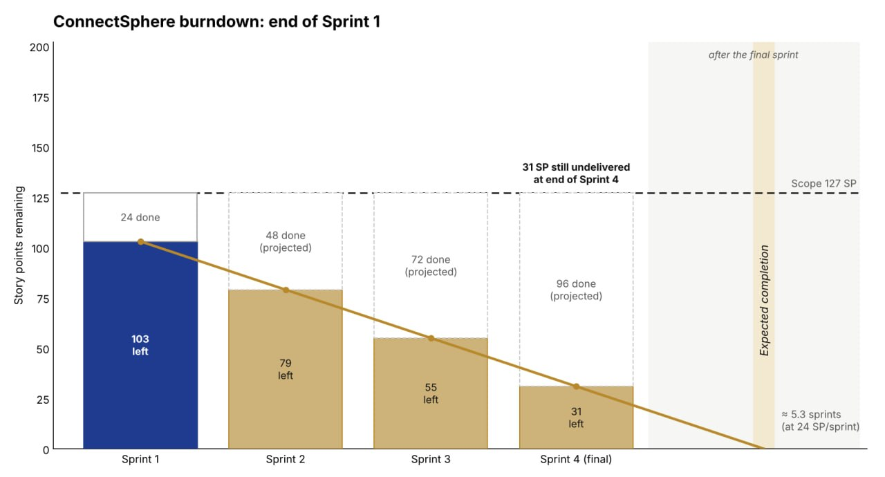
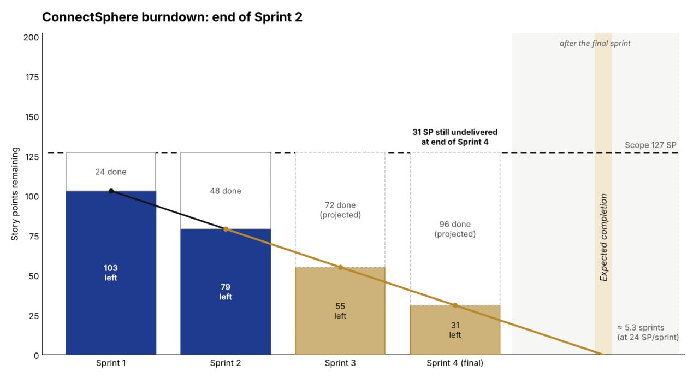
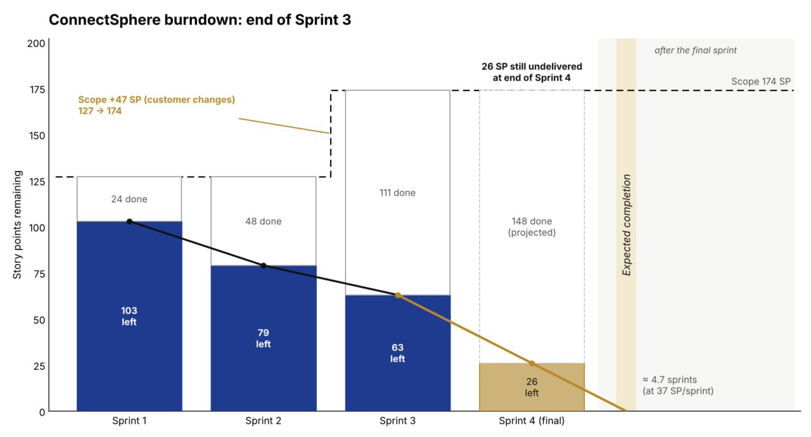
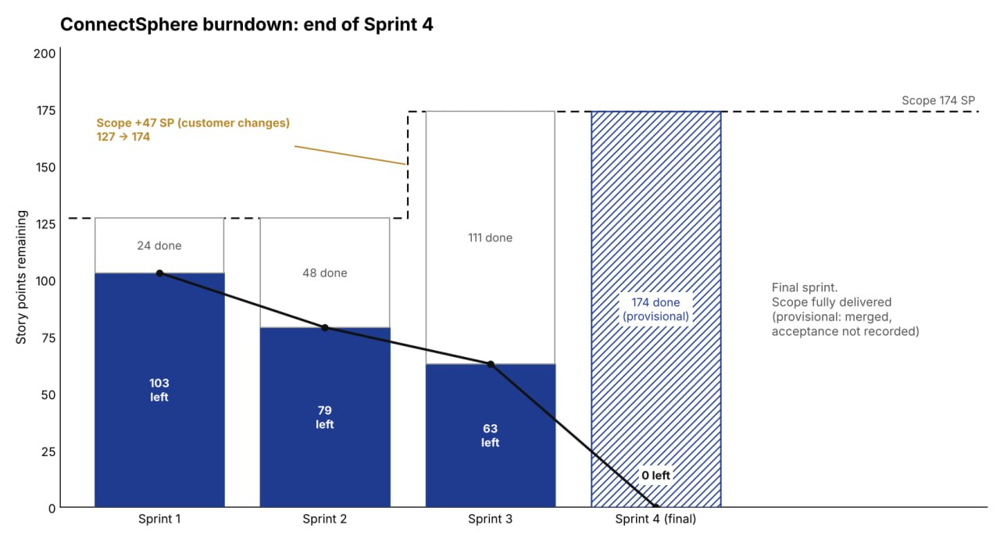

# Release scope and burndown evidence

The team accepted **174 story points across four sprint reviews**. Sprint 3 accepted its 63-SP request and venue package. Sprint 4 accepted the remaining 63-SP equipment, lifecycle, registration, change and safety package. The acceptance balances below come from team reviews.

## Release scope

The estimated inventory on 16 October comprised **42 parent items / 174 SP**. Original requirements accounted for 127 SP and customer changes for 47 SP. Five unfinished stories worth 19 SP moved into Sprint 3 at their existing estimates. Splitting the 8-point notification story into KAN-64 (5) and KAN-80 (3) preserved its total. KAN-15’s revision from 2 to 5 contributed three points to the original-scope estimate. [Change accounting](../requirements/change-requests.md) · [dated inventory](sprint-03/evidence/jira-rebalanced-state-2026-10-16.json)

## Reported review outcomes

| Sprint | Selected SP | Accepted stories / SP | Carried stories / SP | Cumulative accepted SP | Source |
| --- | ---: | ---: | ---: | ---: | --- |
| 1 | 32 | 7 / 24 | 3 / 8 | 24 | [19 September review](sprint-01/review.md) |
| 2 | 43 | 7 / 24 | 5 / 19 | 48 | [3 October review](sprint-02/review.md) |
| 3 | 63 | 13 / 63 | 0 / 0 | 111 | [17 October review](sprint-03/review.md) |
| 4 | 63 | 15 / 63 | 0 / 0 | 174 | [31 October review](sprint-04/review.md) · [recorded assent](final-sprint-recordings.md#review-decision-in-the-recording) |

**Planning interpretation.** At Sprint 3 planning the previous two reviews averaged 24 SP. Repeating that pace twice would cover 48 SP of the 126-SP forecast, a gap of 78 SP. Sprint 4 planning used the then-available three-sprint average of **37 SP** and forecast 63 after discussing availability and dependencies. The four-review average of **43.5 SP** is a calculation made after the project. [Sprint 3 capacity](sprint-03/estimation-and-capacity.md) · [Sprint 4 capacity](sprint-04/estimation-and-capacity.md)

## Chart source observations

The four supplied sprint-end charts use a release-wide balance. The first two show the original 127-SP scope. The third introduces the 47-SP customer-change increment, taking scope to 174 SP. Solid blue bars show work remaining at the review checkpoints. Gold bars show what the team would have left at a later sprint end if the average velocity continued. The sprint commitment and carry-over figures have a different denominator. [Sprint 1–2 checkpoint records](ws4-evidence/board-history.md) · [Sprint 3–4 checkpoint records](ws5-evidence/board-history.md)

| End of sprint | Scope shown | Cumulative SP accepted | Release SP remaining | Projection shown |
| --- | ---: | ---: | ---: | --- |
| 1 | 127 | 24 | 103 | At 24 SP per sprint, 31 SP would remain after Sprint 4. |
| 2 | 127 | 48 | 79 | The second 24-SP review leaves the same 31-SP projection. |
| 3 | 174 | 111 | 63 | At the three-sprint average of 37 SP, 26 SP would remain after Sprint 4. |
| 4 | 174 | 174 | 0 | The recorded final sprint outcome replaces the earlier projections. |

## Chart

### End of Sprint 1

### End of Sprint 2

The 2 October customer changes entered the two-sprint plan on 4 October. At that point 174 SP of release scope minus 48 SP already accepted left **126 SP**, allocated as 63 SP per sprint. The 16 October administrative update records the same allocation. [Sprint 3 planning account, cues 47–53](sprint-03/evidence/meetings/current/planning.docx) · [Administrative snapshot](sprint-03/evidence/jira-rebalanced-state-2026-10-16.json)

### End of Sprint 3

### End of Sprint 4

The supplied image labels the final 174 SP provisional because it says acceptance was unrecorded. The 31 October review recording establishes that the team accepted all 15 Sprint 4 stories, worth 63 SP, bringing cumulative accepted work to **174 SP**. The release record tracks the separate formal decision on the frozen software. [Recorded group assent](final-sprint-recordings.md#review-decision-in-the-recording) · [Sprint 4 story decisions](sprint-04/review.md#story-decisions) · [Formal release decision](../submission/release-record.md#release-decision)

## Historical records

[Preserved pre-cleanup record](archive/2026-11-05/release-burndown.md) contains the original dated updates, earlier preparations and source limitations.

Earlier section links

[Release burndown](archive/2026-11-05/release-burndown.md#release-burndown)

[Current scope and administrative snapshot — 16 October 2026](archive/2026-11-05/release-burndown.md#current-scope-and-administrative-snapshot--16-october-2026)

[Current scope and administrative snapshot — 16 October 2026](archive/2026-11-05/release-burndown.md#current-scope-and-administrative-snapshot--16-october-2026-1)

[Reported review outcomes — confirmation received 26 October 2026](archive/2026-11-05/release-burndown.md#reported-review-outcomes--confirmation-received-26-october-2026)

[Per-sprint data](archive/2026-11-05/release-burndown.md#per-sprint-data)

[Arvin evidence reconciliation — 25 October 2026](archive/2026-11-05/release-burndown.md#arvin-evidence-reconciliation--25-october-2026)

[25 October 2026 — Arvin contribution reconciliation (Sprints 1–3)](archive/2026-11-05/release-burndown.md#25-october-2026--arvin-contribution-reconciliation-sprints-13)

