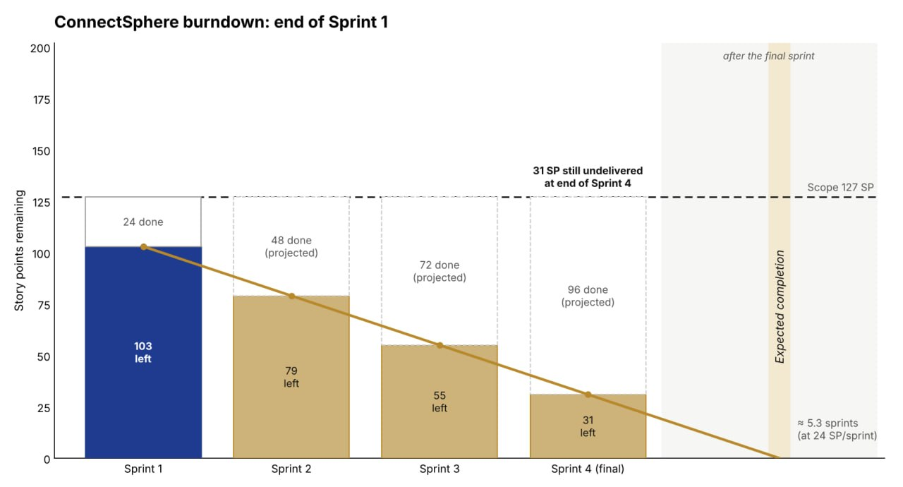
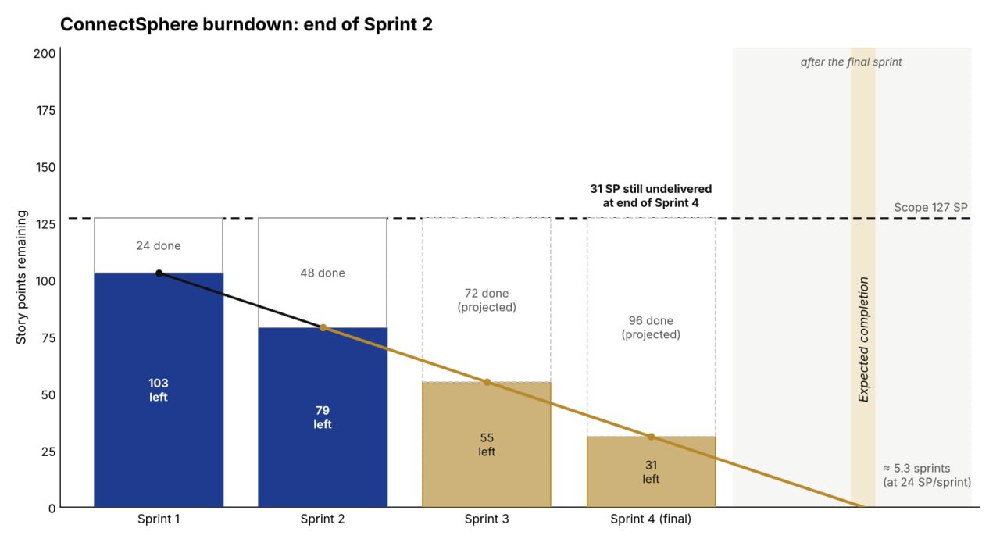

# Sprint boards and burndowns

The two supplied charts show the remaining **release** scope and the forecast visible from each sprint end. The tables beneath them track a different measure: how much of that sprint’s own commitment carried forward. Sprint 2 also has two dated observations of its internal board. [Sprint checkpoint values and sources](chart-data.json) · [All four release charts](../release-burndown.md)

## Sprint 1

The review accepted 24 SP, leaving **103 of the original 127 release SP**. At 24 SP per sprint, the chart projects 31 SP still outstanding after Sprint 4. The sprint itself closed with 8 SP carried from its 32-SP commitment.

| Checkpoint | Scope and disposition | Remaining |
| --- | --- | ---: |
| 6 September · planning | Ten items, including the 5-SP shared database foundation. [Planning cues 34–35 and 55–61](../sprint-01/evidence/meetings/planning.docx) | 32 SP |
| 19 September · review | Seven items accepted for 24 SP. Three carried at full estimates. [Review cues 16–17](../sprint-01/evidence/meetings/review.docx) | 8 SP |

**Closing disposition.** Accepted items were KAN-25, KAN-31, KAN-4, KAN-27, KAN-36, KAN-16 and KAN-24. Submission (KAN-6, 3), the coordinator request view (KAN-33, 2) and draft editing (KAN-34, 3) passed into Sprint 2. The arithmetic is 32 − 24 = 8. [Opening story cards](../sprint-01/sprint-backlog.md) · [Closing decisions](../sprint-01/review.md)

## Sprint 2

The second 24-SP review brought cumulative acceptance to **48 SP**, leaving **79 SP** against the original 127-SP baseline. The chart projects 55 and 31 SP remaining after Sprints 3 and 4 if the 24-SP pace continued. The table tracks the separate 43-SP sprint commitment and 19-SP carry-over. The 47-SP scope increase appears in the Sprint 3 release chart.

| Checkpoint | Scope and disposition | Remaining |
| --- | --- | ---: |
| 20 September · planning | Eight carried points plus 35 new points. [Planning cues 8–15](../sprint-02/evidence/meetings/planning.docx) | 43 SP |
| 21 September · internal board | 35 SP To Do and 8 SP In Review. [Saved backlog export](../../archive/jira-exports/jira-backlog-2026-09-21.csv) · [Dated register](../sprint-02/archive/2026-11-05/daily-progress.md#burndown-data) | 43 board SP |
| 29 September · internal board | At about 18:40 SGT, Irfan recorded zero board Done points. KAN-6 and KAN-34 were In Review and KAN-33 was In Progress. [Dated register](../sprint-02/archive/2026-11-05/daily-progress.md#burndown-data) | 43 board SP |
| 3 October · review | Seven stories accepted for 24 SP. Five carried at full estimates. [Review cues 2–13](../sprint-02/evidence/meetings/review.docx) | 19 SP |

**Closing disposition.** Accepted items were KAN-29, KAN-51, KAN-53, KAN-8, KAN-54, KAN-55 and the previously carried KAN-33. Submission (KAN-6, 3), draft editing (KAN-34, 3), catalogue (KAN-50, 5), search (KAN-12, 5) and suitability (KAN-52, 3) passed into Sprint 3. The arithmetic is 43 − 24 = 19. [Opening story cards](../sprint-02/sprint-backlog.md) · [Closing decisions](../sprint-02/review.md)

## Board evidence disposition

No original Sprint 1 or Sprint 2 opening or closing board screenshot was found in the supplied materials. The planned story/owner/estimate tables, the two reviews and the dated Sprint 2 export let an assessor inspect the opening scope and closing decisions directly. The two internal-board readings show work moving between statuses without assigning it partial acceptance credit. See the [Sprint 1 evidence register](../sprint-01/evidence/README.md) and [Sprint 2 evidence register](../sprint-02/evidence/README.md).
