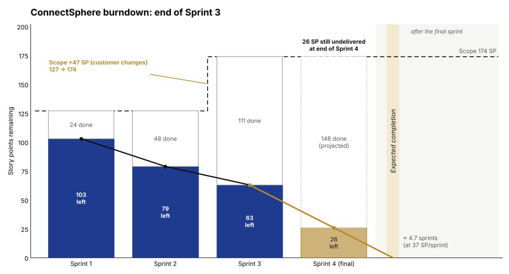
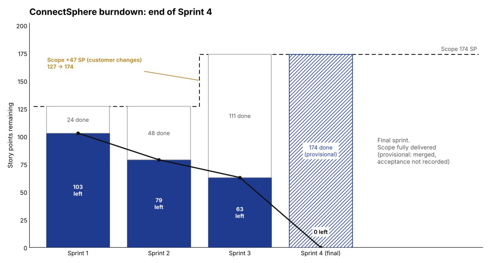

# Sprint boards and burndown charts

The figures show release-wide balances as seen at each sprint end. The tables below record how much of each sprint’s own commitment remained at planning and at review. Both sprints selected and accepted **63 SP**. The standups document handoffs and blockers without assigning daily accepted-point totals. [Sprint checkpoint data](meeting-checkpoints.json) · [All four release charts](../release-burndown.md#chart)

## Sprint 3

Customer changes raised release scope from 127 to 174 SP. The first three reviews accepted 24 + 24 + 63 = **111 SP**, leaving **63 SP** of release work. The gold Sprint 4 bar projects another 37 SP at the three-review average, leaving 26 SP. The actual Sprint 4 result appears below.

| Date and event | Basis | Selected scope remaining |
| --- | --- | ---: |
| 4 October · planning | The team selected 13 stories totalling 63 SP. [Planning account, cues 47–53](../sprint-03/evidence/meetings/current/planning.docx) | 63 SP |
| 17 October · review | The team accepted all 13 selected stories. [Review decisions](../sprint-03/review.md) | 0 SP |

On 16 October the draft allocation still showed 97 SP for Sprint 3 and 29 SP for Sprint 4. The updated record reflected the 63/63 forecast agreed on 4 October. That shifted a net 34 forecast points from Sprint 3 to Sprint 4. The 17 October review accepted all 63 SP selected for Sprint 3. [Draft inventory](../sprint-03/evidence/jira-sprint-state-2026-10-16.json) · [Updated inventory](../sprint-03/evidence/jira-rebalanced-state-2026-10-16.json)

The [selected backlog and tasks](../sprint-03/sprint-backlog.md) give the starting scope. The [progress record](../sprint-03/daily-progress.md) explains how the team cleared the buffer dependency and prepared the full journey for review. On 6 November 2026 the team confirmed that the original Sprint 3 opening and closing board screenshots do not exist.

## Sprint 4

The chart shows **174 SP delivered and zero remaining** and labels acceptance provisional. The 31 October recording confirms the group accepted all 15 Sprint 4 stories (63 SP), bringing the four-review total to 174 SP. Formal acceptance of the frozen release has a [separate decision record](../../submission/release-record.md#release-decision). [Recorded story acceptance, 03:39–03:57](../final-sprint-recordings.md#review-decision-in-the-recording)

| Date and event | Basis | Selected scope remaining |
| --- | --- | ---: |
| 18 October · planning | 15 stories forecast at 63 SP. The planning recording shows the starting board. [Planning decisions](../sprint-04/planning.md) · [board frame at 24:40](../sprint-04/evidence/meetings/planning-board-002440.png) | 63 SP |
| 31 October · review | The group accepted the selected stories together after hearing the owners and checking for concerns. [Story decisions](../sprint-04/review.md) · [recorded assent](../final-sprint-recordings.md#review-decision-in-the-recording) | 0 SP |

The [selected backlog](../sprint-04/sprint-backlog.md) identifies the parent estimates. The [daily record](../sprint-04/daily-progress.md) tracks the equipment-state blocker through its resolution. On 6 November 2026 the team confirmed that the planning-video frame is the available opening view and that no separate opening or closing board screenshot exists. The [release burndown](../release-burndown.md#chart) shows the snapshots for all four sprints.
